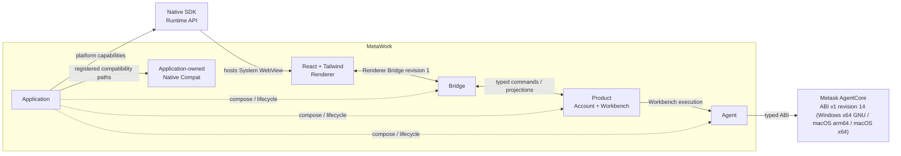

# MetaWork

MetaWork 是一款面向本地工作区的桌面 Agent Workbench。产品围绕 Workspace、Task、Agent 执行、工具活动、用户决策和结果展开，不把终端模拟器或 IDE 当作主要交互模型。

## 当前基线



当前应用是一条真实的同进程同步垂直链路，已经覆盖 Account、Task、typed Text/Skill Run、Agent-owned 十个 built-in、同步 permission、取消、Renderer reload、bounded event delivery 和生命周期收口；`AskUserQuestion` 不进入 MetaWork Agent 产品集合。正式 build 只消费 staged `.agentcore/bundles/<target-id>` 及其中逐字节锁定的官方 Zig package。Windows、macOS arm64 与 macOS x64 均锁定 AgentCore ABI v1 revision 14；未完成独立产品验收的能力保持关闭。

Windows x86_64 GNU、macOS arm64 与 macOS x64 revision 14 development bundle 已分别独立锁定。当前仍是同进程 prototype，不具备 AgentCore 进程隔离、crash recovery、跨进程 Conversation 恢复、strict Workspace security 或正式更新能力。Windows 已有按用户安装/卸载的单 EXE 与显式 Authenticode 签名路径，并完成隔离目录静默安装/卸载验收；交互式平台矩阵与更新仍是独立分发 Gate。精确证据与尚未验证的能力见 [验证规范](docs/validation.md)。

## 快速开始

要求 Node.js 22.15+、Zig 0.16.0，以及与 repository lock 精确匹配的 target-specific AgentCore bundle。

macOS：

```bash
npm ci
node scripts/stage-agentcore-bundle.mjs /absolute/path/to/aarch64-macos-bundle
npm run dev
```

Windows：

```powershell
npm ci
node scripts/stage-agentcore-bundle.mjs C:\absolute\path\to\x86_64-windows.win10...win11_dt-gnu
npm run dev
```

常用工程入口：

```bash
npm run format:check
npm run check
npm test
npm run build:debug
npm run build:release
npm run package:windows
```

`package.json` 只保留九个工程入口：`dev`、`check`、`test`、`format`、`format:check`、`build:debug`、`build:release`、`package:macos` 与 `package:windows`。一次性平台准备、平台验收 harness 和 probe 不是入口，直接以 `node scripts/<name>.mjs` 调用。

macOS 的 Apple Development identity 只需在每台开发机选择一次；`npm run dev` 使用该本地身份。`npm run package:macos` 默认依次构建 arm64 与 x64 DMG，也可显式传入 `arm64` 或 `x64`；正式入口要求唯一有效的 Developer ID Application identity 和钥匙串 `metawork-notary` profile，自动完成 hardened runtime、可信时间戳、DMG 签名、Apple notarization、staple、Gatekeeper、磁盘映像与挂载内容验证。两条路径的具体要求见 [macOS 分发](docs/macos-distribution.md)。Windows development baseline 使用 `node scripts/run-windows-bringup.mjs`；`npm run package:windows` 使用 Native SDK runtime staging 与 Inno Setup 生成版本化 x64 单 EXE，正式签名构建额外传入 `--signing required`，具体要求见 [Windows 分发](docs/windows-distribution.md)。完整验证范围与按变更选择的命令见 [验证规范](docs/validation.md)。

## AgentCore 输入边界

`stage-agentcore-bundle.mjs` 校验 candidate 的 identity、target、manifest bytes、checksum 和必要 symbol，再把白名单内容复制到 canonical `.agentcore/bundles/<target-id>`。正式 build、test 和 package 从 resolved target 对应 bundle 消费官方 Zig package，不直接读取 Metask AgentCore 源码树，也不从环境变量寻找替代实现。

需要验证未 staged candidate 时，可运行：

```bash
AGENTCORE_BUNDLE_ROOT=/absolute/path/to/bundle node scripts/run-agentcore-restore-probe.mjs
```

probe 使用临时 source-free SDK consumer，不进入正式产品 build graph。详细规则见 [AgentCore ABI 消费合同](docs/agentcore-abi-v1.md)和 [AgentCore 集成契约](docs/agentcore-integration.md)。

## 文档入口

- [产品需求](docs/requirements.md)：产品对象、行为与范围
- [UI 设计规范](docs/ui-design.md)：全产品信息架构、交互、视觉与 capability-gated 目标行为
- [高层架构](docs/architecture.md)：技术选型、系统职责与安全边界
- [Product 架构](docs/product-architecture.md)：owner、事务、并发与恢复
- [Account 架构](docs/account-architecture.md)：Account owner、Metask 消费合同、状态、事务、持久化、提交与恢复
- [Renderer Bridge 合同](docs/renderer-bridge-contract.md)：command、event、Snapshot 与运输语义
- [工程结构与所有权](docs/project-structure.md)：active tree、owner 与依赖方向
- [AgentCore 集成契约](docs/agentcore-integration.md)：线程、事件、所有权和生命周期
- [AgentCore ABI v1 消费合同](docs/agentcore-abi-v1.md)：锁定各 target bundle 的机器合同与能力边界
- [Completion 架构](docs/completion-architecture.md)：Agent-owned 非流式无 Tool Completion、Provider codec、Transport 与取消
- [Storage 架构](docs/storage-architecture.md)：SQL contract、直接 SQLite backend、limits 与 lifecycle
- [macOS 分发](docs/macos-distribution.md)：Apple Development 本地身份、Developer ID Application、DMG、公证与发布验证
- [Windows 分发](docs/windows-distribution.md)：Inno Setup、Authenticode、安装与发布验证
- [验证规范](docs/validation.md)：证据、持续回归和未验证能力
- [Agent 工作约束](AGENTS.md)：仓库内执行规则
