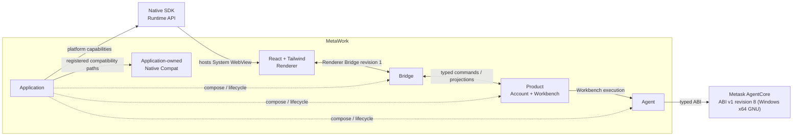

# MetaWork

MetaWork 是一款面向本地工作区的桌面 Agent Workbench。产品围绕 Workspace、Task、Agent 执行、工具活动、用户决策和结果展开，不把终端模拟器或 IDE 当作主要交互模型。

## 当前基线



当前应用是一条真实的同进程同步垂直链路，已经覆盖 Account、Task、typed Text/Skill Run、built-in Read/Bash/Edit、question/permission、取消、Renderer reload、bounded event delivery 和生命周期收口。正式 build 只消费 staged `.agentcore/bundle` 中的官方 Zig package。Windows revision 8 在 revision 7 能力之上提供结构化 `run_state` 事件；未完成独立产品验收的能力保持关闭。

Windows revision 8 development bundle 已锁定；macOS revision 7 artifact 仍独立锁定，待 macOS native probe/build/vertical 复验。当前仍是同进程 prototype，不具备 AgentCore 进程隔离、crash recovery、跨进程 Conversation 恢复、strict Workspace security 或正式安装/更新能力。精确证据与尚未验证的能力见 [验证规范](docs/validation.md)。

## 快速开始

要求 Node.js 22.15+、Zig 0.16.0，以及与 repository lock 精确匹配的 target-specific AgentCore bundle。

macOS：


Windows：

```powershell
npm ci
node scripts/stage-agentcore-bundle.mjs C:\absolute\path\to\x86_64-windows.win10...win11_dt-gnu
npm run dev
```

常用工程入口：

```bash
npm run format:check
npm run check
npm test
npm run build:debug
npm run build:release
```

`package.json` 只保留八个工程入口：`dev`、`check`、`test`、`format`、`format:check`、`build:debug`、`build:release` 与 `package:macos`。一次性平台准备、平台验收 harness 和 probe 不是入口，直接以 `node scripts/<name>.mjs` 调用。

macOS 的 Apple Development identity 只需在每台开发机选择一次，具体要求见 [macOS 本地开发签名](docs/macos-local-development.md)。macOS package 使用 `npm run package:macos`；Windows development baseline 使用 `node scripts/run-windows-bringup.mjs`。完整验证范围与按变更选择的命令见 [验证规范](docs/validation.md)。

## AgentCore 输入边界

`stage-agentcore-bundle.mjs` 校验 candidate 的 identity、target、manifest bytes、checksum 和必要 symbol，再把白名单内容复制到 canonical `.agentcore/bundle`。正式 build、test 和 package 不直接读取 Metask AgentCore 源码树，也不从环境变量寻找替代实现。

需要验证未 staged candidate 时，可运行：

```bash
AGENTCORE_BUNDLE_ROOT=/absolute/path/to/bundle node scripts/run-agentcore-probe.mjs
```

probe 使用临时 source-free SDK consumer，不进入正式产品 build graph。详细规则见 [AgentCore ABI 消费合同](docs/agentcore-abi-v1.md)和 [AgentCore 集成契约](docs/agentcore-integration.md)。

## 文档入口

- [产品需求](docs/requirements.md)：产品对象、行为与范围
- [Workbench UI 设计](docs/workbench-ui-design.md)：当前交互规则与 capability-gated 目标行为
- [高层架构](docs/architecture.md)：技术选型、系统职责与安全边界
- [Product 内部架构](docs/product-architecture.md)：内部 owner、事务、并发与恢复
- [Renderer Bridge 合同](docs/renderer-bridge-contract.md)：command、event、Snapshot 与运输语义
- [工程结构与所有权](docs/project-structure.md)：active tree、owner 与依赖方向
- [AgentCore 集成契约](docs/agentcore-integration.md)：线程、事件、所有权和生命周期
- [AgentCore ABI v1 消费合同](docs/agentcore-abi-v1.md)：锁定各 target bundle 的机器合同与能力边界
- [Metask Account API 合同](docs/metask-account-contract.md)：OAuth、catalog、ExecutionTarget 与持久化
- [macOS 本地开发签名](docs/macos-local-development.md)：Apple Development identity 与 Keychain 稳定性
- [验证规范](docs/validation.md)：证据、持续回归和未验证能力
- [Agent 工作约束](AGENTS.md)：仓库内执行规则
