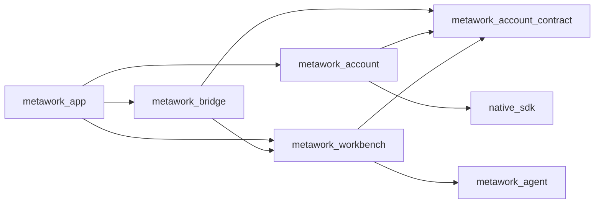

# MetaWork Account 集成方案

> 状态：最终设计稿，待按 DAG 实施
> 复审：2026-07-20 Linus 文档复审通过
> 适用阶段：Phase 0A，macOS 优先
> 公司与账号体系：Metask
> 实现状态：本文档不代表功能已经完成
> 执行真源：TinyKG document 140 与其任务 DAG；本文档只是便于仓库审阅的导出副本

## 1. 文档职责

本文档收敛 MetaWork 接入 Metask 账号体系的整体方案，并记录严格架构复审后采纳的修正。

它是实施计划，不静默覆盖仓库现有的规范性文档。实施的第一个任务必须把已批准的变化同步到对应 source of truth：

- 产品范围与行为：`docs/requirements.md`
- 系统边界与模块职责：`docs/architecture.md`
- 模块和目录结构：`docs/project-structure.md`
- 验收门槛：`docs/phase-0-validation.md`

涉及 AgentCore 的既有边界继续以 `docs/agentcore-integration.md` 和 `docs/agentcore-abi-v1.md` 为准。本方案不要求修改 AgentCore，也不修改 `cc-t2z/metacodes`。

## 2. 结论

MetaWork 新增与 App、Bridge、Workbench、Agent 同级的 **Account** 产品模块。

Account 负责 Metask 账号登录和执行资格配置，最终向 Workbench 提供唯一的 active `ExecutionConfig`。Workbench 负责 Task admission 和执行；Bridge 只承载不含秘密的命令与投影视图；Agent 只消费 Workbench 已安装的执行配置。

生产路径采用以下原则：

1. 普通用户通过 Metask OAuth 登录，不要求手填 `provider + model + base_url + api_key`。
2. OAuth token 只用于访问 Metask 账号 API；选定的 API Key 用于 AgentCore 模型调用。
3. `api_key` 不进入 Renderer、Bridge、日志、事件、snapshot 或持久化产品视图。
4. 凭据只沿 `Account completion → App main loop → Workbench` 传递。
5. Renderer 命令与 worker completion 都由 App 主线程执行同一条 Account prepared/no-fail 提交链；Bridge 和 worker 都不能直接修改 Account committed state。
6. 当前只允许一个 active ExecutionConfig；Workbench 未达到 execution quiescence 时禁止账号、API Key 或模型切换，也禁止退出账号。
7. 不保留旧 Renderer schema、旧环境变量配置路径或旧 AgentCore 消费路径的兼容层。

## 3. 目标与非目标

### 3.1 目标

- 接入 Metask Authorization Code + PKCE 登录。
- 恢复登录、刷新 token、退出登录。
- 获取账号可用 API Key 和模型目录。
- 选择 API Key 与模型，验证后生成唯一 active ExecutionConfig。
- 使用系统安全凭据存储保存敏感信息。
- 在 Renderer 展示脱敏 Account 状态，并提供登录、选择、重试和退出交互。
- 保持现有 AgentCore ABI 和正式 Host 边界不变。
- 给失败、取消、崩溃恢复和 shutdown 定义可验证的语义。

### 3.2 非目标

- 不修改 `cc-t2z/metacodes` 或 AgentCore。
- 不复制 metacodes 的源码、宽松配置解析器或 `~/.metacodes/auth.json`。
- 不把 Account 扩张为通用权限中心。
- 不管理 Agent 工具授权、Workspace trust、Bridge ACL 或操作系统权限。
- 不支持多账号、多 profile 并行或每 Task 独立模型配置。
- 不新增第三方 Provider 的普通用户手填流程。
- 不向 AgentCore 传递 profile header；当前选择的 API Key 已构成执行凭据。
- 不引入当前 AgentCore 配置尚未支持的 `reasoning_effort`。
- 不为了本方案建立通用事务框架、通用 Desktop Interface 或 `NativeSdkAdapter`。

## 4. 复审意见分析

| 复审问题                                                     | 判断                   | 最终处理                                                             |
| ------------------------------------------------------------ | ---------------------- | -------------------------------------------------------------------- |
| Bridge 借用 ExecutionConfig 会接触凭据                       | 正确，违反既有安全边界 | 凭据改由 App 主循环直接安装到 Workbench，Bridge 永不接触             |
| Account 已提交而 Workbench projection 更新失败会产生分裂状态 | 正确，是一致性缺陷     | 使用 Account 专用 prepared transition、预分配存储和 no-fail 产品提交 |
| Workbench 导入 Account 会传递 Native SDK 依赖                | 正确，会污染模块边界   | 增加纯 `account_contract` 构建模块；它不是第六个产品职责模块         |
| 重配置直接覆盖当前配置会使失败路径不可恢复                   | 正确                   | 使用 `committed_execution` 与 `staged_attempt` 双代际                |
| 先删凭据再写退出状态存在崩溃恢复漏洞                         | 正确                   | 先提交 signed-out tombstone，再清内存和删除旧代际                    |
| OAuth loopback callback 缺少完整威胁模型                     | 正确                   | 明确监听、限额、单次 code、deadline、cancel 和日志规则               |
| 完成消息和 secret 的所有权不清楚                             | 正确                   | 明确 completion、prepared transition、Workbench copy 和释放顺序      |
| 测试 endpoint 可能进入正式包                                 | 正确                   | 测试配置构建隔离，并增加产物扫描                                     |
| Bridge 直投 Account 命令仍可绕过一致性提交                   | 正确                   | Bridge 只提交 `AccountCommand`；App 主线程是 Account 唯一写入者      |
| metadata pointer 与 tombstone 的“原子”没有存储合同           | 正确                   | 固定 macOS manifest 路径和 fsync/rename crash protocol               |
| ExecutionConfig 的 provider/base URL 没有权威来源            | 正确                   | 增加 Metask ExecutionTarget 前置合同和生产 endpoint allowlist        |
| “没有 live Task”不是可执行的 quiescence 判定                 | 正确                   | 由 Workbench 提供线性化 replacement gate 和精确 quiescence predicate |
| completion queue 满后无法再投递 typed failure                | 正确                   | 每 attempt 使用 terminal mailbox，并以原子 overflow latch 保底       |
| 单一 phase 混合账号与执行配置状态                            | 正确                   | 拆成 `AccountSessionState` 与 `ExecutionState` 两个正交状态          |

以下方向没有采纳：

- 不建立跨模块通用事务系统。当前问题只有一条明确的 Account 产品提交链，专用 prepared transition 更容易证明。
- 不增加兼容旧 schema、环境变量默认值或旧 AgentCore 的双路径。项目仍处于初步开发阶段。
- 不把 Account 放进 Workbench。账号生命周期和产品执行生命周期不同，父子关系会制造错误所有权。

## 5. 模块语义与依赖

### 5.1 产品模块

产品层保持五个清晰职责：

- **App**：组合根、主线程调度、平台能力注入、Account 命令/completion 到 Workbench 的提交协调。
- **Account**：Metask 登录、账号目录、凭据代际和 ExecutionConfig 生成。
- **Bridge**：校验 Renderer 命令；Workbench 命令直接调用 Workbench，Account 命令只提交给 App 注入的窄 `AccountCommandSink`。
- **Workbench**：Task、Session、Run、admission、Executor 和产品 snapshot。
- **Agent**：AgentCore SDK 集成与单 Run 执行。

Account 与 Workbench 是同级模块。Account 不拥有 Workbench，Workbench 也不拥有 Account。

### 5.2 纯契约构建模块

内部新增 `metawork_account_contract`，建议由 `src/account/contract.zig` 提供。它只包含：

- 有界值类型；
- `AccountSessionState`、`ExecutionState`、`OperationKind`、`AccountView`、`AccountFact`；
- `AccountCommand`、不含 secret 的 `AccountCommandResult`，以及只负责同步提交命令的 `AccountCommandSink`；
- `ExecutionConfigInput` 和明确的 owned transfer 类型；
- 稳定的 `ErrorCode`；
- compile-time 限额和校验函数。

建议依赖图如下，箭头表示“导入”：



实际构建依赖应满足：

- `metawork_account` 导入 `account_contract + native_sdk`。
- `metawork_workbench` 导入 `account_contract + Agent`，不导入 Account runtime 或 Native SDK。
- `metawork_bridge` 只导入 `account_contract + Workbench`，不导入 Account runtime。
- `metawork_app` 注入 Account 专用 `AccountCommandSink`，并负责组合全部模块和所有 Account 提交路径。

`AccountCommandSink` 只有 `context + submit(AccountCommand) AccountCommandResult`；result 只返回 accepted/rejected、稳定 ErrorCode 和可公开 attempt ID。它不承载平台能力、secret 或通用消息总线。`account_contract` 是 Account 所有者发布的窄合同，不是新的产品模块，也不是通用适配层。

## 6. 核心合同

### 6.1 AccountView

Renderer 和 Workbench 只能观察脱敏、有限的 AccountView，例如：

- 当前 account session state、execution state 和 operation；
- 脱敏账号标识和显示名；
- API Key 的服务端 ID、名称和尾号，不含完整 key；
- 可选模型列表和当前模型；
- 是否允许创建 Task；
- 当前错误的稳定 code 和安全 message；
- `catalog_generation` 与 `execution_generation`。

AccountView 禁止包含：

- OAuth access/refresh token；
- authorization code、PKCE verifier；
- 完整 API Key；
- Provider Authorization header；
- 临时 OAuth URL；
- 系统凭据存储 locator 的秘密部分。

### 6.2 ExecutionConfig

唯一 active ExecutionConfig 至少包含：

- `provider_kind`
- `model`
- `base_url`
- `api_key`
- `execution_generation`

所有字符串都有 compile-time 最大长度。输入先完整校验，再复制到 Workbench 预分配的 owned storage。Workbench 不借用 Account 的内存。

`provider_kind + base_url + model` 必须来自第 10.1 节锁定的 Metask `ExecutionTarget` 合同。不得根据 model 名称猜测 provider，不得接受 Renderer、API Key catalog 的自由文本或未经 allowlist 校验的 base URL。

每个成功创建的 Task 和 Run record 必须记录不含 secret 的 `execution_generation`、`provider_kind` 和 `model`，使历史与执行配置可追溯；Agent Session 继续持有创建时的 owned runtime config，不读取之后的全局配置。

### 6.3 SecretBuffer

所有 OAuth token、PKCE verifier、authorization code、完整 API Key 和 Authorization header 使用 Account 私有的 `SecretBuffer`：

- completion 到 PreparedTransition 只 move ownership，不复制；
- 安装 ExecutionConfig 时只产生一份 Workbench runtime copy；
- Account committed state 只保存非秘密 execution metadata 和 Keychain generation locator，不长期保存第二份 API Key；
- API Key catalog 的未选中 secrets 在选择、取消、失败或 catalog replacement 后立即清零；
- 释放使用不可被编译器消除的 secure-zero primitive，再释放 backing storage；
- 每个状态明确一个 owner，禁止普通 slice 复制、日志格式化和跨 Bridge 暴露。

正常稳态只允许 Keychain record 与 Workbench runtime copy 两份 API Key；PreparedTransition 存活期间最多存在一份额外的短期 transfer buffer。

### 6.4 AccountFact

AccountFact 是安全的产品事实，不是操作型 callback。它表达：

- account session state、execution state 或 operation 变化；
- catalog 更新；
- committed execution generation 变化；
- 登录或配置失败；
- signed-out tombstone 生效。

它只能包含 AccountView 可公开的数据，并由 Workbench 以 no-fail 方式写入预分配 projection 后提升 product revision。

## 7. 状态模型

账号控制面与模型执行面是两个正交状态，不能用一个 phase 混合。

`AccountSessionState`：

```text
restoring
signed_out
authorizing
authenticated
refreshing
reauth_required
shutting_down
```

`ExecutionState`：

```text
none
preparing
ready
reconfiguring
invalid
```

`OperationKind` 描述当前细分步骤：

```text
none
oauth_callback
token_exchange
loading_keys
selecting_key
loading_models
selecting_model
persisting
logging_out
```

Task admission 只依赖 committed ExecutionConfig 是否 ready、generation 是否匹配以及 Workbench replacement gate，而不把 OAuth refresh 失败自动等同于 API Key 失效。refresh 失败进入 `reauth_required`：既有 ExecutionConfig 可以继续创建 Task，但 catalog、重配置和账号资料刷新被禁止。只有 Metask account/key catalog 明确撤销选定 API Key，或 Account 使用锁定 endpoint 执行的显式 credential probe 返回确定鉴权拒绝时，ExecutionState 才进入 `invalid` 并关闭新 Task admission。

当前 AgentCore ABI 只提供通用 `api_error`，没有 typed HTTP authentication failure；Workbench 不得从 `api_error` 或 diagnostic 文本猜测 credential 已失效。

关键代际：

- `attempt_id`：区分并发或过期的登录、刷新、重试和重配置完成消息。
- `catalog_generation`：区分 API Key/模型目录版本。
- `execution_generation`：区分已经验证并持久化的执行配置。

所有 worker completion 必须携带 `attempt_id`。Account 丢弃过期 completion，并在丢弃前清零其 secret buffer。

错误事实必须携带所属 state/operation，并保留可恢复上下文：是登录失败、刷新失败、目录失败、验证失败还是安全存储失败。Renderer 只能得到稳定错误码和安全诊断。

## 8. 两阶段启动与线程模型

当前 Native SDK `PlatformServices` 只在 App start 后可用，因此启动分为两阶段：

1. **Compose 阶段**
   - 初始化纯数据结构、队列、固定容量存储和 Workbench。
   - 不访问 Keychain，不打开浏览器，不发网络请求。
2. **Platform-ready 阶段**
   - App 收到 PlatformServices。
   - 注入 Account 所需的安全凭据存储和外部浏览器能力。
   - 启动 restore，并把完成消息投递回 App 主循环。

在验证 Native SDK 的线程合同前：

- `openExternalUrl` 和 credential set/get/delete 只在主线程调用。
- 网络和 loopback server 可在有上限的 Account worker 上运行。
- worker 不直接更新 Workbench、Renderer 或 WebView。
- cancel/shutdown 必须能关闭 socket、唤醒等待并 join worker。
- Bridge handler 与 App 的 `AccountCommandSink.submit()` 同在 Native 主线程同步执行；sink 不排队、不跨线程，只进入第 9 节提交链。
- worker completion 只写入 Account completion channel；App 主线程是 Account committed state 的唯一写入者。

## 9. Account 到 Workbench 的一致性提交

### 9.1 唯一提交链

```text
Bridge validated AccountCommand ─┐
                                ├→ App main-loop
Account worker completion ──────┘
  → Account.prepare(command | completion)
  → Workbench.commitAccountFactNoFail(...)
  → Workbench.installExecutionNoFail(...)  [如有]
  → Account.commit(prepared)
  → 释放旧代际和 staged secret
  → 允许 snapshot / Renderer delivery
```

具体约束：

1. Bridge 只构造不含 secret 的有界 AccountCommand；worker completion 拥有它携带的全部 bytes。
2. `Account.prepare` 对命令和 completion 执行限额、协议、attempt 和状态校验，但不修改 committed state。
3. PreparedTransition 明确拥有待提交数据和释放责任。
4. Workbench 在初始化时预分配 Account projection 和 ExecutionConfig storage。
5. 校验通过后的 `commitAccountFactNoFail` 与 `installExecutionNoFail` 不分配、不阻塞、不可返回业务失败。
6. `Account.commit` 只进行已验证的 no-fail 代际 swap。
7. 整条链在 App 主线程同一 turn 内完成，期间不生成 snapshot、不通知 Renderer。
8. Bridge 只在链路入口提交命令，不参与 prepare/commit，且永远看不到 credential。
9. 所有 account session、execution 和 operation 状态变化都走这条链；不存在 Account 的第二个 committed-state 写入口。

如果命中内部不变量错误，必须 fail closed：保留旧 committed state、清零 staged secret，并使用预分配的 dependency/account-contract 错误进入可诊断状态。不得继续发布部分状态。

完成提交后，App 只触发一次现有 Workbench change notifier。notification/delivery failure 进入既有 typed transport-fact 路径，不回滚已经提交的 Account/Workbench canonical state。

### 9.2 Execution replacement gate

Workbench 提供主线程专用的线性化 `beginExecutionReplacement()`：

1. 先设置 `execution_replacement_pending`，使后续 `createTask()` fail closed。
2. 在同一主线程 turn 内检查 execution quiescence。
3. 检查失败则清除 gate，并返回稳定的 `execution_in_use`。
4. 检查成功则保持 gate，直到重配置/退出成功、失败或取消完成。

execution quiescence 必须同时满足：

- 没有 lifecycle 为 `open` 或 `closing` 的 Task；
- 没有 Agent Session、Conversation、closing Session 或 close worker；
- 没有 queued、starting、running、waiting 或 stopping Run；
- 没有 Workbench executor job 或 `RunRef` 仍引用 execution/Session；
- 只允许保留已关闭、无引用、只含历史 projection 的 Task。

`beginExecutionReplacement()`、`createTask()` 和 Account commit 都只在主线程执行，因此 gate check 与 Task admission 之间不存在竞态。重配置和退出不得自己扫描 Task 数组或复制第二套“busy”逻辑。

### 9.3 Task admission

Workbench 只有在以下条件同时满足时才允许创建 Task：

- ExecutionState 为 `ready`；
- Workbench 已安装相同 `execution_generation` 的 active ExecutionConfig；
- `execution_replacement_pending == false`；
- 现有 Workbench admission 条件也通过。

这替换当前静态环境默认值引起的 `InvalidExecutionDefaults` 路径。生产运行不再读取：

- `METAWORK_PROVIDER_API_KEY`
- `METAWORK_PROVIDER_MODEL`
- `METAWORK_PROVIDER_KIND`
- `METAWORK_PROVIDER_BASE_URL`

测试只能通过显式 test-only fixture 注入 ExecutionConfig。

## 10. 登录与 Metask API

### 10.1 C1 登录合同与 C2 执行合同

Metask 产品 owner 已锁定 C1：MetaWork 作为 Metask 第一方客户端使用 Authorization Code + PKCE S256、`https://napi.metask-ai.com`、`client_id=metacode-cli`、`scope=metacode:use`、动态 `127.0.0.1` loopback `/auth/callback`，并通过 bearer `GET /v1/profiles` 取得 identity。精确值、schema 和生命周期见 [Metask Account API 合同](metask-account-contract.md)。

C1 登录成功提交 `account_only`，不自动加载 API Key/model，也不打开 Task admission。C2 独立锁定：

- API Key catalog endpoint 和严格 response schema；
- 模型 catalog 对应的 `ExecutionTarget { provider_kind, base_url, model }`；
- API Key revoke/disable、credential probe 与确定性鉴权失败语义。

MetaWork 只消费这个公开合同，不要求修改 `cc-t2z/metacodes`。如果 Metask 当前模型目录没有 typed `provider_kind/base_url`，产品必须选择并锁定一个固定的 Metask gateway protocol/endpoint；不得复制 metacodes 根据 model 名称猜 provider 的逻辑。

生产 ExecutionTarget 只能来自编译期锁定的 Metask origin 和严格解析后的 typed catalog。至少执行以下校验：

- scheme 必须为 `https`；
- host 和 port 必须命中编译期 allowlist；
- path 必须匹配对应 provider protocol 的固定形状；
- 禁止 userinfo、fragment 和 IP literal；
- 模型请求默认禁止 redirect；确需 redirect 时只允许同 scheme、同 host、同 port。

C2 未确认时只阻塞 catalog/ExecutionTarget 与 Task admission，不阻塞 C1 OAuth 登录、恢复、刷新和退出。测试 endpoint 只能由 test build module 注入。

### 10.2 OAuth

采用 Metask Authorization Code + PKCE：

1. 先绑定 loopback callback socket。
2. 使用 CSPRNG 生成一次性 `state` 和满足 RFC 7636 长度/字符集要求的 PKCE verifier，只允许 `code_challenge_method=S256`，禁止 `plain`。
3. 由 Host 打开 Metask authorize URL。
4. 校验 callback state 并交换 OAuth token。
5. 使用 OAuth bearer token查询 `/v1/profiles`，提交 `account_only` manifest 并结束登录 attempt。
6. C2 通过独立命令加载 API Key/model catalog。
7. 用户选择模型后，Account 验证组合并形成 staged ExecutionConfig。

生产 endpoint、client id、scope 和 redirect 规则来自第 10.1 节合同，并以固定生产配置编译。

`beginLogin` 只允许从 signed out/首次恢复状态进入。`reauthenticate` 只用于 `reauth_required`，OAuth callback 返回的稳定 account ID 必须与现有 committed account ID 相同，才允许替换 OAuth slot 并保留 ExecutionConfig；不同账号必须拒绝为 `account_mismatch`。切换 Metask 账号只能先在 execution quiescence 下完成 logout，再重新 login，不能把新账号 token 与旧账号 API Key 拼接。

### 10.3 OAuth callback 安全合同

- 只监听合同明确允许的 `127.0.0.1` 或 `[::1]`，不依赖 `localhost` DNS 解析，不绑定 `0.0.0.0`。
- 必须先成功 bind，再打开浏览器。
- 只接受 `GET /auth/callback`。
- 对 request line、header 数量、header bytes、target 和 query value 设置硬上限。
- 严格 URL decode，拒绝重复或歧义参数。
- `state` constant-time 比较；authorization code 只消费一次。
- 对无效请求次数和整个登录尝试设置上限与总 deadline。
- 用户取消、superseding attempt 和 Account shutdown 必须通过关闭 socket 唤醒 accept/read；Task/Session close 与应用级登录 attempt 无关，不能误取消 OAuth。
- code、token、verifier 和完整 URL 不进入日志、Renderer 或诊断。
- 打开浏览器失败由 Host 提供安全重试，不向 Renderer 暴露临时 OAuth URL。

### 10.4 API client 边界

Account 的 Metask client 必须定义：

- connect、read 和总请求 deadline；
- 默认禁止 redirect；合同明确允许时只接受同 origin redirect；
- 使用系统 trust store、强制 TLS hostname verification，禁止 insecure/custom trust bypass；
- HTTP status 到稳定 ErrorCode 的映射；
- response body 最大 bytes；
- API Key 和模型条目最大数量；
- 单字段最大 bytes；
- 严格 JSON schema 读取和 unknown-field 策略；
- token refresh 的单飞与 attempt 失效规则；
- 429、5xx 和网络错误映射为稳定错误；authorization-code exchange 和可能轮换 refresh token 的请求禁止盲目自动重试，避免把服务端已提交、本地未知的结果伪装成安全重试；
- secret-safe diagnostics。

本方案参考 metacodes 已验证的业务流程，但不复制其内部解析器或本地凭据文件格式。

## 11. 重配置语义

Account 同时区分：

- `committed_execution`：当前已验证、已持久化、已安装到 Workbench 的配置。
- `staged_attempt`：正在获取目录、选择、验证或持久化的新配置。

重配置流程：

1. App 主线程先取得 Workbench execution replacement gate；未达到第 9.2 节 quiescence 时立即拒绝。
2. 保留旧 committed execution，但 ExecutionState 进入 `reconfiguring`；replacement gate 持续阻止新 Task admission。
3. 在 staged generation 内完成目录加载、选择、验证和安全持久化。
4. 使用第 9 节的一致性提交把新 generation 安装到 Workbench。
5. Account 切换 committed generation。
6. 释放 replacement gate，最后清零并清理旧 generation。

失败或取消时：

- 清零 staged secrets；
- 删除未提交的安全存储 generation；
- 回到旧 committed execution 的 `ready` 并释放 replacement gate；
- Workbench 继续持有旧配置；
- 不产生半更新状态。

## 12. 安全存储与崩溃恢复

### 12.1 代际存储

MetaWork 使用自己的系统安全凭据命名空间，不读取或共享 `~/.metacodes/auth.json`。

macOS Phase 0A 固定使用两个存储面：

- 非秘密 manifest：`~/Library/Application Support/MetaWork/account/manifest.v1`。
- Keychain：
  - OAuth slot family `oauth/A|B`，保存 access token、refresh token 和 commit marker；
  - Execution slot family `execution/A|B`，保存完整 API Key 和 commit marker。

Account 的 macOS platform implementation 直接负责该固定路径，不增加通用 Desktop Interface。account 目录必须由 Host 创建并验证为当前用户所有、权限 `0700`，拒绝 symlink；manifest 权限为 `0600`。

manifest 是唯一 committed pointer，使用有界 strict JSON v1；超过 byte limit、缺字段、重复字段或出现 unknown field 都拒绝。它包含：

- schema version；
- `state = signed_out | account_only | execution_ready`；
- `active_oauth_slot = A | B | none` 和随机 `oauth_generation_id`；
- `active_execution_slot = A | B | none` 和随机 `credential_generation_id`；
- 持久化的 `execution_generation` high-watermark；
- 账号安全标识、API Key 服务端 ID；
- 不含 secret 的 provider、model 和 allowlist 校验后的 base URL；
- 各 slot family 必须存在的 Keychain record bitmap。

manifest 不包含 token、完整 API Key、authorization code 或 verifier。

manifest 提交协议固定为：

1. 在同目录以 `O_CREAT | O_EXCL` 和 `0600` 创建随机临时文件，拒绝 symlink。
2. 完整写入并 `fsync` 临时文件。
3. 使用同目录原子 rename 替换 `manifest.v1`。
4. `fsync` account 目录。
5. rename 前失败时旧 manifest 保持 canonical，并删除临时文件；rename 成功但 directory fsync 失败时结果视为 `persistence_outcome_unknown`，保留两个 slot family 的新旧 records、关闭 Task admission，并要求通过重新读取/重启恢复，绝不继续内存提交。

Native SDK credential API 不提供枚举，因此禁止用不可发现的随机 account name 创建任意数量 generation。每个 slot family 都只在自己的固定 inactive slot staging：

1. 选择该 family 非 active 的固定 slot；signed out/首次登录固定从 `A` 开始。
2. 删除 inactive slot 的全部已知 record；NotFound 视为成功，其他失败中止 staging。
3. 生成不复用的随机 128-bit generation ID。
4. 每个 secret record 都封装 `{generation_id, record_kind, secret}`，commit marker 最后写入并包含 generation ID 与 required-record bitmap。
5. 逐项读回并验证存在性、长度、record kind、generation 和原值；比较不写日志，读回 buffer 随即清零。
6. 原子提交指向该 family 新 slot/generation 的 committed manifest。
7. 通过第 9 节提交到 Workbench/Account。
8. 最后删除该 family 旧 active slot 的全部 records；删除失败不会回滚新 committed state，下次 restore 仍能通过固定 slot 名称清理。

每个 secret record 连同封装头必须满足 Native SDK credential 的 4096-byte 限制；不得把多个无界 token 拼成单一 record。

OAuth exchange/refresh 只轮换 OAuth slot 和 `oauth_generation_id`，不改变 `execution_generation`，也不重新安装 Workbench config。首次 OAuth exchange 成功后先提交 `account_only` manifest，因此应用在模型选择前退出也不必重新登录。API Key、provider、model 或 base URL 变化才轮换 Execution slot、递增 `execution_generation` high-watermark，并把 manifest 提升为 `execution_ready`；达到 `u64` 上限时 fail closed。

如果 refresh token 已由服务器轮换但新 OAuth slot 无法提交，Account 进入 `reauth_required`，保留仍有效的 ExecutionConfig，不声称 refresh 成功。

restore 分别验证 manifest 指向的 OAuth 和 Execution active slot：commit marker、required records、record kinds 和 generation 必须全部匹配，ExecutionTarget 还必须通过生产 allowlist。每个 family 的另一个固定 slot、临时 manifest 和不完整 slot 都直接清理、不自动采用；因为 slot 名称固定，不依赖 Keychain enumeration。manifest 不存在表示首次 signed out，并清理两个 family；manifest malformed/corrupt 则进入 typed recovery failure，禁止 Task admission，不猜测为 signed out。OAuth slot 失效可以进入 `reauth_required` 并保留有效 Execution slot；Execution slot 失效必须关闭 Task admission。C1 必须证明 OAuth A/B slot、manifest rename/fsync 和 Native SDK credential 的 set/get/delete；C2 在此基础上增加 Execution slot 和 ExecutionTarget 校验。

manifest corrupt 或 `persistence_outcome_unknown` 时只开放 `resetLocalState` 恢复动作。它必须经过 Host 原生确认，在持有 execution replacement gate 时写入新的 signed-out tombstone、清除两个固定 slot family，再重新进入正常登录；Renderer 不能直接要求忽略 manifest 或采用任意 Keychain record。

### 12.2 退出 tombstone

退出必须先取得并持有第 9.2 节 Workbench execution replacement gate：

1. 使用第 12.1 节 manifest 协议提交 `state = signed_out, active_oauth_slot = none, active_execution_slot = none` tombstone，并保留 execution high-watermark；tombstone 不引用任何 credential generation。
2. no-fail 清除 Workbench active ExecutionConfig，并清零 Account 当前 attempt/catalog 中的全部 secret buffer。
3. Account committed state 切换为 signed out，释放 replacement gate。
4. 删除 Keychain 两个 slot family 的固定 `A/B` records；失败时按固定 slot 名称异步重试 cleanup。

崩溃恢复看到 tombstone 时必须保持 signed out，不得因为旧 Keychain record 仍存在而恢复账号。

只有 Metask 公开 API 明确支持 remote revoke 时才调用 revoke；本方案不假设该能力存在。

## 13. Bridge 与 Renderer

### 13.1 Bridge

Bridge schema 直接升级，不保留旧 schema 兼容。建议新增命令：

- `account.beginLogin`
- `account.reauthenticate`
- `account.cancelLogin`
- `account.selectApiKey`
- `account.selectModel`
- `account.retry`
- `account.beginReconfigure`
- `account.logout`
- `account.resetLocalState`

Bridge 必须校验来源、payload、状态、attempt、工作区/窗口归属和命令白名单。命令只携带公开 ID；Bridge 不接收、不返回、不缓存 secret。

Bridge 从 Workbench snapshot 读取 AccountView。Account 命令只能调用 App 注入的 `AccountCommandSink.submit()`；Bridge 不导入 Account runtime，也不能直接改变 Account 或 Workbench 的 Account projection。sink 在同一主线程调用第 9 节唯一提交链。

### 13.2 Renderer

Renderer 根据 account session state、execution state 和 operation 显示：

- 首次使用登录引导；
- 浏览器授权进度和取消；
- API Key 与模型选择；
- 恢复、刷新、验证和重试状态；
- ready 状态的脱敏账号与当前模型；
- execution quiescence 未满足时的切换/退出阻止原因；
- 稳定、可本地化的错误提示。

Task 创建按钮的 enabled 状态来自 Host 投影，但 Host 仍是最终 admission 权威。Renderer 不能自行推导或绕过权限。

UI 沿用现有 MetaWork 视觉系统，不引入第二套 Renderer 或 React-to-native 迁移层。

## 14. 错误与资源上限

Account contract 使用稳定 ErrorCode，至少覆盖：

- OAuth bind/open/callback/state/exchange 失败；
- 用户取消和 deadline；
- token refresh 失败；
- Metask API 鉴权、限流、服务端和协议错误；
- catalog 过大或字段越界；
- 无可用 API Key / 模型；
- ExecutionConfig 验证失败；
- credential store 读写删失败；
- generation/tombstone 不一致；
- execution replacement quiescence 阻止操作；
- completion queue overflow 与 guaranteed wake failure；
- dependency/account-contract 内部不变量失败；
- shutdown。

所有队列、字符串、目录、HTTP body、callback 请求和 worker 数量必须有硬上限。

每个 active attempt 独占一个预分配 terminal mailbox，普通 progress/catalog completion 使用有界 MPSC queue：

- worker 先尝试普通 queue；
- queue 满时，worker 清理尚未 transfer 的 secret，把稳定错误写入该 attempt 的 terminal mailbox，并设置 atomic overflow latch；
- terminal mailbox 每 attempt 只能 first-writer-wins 写入一次，不与普通 queue 共享容量；
- worker 通过 guaranteed main-loop wake/pending gate 通知 App；
- App 先消费 terminal mailbox，再丢弃该 attempt 的过期普通 completion；
- 如果 guaranteed wake 不可用，Account 进入 shutdown/fatal path，并由 App 的既有主循环 quiescence 合同收口，不能假装仍在等待。

因此 queue overflow 不依赖再次向已经满的 queue 投递 failure。

## 15. 验证方案

### 15.1 单元和状态机

- account session、execution 和 operation 的合法/非法组合与 transition。
- 所有 AccountCommand 和 completion 都只能通过 App 唯一提交链改变 committed state。
- 过期 attempt completion 被丢弃并清零。
- prepared transition 在提交前不修改 committed state。
- Workbench AccountFact 与 ExecutionConfig 提交不分配、不可失败。
- execution replacement gate 与 createTask 的线性化及 quiescence predicate。
- 重配置失败保留旧 generation。
- tombstone 优先于残留 Keychain record。
- SecretBuffer move/copy 次数、owner、释放和不可消除清零路径。
- 普通 completion queue 满时 terminal mailbox 仍能发布一次 typed failure。

### 15.2 OAuth 和 API

- callback 绑定失败、浏览器打开失败、state 不匹配、重复 code。
- oversized request/header/query、错误 method/path、慢速请求和无效请求洪泛。
- cancel/shutdown 能唤醒 socket。
- token exchange、refresh、401、429、5xx、timeout 和 malformed JSON。
- catalog 数量、字段和 body 上限。
- OAuth client id、redirect、scope 与 ExecutionTarget fixture 必须匹配锁定合同。
- base URL 的 scheme/host/port/path、userinfo/IP literal 和 redirect 拒绝测试。

### 15.3 集成

- signed out 时 Task admission fail closed。
- ready generation 与 Workbench generation 必须相同；Task/Run 记录创建时的 generation/provider/model。
- Bridge/Renderer/snapshot/log 不出现 token、完整 API Key 或 Authorization header。
- 任一 quiescence 条件不满足时，账号、key、model 和 logout 操作被 Host 拒绝。
- 重配置期间旧配置不丢失且新 Task 被阻止。
- App shutdown 按 Bridge/Account ingress stop → Account attempt cancel → Workbench executor/Run/Session abort 与 join → Account worker join → Workbench ExecutionConfig 清零 → Account secret cleanup → 模块销毁顺序完成。

### 15.4 崩溃恢复

对以下每个持久化边界注入崩溃：

- 新 Keychain generation 写入前后；
- manifest 临时文件写入、file fsync、rename、directory fsync 前后；
- Workbench 安装前后；
- Account committed swap 前后；
- tombstone commit 前后；
- 旧 generation 删除前后。

恢复后只能得到：旧 committed、完整的新 committed 或 signed out。不得采用临时 manifest、staged/incomplete generation 或孤儿 secret；tombstone high-watermark 后不得复用旧 generation。

### 15.5 构建隔离与产物扫描

- mock endpoint、fixture key 和 test command 只存在于 test build module。
- automation 使用独立 fake credential store，不访问真实 Keychain。
- release/package 构建扫描不得包含 fixture endpoint、fixture credential、测试命令或 secret。
- 完成 macOS 全门禁：

```bash
npm ci
npm run format:check
npm run check
npm test
npm run build:debug
npm run build:release
npm run package:macos
```

## 16. 实施 DAG

### A. 合同与规范

- 更新 requirements、architecture、project-structure 和 validation。
- C1 锁定 Metask OAuth client/redirect/scope 后即可实现登录网络路径；API Key schema 和 typed ExecutionTarget 由 C2 独立锁定，只阻塞执行目录与 Task admission。
- 新增 `account_contract`、AccountCommandSink 和 compile-time limits。
- 固定 AccountFact、AccountView、ExecutionConfig、SecretBuffer ownership 与 ErrorCode。
- 通过 Linus 审核后再进入后续任务。

### B. Account 纯状态机

- 实现双状态、operation、attempt/generation 和 command/completion 共用的 prepared transition。
- 使用 fake Metask client、fake credential store 和 fake browser。
- 证明 no partial commit、terminal mailbox、过期 completion 清理和 shutdown。
- 完成后进行 Linus 审核。

### C1. Metask OAuth 登录与账号生命周期

- 实现 OAuth loopback、PKCE、token/profile client 和 account-only credential generations。
- 完成 Native SDK 主线程合同与 macOS manifest rename/fsync。
- 实现 account-only manifest、tombstone、restore、refresh rotation、cancel/join 和 crash injection tests。
- 登录完成后保持 ExecutionState none，不自动进入 catalog。
- 完成后进行 Linus 审核。

### C2. Metask 执行目录

- 锁定并实现 API Key/model strict catalog decoder。
- 形成 typed/fixed ExecutionTarget，验证 provider/base URL/model 与 credential 归属。
- 只有 C2 committed 后才允许 D 安装 ready ExecutionConfig。
- 完成后进行 Linus 审核。

### D. App 与 Workbench 集成

- 实现两阶段启动。
- 预分配 Workbench Account projection 与 ExecutionConfig storage。
- 实现 App 主线程的 AccountCommandSink 和唯一一致性提交。
- 实现 Workbench execution replacement gate、quiescence predicate 与 Task generation stamping。
- 移除生产环境变量执行默认值。
- 完成后进行 Linus 审核。

### E. Bridge 与 schema

- 升级 snapshot/command schema。
- 增加只经 AccountCommandSink 提交的安全 Account 命令与 AccountView。
- 添加 secret absence、权限和 payload 测试。
- 完成后进行 Linus 审核。

### F. Renderer

- 实现登录、选择、ready、失败、重配置和退出 UX。
- 自动化覆盖完整首次使用与恢复流程。
- 完成后进行 Linus 审核。

### G. 端到端验收

- 运行安全、崩溃恢复、资源上限和 macOS 全门禁。
- 构建并检查 `.app` 产物。
- 对整体实现进行最终 Linus 审核。

每个 DAG 子任务在实现和验证后都必须单独考虑是否形成及时、可回滚的提交；未经用户明确授权不主动提交。获准提交时遵循 Conventional Commits，并保持一个提交只表达一个完整意图。

## 17. 完成判据

只有同时满足以下条件，Account 集成才算完成：

- 用户可通过 Metask OAuth 完成首次登录并选择可用模型。
- MetaWork 使用已锁定的 OAuth client 与 typed/fixed Metask ExecutionTarget，不根据 model 名称猜 provider。
- 重启后能安全恢复，过期 token 能按合同刷新。
- Workbench 只在 ExecutionState ready、replacement gate 开放且 generation 一致时创建 Task。
- AgentCore 使用正确的 provider、model、base_url 和 api_key 执行。
- Bridge、Renderer、日志、snapshot 和持久化产品视图中没有 secret。
- 重配置失败不破坏旧配置，注销崩溃后不会复活旧账号。
- 所有网络、队列、内存和线程资源有上限并可 shutdown。
- release 产物不含测试 endpoint、fixture credential 或测试命令。
- macOS 全门禁和最终 Linus 审核通过。

## 18. 延后事项

- 多账号和多 profile 并行。
- 每 Task 独立 ExecutionConfig。
- 非 Metask 管理的第三方 Provider 手动配置。
- AgentCore `reasoning_effort` 等尚未暴露的配置。
- Metask remote revoke，除非公开合同确认支持。
- Windows Phase 0B。
- 任何 AgentCore 或 `cc-t2z/metacodes` 改动。
