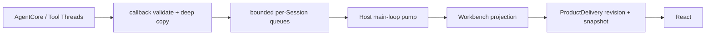

# MetaWork AgentCore 集成契约

> 状态：Windows x86_64 GNU 与 macOS arm64 使用 AgentCore ABI v1 revision 9；当前分支的真实 vertical 结果以验证规范为准
> 目标依赖：Metask AgentCore ABI v1（target-specific revision）；精确 artifact identity 见 [AgentCore ABI v1 消费合同](agentcore-abi-v1.md)

本文定义 MetaWork Agent 执行边界与 Metask AgentCore 之间的规范合同。Agent 与 Product 并列，Application 管理其生命周期，Workbench 直接消费其公共执行表面。顶层模块与故障域见 [高层架构](architecture.md)，Product owner 及其与 Agent 的协作见 [Product 内部架构](product-architecture.md)，Bridge transport 见 [Renderer Bridge 合同](renderer-bridge-contract.md)，target-specific ABI 能力见 [AgentCore ABI v1 消费合同](agentcore-abi-v1.md)。

## 1. 集成原则

1. Metask AgentCore bundle SDK 是 AgentCore canonical typed protocol 的唯一来源；
2. MetaWork 不解析模型 Provider SSE；
3. MetaWork 不建立平行的 `AgentEvent` / `WorkbenchEvent` 体系；
4. MetaWork 正式 Agent module 只使用 bundle typed SDK 和 binary ABI；
5. AgentCore/tool callback 不直接调用 WebView；
6. MetaWork 只补充产品路由、生命周期、所有权、传输 envelope 和安全校验；
7. 当前产品路径只使用 AgentCore built-in tools，不注册 v1 Host tools；
8. 当前 UI request 是同步调用，不伪装成 async suspend/resume；
9. 进程模型变化不得改变 Renderer 看到的产品边界。

## 2. Bundle 消费合同

MetaWork 的依赖输入是一个完整 bundle，而不是 AgentCore 实现源码。精确 artifact identity、payload whitelist 和 manifest schema 只由 [AgentCore ABI v1 消费合同](agentcore-abi-v1.md)定义；本文只定义 candidate、staging、build graph 和 Host 生命周期。

### target-specific 开发期 bootstrap

- Metask AgentCore 独立构建并测试 target-specific bundle，candidate 直接取自本机精确路径 `metacodes/zig-out/agentcore/<target>`；
- candidate probe 与 `stage-agentcore-bundle.mjs` 使用显式绝对 bundle root；正式 build/test/package 只消费 `.agentcore/bundle`；
- repository lock 按 target 保存完整 manifest，锁定 package/source、target、toolchain、ABI version/revision、table size、required capabilities、link inputs 和所有 payload checksum；缺少对应 artifact 必须失败；
- stager 只复制 manifest whitelist；捕获到的复制/rename 错误必须恢复旧 canonical bundle。当前内部开发不承诺跨进程 crash transaction 或并发 build/stage，强制中断后的残留由再次执行 stage 清理；
- staged bundle 在正式 build 前由 MetaWork verifier 再校验；官方 Zig package 只负责 module/link graph，不承担 repository lock 和 checksum 信任政策；
- 由于 Zig 会在执行 root build verification 前解析 staged path dependency，正式 `dev/check/test/build/package` 必须先运行轻量 `verify-staged-agentcore-bundle.mjs` preflight，给出明确的缺包或 lock mismatch 错误；Zig build-time verifier 仍负责最终 build correctness；
- 常规 build/test/package 不访问 AgentCore 实现源码或外部 `zig-out`；
- artifact 缺失、target 不匹配或 checksum 错误时明确失败；
- 禁止 path/Git source dependency、源码复制、`latest`、版本范围、可变 tag 和 source fallback。

stager 与 verifier 根据 manifest target 选择显式 target policy 和 exact lock，只接受 ABI 消费合同定义的 schema 1 target-specific manifest、280-byte table 与对应 required capabilities。未知 target 必须失败；Linux 后续通过新增独立 policy/lock 接入，不提供 generic fallback。MetaWork 不保留任何旧 revision 的 function table、类型别名、兼容 parser 或 fallback。

当前内部初步开发不实现 dependency resolver、content-addressed cache、artifact repository 或跨机器自动分发。这个限制意味着开发 checkout 需要本机 Metask AgentCore 构建输出；它是明确的开发期前提，不得伪装成公司发布方案。

### candidate validation 与正式 Agent module

candidate probe 只用于证明锁定 artifact 与官方 Zig package 可以 source-free discover/link/run。该 probe：

- 只通过 bundle 的官方 `bindings/zig` package 消费 AgentCore；
- 不能进入正式 Host target；
- 不能成为产品状态映射或 UI JSON 解析实现；
- 不能注册到 React/Native SDK 正式链路；
- 不维护上游 ABI facade 或 SDK 行为的平行测试套件。

当前 bundle 提供完整 typed status、八个 StopReason、known/unknown observation decoder、Permission provenance、`UiRequest` decoder、request-aware `UiResponse` encoder、Skill/MCP catalog decoder、Session description/restore/checkpoint entry、idle-only Session model mutation、Runtime MCP configuration apply，以及 callback-scoped validated `RunContext`。revision 8 额外提供结构化 `CoreEvent.run_state`；正式 `agent/` 直接使用官方 `bindings/zig` package 暴露的表面，Workbench 只保存受限运行时投影；MetaWork 不手写 raw enum、tag switch、identity layout、Permission/Skill/MCP schema 或 SDK module/link graph。

### MetaWork module boundary

- `src/agent.zig` 是 Agent 执行层的 named module root；
- `src/agent/` 直接消费唯一 `metask_agentcore` module，不得 import Workbench、Bridge 或 `metawork_app`；
- Application 不直接 discover AgentCore ABI；`agent.Runtime.init()` 在 Agent 边界内完成 bundle SDK discovery，raw function-table injection 只保留给隔离测试；
- Workbench 只通过 `metawork_agent` 公共表面协调 Session/Run，并消费 SDK-validated `OwnedCoreEvent`/UI types；这不是复制一套 `AgentEvent`/UI schema；
- Bridge DTO 使用 Bridge-owned transport enum，由 Bridge 解码为 Workbench-owned `UiResponse`；Workbench 调用 Agent 的 validated response type，只有 Agent 内部把它映射为 SDK `UiResponse`，任何边界都不返回 SDK enum、owner 或 handle；
- Workbench 可以持有 Agent 公共表面提供的受限 Session reference/lease 作为 `RuntimeAttachment` 的一部分，但不得读取或操作 Agent Session internals、AgentCore handle 或 callback state；所有 Session 操作必须经过 `metawork_agent` 公共 API；
- Agent 不解析或查询 Account 当前状态；Account/Application/Workbench 先解析并在受控生命周期内转移 execution-scoped `ExecutionConfig`，Agent 只消费该已解析配置创建或重绑定 Session；
- `src/main.zig` 只进入 `metawork_app`，不能绕过 Application 组装低层模块；
- Executor、queue 与 workers 归 Workbench 独占，Agent Runtime 不接收 Scheduler capability。持久 Scheduled Task 的 recurrence、触发游标、wall clock、timer、恢复和 occurrence admission 同样只归 Workbench；Application 只注入 store/timer/notification/tray 平台能力。到期后必须先创建真实 Task，再由同一 Executor 进入 Agent Run。Agent active Run 只保留 first-writer-wins `TerminationSignal`，并通过 immutable `TerminalResult` 向 Workbench 提交 terminal facts；Session snapshot 不保存 Schedule 或 occurrence 历史结果。

## 3. 当前协议表面

| 类型              | 方向        | 当前 ABI v1 语义                                                                   |
| ----------------- | ----------- | ---------------------------------------------------------------------------------- |
| `RunContext`      | Core → Host | callback-scoped borrowed identity；包含 Session handle、run ID 和稳定 session ID   |
| `CoreEvent` JSON  | Core → Host | callback-scoped borrowed bytes；与同次 callback 的 `RunContext` 绑定               |
| `UiRequest` JSON  | Core → Host | 同步 callback 请求；与同次 callback 的 `RunContext` 绑定                           |
| `UiResponse` JSON | Host → Core | 同一 callback 内 answered response；或 unavailable/fatal                           |
| ABI status        | Core → Host | function 调用层错误，独立于有效 Run 结果                                           |
| `RunResult`       | Core → Host | status OK 时完整有效；checkpoint budget pre-admission status 只定义 budget 字段    |
| abort             | Host → Core | 按 Session/Run 的 user/timeout 中断机制                                            |
| manual compact    | 双向        | Host 分配严格递增 operation ID；Core 返回 typed compact result                     |
| compact abort     | Host → Core | 只按 active compact operation ID 请求取消，不等待 provider I/O response            |
| Skill descriptor  | Core → Host | query-scoped owned bytes；由 SDK 解码后立即释放                                    |
| Skill catalog     | 双向借用    | Runtime query 返回 opaque handle；Session create/idle update 同步借用              |
| Skill policy      | Host → Core | Session create/restore/idle update 显式传入完整 replacement；由 Workbench committed policy 编译当前 catalog 的 granted concrete IDs |

`UiEvent` / `UiBackend.poll()` 虽然存在于 Metask AgentCore native 协议中，但当前生产 agent loop 未证明消费。MetaWork 不依赖它完成 stop、生成期 queue message 或 steering。

当前 ABI `RunResult` 不包含 `SuspendInfo`、resume token 或 background handle，但包含 checkpoint outcome、durable usage、required checkpoint bytes 与两个 budget stop。unknown status、stop reason、checkpoint outcome、result flag 或不一致组合在 Host validation 层 fail closed；Host 不能制造这些产品状态。

revision 9 的公开 Runtime/Session surface 包含 fresh create、checkpoint export/restore、Session description、typed Run/abort、manual compact、MCP catalog/selection、Runtime MCP configuration apply 与已列出的 mutation；独立 Completion surface 不借用 Runtime 或 Session。Model Connection probe 只创建短寿命 Completion/Stream，主线程 drain typed event 直到 terminal `done`，watchdog 可以在线程外调用 stream abort；next 与 abort 都返回并 join 后，严格按 Stream → Completion 销毁。超时事实优先于 abort 的 `too_late` 竞态；只有合法 terminal `done` 的 `end_turn` 表示连接成功，其他 stop reason 是 Completion 路径下的 provider rejection，不冒充旧 Session Run 的 turns/tool-calls 判定。`agent/mcp/connector.zig` 已建立 Host transport capability 到官方 `McpConnectorV1` 的唯一映射；每个 `McpServerV1` 携带由 Workbench canonical runtime descriptor 计算的非零、非 secret `configuration_fingerprint`。Runtime 线性接收完整 server descriptors、持有 adapters，并通过 `runtime_apply_mcp_configuration` 应用完整 replacement：Host 串行化 apply/refresh，验证 typed report，APPLIED 时交换当前 Servers owner并更新 registry generation；旧 Servers owner进入有界 retired 集合，只有 AgentCore retain 与 active connection 都归零后才回收，仍被既有 Session 使用的 owner 最迟由 Agent Runtime 销毁统一释放。产品不调用 `sessionUpdateMcp` 热替换既有 Session；Workbench 只用新 activation/selection更新后续新 Task 的 Admission Authority。Agent 不拥有 Desired Registry、Runtime Manifest、mutation transaction 或 Task admission。真实 MCP tool execution继续走既有 AgentCore Run；Renderer 不解码 AgentCore schema。

Agent 复制官方 MCP catalog 的 `fresh` 与 `ttl_remaining_ms` 作为产品无关 freshness fact；Session create 的官方 `mcp_not_refreshed` 只在无返回 handle 的合法拒绝形态映射为 `McpNotRefreshed`，Session restore 的同一 typed status 只在空 report、无返回 handle且 cleanup 完整的合法拒绝形态保留为相同错误，其余非 ok/handle/report 组合仍 fail closed 为 ABI contract failure。

`agent/checkpoint.zig` 独占流式 export 与 typed Session description；`agent/checkpoint_restore.zig` 独占 source callback、restore config/report、post-restore description 与 expectation 对账。Workbench 持久化 opaque blob 和无 secret `CheckpointRecord`，并只把经过 size/hash 再校验的 source 与当前 Skill/MCP authority 交给 Agent。restore 不读取私有 transcript，不从 CLI 行为推断 resume，也不在 `agent/` 外复制 ABI。

`Runtime.restoreSessionRoute` 按 catalog query 的既有并发范式工作：在 `sessions_mutex` 内预留 Session slot 并递增 active restore count，解锁后执行可能流式读取整个 checkpoint 的 ABI 调用，返回后重新加锁对账并在 shutdown 已开始时拒绝安装。`Runtime.shutdown()` 自己等待 restore、catalog 与 MCP in-flight 调用归零，然后关闭 Sessions、检查 catalog leases 并调用 `runtimeDestroy`；Workbench/Application 的正常关闭顺序不能替代这条 Agent-owned fence。

Agent-private STDIO/Streamable HTTP backend 只通过 Application 注入的 bounded process/network capability 执行 effect。Agent 拥有 STDIO newline framing、HTTP MCP headers/status/media-type/session 规则、JSON body bound 与 SSE 帧还原；Application endpoint 只保留 child/pipe/connection 生命周期、原始字节泵、timeout/cancellation，并在 401/403 时记录合法 Bearer challenge。完整 request response（包括 401/403、400 与 5xx）的 status/body 继续进入 Agent sink，由 connector 作为 transport observation 交给 AgentCore；没有 response descriptor 的 notification 仍把 401/403 收口为 auth failure。effect connection 与 reader 不跨边界转移，Application 只在同步 callback 期间把 borrowed byte slice 交给 Agent-owned sink。OAuth mechanics 与 ref-counted HTTP auth snapshot 不进入 Agent。同一 OAuth consent epoch 的 HTTP token revision 只替换 Application auth snapshot，不改变 Runtime descriptor 或既有 Session selection；运行时授权拒绝只通过 Workbench Admission Authority 收缩后续新 Task 的 authority。Agent 不拥有授权事务，Application 也不把 token 或 raw challenge 传播进 AgentCore 协议。

MetaWork MCP Host 工程接线不得改变上述协议 owner。Workbench preparation 只把 enabled、配置有效、connection-approved 且 credential/consent-ready 的 owned server input 线性转交 Agent；其他状态保留为 Workbench 产品事实与 Runtime Manifest absence proof。Add/Replace 在用户提交前不得连接网络、启动 child、读取 credential 或打开 browser；提交成功后 `testConnection` 可以对唯一目标构造短寿命候选 Runtime，真正执行 official refresh/activation。候选 Runtime 与正式 Runtime 使用同一 Agent owner/API 和同一有界 connector，实现不解析 MCP JSON-RPC；它最多一个 session，不创建产品 Session，不安装 Manifest/Admission，并在 completion/shutdown 后完整释放。正式 Runtime 创建前仍只构造惰性 backend；`McpRuntimeInput` 以失败零消费、成功全接管的方式持有 backend owner、adapter、official descriptor、稳定 id→binding identity 与 allowlist。Activation 不包含 raw issue detail、schema、fingerprint、transport 或 credential。AgentCore `runtimeCreate` 仍返回统一 Runtime 结果；正式启动不重试、不复制 MCP 协议，也不把该失败降级为普通 MCP unavailable。

Canonical bundle revision 9 提供 `2026-07-28`、`2025-11-25` 与 `2025-06-18` negotiation policy、typed MCP auth/transport health、catalog/selection 与 tool execution，但不提供 OAuth discovery、PKCE、registration、browser/callback 或 token API。`automatic` 可以协商并 exact reopen 到三个 era 之一；这不构成对旧 AgentCore ABI revision 的兼容。Modern disposable probe 收到完整 HTTP 400 时，MetaWork 保留 status/body，AgentCore 才能判定是否进入 Classic；probe connection 永不升格或与 actual connection 共享 session。OAuth 缺口不要求 AgentCore ABI 扩展：OAuth 是 Streamable HTTP 在产生 preauthorized capability 前的 Host transport authorization，由 Workbench 持有产品状态、Application 执行标准 effect。Workbench 只有在目标 transport 的 approval/auth facts 完整且 secret 满足 Application-owned runtime limits 时才发布 `eligible`；Agent-owned HTTP backend 按成功 response 的 media type 严格分流 JSON 与 event-stream，对非 2xx body 只做有界原样收集，并把 response observation 交给 AgentCore，不解析 JSON-RPC identity 或 MCP 语义。

Workbench 首个 Run 后的 Task 标题生成也只消费公共 Completion surface：它复用 Task admission 已固定的 ExecutionConfig，创建短寿命 Completion/Stream，并遵守同一 next/abort quiescence 与 Stream → Completion 销毁顺序；该元数据请求不创建新的 Agent Session、Run history 或 Conversation，失败只由 Workbench 执行本地标题回退。

## 4. Agent binding

Agent binding 是 Metask AgentCore 的 ABI 消费者，不是 Native SDK Adapter。它直接持有 bundle SDK API table 和 opaque handles。

### Event callback

```text
AgentCore/tool thread
→ SDK validates RunContext layout and borrowed session ID
→ Host atomically binds/compares Session handle + active run ID + stable session ID
→ SDK validates bytes/tag/payload as known or owned unknown observation
→ unknown observation: Host releases the SDK owner and returns continue
→ known observation: Host deep-copies escaping bytes
→ attach workspace/session/run routing envelope
→ push bounded test sink/event pump
→ return CONTINUE or FATAL
```

约束：

- callback bytes 默认只在返回前有效；
- `RunContext` 及其 session ID 也只在 callback 内借用，禁止保存 slice；
- Session handle、active run ID、Session-lifetime session ID 的首次绑定/比较与 callback ref admission 必须在同一 Session lock 内完成；
- invalid layout、错误 handle/run ID、同 Run 或跨 Run session ID 漂移均为 dependency contract failure，返回 fatal 并 poison Session；
- 整段 `CoreEvent` / `UiRequest` JSON 必须先通过严格 UTF-8 校验；官方 typed decoder 返回后，所有进入产品 projection 的文本字段还必须逐项验证，拒绝由合法 JSON byte array 解出的非 UTF-8 `[]u8`；校验和深拷贝必须在 callback 内完成；
- callback 可能来自不同 Session 的并发线程；
- 同一 Run 的事件顺序必须保留；
- 无法验证、复制或接收关键事件时返回 callback fatal；
- valid unknown observation 在 SDK 完成结构、ownership 和 byte-bound 校验后立即释放并忽略，不占用产品事件泵，不得传给 Renderer 或猜测为产品状态；
- callback 不等待 WebView，也不调用 Session destroy 或 re-enter Run。

初始验证先把正式 Host 连接到 FIFO bounded test sink，再替换为 per-Session/global count+bytes、control reserve 和 deadline 受限的 Event pump。当前正式 AgentCore→Workbench projection→Native SDK Bridge→React 垂直链路持续验证同步权限、Renderer reload、终态和异步 Session close；Agent 层另以固定 Runtime/Session allowlist 证明 AskUserQuestion 未向 MetaWork Agent 开放。持续回归要求见 [验证规范](validation.md)。

### UI request callback

```text
Core calls synchronous UI callback
→ SDK validates RunContext and UiRequest
→ Host atomically validates the same full Session/Run identity tuple
→ enqueue control item
→ callback waits on Host-owned condition/channel
→ response / cancel / close / shutdown
→ SDK encodes a response into Host-owned bytes when one was supplied
→ under the Session lock, recheck identity/dependency-contract health
→ transfer answered bytes, or free them and return unavailable/fatal
```

Bridge handler 只写入 response channel，不同步等待 AgentCore。callback wait 仍占用 Run executor slot。

callback admission 只建立 lifetime 与当时的 identity 事实，不保证等待期间不会有另一个并发 callback 发现 identity 漂移。因此 Host 在发布 UI request 前和最终提取 response 的线性化点都必须在同一 Session lock 下重新检查现有 Core identity 与 dependency-contract 状态。检查失败时返回 UI fatal；如果 Renderer response 已完成编码但 ownership 尚未转移给 Core，Host 必须自行释放，禁止返回 answered。

目标 ABI v1 revision 9 的 `UiRequest` / `UiResponse` 只有 `ask_question`/`answers` 与 `permission`。Agent 边界继续使用官方 decoder 完整理解该 ABI，但 MetaWork 固定工具集合不注册或允许 `AskUserQuestion`，正式产品路径只会产生 Permission request。Permission request 是携带 request/session/run/tool/digest/policy generation/candidate 的 typed flat object，response 必须回显 request identity 与 generation，Session choice 还必须回显 candidate rule ID。Permission request 与 callback `RunContext` identity 不一致时立即 fatal 并 poison Session；`permission_provenance` 是 control event，不得静默丢弃。

Agent Session 的公开回答入口只有 choice-only `respondPermission`。调用方不能提交任意 SDK `UiResponse`：Permission 入口从 pending request 回填 request ID、policy generation 和 candidate rule ID；完整 SDK response 只在 Agent 私有 encoder 边界内构造并校验。ABI decoder 仍识别 `ask_question`，但 Agent capability gate 在建立 pending UI 状态前返回 callback fatal，因此 Workbench、Bridge 与 Renderer 不拥有 answers 产品路径。

### Host tools

目标 revision 9 的 Host tool callback 同样携带 validated `RunContext`，但这只补齐 wire identity，不自动建立 MetaWork 的产品工具、安全与路由政策。当前产品 Runtime 配置仍必须保持 `host_tool_count = 0`；MetaWork Agent 在 Agent 模块中统一注册并允许固定 built-in 集合，Workbench 和 Application 不持有 profile 或 wire name。启用正式 Host tools 属于独立 capability Gate，不在本次 ABI 迁移中顺带开放。

## 5. Host envelope 与产品状态

Host 可以在 AgentCore event 外增加产品路由 envelope：

```json
{
  "workspaceId": "workspace-1",
  "sessionId": "session-12",
  "runId": "run-8",
  "sequence": 318,
  "event": {
    "tool_start": {
      "id": "toolu_123",
      "name": "Bash",
      "input": "{\"command\":\"zig build\"}"
    }
  }
}
```

其中：

- `event` 保持 AgentCore 语义，不复制为另一套 Agent event；
- workspace/session/run ID 属于 MetaWork 产品路由；
- `sequence` 是 Host 的单 Session/Run 传输序列；
- Host 可以维护 `run.started/completed/stopped/failed/cancelled/interrupted/waiting_ui` 等产品生命周期状态；
- envelope 必须保留 SDK 验证后的原始 stop code/reason；
- Renderer view model 可以派生消息列表和工具卡片，但不能反向成为 AgentCore 协议来源。

## 6. Session 与 Runtime 生命周期

### 状态机

```text
Open.Idle
  → Open.Queued
  → Open.Running
  ↔ Open.WaitingUi
  → Open.Idle / terminal Run state

Open.Idle
  → Open.CompactQueued
  → Open.Compacting
  → Open.Idle / terminal Compact state

Open.*
  → Closing
  → Closed
```

`WaitingUi` 是仍在执行的同步 Run 子状态，不是可持久化 `suspended`。

checkpoint restore 不进入既有 Session 状态机：它先占用 Runtime 的候选 slot，成功且完成 report/description 对账后才产生 `Open.Idle` Session；失败或 shutdown 竞态必须释放 slot 和全部 Core/Host candidate。Workbench 的 `session_recovery_in_progress` 是 Task active operation，不是 Agent Session lifecycle。

Compact 的 `Queued / Compacting / Stopping` 不是由 Worker 直接覆盖同一个 phase atomic。Workbench record 分开保存 executor handoff、first-writer pending interruption 与三态 terminal publication；main thread 以 terminal 优先派生产品 phase。`published` 是 terminal linearization point，payload 与 diagnostic bytes 在 release-store 后不可修改；pending interruption 是 advisory control fact，在 terminal race 后即使被设置也不得改变真实 outcome。

### 每 Session 规则

- 至多一个 in-flight operation；Run、manual compact、model/Skill/permission mutation 与 destroy 互斥；
- 第二个 Run 明确排队或拒绝；
- run ID 单调且与 Session 绑定；
- queued Run 不接触 AgentCore mutable state；
- queued Text/Skill input 在复制前按 Host byte limit、catalog identity 和参数数量拒绝，保证 executor 有界时输入内存也有明确上限；
- active Run 独占 Session Conversation；
- active compact 同样独占 Session Conversation；Host operation ID 在独立 compact ID space 中严格递增，pre-admission rejection 不消费 ID，admitted terminal path 消费 ID；
- callback context 与 Session handle 具有独立 lifetime guard；
- Run 返回不等于可以立刻 free callback context，必须确认 callback refcount 为零。

初始 raw lifecycle foundation 使用 bundle SDK 提供的精确 `ApiV1` table 作为可注入依赖，并显式接收 Zig `std.Io` 来实现 mutex/condition；它不导入 AgentCore 实现源码，也不建立 Adapter。`submit` 在持有 Session lock 时完成 bounded executor enqueue，避免 enqueue 与 close 之间出现未入队的悬空 `Queued` 状态。Core callback 在 `Closing` 后不得再取得新的 lifetime reference；已经进入的 callback 必须在 destroy 前归零。

正式 Host 在同一状态机上直接加入 bundle typed SDK，不另建 Adapter：event callback 先校验并形成 SDK-owned parse owner，再以单调 Host Session ID 和 Run ID 进入 FIFO bounded sink；UI callback 保留校验后的 request owner，response 只由 request-aware SDK encoder 生成。同步 UI 等待没有 deadline：response、cancel、close 或 shutdown 之一在 callback 返回前收敛等待；人类决策不由 Host 过期。

当前实现由 Workbench 预留 durable Run record、generation、tool slots 与 terminal diagnostic buffer，再调用 `Session.prepareRun(RunInput)` 并把 Workbench-owned job 放入自身 bounded Executor。`RunInput` 只有 Text 与 typed Skill 两个分支；Agent 在 admission 时有界深拷贝整个输入，Skill argument JSON 只通过官方 SDK encoder 在同步 `sessionRunSkill` 调用边界内生成，旧 `session_run` 和 slash 字符串不进入 Agent。worker claim 后以原子 `starting` 状态调用 `Session.beginRun()`；成功后先发布 generation-bound `RunControl` 和 `running`，再调用唯一 latch-aware `Run.execute()`。`beginRun()` 失败会在同一 Session lock 下返回 typed completion disposition，Workbench 据此生成 pre-execution terminal payload，不再额外读取 Session snapshot。cancel/close/shutdown 在 `starting` 时只发布 first-writer pending termination，在 `running` 时取得 `RunControlLease` 后于锁外请求终止。Agent Runtime 不 enqueue、不停止、也不销毁 Executor。

### Skill catalog ownership

Agent Runtime 的 catalog resolve 是同步 Core 调用；调用在哪条受界线程运行由 Workbench 决定。输入必须使用 Application 解析并注入的 canonical user home，以及 Workbench canonicalize 并按 Workspace identity、authority 和 epoch 校验的 Workspace root。当前 MetaWork 只消费 AgentCore 默认的 user/workspace `.agents/skills` discovery，`additional_sources` 保持空值；其他 Skill 路径及其配置不属于当前产品范围。MetaWork 不扫描候选或决定 winner。顶层管理 catalog 使用无外部 generation 形式：root 与 home 都绑定 canonical user home，epoch 为空；该 lease 只由 Workbench 持有和释放，禁止借给 Session。AgentCore descriptor 由官方 SDK 校验后立即释放，Agent 只向上层返回两份彼此独立的线性值：

- MetaWork-owned catalog projection：只包含 revision、health、可调用 Skill 的产品字段与 bounded issue；不包含 raw JSON、catalog scope、物理路径、Skill body 或内部 policy；
- opaque catalog lease：内部持有 AgentCore handle 及 root/home/epoch/Runtime owner 绑定，只能同步借给 Session create 或 idle refresh，并由原 Runtime 精确 release 一次。

projection 的销毁不释放 lease，lease 的释放也不使已经复制的 projection 失效。Session create/update/restore 必须拒绝另一 Runtime、Workspace、home 或 epoch 的 lease；绑定 catalog 时由 Workbench 同步提交 typed `SkillPolicyV1`，其中 `granted_skill_ids` 是对当前 resolved winners 应用稳定 `skill_policy_key` 策略后得到的 concrete ID 集合。update 只在 idle 状态调用 `sessionBindSkillPolicy` 并原子替换 catalog 与同一 policy；queued/running/waiting/closing 状态 fail closed。Agent 只校验并转交 typed policy，不拥有启用 policy、持久 revision 或 UI mutation；`permission_rules` 保持 null。Manual compact 只由 Workbench 在 Task idle admission 后进入 Agent typed surface，不由 catalog、Bridge 或 Renderer 直接调用。Runtime shutdown 先阻止新 query，等待正在执行的 catalog call 收敛，并在仍有 lease 时明确返回 `CatalogLeasesOutstanding` 而不销毁 Core Runtime；上层释放 lease 后可重试同一 shutdown。实际 catalog 缓存、policy persistence、刷新合并、Task admission 和状态投影归 Workbench，Agent 不在内部隐式监听文件变化。

本地 Skill 管理不改变上述 Agent 边界。Workbench package/inventory 层可以在 Application 授予的 personal root 与已授权 Manual Workspace root 内执行机械文件检查和事务，但不能生成 AgentCore handle、复制 catalog parser、决定 winner/conflict 或把管理 `install_id` 传给 Session。每次 import/reimport/uninstall publish 后由既有 bounded Executor 发起精确 scope 的 catalog query；只有 AgentCore 返回的 projection 才能把管理资产标记为 runtime ready/degraded。明确属于候选的 definition/resource/conflict issue 触发 Workbench filesystem rollback；query 本身暂不可用只产生 `pending_verification`，不能伪造成空 catalog 或成功。AgentCore 不需要 staged install API，也不承担下载、归档、provenance、导出或删除职责。

当前 Workbench 已将 catalog discovery 接入同一 bounded Executor。顶层管理 job 按 request generation 提交到独立 projection；Manual Workspace job 使用 Application 注入的 canonical home capability 和 Workbench-owned Workspace root/epoch query，主线程只提交仍匹配 Workspace id、epoch、request generation、authorization 和 Runtime 生命周期的结果，过期/取消结果立即释放 projection 与 lease。若 Manual Workspace 在旧 epoch query 尚未收敛时重新授权，Workbench 只记录一次 latest-epoch reschedule intent；旧 job 收口并释放结果后立即通过同一 Executor 发起新 query，不能因已有 job 而把已恢复授权的 Workspace 永久留在 unavailable。Manual Workspace current catalog 与每个 Task 的 pinned catalog 分离；创建 Task 时先复制并计入全局 projection budget，再同步借用 current lease 创建 Session。loading/unavailable 仍允许 text-only Task；此时 Task 没有 pinned catalog，其 Task-level catalog 固定投影为 uninitialized，不镜像 Workspace availability，只有显式 idle refresh 成功后才进入 ready/degraded。只要 canonical home capability 可用，Session 仍保存同一 epoch，以便后续用户显式 idle refresh。

Automatic Workspace 复用同一个 Agent Session workspace 合同，不形成 AgentCore 新类型。首期 automatic admission 只允许 Text Task：Workbench 不为该 Workspace 排队 catalog job，以 null catalog lease 创建 Session，并仍传入精确 canonical root、temporary trust root 与 Workspace epoch。不同 automatic Task 使用不同 root；同一 Task 的后续 Run 继续使用原 Session/root。Skill automatic admission 在 Workbench fail closed，直到 automatic root-specific catalog acquisition 与 shutdown 通过独立验收。Task 发布前 Session 创建失败必须由 Workbench 回滚 Workspace record 和本次创建的空目录；Agent Runtime 不接收目录 store 或回收 capability。Workbench shutdown join catalog/Run jobs 并释放顶层与 Manual Workspace leases 后，由 Application 销毁 Agent Runtime。

Workbench 的 typed Skill admission 在 `Session.prepareRun` 前同时验证 pinned catalog revision、pinned selection revision、skill identity、enabled 状态、参数数量、UTF-8、Workspace/Task epoch 和容量。RunRecord 保存 admission 时的稳定 Skill 身份、invocation/display 与参数副本；disabled Skill 在进入 AgentCore 前以 `skill_unavailable` 拒绝，AgentCore 的五类 Skill rejection 继续映射为独立产品 cause，不 poison Session、不自动刷新和不重放用户动作。

Renderer Bridge revision 1 原地 hard cut 后，`metawork.tasks.run` 只接受 `input.kind = text | skill` 的 tagged payload，旧 `prompt` 字段必然解码失败；Skill input 同时携带 `catalogRevision + selectionRevision`。`tasks.create` 必须显式传成对 nullable 的 `expectedSkillCatalogRevision + expectedSkillSelectionRevision`，Text 两者均为 `null`，Skill 两者均为选择时 revision。Workspace current catalog/selection、Task pinned catalog/selection 与 Run typed input 由同一 Workbench snapshot 投影；Bridge 只严格解码、路由和编码，不解析 slash、归档或 AgentCore raw catalog。`workspaces.refreshSkillCatalog` 与 `tasks.refreshSkillCatalog` 分别只调用 Workbench 的 Workspace query transaction 与 idle Task binding transaction。`skills.setEnabled` 使用 Workspace epoch 与双 revision CAS 更新 Workbench policy；`skills.refreshCatalog` 更新顶层管理 catalog/inventory reconciliation，不改变 Task 或 Session binding。Skill preview/detail 只发布 Workbench 已做容量与内容边界处理的文本，file picker 返回的一次性 staged handle 和 Host-only physical path 都不得进入 snapshot。Import/export/reimport/uninstall mutation 沿同一 Dispatcher authority、expected generation/Workspace epoch 与 ProductDelivery resync 路径返回 typed result，不形成第二条执行路线。

每个 Session 拥有独立分配、存活到 Session release 的 `SessionControlBlock`。`RunControlLease` 用 closed-bit + atomic reference count 保活该 control block，并携带单调 `run_generation`；旧 lease 在下一 Run 复用执行槽后返回 `stale_run`，Run 自然完成后返回 `already_terminal`。Session close 先关闭 lease acquisition gate，再等待 Run、callback 和全部 control lease 归零；该 quiescence wait 不持有 Session/Workbench lock。`Run.execute()` 返回 immutable `TerminalResult`，worker 在释放 execution base lease 前将它提交到 Workbench admission 时预留的 write-once terminal payload。Workbench executor worker 入队前取得的 Task-owned stable record reference 归零前，所属 Task 即使已经归档也不得物理删除；Workbench 保留已受理的删除意图并在引用归零后完成事务；不存在只被测试消费的第二套公开 record-reference 协议。

### Close 顺序

```text
1. close control lease acquisition gate and CAS Session state → Closing
2. reject new Run/compact and UI response
3. remove/cancel queued Run or compact
4. wake active synchronous UI wait
5. set first-writer-wins TerminationSignal if absent
6. request matching abort for active Run or compact
7. join active Workbench job and wait every abort call to return
8. wait callback refcount == 0
9. wait control refcount == owner only
10. call session_destroy
11. free Host callback/session state and mark Closed
```

规则：

- callback 内不得直接 destroy；
- abort stale/too-late 不跳过 join；
- `session_destroy` busy 说明 Host 顺序错误或 Run 尚未退出，不允许强行 free；
- double close、同一 Session/run ID 的重复 cancel 和 shutdown 竞态必须幂等；stale run ID 必须明确拒绝且不得触发 abort；
- Runtime 记录活跃 Session，只有全部 Session Closed 后才能 destroy；
- Runtime 记录活跃 restore、catalog 与 MCP calls 以及 catalog leases；Core Runtime destroy 前所有 in-flight call 与 Session 都必须归零，lease outstanding 必须明确拒绝 shutdown；
- Host shutdown 对全部 Session 执行同样状态机，不另写一条危险的快速路径。
- Host shutdown 本身必须串行化；并发调用不得重复 join executor、`session_destroy` 或 `runtime_destroy`；暂时的 destroy failure 必须可由后续显式 shutdown/close 重试，失败时不得强行 deinit。
- abort 的 raw status 即使是 stale/too-late 也要保留供 diagnostic/telemetry 使用，且 owned diagnostic 仍按 bundle release contract 释放。
- queued compact 由 Workbench 从 Executor 移除后调用 `cancelPreparedCompact` 并直接发布 pre-Core `aborted`；已由 Worker claim 的 compact 只登记 pending interruption 并通过 Agent typed cancellation 收口。两条路径都必须进入同一个 allocation-free、no-fail terminal commit，terminal 发布后才 release record references。
- `Closed` tombstone 保留到 owner 显式 `releaseClosedSession`，以支持幂等 close 和事后 snapshot；释放后指针失效且 Host slot 才可复用。Host shutdown 开始后禁止单独 release，由统一 teardown 持有所有权。

### 必测 race

- cancel 与自然完成同时发生；
- close queued Session；
- close active Run；
- close queued/active compact；
- close while WaitingUi；
- callback fatal 与用户 cancel 同时发生；
- Host shutdown 多 Session；
- abort 返回 stale/too-late；
- accepted compact abort 返回 OK 但原 compact 返回非 aborted；
- compact terminal publication 与 cancel/snapshot 同时发生；
- Executor pop 与 queued compact cancel 同时发生；
- double close / duplicate response；
- runtime destroy while Session alive；
- diagnostic/release callback 恰好一次。

## 7. TerminationSignal、TerminalResult 与错误传播

每个 Run 持有：

```text
SessionControlBlock (Session lifetime)
├── closed-bit + atomic control reference count
├── Session termination capability
└── close quiescence wait

RunControl / RunControlLease
├── active run_id
├── monotonic run_generation
└── requestTermination() → requested / already_requested / already_terminal / stale_run / session_closing
```

`TerminationSignal` 是 active Run 唯一可变的 first-writer-wins latch，并按 execution failure domain 分型：external interruption、callback failure、event-pump failure、event-consumer-notification failure。dependency contract failure、ABI status 与 validated StopReason 是 terminal facts，不伪装成 abort cause。`product/task/policy.zig` 是这些 Agent 公共 typed facts 到 Run/Compact phase、outcome 与 product cause 的唯一纯映射；Workbench 只执行 termination、terminal diagnostic 清洗与 write-once publication。

wire abort reason 只作为 AgentCore 中断机制。`TerminalResult` 同时保留 typed/raw ABI status、typed/raw StopReason、typed/raw abort status、最终 termination latch、completion-time Session disposition，以及 bounded owned diagnostic。产品 `RunOutcome` 与 durable cause 只由 Workbench 映射。Renderer transport 不是 active Run cause，不得写入 Agent termination latch。

### callback 内失败

event validation、copy 或同步入队失败：

```text
set typed TerminationSignal if absent
→ return EVENT_FATAL
→ session_run_input returns non-OK callback status
→ Host releases diagnostic
→ Run = failed
```

此路径不读取 `RunResult`。

### notification、projection 与 Renderer transport

event 入泵后 ownership 已经转移给 Agent event pump。`EventReadyNotifier` 只返回 `scheduled`、`already_pending` 或 `unavailable`；Application 使用原子 pending gate 将重复 Native `services.wake()` 合并为 `already_pending`，并在调用 Workbench 固定 drain 前清 gate，避免 producer 与 consumer 交错时丢 wake。Agent 对 `unavailable` 按 composition 提供的 retry interval 和 deadline 同步重试；deadline 耗尽后 callback 才返回 fatal 并记录 typed `event_consumer_notification_failure`。失败不会撤销已经完成的 pump ownership transfer，事件仍由 pump 负责释放或交给 canonical consumer。

callback 返回后的 Product Task event application failure 仍由 Workbench 按 Run identity 请求 Agent 终止，并使用不含 Workbench 名称的 `event_pump_failure.consumer_rejected`；这不是 Bridge failure。如果 Agent terminal 已先发布，Workbench 还必须独立保存 projection failure 产品事实，在 event drain 后把 Run 暴露为 `event_pipeline_failure` 并禁止 continuation，不能把已经太晚的 termination request 当作唯一收口。Renderer response、revision、snapshot 和 connection/generation failure 则形成 typed transport report，由 Workbench policy 决定 reject/retry/detach。当前所有 Renderer transport stage 都明确不返回 `request_run_termination`；Renderer detach/reload 不得杀死后台 Run。

AgentCore tool event 的 raw `id` 只在 Product Task 应用当前 event 时用于计算固定长度 SHA-256 correlation key；raw `id` 不保存在产品历史。后续 progress/result 使用同一 digest 关联 Tool record。callback-scoped projection 以 Run 内唯一 activity order 生成稳定且不敏感的产品 tool `id`；`name`、input、progress 和 content 在进入 canonical projection 前统一清理。该 digest 不进入 Renderer wire，也不是第二个产品 tool identity。Renderer decoder 必须拒绝同一 Run 内重复的产品 tool `id` 或 activity order。

`thinking_chunk` 正文属于 private reasoning，Product Task state 不把它写入 Assistant、Snapshot 或 Task persistence，只用事件类型把现有 safe status 更新为 `Thinking`；同状态的连续 chunk 不重复发布 revision。`text_chunk` 到达后 safe status 更新为 `Writing response`，正文继续进入 Assistant。assistant `text_chunk` 的 credential 清理采用流式未决尾部：已经提交的 canonical 字节不再随之后的 chunk 重扫，只有仍可能组成跨 chunk credential 的有限后缀与新字节参与下一次清理。snapshot 只发布 committed prefix，未决尾部保持 Host-only。Run terminal publication acquire 后，Application 只安排 main-loop 调用；`Workbench.drainAgentEvents()` 在第一次 drain 后观察 terminal、再完整排空一次 Agent event pump，最后调用 Product Task state 同时发布产品可见 terminal phase/outcome/cause、折叠 completion-time Session disposition、提交最终安全 assistant 尾部并关闭该 Run 的 event ingestion。raw terminal publication 本身不能替代这次 drain barrier。barrier 完成前新 Run admission 仍以当前 Run 未结束处理，close completion 和 Task 物理删除也必须等待该 Run 的事件流完成收口。barrier 后仍到达的 event 属于合同违约；仍开放的 Task 必须关闭 owning Session 并终止可能已经开始的后续 Run，不能只对已经 terminal 的历史 Run 重发无效 termination。上述状态只存在于 Product Task aggregate，不形成第二份 terminal 或 assistant 内容；Workbench 保留事件泵、提交与 revision 编排，并以 callback-scoped capability 提供 bounded projection 与 credential 清洗。

Bridge 异步 payload 必须是 owned copy 或显式 ownership transfer。Native SDK 在 platform loop 上串行执行同步 Bridge handler 与 `app.stop`；Application 先关闭 ingress，用 callback lease 计数断言 quiescence，再依次收口 Workbench 与 Agent 并 detach Workbench。Bridge retained JSON/batch 不借用 Workbench memory，因此在 Workbench deinit 后独立释放。

## 8. Event pump

### 固定路径



### 当前已测量并固定的维度

- global queue count/bytes；
- per-Session queue count/bytes；
- maximum single event bytes；
- control reserved capacity；
- per-pump Session/event budget；
- Workbench snapshot capacity/chunk bytes 与 revision retry budget。

### 过载语义

| 数据                            | 允许策略                                                             |
| ------------------------------- | -------------------------------------------------------------------- |
| `text_chunk`                    | 当前逐项保留；若后续按 Session/Run 合并，最终字节必须一致            |
| `tool_progress`                 | pump 逐项保留；Renderer projection 按同一 tool 覆盖旧进度            |
| `usage`                         | pump 逐项保留；Renderer projection 根据 AgentCore 事件语义累计或替换 |
| diagnostics                     | 按明确配置采样                                                       |
| tool start/result               | 不得静默丢失                                                         |
| UI request/response state       | 不得静默丢失                                                         |
| run/error/cancel/terminal state | 不得静默丢失                                                         |

当前没有完整最终 assistant snapshot 时，`text_chunk` 不能丢。队列不能接收关键事件时，可以有限阻塞 callback；达到 deadline 后返回 fatal，而不是无限等待。

按 Session 公平轮转，单一高输出 Session 不得饿死其他 Session。控制容量不能被文本增量占满。

### 大 payload

Native SDK 和真实事件大小已经测量；49,703-byte 真实 event 超过当前 8 KiB Host window-event budget，因此当前使用受限 Host-owned object reference：

- opaque object ID；
- Session/Run ownership；
- count/byte/TTL 上限；
- Renderer fetch 命令的来源和归属校验；
- Session close、Run terminal、reload 和 shutdown 清理。

禁止为了假想大对象先建设通用 blob service。

## 9. Renderer reload 与重连

当前 baseline 只保证 WebView/Renderer reload 后从仍存活 Host 重建视图：

- Native SDK 的真实 push/poll 机制由 dev/prod smoke 验证；
- Host 维护可生成当前 view snapshot 的产品状态；
- 重连策略必须定义 snapshot/event 的大小上限、旧连接隔离和清理；
- reload 期间仍 active 的同步 UI request 可以重新展示，但响应仍须绑定原 Session/Run/request；
- Host/AgentCore 进程退出后不恢复 active Run；
- snapshot 不包含 Provider credential。

Workbench revision 通知只在 revision 变化时发送，Renderer 合并并发 refresh；Host 发送失败时保留最新 revision 并由一次性 timer 重试，若 timer 也无法建立则立即使当前 event connection 失效，不能只记录日志后继续宣称可用。Renderer snapshot 拉取失败时保留目标 revision；每个 generation 的自动重试预算耗尽后停止请求、禁止产品 mutation 并等待用户显式恢复，不得把失败误记成已同步，也不得永久循环重试。

正式 AgentCore 产品事件由 Workbench 在主线程从 Agent event pump 取出并完成 typed projection 后即释放，不把同一 raw `CoreEvent` 复制到 Renderer。产品 Renderer 的唯一数据面是 Workbench-owned revision + bounded snapshot；automation 只观察和驱动这条真实路径，不定义独立 Renderer transport。

当前 Bridge 单次 result 上限为 1 MiB，但它不是 Workbench 产品状态容量。Host 在固定 64 MiB snapshot store 中生成一致的完整 JSON，再由 Renderer 以绑定 snapshot ID、generation、window、offset 和长度的 256 KiB 原始分块拉取；分块使用 base64 后仍低于单次 result 上限。新的 begin 在写入 store 前必须先使旧 descriptor 失效；写入失败不能让旧 identity 继续读取被部分覆盖的 buffer。Workbench 以 JSON 字符串最坏六倍 escaping、最大 Account catalog、Workspace/Task Skill catalog 结构、Task/Run/Tool 最大结构数量，以及“同步 UI 最多占满四个 executor slot”的并发 pending UI 最坏值，在初始化时验证完整 snapshot 预算，并以最大 Account projection 和最大 Task 结构的真实 serializer 测试校验估算上界。当前 Task projection 上限保持 512 KiB；不得为了适配 Bridge 缩小产品状态，也不得允许合法 projection 进入永久 `SnapshotTooLarge` 状态。

不在验证 transport 前发明固定 `events.drain`、cursor 或轮询协议；最终机制必须以 Native SDK 事实和压力数据为依据。

## 10. UI request 语义

当前 ABI v1 只有同步 outcome：answered、unavailable、fatal。

- answered response 由 SDK encoder 生成，并按照 bundle ownership 规则 release 恰好一次；
- unavailable 表示当前 Host 无法回答，Core 按其工具语义安全失败；
- fatal 表示 Host request pipeline 失败，Run 必须退出；
- 每个 Run 同时最多一个 active UI wait；
- UI 等待没有 deadline：等待只由 answered、cancel、close 或 shutdown 结束，Host 不得代替用户过期一个待决请求；
- cancel、close、shutdown 唤醒 wait；
- response 必须拒绝 stale、duplicate、错误 Session/Run 和错误类型；
- 同步 wait crash 后不恢复，工具保持未执行，Run 标记 interrupted。

未来 async pending/resume 必须独立定义 request identity、SuspendInfo、持久化、exactly-once tool execution、subagent 限制和 crash recovery；不能只在 React 中保存审批框。

## 11. RunResult 与 StopReason

`session_run_input` 的处理顺序固定：

```text
call ABI
→ validate typed function Status
→ checkpoint_budget_required: validate only the fields defined for that status and keep Session retryable
→ every other non-OK: release diagnostic, do not read RunResult
→ OK: validate RunResult layout, reserved bytes, checkpoint outcome/result flags and typed StopReason consistency
→ exhaustive Host mapping
```

| StopReason                    | 当前 Host 状态                                                                           |
| ----------------------------- | ---------------------------------------------------------------------------------------- |
| `end_turn`                    | completed                                                                                |
| `max_turns`                   | stopped / awaiting_user                                                                  |
| `aborted`                     | `TerminalResult.termination_signal` 由 Workbench 映射为 cancelled / interrupted / failed |
| `tool_error`                  | failed                                                                                   |
| `api_error`                   | failed                                                                                   |
| `tool_loop`                   | stopped / awaiting_user                                                                  |
| `checkpoint_budget_exhausted` | stopped / resource_limit                                                                 |
| `checkpoint_resource_limit`   | stopped / resource_limit                                                                 |

MetaWork 对 bundle SDK 的 typed StopReason 使用无 `else` switch。unknown raw code 必须在 SDK validation 层失败，并在 diagnostic 中保留 raw value。

ABI status 的 `checkpoint_budget_required` 表示 Run 未 admission，Host 只读取其合同明确允许的 `checkpoint_outcome_code`、`result_flags`、`durable_usage_bytes` 和 `required_checkpoint_bytes`，并保持 Session 可重试；当前产品未开放 checkpoint 后自动重试，因此向 Workbench 失败收口。manual compact 与 idle Session Skill mutation 也分别按自己的 operation-specific status set 接受该 status，当前操作失败但不污染 Session；不能因为 status 属于 revision 9 typed enum 就跨 operation 接受，也不能把某个 operation 的合法 status 当成 dependency contract failure。`resource_limit` 与 pre-admission `invalid_argument`、`busy`、`stale_run` 一样不污染 Session；一旦 Run 已 admission，`out_of_memory`、`core_error`、`callback_failed` 或 `internal_error` 会 poison Session。Host 在这些状态后拒绝新 Run 并要求关闭或重建 Task 的 AgentCore Session，不能提供虚假的原 Session retry。

checkpoint export 与 Session describe 各自维护独立 disposition。export 中经 sink 本地原因交叉验证的 `checkpoint_io` 是可再生操作失败，保留旧 blob/descriptor 且 Session reusable；sink `FAILED` 用于 cancel 或普通 I/O 中止，`FATAL` 只用于 Host sink contract failure。`checkpoint_corrupt`、`checkpoint_unsupported`、`checkpoint_incompatible` 与 `logical_session_conflict` 属于 restore 侧语义，不是 export 合法结果。describe 的 `invalid_argument`、`resource_limit`、`busy` 保持 reusable。两条路径的 `out_of_memory`、`core_error` 与 malformed OK 保守关闭 Session 后续 admission；这是上游未承诺失败后 Session 状态时的 MetaWork fail-closed 策略，不宣称为 ABI 保证。`checkpoint_budget_required` 不是 export/describe 的合法结果，出现时走显式 dependency contract failure。checkpoint generation 是 opaque `u64`，允许零值且不推断单调性。shutdown/cancel 只能在 chunk callback 边界请求 `CHECKPOINT_IO_FAILED`；已提交 terminal 产品结果不被 checkpoint 失败改写。

Agent sink 同时累计 total bytes、chunk count 与实际 streamed bytes 的 SHA-256。前两者必须与 export result 精确一致；revision 9 未定义 result `digest` 的算法，且真实 canonical bundle 输出与 byte SHA-256 不同，因此产品 content hash 只使用本地 sink 观测值，raw digest 不离开 Agent。该差异记录为上游合同缺口，而不是在 Workbench 复制或猜测算法。

当前产品 checkpoint 上限为总量 64 MiB、单 section 16 MiB、单 string 1 MiB、chunk 256 KiB、message 4096 条和 block 256 个。命中任一上限只使本次 export 以可再生失败收口，不 poison Session；长会话分布仍需持续采样，但不得以放大上限替代证据。

`stream_done` 只表示一次模型流结束，不等于整个 Run 完成。只有 ABI status 与 RunResult 映射完成后才能发布 terminal product state。

## 12. Credential、Workspace 与工具安全

### Credential

- Provider key 从 Host process environment 或受控配置读取；
- composition 将 execution defaults 复制进 Workbench-owned process-local storage；该 storage 不进入 Task/Run canonical state，并在 Executor 与全部 workers quiesce 后清零；
- `session_create` 只借用 Workbench 在 Session 生命周期所需期间保持稳定的 credential view；
- 不从 Renderer command 接收 key；
- 不写日志、event、snapshot、crash diagnostic 或持久化 view；
- Host 临时 buffer 在不再需要时及时清理；
- AgentCore 是否复制并如何清理 Session credential 以锁定 bundle contract 为准。

### Workspace

- Host 直接发起原生目录选择与原生 trust 确认，Bridge 签发绑定 window、`ProductDelivery` connection generation 和该次 Native picker 结果的一次性 grant；
- Renderer 创建 Task 时只回传 grant，不得回传任意路径加 `trusted` boolean；Workbench 消费 grant 后使用标准 I/O 规范化并验证目录，再建立 Task/Agent Session。grant 在 disconnect、拒绝、替换或首次消费后失效；
- lifecycle API 只接收 Workbench 已规范化的绝对路径，并再次拒绝空 component、`.`、`..`、尾随分隔符和临时根的词法逃逸；symlink/TOCTOU 仍不在此保证内；
- 当前 v1 只运行临时 fixture 或用户明确 trusted 的 Workspace；
- 不以 `workspace_root` 字段存在为 strict security 证据；
- symlink、路径逃逸、不存在写入目标、sandbox、process tree 和 TOCTOU 矩阵属于后续安全 Gate；
- strict security 未完成前，UI 和文档不得宣称可以安全运行不可信 Workspace。

### built-in tools

- Runtime catalog 与 Session allowlist 共同限制可发布工具；
- Provider 伪造未发布工具名必须 dispatch 失败；
- 正式 Session 使用 `accept_edits`：当前 Workspace 范围内的 Write/Edit 由 AgentCore 自动允许，范围外编辑与 Bash 等其他危险操作仍经过同步 permission；
- 默认 Bash 是非交互 shell，不使用 PTY；
- stdout/stderr/exit code 有界或通过后续对象引用展示。

## 13. 反向控制

### 当前有效路径

```text
React stop command
→ Native SDK main thread handler
→ validate Session/Run
→ set TerminationSignal.interrupted=user_cancel
→ session_abort(run_id)
→ join synchronous run
→ publish terminal state
```

stop 不进入普通 FIFO，不能被文本或 queue message 阻塞。abort 只请求中断；UI 必须等待真实 Run 返回后才能显示 terminal state。

Manual compact 的反向控制遵循同一产品原则，但使用独立 identity 与 ABI entry：

```text
React stop compact command
→ Native SDK main thread handler
→ validate Task active operation + compact operation ID
→ publish first-writer pending interruption
→ remove queued Executor job and publish pre-Core aborted
  OR session_abort_compact(operation_id) after Worker claim
→ join synchronous compact
→ allocation-free write-once terminal publication
→ publish typed compact terminal history from canonical snapshot
```

Compact abort 同样不进入普通 FIFO；accepted cancellation 最终必须由 `session_compact` 返回 `STATUS_OK + COMPACT_ABORTED` 才能发布 aborted，acknowledgement 本身不构成 terminal product state。`too_late / stale_compact / invalid_argument / invalid_state` 仍等待并独立验证原 compact result；只有 abort `STATUS_OK` 与非 aborted terminal 的组合属于 dependency contract failure。Compact terminal publication 直接成为产品 terminal fact，不复制 Run 的 event-drain barrier。

生成期 `queue_message` 当前只进入 Host 有界 Session 输入队列，在当前 Run 结束后按确定规则形成下一 Run 输入。它不依赖未接通的 `UiBackend.poll()`。

## 14. Shell 边界

| 能力                         | 当前 Bash baseline |
| ---------------------------- | ------------------ |
| hidden non-interactive child | 使用               |
| stdout/stderr capture        | 使用               |
| exit code/timeout/cancel     | 必须验证           |
| Terminal Emulator            | 不使用             |
| PTY/ConPTY                   | 不使用             |
| TTY-only programs            | 拒绝或明确报错     |

未来如需交互式终端，应作为独立 `TerminalTool` 设计，不得重新成为 Agent 通信层。

## 15. 进程模型

独立测试进程已经完成同进程 fatal baseline 和最小 Worker harness。结果是同进程 fatal 会带走 Host 与全部进程内 Session；Worker crash 时 Host 与已有产品 snapshot 可继续存活，归属 active Run 进入 `interrupted/worker_disconnected`，危险工具不自动重放。因此后续正式方向选择单 AgentCore Worker。

当前应用仍是同进程 bounded-executor prototype。正式 Worker 尚未实现，spike IPC 不是产品协议。后续必须单独定义版本化 transport、容量/backpressure、ownership、correlation、credential、disconnect 和 shutdown。当前 revision 9 checkpoint restore 只证明同一桌面 Application 正常重启后可以显式重建 finalized Conversation attachment；它不意味着 Worker restart 已具备 in-flight Run、async pending、suspend/resume 或进程级 crash recovery。

Renderer 始终只面对 Host 领域命令和产品 envelope，不直接绑定 Worker 或 AgentCore memory。
