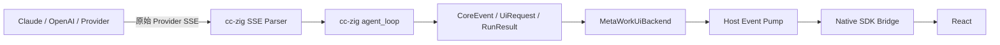
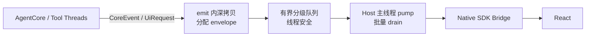
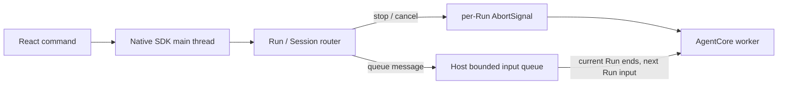

# MetaWork AgentCore 集成契约

> 状态：高层集成约束已确认，容量与具体实现参数待 Phase 0 测量
> 依赖：cc-zig / `metacodes-core`

本文定义 MetaWork Zig Host 与 cc-zig 之间的规范边界。系统整体结构见 [高层架构](architecture.md)，预编译库必须导出的首版能力见 [AgentCore ABI v1 需求规格](agentcore-abi-v1.md)。

## 1. 集成原则

1. cc-zig 是 Agent 结构化协议的唯一来源；
2. MetaWork 不解析模型 Provider SSE；
3. MetaWork 不建立平行的 `AgentEvent` / `WorkbenchEvent` 体系；
4. cc-zig library facade 把内部 `UiBackend` / `UiRequester` contract 暴露为 ABI-safe callback contract，`MetaWorkUiBackend` 实现该 callback contract；
5. MetaWork 只补充产品路由、运行生命周期、所有权和传输 envelope；
6. MetaWork 正式应用只消费 cc-zig 发布的版本化 AgentCore library bundle，不通过 path/Git dependency 直接编译 cc-zig 源码；Phase 0 隔离 packaging spike 是唯一例外；
7. AgentCore 与 Host 同进程或跨进程，不改变 Renderer 看到的产品边界。

### 1.1 library bundle 契约

cc-zig 独立负责构建和验证 `metacodes-core`。MetaWork 的依赖输入必须是一个完整 library bundle：

```text
metacodes-core bundle
├── target-specific static library
├── cc-zig-owned public Zig SDK definitions
└── manifest
    ├── release version
    ├── cc-zig commit
    ├── API version
    ├── exact Zig toolchain
    ├── target / architecture / build mode
    └── artifact checksum
```

规范要求：

- MetaWork 正式应用及其常规 build/test/package 流程不得引用 cc-zig source tree、源码相对路径或 Git source package；
- Phase 0 允许一个明确隔离的 packaging spike 读取本地 cc-zig source tree，其唯一目标是证明 bundle 能被构建和独立链接；spike 不得成为应用 target 的传递依赖；
- 开发 bootstrap：cc-zig 本地构建 bundle 并写入本地 artifact cache；MetaWork 可以从该 cache 解析，但不能指向 cc-zig source tree；
- 正规发布：cc-zig CI 按 release version、target 和 architecture 将同一格式的 bundle 发布到远程 artifact repository，已发布版本必须不可变；
- MetaWork dependency lock 必须记录精确 version/build identity、artifact identity 和 checksum，禁止使用 `latest`、版本范围或可变 tag；
- dependency resolver 根据 lock 和当前 target 从配置的 artifact source 获取 bundle，校验 checksum 后写入或命中本地内容寻址 cache；
- artifact 缺失或校验失败时构建明确失败，不能改走 cc-zig source checkout；
- public Zig SDK definitions 只声明库的正式 ABI 表面，并随 cc-zig artifact 一起发布；它们不是 MetaWork 维护的协议副本；
- ABI-safe 的 event/request/result views、`StopReason`、opaque handles 和回调签名必须来自该 bundle；
- 库实现、Provider SSE、工具和 agent loop 均在 cc-zig 构建中完成，MetaWork 只链接产物；
- binary ABI 使用 C-compatible calling convention 和固定布局类型；不得直接导出 native Zig slice、Zig enum、allocator、error union 或 tagged union，wire enum/tag/status 使用校验后的固定宽度整数 code，由 bundle SDK 包装成类型化 enum；
- cc-zig facade 负责在内部 native `CoreEvent` / `UiRequest` / `RunResult` 与 ABI views 之间转换，并对 enum 使用无 `else` 穷尽 switch；
- 初期 artifact 与消费者仍使用 manifest 固定的同一 Zig toolchain；ABI 稳定性成熟后才评估放宽；
- 只有独立消费工程在不访问 cc-zig 实现源码的条件下完成 link/run smoke test，才算 library bundle 可交付。

cc-zig 内部以 UI-neutral Runtime/Session owner 统一 Provider、Conversation、Workspace、工具权限、PermissionContext、AbortSignal、Run identity 和 callback-failure state。native Zig `pub` 类型仍是源码接口，不视为已交付 binary ABI。正式 v1 只需满足 [ABI v1 消费需求](agentcore-abi-v1.md)；具体内部拆分、导出函数名和 wire layout 由 cc-zig 在真实 consumer 验证后确定。

依赖升级是显式工程变更：修改锁定 version/build identity 和 checksum，获取新 bundle，重新执行 API/StopReason 穷尽编译、link/run、permission、取消和 suspend/resume contract tests。MetaWork 不在普通启动或构建过程中自动追踪新版本。

本地 bootstrap 与远程正式发布必须使用同一 bundle layout、manifest 和校验规则。后续切换到远程只改变 artifact source，不改变 MetaWork 的链接方式和 AgentCore contract。

### 1.2 cc-zig bundle 接收条件

MetaWork 只接收由 cc-zig 构建的 bundle。开发期本地 bundle 与正式远程 bundle 使用同一 layout 和 manifest，至少必须包含：

- 可重复执行的 AgentCore library 构建命令；
- cc-zig-owned public SDK definitions；
- 包含 commit/release、Zig toolchain、target、architecture、API/ABI version 和 checksum 的 manifest；
- 不访问 cc-zig 实现源码的 artifact-only consumer；
- consumer 对真实 agent loop、工具、Host 请求、suspend/resume、`StopReason`、事件 callback 和 abort 的 link/run 证据。

MetaWork 仓库不维护 cc-zig 的 ABI facade、SDK 或打包实现。

cc-zig CLI 二进制不属于该 bundle，也不是 MetaWork 的运行依赖。

## 2. Provider SSE 的归属



cc-zig 负责：

- SSE framing；
- Provider-specific event 解析；
- 文本增量与 tool-call 参数组装；
- usage、stop reason 和重试；
- 工具执行与后续 agent loop。

MetaWork 不包含 Anthropic/OpenAI SSE parser。cc-zig 的 HTTP/SSE `WebBackend` 是参考前端实现，不是 library 强制协议；同进程 MetaWork 不启动本地 HTTP Server 来绕一圈连接 React。

## 3. cc-zig 结构化协议

| 类型 | 方向 | 主要内容 |
| --- | --- | --- |
| `CoreEvent` | Core → UI | `text_chunk`、stream、tool、progress、usage、context、retry、diagnostics |
| `UiEvent` | UI → Core | `interrupt`、`queue_message` |
| `UiRequest` | Core → UI | `ask_question`、`permission`、`plan_approval`、`custom` |
| `UiResponse` | UI → Core | answers、permission choice、plan approval、custom result |
| `RunResult` | Core → Host | `StopReason`、turn/tool count、可选 `SuspendInfo` |

`UiEvent` 是已定义的协议类型，不等于当前 `agent_loop` 已消费它。截止本文版本，cc-zig 生产代码没有调用 `UiBackend.poll()`；MetaWork 当前不能依赖 `poll()` 完成中断或生成期消息注入。

主要源码（相对 cc-zig 仓库根目录）：

- `src/core/protocol/ui_event.zig`
- `src/core/protocol/ui_backend.zig`
- `src/core/protocol/ui_request.zig`
- `src/core/agent_loop.zig`

## 4. MetaWorkUiBackend

`MetaWorkUiBackend` 是 cc-zig backend，不是 Native SDK Adapter。

下列代码表达内部语义 contract，不是最终 binary ABI 函数签名。library facade 在库内构造 native `UiBackend` / `UiRequester`；wire 层暴露固定布局 callback table、opaque handles、固定宽度整数 code 和 pointer+length views，bundle SDK 负责校验 code 并提供类型化 enum。

其核心职责：

```zig
const MetaWorkUiBackend = struct {
    fn emit(
        ctx: *anyopaque,
        session: SessionId,
        event: CoreEvent,
    ) void;

    fn poll(
        ctx: *anyopaque,
        session: SessionId,
    ) ?UiEvent;

    fn request(
        ctx: *anyopaque,
        session: SessionId,
        allocator: Allocator,
        req: *const UiRequest,
        out: *UiResponse,
    ) !RequestOutcome;
};
```

- `emit`：复制并投递 Core 事件；
- `poll`：保留实现 cc-zig vtable，但在 cc-zig 真正接入消费点前不得承载产品保证；
- `request`：处理提问、permission、计划审批和 custom UI；
- 维护 Session 路由、请求标识、运行状态和线程安全；
- 不重新解释或重命名整套 `CoreEvent`。

## 5. Host envelope

cc-zig 的 `SessionId` 位于 backend 函数参数中，不重复嵌入每个 `CoreEvent`。MetaWork 转发给 React 时增加外层 envelope：

```json
{
  "workspaceId": "workspace-1",
  "sessionId": "session-12",
  "runId": "run-8",
  "sequence": 318,
  "timestamp": 1784012345678,
  "event": {
    "tool_start": {
      "id": "toolu_123",
      "name": "Bash",
      "input": "{\"command\":\"zig build\"}"
    }
  }
}
```

其中：

- `event` 保持 cc-zig 语义；
- `workspaceId` / `runId` 属于 MetaWork 产品；
- `sessionId` 来源于 backend 调用参数；
- `sequence` 用于单 Session 排序、重连和诊断；
- `timestamp` 是 Host 观察时间，不替代 sequence。

Host 可以补充 `run.started`、`run.completed`、`run.stopped`、`run.failed`、`run.cancelled`、`run.suspended`、`run.backgrounding`、`run.backgrounded`、`run.interrupted`，因为它们描述一次 library 调用或产品执行转换的生命周期。envelope 必须同时保留原始 `StopReason`；不得为了命名偏好复制全部 Core 类型。

## 6. 跨线程事件泵

### 固定路径



### 所有权

`CoreEvent` 中字符串 slice 通常是 borrowed。`emit()` 返回后可能立即失效，因此禁止：

```zig
queue.push(event); // 错误：保存 borrowed 指针
```

必须在 `emit()` 返回前复制全部逃逸数据：

```zig
const owned = copyCoreEvent(host_allocator, session, event) catch {
    run_control.failAndAbort(.event_copy_failed);
    return;
};
queue.push(owned);
```

队列消费后统一释放 owned event。错误路径、Bridge 失败和 Session 关闭必须覆盖释放逻辑。

### 队列策略

队列必须有界，并避免单 Session 垄断。具体容量由 Phase 0 测量，语义现在固定：

| 数据 | 过载策略 |
| --- | --- |
| `text_chunk` | 按 Session/Run 合并；当前不得丢失字节 |
| `tool_progress` | 可以覆盖同一 tool 的旧进度，只保留最新值 |
| `usage` | 累计合并 |
| spinner/current-tool 状态 | 允许用最新状态覆盖旧状态 |
| `diag_*` | 可按诊断配置采样 |
| `tool_start` / `tool_result` | 不得静默丢失 |
| `UiRequest` / approval | 不得静默丢失 |
| error / cancel / stopped / suspended / backgrounded / completed | 不得静默丢失 |

cc-zig 当前没有携带完整最终 assistant 内容的消息快照事件。因此丢弃 `text_chunk` 会永久破坏回复，只能合并、短暂阻塞或显式失败。

为控制事件预留容量。队列仍无法接收控制事件时，可以短暂阻塞 producer；超过上限后显式终止当前 Run 并记录错误，不能伪装成功。

`emit()` 返回 `void` 表示没有显式可失败反压协议，不表示 Backend 不能通过同步阻塞形成有限反压。

### 失败反向注入

事件泵失败不能只改 Host 状态；同步运行的 `agent_loop` 必须被要求停止。每个 in-flight Run 持有独立的控制对象：

```text
RunControl
├── abort: AbortSignal
└── fatal_reason: atomic optional HostFatalReason

emit copy OOM / control queue timeout / unrecoverable bridge pipeline failure
  → first-writer wins: set fatal_reason
  → abort.abort(host failure reason)
  → agent_loop 在检查点返回 stop_reason=.aborted
  → Host 先检查 fatal_reason，再映射为 run.failed
```

cc-zig 内部如何表示 Host failure 可以演进，但 ABI 必须保留可区分的原因。Host 同时保留结构化 `fatal_reason` side channel，用于记录具体基础设施故障并把 `.aborted` 映射为 `failed`，禁止误报成用户取消。

### 主线程边界

AgentCore 和工具线程不得直接操作 WebView。Native SDK Bridge 调用只发生在 Host/UI 事件循环。主线程 pump 以批量方式 drain，避免每个 token 单独触发一次 Bridge 调用。

`UiResponse` 和 Workbench command 使用线程安全通道进入对应 Run/Session。Bridge handler 不同步运行长耗时 agent loop。`UiEvent` 的当前限制与替代路径见下一节。

## 7. 反向控制与 Host 中断

### 当前有效路径



- Stop/cancel 直接对目标 Run 的 `AbortSignal` 做原子中断，不经过 WebView 回调或 `UiBackend.poll()`；
- 生成期间提交的 `queue_message` 先进入 Host 的 Session 输入队列，当前 Run 结束后合并或按产品规则启动下一 Run；
- Host 输入队列按 Session 同时限制条数和总字节数。满载时 Bridge command 必须显式拒绝或让调用方重试，不能无限增长或静默丢弃；
- interrupt 是每 Run 的幂等原子状态，不进入普通 FIFO，也不会被低优先级消息阻塞；
- `UiResponse` 通过 request ID 路由，不与普通 `queue_message` 共用无类型缓冲区。

### `UiBackend.poll()` 的启用门槛

只有 cc-zig 在真实 `agent_loop` 检查点调用 `poll()`，并完成顺序、所有权、中断优先级和阻塞调用测试后，MetaWork 才能把 `UiEvent` 用作运行中反向通道。启用时仍必须满足：

- `interrupt` 采用原子/合并语义，优先于普通消息；
- `queue_message` 队列有 count 与 byte 双上限；
- poll 返回的 owned slice 在 Core 消费后严格释放；
- 中断、HTTP stream、长工具和 Run 边界都有可复现检查点测试。

在此之前，文档和 UI 不得宣称支持“通过 `UiEvent` 实时 steering 当前 Run”。

## 8. UI 请求与恢复语义

cc-zig 当前存在两条不同路径。

### 可挂起路径

以下请求可返回 `.pending`：

- `ask_question`
- `plan_approval`
- `custom`

对应流程：

```text
UiRequester returns .pending
  → tool returns error.UiPending
  → agent_loop returns stop_reason=.suspended
  → RunResult.suspend_info
  → Host persists transcript + SuspendInfo
  → UI response arrives
  → Host calls resumeRun
```

`.suspended` 是明确 checkpoint 边界。响应必须校验 Session、Run、request/tool-use ID 和当前状态，拒绝过期或重复响应。

### 单挂起点限制

cc-zig 当前每个 turn 只支持一个可恢复挂起点：

- 同一 turn 出现多个返回 `.pending` 的 UI 工具时，只有第一个写入 `SuspendInfo`；
- 其他 pending 工具被转换为 `ConcurrentSuspendUnsupported` error result；
- MetaWork UI 每个 Run 只展示一个 active resumable request，不制造多个可同时响应的审批框；
- 该限制只针对 `ask_question`、`plan_approval`、`custom` 等可挂起请求，不包含下面的同步 permission。

### subagent 限制

cc-zig 当前只在 `agent_depth == 0` 时向 `ToolContext` 注入 `UiRequester`。MetaWork Phase 0 固定以下行为：

- 只有顶层 Run 可以进入可恢复 UI 挂起；
- subagent 不得发起可挂起 UI 请求；
- subagent 请求此能力时必须得到明确的 unsupported/unavailable tool error，不能等待、伪造成功或形成不可恢复的 `.suspended`；
- 将来若允许 subagent 挂起，必须先定义父子 Run 的 request routing、checkpoint、恢复顺序和取消传播。

### 同步 permission

普通工具 `permission` 当前是 execute 前的同步门：

- 只有 `.answered` 继续使用响应；
- `.pending` 当前不会生成 `SuspendInfo`；
- 无可用 TTY 的 GUI 路径安全 deny；
- 同步等待期间发生 Host/Core crash，原生调用栈无法恢复。

MetaWork 当前语义：

```text
crash during permission wait
  → Run = interrupted
  → pending permission invalidated
  → tool remains not executed
  → user explicitly retries or starts a new Run
```

若将来要求 permission 跨重启恢复，必须扩展 cc-zig suspend contract，并处理 stale approval、重复执行和 tool-use/tool-result 配对，不能只在 React 中保留一个审批框。

## 9. Run 生命周期

`stream_done` 只表示一次模型流结束，不等于整个 agent run 成功。Host 必须结合：

- `RunResult.stop_reason`；
- `RunResult.suspend_info`；
- `agent_loop.run()` / `resumeRun()` 返回的 error；
- abort 和 Host shutdown 状态。

Host 使用稳定状态加原始 `StopReason`，而不是重新定义九套 Core 枚举：

```text
run.started
run.completed
run.stopped
run.failed
run.cancelled
run.suspended
run.backgrounding
run.backgrounded
run.interrupted
```

### StopReason 穷尽映射

| cc-zig `StopReason` | Host 状态 / 转换 | UI 语义 | 恢复或继续方式 |
| --- | --- | --- | --- |
| `end_turn` | `completed` | 本次 Run 正常完成 | 无；下一次用户输入创建新 Run |
| `max_turns` | `stopped`，Session=`awaiting_user` | 达到防呆轮数上限，任务可能未完成 | 用户确认或调整方向后创建新 Run |
| `aborted` | `cancelled` / `interrupted` / `failed` | 由 user cancel、Host shutdown 或 Host fatal 原因决定 | 不调用 `resumeRun`；按原因重试或新建 Run |
| `tool_error` | `failed` | 当前 Run 因不可恢复工具错误停止 | 修正后创建新 Run |
| `api_error` | `failed` | Provider/API 重试耗尽或请求失败 | 重试时创建新 Run |
| `tool_loop` | `stopped`，Session=`awaiting_user` | 重复无效动作熔断，不伪装完成 | 用户调整方向后创建新 Run |
| `suspended` | `suspended` | 存在一个有效 `SuspendInfo` 和待响应 UI 请求 | 校验响应后对同一 Run 调用 `resumeRun` |
| `backgrounded` | `backgrounding` → `backgrounded` / background Run running | 当前 library 调用已返回，但产品任务未完成 | 深拷贝 Conversation 并成功启动后台执行；失败则保留前台状态 |
| `budget` | `stopped`，Session=`awaiting_user` | 成本闸触顶，等待用户明确决定 | 提高/确认预算后创建新 Run，禁止自动继续 |

实现必须先由 bundle SDK 校验 raw code，再直接 switch SDK 导入的类型化 cc-zig enum，且不写 `else`：

```zig
return switch (result.stop_reason) {
    .end_turn => ...,
    .max_turns => ...,
    .aborted => ...,
    .tool_error => ...,
    .api_error => ...,
    .tool_loop => ...,
    .suspended => ...,
    .backgrounded => ...,
    .budget => ...,
};
```

`.aborted` 的 Host 映射必须检查 `RunControl.fatal_reason`、用户取消记录和 shutdown 状态。`.backgrounded` 只有在 Conversation clone 与后台执行启动都成功后才可发布成功转换；不能在收到 stop reason 时立即标记 completed。

取消不能只是停止 React 渲染。只有 AgentCore 已确认 abort/stop 后，Run 才进入终态。

### cc-zig 契约版本

MetaWork 固定明确的 cc-zig commit。当前 cc-zig `doc/LIB_API.md`、`doc/CORE_REFERENCE.md` 与源码的 `StopReason`、Session 参数和 `UiRequester` 签名存在漂移，因此：

- 构建直接导入 cc-zig 类型，不复制 enum 或 vtable 签名；
- 用上述无 `else` switch 作为编译期变更探针；
- Phase 0 保存实际 commit、导出类型检查结果和 contract smoke test；
- cc-zig 对外文档未同步前，不把文档示例当作比编译器类型更高的事实来源。

## 10. Shell 与终端边界

MetaWork 已脱离终端协议，但 AgentCore 仍可执行 shell 子进程。

| 能力 | 默认 Bash 工具 |
| --- | --- |
| shell child process | 使用 |
| stdout/stderr pipe 或文件 | 使用 |
| Terminal Emulator | 不使用 |
| PTY / ConPTY | 普通命令不使用 |

当前 cc-zig POSIX 路径通过 `/bin/sh -c` 执行，捕获 stdout、stderr 和 exit code；后台任务重定向到文件。Windows 兼容实现应使用隐藏的非交互 shell 子进程和 pipe，不弹出控制台窗口。

`vim`、`top`、交互式 REPL、需要 TTY 的 SSH 等不属于默认 Bash 工具能力。第一阶段明确拒绝或限制。未来若需要交互式终端，应作为独立 `TerminalTool` + PTY/ConPTY 加入，不得重新成为整个 Agent 通信层。

cc-zig Bash 源码（相对 cc-zig 仓库根目录）：`src/tools/bash.zig`。

## 11. 进程模型的传输影响

同进程：

```text
Host → metacodes-core library call
CoreEvent → UiBackend callback / queue
```

独立 Worker：

```text
Host → structured IPC command → Worker
Worker → structured IPC event → Host
```

Renderer 始终面对 Host 的领域命令与 envelope。进程模型变化不得让 React 直接绑定 Worker、Provider SSE 或 cc-zig 内部内存。

IPC framing 尚未锁定。无论使用长度前缀帧、NDJSON 或其他方案，都必须定义最大消息、关联 ID、版本、队列上限、断连和未完成 Run 语义。
