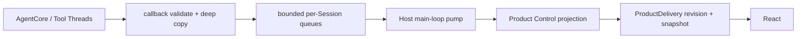

# MetaWork AgentCore 集成契约

> 状态：消费 canonical AgentCore exact bundle；artifact identity 见各 target repository lock，target availability 与真实 vertical 结果见验证规范
> 目标依赖：Metask AgentCore ABI v1；接受和安全消费规则见 [AgentCore ABI v1 合同](agentcore-abi-v1.md)

本文定义 MetaWork Agent 执行边界与 Metask AgentCore 之间的规范合同。Agent 与 Product 并列，Application 管理其生命周期，Product Control 直接消费其公共执行表面。顶层模块与故障域见 [高层架构](architecture.md)，Product owner 及其与 Agent 的协作见 [Product 架构](product-architecture.md)，Bridge transport 见 [Renderer Bridge 合同](renderer-bridge-contract.md)，ABI 接受边界见 [AgentCore ABI v1 合同](agentcore-abi-v1.md)。

## 1. 集成原则

1. Metask AgentCore bundle SDK 是 AgentCore canonical typed protocol 的唯一来源；
2. MetaWork 不解析 AgentCore Run 的 Provider SSE；独立 Agent-owned Completion 的封闭 codec 不属于 AgentCore 集成协议；
3. MetaWork 不建立平行的 `AgentEvent` / `WorkbenchEvent` 体系；
4. MetaWork 正式 Agent module 只使用 bundle typed SDK 和 binary ABI；
5. AgentCore/tool callback 不直接调用 WebView；
6. MetaWork 只补充产品路由、生命周期、所有权、传输 envelope 和安全校验；
7. Agent 统一拥有固定 built-in 集合和固定 `GenerateImage` Host Tool，工具声明不随登录、模型选择或 Run readiness 变化；
8. 当前 UI request 是同步调用，不伪装成 async suspend/resume；
9. 进程模型变化不得改变 Renderer 看到的产品边界。

## 2. Bundle 消费合同

MetaWork 的依赖输入是一个完整 bundle，而不是 AgentCore 实现源码。精确 artifact identity 与 payload whitelist 由各 target repository lock 和 bundle manifest 定义，[AgentCore ABI v1 合同](agentcore-abi-v1.md)定义其接受规则；本文只定义 candidate、staging、build graph 和 Host 生命周期。

### target-specific 开发期 bootstrap

- Metask AgentCore 独立构建并测试 target-specific bundle，candidate 来自本机上游构建的 target-specific bundle root（包括从精确 archive 解包并核验的 root）；
- candidate probe 与 `stage-agentcore-bundle.mjs` 使用显式绝对 bundle root；正式 build/test/package 只消费 resolved target 对应的 `.agentcore/bundles/<target-id>` 及其中的官方 Zig package；
- repository lock 按 target 保存完整 manifest，锁定 package/source、target、toolchain、ABI version/revision、root table size、link inputs 和所有 payload checksum；required surface 由 exact root 与 mandatory child table layout 定义，缺少对应 artifact 必须失败；
- stager 只复制 manifest whitelist；捕获到的复制/rename 错误必须恢复旧 canonical bundle。当前内部开发不承诺跨进程 crash transaction 或并发 build/stage，强制中断后的残留由再次执行 stage 清理；
- staged bundle 在正式 build 前由 MetaWork verifier 再校验；官方 Zig package 只负责 module/link graph，不承担 repository lock 和 checksum 信任政策；
- 由于 Zig 会在执行 root build verification 前解析 staged path dependency，正式 `dev/check/test/build/package` 必须先运行轻量 `verify-staged-agentcore-bundle.mjs` preflight，给出明确的缺包或 lock mismatch 错误；Zig build-time verifier 仍负责最终 build correctness；
- 常规 build/test/package 不访问 AgentCore 实现源码或外部 `zig-out`；
- artifact 缺失、target 不匹配或 checksum 错误时明确失败；
- 禁止 path/Git source dependency、源码复制、`latest`、版本范围、可变 tag 和 source fallback。

stager 与 verifier 根据 manifest target 选择显式 target policy 和 exact lock，只接受 [ABI 消费合同](agentcore-abi-v1.md)定义的精确 manifest、revision 与 table layout。官方 SDK继续精确验证五个 mandatory child table。未知 target 必须失败；Linux 后续通过新增独立 policy/lock 接入，不提供 generic fallback。MetaWork 不保留任何旧 revision 的 function table、类型别名、兼容 parser 或 fallback。

当前内部初步开发不实现 dependency resolver、content-addressed cache、artifact repository 或跨机器自动分发。这个限制意味着开发 checkout 需要本机 Metask AgentCore 构建输出；它是明确的开发期前提，不得伪装成公司发布方案。

### candidate validation 与正式 Agent module

candidate probe 只用于证明锁定 artifact 与官方 Zig package 可以 source-free discover/link/run。该 probe：

- 只通过 bundle 的官方 `bindings/zig` package 消费 AgentCore；
- 不能进入正式 Host target；
- 不能成为产品状态映射或 UI JSON 解析实现；
- 不能注册到 React/Native SDK 正式链路；
- 不维护上游 ABI facade 或 SDK 行为的平行测试套件。

当前 bundle 还提供 Session prompt profile、per-Run context blocks、typed `prompt_manifest` 和 `describe.prompt`；Agent 使用固定 Session 产品身份 profile，并按下面定义的输入范围消费 Host 时间上下文；当前产品不开放用户 customization、不建立 Renderer 入口或持久投影，其 ABI 消费见 [AgentCore ABI v1 合同](agentcore-abi-v1.md)。当前 bundle 提供完整 typed status、八个 StopReason、known/unknown observation decoder、结构化 `CoreEvent.run_state`、Permission provenance、`UiRequest` decoder、request-aware `UiResponse` encoder、Skill/MCP catalog decoder、Session description/restore/checkpoint entry、idle-only Session model mutation、Runtime MCP configuration apply，以及 callback-scoped validated `RunContext`。正式 `agent/` 直接使用官方 `bindings/zig` package 暴露的表面，Product Control 只保存受限运行时投影；MetaWork 不手写 raw enum、tag switch、identity layout、Permission/Skill/MCP schema 或 SDK module/link graph。

公开 observation 的消费边界如下；“持久化”均指 Product Task 派生事实，不保存 raw CoreEvent：

| CoreEvent                  | Product Task 消费                                                                                                                                                      | 持久化边界                                                                         |
| -------------------------- | ---------------------------------------------------------------------------------------------------------------------------------------------------------------------- | ---------------------------------------------------------------------------------- |
| `output_segment_begin/end` | 校验 index/turn/group/bytes，驱动 group 定性                                                                                                                           | 保存 final/partial 分类与安全 assistant 正文起点                                   |
| `text_chunk`               | 写入当前 open segment                                                                                                                                                  | 已闭合可见 group 进入既有 assistant history                                        |
| `thinking_chunk`           | 只更新安全状态                                                                                                                                                         | 不保存 reasoning 正文                                                              |
| `stream_done`              | 更新为 Finishing，不作为完成信号                                                                                                                                       | 仅现有安全状态                                                                     |
| `retry_notice`             | 更新 typed retry activity；后续有效 forward activity 或 terminal 使其失效                                                                                              | 不持久化                                                                           |
| `tool_start`               | 建立/更新 Tool record                                                                                                                                                  | 随 Run history 保存                                                                |
| `tool_progress`            | 按 tool identity 更新进度                                                                                                                                              | 随 Run history 保存                                                                |
| `tool_result`              | 完成 Tool record 与 file reference 投影                                                                                                                                | durable boundary                                                                   |
| `file_changes`             | Agent typed decode 后由 Product 显式消费；Agent 保留每条 kind/status/locator/bytes/diff/depth 与 event-level overflow/lost，Product 建立 Run-owned bounded observation | 只接纳 applied/partial，全部 agent depth 同等归属当前 Run；不从 Tool/Bash/Git 反推 |
| `run_state`                | 受 transition sequence 保护的 runtime observation                                                                                                                      | phase observation 不持久化                                                         |
| `progress`                 | 更新 executing-tools 状态                                                                                                                                              | 仅现有安全状态                                                                     |
| `usage`                    | checked delta 累计                                                                                                                                                     | 随 Run history 保存                                                                |
| `context_warning`          | 更新当前 attached Conversation 的 context pressure                                                                                                                     | 不持久化，不跨 attachment                                                          |
| `auto_compact`             | 清除 pressure 并记录当前 Conversation 最近一次 compact observation                                                                                                     | 不持久化，不跨 attachment                                                          |
| `permission_provenance`    | 更新 Run/UI permission summary                                                                                                                                         | 随对应 UI history 保存                                                             |
| `prompt_manifest`          | Agent 使用官方 typed decoder 校验并有界消费；Product 显式忽略，不改变 Task/Run 状态 | 不持久化、不投影 |

unknown observation 继续走官方 unknown 分支并被忽略，不由 MetaWork 猜测其 payload。

### MetaWork module boundary

- `src/agent.zig` 是 Agent 执行层的 named module root；
- `src/agent/` 直接消费唯一 `metask_agentcore` module，不得 import Product Control、Bridge 或 `metawork_app`；
- Application 不直接 discover AgentCore ABI；`agent.Runtime.init()` 在 Agent 边界内完成 bundle SDK discovery，raw function-table injection 只保留给隔离测试；
- Product Task 只通过 `product/task/agent_session.zig` 的线性 `Binding`/`Access` 协调 `metawork_agent` Session/Run，并消费 SDK-validated `OwnedCoreEvent`/UI types；组合层不保存裸 Session 或 restore route，这不是复制一套 `AgentEvent`/UI schema；
- Bridge DTO 使用 Bridge-owned transport enum，由 Bridge 解码为 Product Control-owned `UiResponse`；Product Control 调用 Agent 的 validated response type，只有 Agent 内部把它映射为 SDK `UiResponse`，任何边界都不返回 SDK enum、owner 或 handle；
- Product Task 的 `RuntimeAttachment` 只持有 `agent_session.Binding`：Agent Runtime 始终拥有真实 Session allocation/slot，Task 拥有唯一使用与归还责任。每个 Run/Compact worker 或同步观察以 `Access` 调用 Agent 公共 API，`Access` 只覆盖实际 Session 操作区间、复用 Session `active_refs` 并 exactly-once 释放；开始关闭后 Binding 被线性移入 close-worker 独占槽，主线程只保留 immutable route id 供已入队 event drain，且只在 join 后读取关闭结果、恢复 owner 或记录 Runtime shutdown relinquish；组合层不得读取或操作 Session internals、AgentCore handle 或 callback state；
- Agent 不解析或查询 Account 当前状态；Account/Application/Product Control 先解析并在受控生命周期内转移 execution-scoped `ExecutionConfig`，Agent 只消费该已解析配置创建或重绑定 Session；
- `src/main.zig` 只进入 `metawork_app`，不能绕过 Application 组装低层模块；
- Executor、queue 与 workers 归 Product Control 独占，Agent Runtime 不接收 Scheduler capability。持久 Scheduled Task 的 recurrence、触发游标、wall clock、timer、恢复和 occurrence admission 同样只归 Product Control；Application 只注入 store/timer/notification/tray 平台能力。到期后必须先创建真实 Task，再由同一 Executor 进入 Agent Run。Agent active Run 只保留 first-writer-wins `TerminationSignal`，并通过 immutable `TerminalResult` 向 Product Control 提交 terminal facts；Session snapshot 不保存 Schedule 或 occurrence 历史结果。

## 3. 当前协议表面

| 类型              | 方向        | 当前 ABI v1 语义                                                                                                                     |
| ----------------- | ----------- | ------------------------------------------------------------------------------------------------------------------------------------ |
| `RunContext`      | Core → Host | callback-scoped borrowed identity；包含 Session handle、run ID 和稳定 session ID                                                     |
| `CoreEvent` JSON  | Core → Host | callback-scoped borrowed bytes；与同次 callback 的 `RunContext` 绑定                                                                 |
| `UiRequest` JSON  | Core → Host | 同步 callback 请求；与同次 callback 的 `RunContext` 绑定                                                                             |
| `UiResponse` JSON | Host → Core | 同一 callback 内 answered response；或 unavailable/fatal                                                                             |
| ABI status        | Core → Host | function 调用层错误，独立于有效 Run 结果                                                                                             |
| `RunResult`       | Core → Host | status OK 时完整有效；两个 input counts 在所有已定义返回状态有效；checkpoint budget pre-admission status 另定义 budget 字段                                                      |
| abort             | Host → Core | 按 Session/Run 的 user/timeout 中断机制                                                                                              |
| manual compact    | 双向        | Host 分配严格递增 operation ID；Core 返回 typed compact result                                                                       |
| compact abort     | Host → Core | 只按 active compact operation ID 请求取消，不等待 provider I/O response                                                              |
| Skill descriptor  | Core → Host | query-scoped owned bytes；由 SDK 解码后立即释放                                                                                      |
| Skill catalog     | 双向借用    | Runtime query 返回 opaque lease；Session create/idle update 同步借用并保留 Host 引用，最后一个引用释放时才调用 Core release |
| Skill policy      | Host → Core | fresh create 与 idle update 提交完整 replacement；冷恢复为 null；同进程恢复使用原 pinned catalog 与精确默认拒绝 grant 集合，可按当前 ceiling 收缩 |

MetaWork 不调用 `UiBackend.poll()` 注入输入。Agent 对已开始的普通 Run 提供 typed `RunControlLease.submitInput`；generation、输入窗口与提交调用登记由同一 Session lock 校验，SDK 在锁外调用。只有 validated Core starting observation 才开放输入；关闭窗口与登记同锁，Run 收尾须等待已登记提交、callback 和 abort 静止后才能进行 checkpoint 或下一次 Core 操作。lease 只保证对象存活，不代替调用静止屏障。输入关联只保存有界 identity、receipt 与采纳事实，不保存稍后投递的文本。Product 的输入交互及后续 Run 准入由 Product 合同定义，Agent 不调度后续 Run；停止沿已有 abort 路径。

当前 ABI `RunResult` 不包含 `SuspendInfo`、resume token 或 background handle，但包含 checkpoint outcome、durable usage、required checkpoint bytes 与两个 budget stop。unknown status、stop reason、checkpoint outcome、result flag 或不一致组合在 Host validation 层 fail closed；Host 不能制造这些产品状态。

当前锁定合同的公开 Runtime/Session surface 包含 fresh create、checkpoint export/restore、Session description、typed Run/abort、manual compact、MCP catalog/selection、Runtime MCP configuration apply 与已列出的 mutation；相邻的独立 Completion surface 是 MetaWork-owned 能力，AgentCore ABI 不包含 Completion entry。Custom Provider probe 只创建短寿命 Completion，通过一次有界、可取消的 buffered HTTP 请求取得最终 JSON；watchdog 可以在线程外请求整次调用取消，调用与 watchdog 都返回后才能销毁 Completion。只有成功结果的 `end_turn` 表示连接成功，其他 stop reason 是 Completion 路径下的 provider rejection，不冒充 Session Run 的 turns/tool-calls 判定。`agent/mcp/connector.zig` 已建立 Host transport capability 到官方 `McpConnectorV1` 的唯一映射；每个 `McpServerV1` 携带由 Product Control canonical runtime descriptor 计算的非零、非 secret `configuration_fingerprint`。Runtime 线性接收完整 server descriptors、持有 adapters，并通过 `McpApi.applyConfiguration` 应用完整 replacement：Host 串行化 apply/refresh，验证 typed report，APPLIED 时交换当前 Servers owner并更新 registry generation；旧 Servers owner进入有界 retired 集合，只有 AgentCore retain 与 active connection 都归零后才回收，仍被既有 Session 使用的 owner 最迟由 Agent Runtime 销毁统一释放。产品不调用 `McpApi.updateSelection` 热替换既有 Session；Product Control 只用新 activation/selection更新后续新 Task 的 Admission Authority。Agent 不拥有 Desired Registry、Runtime Manifest、mutation transaction 或 Task admission。真实 MCP tool execution继续走既有 AgentCore Run；Renderer 不解码 AgentCore schema。 当前锁定合同的 `request_tool_stream` 是唯一 MCP `tools/call` callback；Host 把完整 response 从 byte zero 写入 borrowed sink，sink、取消、上限或 secret 校验失败均 fail closed。Session Host config 显式使用 ephemeral active-Run journal；durable journal 与 process-plugin/Host stream-tool authority当前均未开放。

Agent 复制官方 MCP catalog 的 `fresh` 与 `ttl_remaining_ms` 作为产品无关 freshness fact；Session create 的官方 `mcp_not_refreshed` 只在无返回 handle 的合法拒绝形态映射为 `McpNotRefreshed`，Session restore 的同一 typed status 只在空 report、无返回 handle且 cleanup 完整的合法拒绝形态保留为相同错误，其余非 ok/handle/report 组合仍 fail closed 为 ABI contract failure。

`agent/checkpoint.zig` 独占流式 export 与 typed Session description；`agent/checkpoint_restore.zig` 独占 source callback、restore config/report、post-restore description 与 expectation 对账。Product Control 持久化 opaque blob 和无 secret `CheckpointRecord`；冷启动恢复把经过 size/hash 再校验的 source、精确 Workspace/ExecutionConfig 与 null Skill catalog/policy、null MCP selection、null durable permission rules交给 Agent。AgentCore 可以返回 complete 或 degraded 的有效 Session；二者都保留同一 Conversation，degraded report 精确说明被安全失效的可选 authority。restore 不读取私有 transcript，不从 CLI 行为推断 resume，也不在 `agent/` 外复制 ABI。

`Runtime.restoreSessionRoute` 按 catalog query 的既有并发范式工作：在 `sessions_mutex` 内预留 Session slot 并递增 active restore count，解锁后执行可能流式读取整个 checkpoint 的 ABI 调用，返回后重新加锁对账并在 shutdown 已开始时拒绝安装。`Runtime.shutdown()` 自己等待 restore、catalog 与 MCP in-flight 调用归零，然后关闭 Sessions、检查 catalog leases 并调用 `RuntimeApi.destroy`；Product Control/Application 的正常关闭顺序不能替代这条 Agent-owned fence。

同进程 MCP 恢复输入由 Agent owner 保管：Session create/restore 及成功的 idle MCP selection replacement 同步复制原始精确 selectors 与相关连接的 configuration fingerprint、稳定 identity 和 namespace；失败的 replacement 保留原输入。调用方只取得可独立释放的 opaque owned 副本，可跨原 Session close/release 持有，不包含 Core handle、schema 或 credential，也不进入 Product history、Bridge 或 Snapshot。Runtime 在当前合法 activation 下重验该 Runtime owner 和原连接来源，再按原 selectors、当前目录及当前允许工具求交集，重新构造合法 selection；不修改旧 generation，不借用新任务的完整 selection，不增加新增工具。无关目录刷新不单独撤销恢复资格；相关连接来源改变或消失必须在关闭旧 Session 前明确拒绝，不能仅依赖 Core restore report 的 complete。工具缺失或授权收缩可形成显式空/更窄 selection，schema 与历史权限的兼容和失效由官方 Core restore report 判断；null 原选择仍为 null，不从全局 MCP 设置补齐。

Session.captureRestoreInputs 在 idle 锁内一致捕获 Skill、MCP 和权限输入。权限 mode 从官方 typed Session description 读取，shell policy 和交互方式来自该 Session 原始 Host 配置；成功的权限 mode mutation 后捕获实际新值，不从当前全局默认推断。Host 不复制 session allow/deny 或一次性批准；session 规则只随 Core checkpoint 恢复。捕获输入为线性进程内 owner，跨原 Session close/release 持有，deinit 消费全部引用；不写 history、Snapshot 或 Bridge。Skill 引用释放失败仍沿原 catalog 消费合同报告；关闭保留真实 Session owner 以待既有 close retry，不能为了清理引用跳过 Runtime fence。

Agent-private STDIO/Streamable HTTP backend 只通过 Application 注入的 bounded process/network capability 执行 effect。Agent 拥有 STDIO newline framing、HTTP MCP headers/status/media-type/session 规则、JSON body bound 与 SSE 帧还原；Application endpoint 只保留 child/pipe/connection 生命周期、原始字节泵、timeout/cancellation，并在 401/403 时记录合法 Bearer challenge。完整 request response（包括 401/403、400 与 5xx）的 status/body 继续进入 Agent sink，由 connector 作为 transport observation 交给 AgentCore；没有 response descriptor 的 notification 仍把 401/403 收口为 auth failure。effect connection 与 reader 不跨边界转移，Application 只在同步 callback 期间把 borrowed byte slice 交给 Agent-owned sink。OAuth mechanics 与 ref-counted HTTP auth snapshot 不进入 Agent。同一 OAuth consent epoch 的 HTTP token revision 只替换 Application auth snapshot，不改变 Runtime descriptor 或既有 Session selection；运行时授权拒绝只通过 Product Control Admission Authority 收缩后续新 Task 的 authority。Agent 不拥有授权事务，Application 也不把 token 或 raw challenge 传播进 AgentCore 协议。

MetaWork MCP Host 工程接线不得改变上述协议 owner。正式 Runtime 以 canonical empty MCP configuration 创建；恢复出的 Desired 只在 Product Control 与 Application coordinator 就绪后构造 `McpRuntimeInput`，通过官方 `McpApi.applyConfiguration` 完整替换并执行 activation。empty create 后 apply 不是失败 fallback 或第二条 Runtime path，AgentCore `RuntimeApi.create` 仍只调用一次、plugin config 固定为 null，并在失败时终止 Application。Product Control preparation 只把 enabled、配置有效、connection-approved 且 credential/consent-ready 的 owned server input 线性转交 Agent；其他状态保留为 Product Control 产品事实与 Runtime Manifest absence proof。Add/Replace 在用户提交前不得连接网络、启动 child、读取 credential 或打开 browser；提交成功后 `testConnection` 可以对唯一目标构造短寿命候选 Runtime，真正执行 official refresh/activation。候选 Runtime 与正式 Runtime 使用同一 Agent owner/API 和同一有界 connector，实现不解析 MCP JSON-RPC；它最多一个 session，不创建产品 Session，不安装 Manifest/Admission，并在 completion/shutdown 后完整释放。`McpRuntimeInput` 以失败零消费、成功全接管的方式持有 backend owner、adapter、official descriptor、稳定 id→binding identity 与 allowlist。Activation 不包含 raw issue detail、schema、fingerprint、transport 或 credential。initial apply 前创建的 Session 同步复制 null MCP authority且不热替换；apply 完成后只有新 Session 取得新 selection。

当前 canonical bundle 提供 `2026-07-28`、`2025-11-25` 与 `2025-06-18` negotiation policy、typed MCP auth/transport health、catalog/selection 与 tool execution，但不提供 OAuth discovery、PKCE、registration、browser/callback 或 token API。`automatic` 可以协商并 exact reopen 到三个 era 之一；这不构成对旧 AgentCore ABI revision 的兼容。Modern disposable probe 收到完整 HTTP 400 时，MetaWork 保留 status/body，AgentCore 才能判定是否进入 Classic；probe connection 永不升格或与 actual connection 共享 session。OAuth 缺口不要求 AgentCore ABI 扩展：OAuth 是 Streamable HTTP 在产生 preauthorized capability 前的 Host transport authorization，由 Product Control 持有产品状态、Application 执行标准 effect。Product Control 只有在目标 transport 的 approval/auth facts 完整且 secret 满足 Application-owned runtime limits 时才发布 `eligible`；Agent-owned HTTP backend 按成功 response 的 media type 严格分流 JSON 与 event-stream，对非 2xx body 只做有界原样收集，并把 response observation 交给 AgentCore，不解析 JSON-RPC identity 或 MCP 语义。

Product Control 首个 Run 后的 Task 标题生成也只消费 Agent-owned 公共 Completion surface：它复用 Task admission 已固定的 ExecutionConfig，创建短寿命 Completion 并执行一次可取消的非流式请求；该元数据请求不创建新的 AgentCore Session、Run history 或 Conversation，失败只由 Product Control 执行本地标题回退。

## 4. Agent binding

Agent binding 是 Metask AgentCore 的 ABI 消费者，不是 Native SDK Adapter。它直接持有 bundle SDK API table 和 opaque handles。

### Event callback

```text
AgentCore/tool thread
→ SDK validates RunContext layout and borrowed session ID
→ Host atomically binds/compares Session handle + active run ID + stable session ID
→ SDK validates bytes/tag/payload as known or owned unknown observation
→ unknown observation: Host releases the SDK owner and returns continue
→ known observation: Host deep-copies escaping bytes
→ attach workspace/session/run routing envelope
→ push bounded test sink/event pump
→ return CONTINUE or FATAL
```

约束：

- callback bytes 默认只在返回前有效；
- `RunContext` 及其 session ID 也只在 callback 内借用，禁止保存 slice；
- Session handle、active run ID、Session-lifetime session ID 的首次绑定/比较与 callback ref admission 必须在同一 Session lock 内完成；
- invalid layout、错误 handle/run ID、同 Run 或跨 Run session ID 漂移均为 dependency contract failure，返回 fatal 并 poison Session；
- 整段 `CoreEvent` / `UiRequest` JSON 必须先通过严格 UTF-8 校验；官方 typed decoder 返回后，所有进入产品 projection 的文本字段还必须逐项验证，拒绝由合法 JSON byte array 解出的非 UTF-8 `[]u8`；校验和深拷贝必须在 callback 内完成；
- callback 可能来自不同 Session 的并发线程；
- 同一 Run 的事件顺序必须保留；
- 无法验证、复制或接收关键事件时返回 callback fatal；
- valid unknown observation 在 SDK 完成结构、ownership 和 byte-bound 校验后立即释放并忽略，不占用产品事件泵，不得传给 Renderer 或猜测为产品状态；
- callback 不等待 WebView，也不调用 Session destroy 或 re-enter Run。

初始验证先把正式 Host 连接到 FIFO bounded test sink，再替换为 per-Session/global count+bytes、control reserve 和 deadline 受限的 Event pump。当前正式 AgentCore→Product Control projection→Native SDK Bridge→React 垂直链路持续验证同步权限、Renderer reload、终态和异步 Session close；Agent 层另以固定 Runtime/Session allowlist 证明 AskUserQuestion 未向 MetaWork Agent 开放。持续回归要求见 [验证规范](validation.md)。

### UI request callback

```text
Core calls synchronous UI callback
→ SDK validates RunContext and UiRequest
→ Host atomically validates the same full Session/Run identity tuple
→ enqueue control item
→ callback waits on Host-owned condition/channel
→ response / cancel / close / shutdown
→ SDK encodes a response into Host-owned bytes when one was supplied
→ under the Session lock, recheck identity/dependency-contract health
→ transfer answered bytes, or free them and return unavailable/fatal
```

Bridge handler 只写入 response channel，不同步等待 AgentCore。callback wait 仍占用 Run executor slot。

callback admission 只建立 lifetime 与当时的 identity 事实，不保证等待期间不会有另一个并发 callback 发现 identity 漂移。因此 Host 在发布 UI request 前和最终提取 response 的线性化点都必须在同一 Session lock 下重新检查现有 Core identity 与 dependency-contract 状态。检查失败时返回 UI fatal；如果 Renderer response 已完成编码但 ownership 尚未转移给 Core，Host 必须自行释放，禁止返回 answered。

当前锁定 ABI 的 `UiRequest` / `UiResponse` 只有 `ask_question`/`answers` 与 `permission`。Agent 边界继续使用官方 decoder 完整理解该 ABI，但 MetaWork 固定工具集合不注册或允许 `AskUserQuestion`，正式产品路径只会产生 Permission request。Permission request 是携带 request/session/run/tool/digest/policy generation、`responses[]` 与可选 candidate 的 typed flat object；当前 choice 为 `deny_once | deny_session | allow_once | allow_session`，Session choice 只有在 candidate 存在且 scope 为官方 SDK 认可的 `exact_arguments | file_target` 时才可发布。`exact_arguments` 只覆盖同一工具的相同 canonical arguments；`file_target` 只覆盖同一 built-in Write 或 Edit 对同一 canonical file 的后续调用，内容可变，不跨工具、不跨文件。candidate 的 canonical target 只由 Core 提供，Host 不重新规范化或从参数推断；Product 投影遵守 [Renderer Bridge 合同](renderer-bridge-contract.md)，目标命中敏感过滤时隐藏 candidate 和 Session choices。response 必须回显 request identity 与 generation，Session choice 还必须回显 candidate rule ID。Permission request 与 callback `RunContext` identity 不一致时立即 fatal 并 poison Session；`permission_provenance` 是 control event，不得静默丢弃。

Agent Session 的公开回答入口只有 choice-only `respondPermission`。调用方不能提交任意 SDK `UiResponse`：Permission 入口从 pending request 回填 request ID、policy generation 和 candidate rule ID；完整 SDK response 只在 Agent 私有 encoder 边界内构造并校验。AgentCore 独占 Session grant 匹配与 provenance，Workbench 只保存当前 permission occurrence 和有界审计摘要，不维护平行 grant cache 或规则 compiler。ABI decoder 仍识别 `ask_question`，但 Agent capability gate 在建立 pending UI 状态前返回 callback fatal，因此 Product Control、Bridge 与 Renderer 不拥有 answers 产品路径。

为解释重复审批，该有界审计摘要可以保留 AgentCore typed request/provenance 已提供的 canonical arguments digest、policy generation 与 candidate/matched rule identity，但不保留原始参数、credential 或可重放 response。这些字段只是观测与解释事实；只有 AgentCore 当次 request 发布的 `responses[]` 与 candidate 决定可提交 choice，MetaWork 不用 digest 本地命中、延长、恢复或生成 grant。

当前同步 request 是外部执行层的 compatibility surface，不等于 MetaWork 已拥有完整的 effect 或风险语义。`tool_name`、display text、命令字符串和 `exact_arguments` candidate 都不能单独证明操作的真实文件、进程、网络或系统 effect；Product Control 不得据此编译第二套 Bash allowlist、建立确定的“安全命令”分类或承诺跨 Session 的持久权限。用户选择自动评审后，Host 可以接纳有界、非确定的 LLM 本次建议；它不是 effect 证明或安全保证，主 Agent 与审核器使用相同模型可能发生相关错误。审批权、严格 once-only 映射与失败转人工由[Product 架构](product-architecture.md#22-workspace-与-task-admission)定义，不要求 AgentCore 提供审核器。

当前 `PermissionProfile` 由 MetaWork 产品层拥有，与 AgentCore `PermissionMode`、`ShellPolicy` 和 permission rule schema 分离：Product Control 保存新 Task 默认审批模式，Task 捕获其 effective profile 与自动评审事实，每个 Run 保存 provenance。人工审批与自动评审都映射 `approval_required → accept_edits + unrestricted`，完全访问映射 `full_access → full_access + unrestricted`；自动评审仅改变 Host 回答当前 callback 的方式，`auto` 和 `dont_ask` 等其他 Core mode 不是 MetaWork 产品档位。Agent 接受 fresh create、按已提交 profile 的 restore，以及 Product 在同一 attachment 静止后明确请求的官方 Session mode mutation；它不拥有默认值、产品模式选择、持久化或 UI。人工与自动评审之间只改变 Host 委托，不调用 Core mutator；跨 profile 使用官方 SDK `update_permission_mode`，不能以规则、Session shadow 或目标 profile restore 模拟。Agent 在互斥区间验证 idle、无 callback/Core call/abort 引用与完整 Session identity，并比较前后 typed description 的 mode 和 policy generation：真正改变必须推进 generation，相同 mode 必须保持 generation；Core 明确拒绝、预算拒绝与 poisoned/未知状态分别返回 typed disposition，不推断成功或静默降级。变更撤销 Session grants，不允许以反向 mutation 假装恢复原授权；Product 的 checkpoint/metadata 事务与旧基线恢复由[Product 架构](product-architecture.md#22-workspace-与-task-admission)拥有。`full_access` callback 不进入 Host 自动评审，保留核心保护的原处理方式。

Manual Task 使用 interactive callback policy；Scheduled occurrence 创建的 Task 使用独立的 noninteractive interaction fact，但仍按定义固定的同一 PermissionProfile 映射 AgentCore mode。noninteractive callback 收到第一个 typed permission request 后不得建立 Renderer pending UI 或等待 response：先提交 Product stop fact，再立即返回 unavailable；canonical Agent event consumer 必须在没有 Renderer 的情况下驱动 Product lifecycle 请求中止当前 Run，最终只由真实 Run 收口提交 `permission_required` 与 Schedule `needs_attention`。若 stop fact 的 consumer wake 在有界重试后仍不可用，callback 必须 fatal fail closed，使 Run 自行退出且保留先提交的 `permission_required`，不得返回 unavailable 后等待一个无法被 Product 请求的 abort。这不是把 Session mode 替换为 `dont_ask`：后者会在 callback 前直接拒绝代表性 effect，无法提供同一 request/stop 边界，也不能被当作另一个产品 profile。

历史 revision 15 macOS canonical bundle 的 source-free probe 使用 realpath 后的同一 canonical Workspace，已证明以下外部事实：`accept_edits` 自动执行 Workspace 内 Write/Edit，并对 Workspace 外 Write 和明确有副作用的 Bash 发布同步 permission request；`full_access` 直接允许同一 Bash 和 Workspace 外 Write，但 `.git/config` 等 Core protected path 仍请求 callback；显式规则优先于 mode，重叠规则按 deny > ask > allow 收口，callback unavailable 不执行待决 effect；`allow_session` 的 `exact_arguments` grant 在同一 Session 复用并随 same-profile checkpoint restore 恢复，而未产生 grant 的 `full_access` restore 不伪造规则。`auto` 对代表性 Write/Bash 仍请求，`dont_ask` 不请求但拒绝 effect。跨 `accept_edits ↔ full_access` restore 产生不可消费的 degraded report；MetaWork 必须销毁 candidate，不能据此实现 profile mutation。精确 artifact identity 只由对应 target lock 定义；替换 artifact 后必须重新取得行为证据。

PermissionProfile 的产品切换只通过上述官方 mutator；Core 原始跨 mode restore 能否成功，不授予 Product 另一条切换路径。source-free probe 必须独立验证 report、describe、policy generation 与恢复后的实际权限 effect，不把旧 artifact 的不可消费 report 固化为所有后续 artifact 的预期。平台差异必须保留为证据：Windows 上 `full_access` 对 `.git/config` 使用普通 built-in classification 并直接执行，不产生 macOS 上的 core-protected callback；`SHELL_SANDBOXED` 在 Session create 时以 `UnsupportedOs` 明确拒绝。MetaWork 两档都使用 `SHELL_UNRESTRICTED`，且产品从不把 profile 描述成 Sandbox；这些差异不改变当前产品映射，也不得被 UI 隐藏为虚假的跨平台同构。

### Host tools

普通 Runtime 固定注册 `GenerateImage`，fresh 与 restore Session 使用相同的 built-in 加 Host tool allowlist。注册、schema 和 wire name 由 Agent 拥有，Product Control 和 Application 只交付执行输入，不按 Account 或 Models 状态增删工具，也不开放任意工具 registry 或运行时能力开关。callback 必须携带并验证 `RunContext`；只接收 `prompt`，一次调用请求一张图片，按内容签名与有界容器结构校验接纳 PNG、JPEG 或静态 WebP，返回 owning Workspace 的真实文件引用或有界分类结果，不接收模型提供的 endpoint、model、credential 或输出路径。

当前 Host Tool ABI 只返回文本，Agent 不改写 Core event 或伪造 `file_refs`。GenerateImage 保存成功后，Agent 在当前 Session/Run 的有界 receipt 表中保留已提交路径；仅当同一 Run 的真实成功 `GenerateImage tool_result` 与该 receipt 的完整返回内容精确匹配时，才随 owning event 交付独立的 Host 文件凭据，匹配一次即消费，下一 Run 清空。队列把凭据内存计入既有预算，保留原 JSON 长度校验。Product 将凭据投影并持久化为既有 file reference，标记 Host 生成图片来源；普通工具文本、失败结果、模型回复及未经匹配的结果都不能授予此来源。该表不缓存生成结果、不去重、不重试，也不表示模型已经看过图片。


Run 没有可用图片配置时仍可执行普通对话；若模型调用图片工具，Core 可以先询问权限，允许后返回 `unavailable`，不发送图片请求或创建文件。`accept_edits` 下使用当次合法审批，Host 不伪造 `allow_session`；`full_access` 和 noninteractive 继续遵循既有 Core 与 Product 合同。Host 解析默认或目录回退模型不构成生成授权；每次调用都是可能收费的新生成意图，工具必须说明失败或取消也可能已生成，禁止自动重试。

当前启用用于内部测试，不代表正式服务和新包发布验收完成。旧工具集合 checkpoint 必须通过 canonical bundle 的迁移验收；不合法的 report 继续 fail-closed，不以 SDK patch、checkpoint 改写或另一套旧工具 Runtime 绕过。迁移、真实服务与目标平台证据属于发布前条件，状态只由[验证规范](validation.md#generateimage-工具集合迁移的恢复缺口)维护。

图片执行 client 消费 Host 已解析的 target、model、credential 与输出能力；正式输入只接受有界 HTTPS URL，拒绝 userinfo、query、fragment、控制字符及不安全结构，不在 Agent 复制 Models 的正式地址政策。隔离 fixture 入口只接受固定 loopback Images Generation 目标，不能借该入口访问正式服务。图片 codec、deadline、发送额度、固定并发槽和 owned buffer 预算由 Agent 统一约束，生产与缩小测试预算使用同一校验；working reservation 包含响应解析 scratch、解码图片与发送前预分配的结果，不增加等待队列或自动重发。请求发出但没有 saved receipt 时，即使服务拒绝、响应无效或落盘失败，也不能承诺未生成或未计费；工具说明须覆盖这些失败的禁止自动重试语义。

图片 output port 借用已识别格式及原始编码字节，Application 按实际格式生成扩展名；committed receipt 的 MIME 必须与该格式一致，不要求服务端统一返回 PNG，也不转码或在 callback 中等待 Native 主线程解码。此校验约束编码容器结构和像素尺寸，不替代后续查看图片时的完整像素解码。图片 output port 每次返回独立的 committed receipt 或有界分类失败，不通过任意 error 文本、共享错误槽或借用调用栈字符串传递文件事实。清理不完整的 attempted path 必须以 owned value 交付；即使取消同时发生，也不能丢弃该事实或把它当作 saved。输出取消只依赖共享取消 token，不要求 HTTP transport 提供文件 I/O 的唤醒。成功及失败 metadata 都必须装入发送前预留的结果容量，release 仍遵循原有 owned result 合同。

图片配置以 Run preparation 为冻结点：`prepareRunWithImage` 在排队前复制 target、model、credential，并捕获本 Run 的 HTTP/output capability；显式空配置冻结 unavailable，不继承上一 Run、Session fixture 或历史工具结果。调用方只需保持配置字节到 preparation 返回，但必须持有 effect context 到 Run callback 与 I/O 静止。queued cancel、Core 调用前中止及正常/失败 terminal 都在静止后释放执行副本并清零 credential；这不代替 Product 对尚未 drain 的事件保留独立脱敏副本。既有 fixture 配置只作为隔离测试的输入来源，callback 同样只消费冻结后的 Run 数据；配置有无不改变正式工具声明或 Session grants。

## 5. Host envelope 与产品状态

Host 可以在 AgentCore event 外增加产品路由 envelope：

```json
{
  "workspaceId": "workspace-1",
  "sessionId": "session-12",
  "runId": "run-8",
  "sequence": 318,
  "event": {
    "tool_start": {
      "id": "toolu_123",
      "name": "Bash",
      "input": "{\"command\":\"zig build\"}"
    }
  }
}
```

其中：

- `event` 保持 AgentCore 语义，不复制为另一套 Agent event；
- workspace/session/run ID 属于 MetaWork 产品路由；
- `sequence` 是 Host 的单 Session/Run 传输序列；
- Host 可以维护 `run.started/completed/stopped/failed/cancelled/interrupted/waiting_ui` 等产品生命周期状态；
- envelope 必须保留 SDK 验证后的原始 stop code/reason；
- Renderer view model 可以派生消息列表和工具卡片，但不能反向成为 AgentCore 协议来源。

### Session 产品身份

Agent 内部固定替换官方 `metacodes:identity` 与 `metacodes:subagent` sections，分别维护主助手产品身份和子代理委派角色；显示名称取 canonical manifest。其余 locked safety/system 与模型、平台、工作区环境继续由 AgentCore 提供。此策略不建立 Product、Bridge 或 Renderer 配置、状态或 mutation 接口。

fresh create 同步传入该 profile。checkpoint restore 完成原有 report、逻辑身份、模型、generation 与 idle 校验后，Agent 在发布候选 route 前调用官方 idle-only profile setter；相同 profile 由 SDK 处理为 no-op。恢复 reservation 与 in-flight fence 覆盖 setter 及失败清理，mutation 不持有 sessions mutex。更新失败不发布可用候选，沿既有恢复错误返回；销毁失败时保留 poisoned candidate，由 Runtime shutdown 继续拥有清理责任。不得清空 profile、增加预算、compaction 或无限重试来伪造成功。

profile 的 owned copy、子代理与 isolated Skill 继承、checkpoint 编码均由官方 SDK 拥有。旧 checkpoint 先恢复再应用当前身份；下一次正常导出持久化该 profile，不改写历史或批量迁移。带 profile 的官方 checkpoint 不能通过删除 profile 或降级依赖来兼容早期 SDK。`describe.prompt` 与 Run `prompt_manifest` 仅有界消费和验证，不成为上层投影。

## 6. Session 与 Runtime 生命周期

### 状态机

```text
Open.Idle
  → Open.Queued
  → Open.Running
  ↔ Open.WaitingUi
  → Open.Idle / terminal Run state

Open.Idle
  → Open.CompactQueued
  → Open.Compacting
  → Open.Idle / terminal Compact state

Open.*
  → Closing
  → Closed
```

`WaitingUi` 是仍在执行的同步 Run 子状态，不是可持久化 `suspended`。

checkpoint restore 不进入既有 Session 状态机：它先占用 Runtime 的候选 slot，成功且完成 report/description 对账后才产生 `Open.Idle` Session；失败或 shutdown 竞态必须释放 slot 和全部 Core/Host candidate。Product Control 的 `session_recovery_in_progress` 是 Task active operation，不是 Agent Session lifecycle。

Compact 的 `Queued / Compacting / Stopping` 不是由 Worker 直接覆盖同一个 phase atomic。Product Control record 分开保存 executor handoff、first-writer pending interruption 与三态 terminal publication；main thread 以 terminal 优先派生产品 phase。`published` 是 terminal linearization point，payload 与 diagnostic bytes 在 release-store 后不可修改；pending interruption 是 advisory control fact，在 terminal race 后即使被设置也不得改变真实 outcome。

### Agent Session 多模态输入

Agent 的 `RunInput.multimodal` 接受有序 `InputPart`：非空 UTF-8 文本、带来源名称的非空 UTF-8 文本附件，或带 `ImageFormat` 的非空图片文件字节。图片格式为 PNG、JPEG、GIF、WebP；调用方负责图片文件字节与声明格式相符。允许纯图片及图文交错；既有 Text/Skill 语义保持不变。该入口不接受 document part、URL、路径、file ID、调用方 Base64、Skill 与附件混合或音视频。Product 附件能力只消费其中 PNG、JPEG、WebP 及按[产品输入限制](requirements.md#53-task)接纳的其他文件的有界 UTF-8 原件引用，原件大小不作为模型输入大小；Product 构造有界图片预览与 Task 本地原件引用文本，固定为可空用户文字 part 后接 attachment chip 顺序；含非图片文件时 Product 必须要求非空用户指令。GIF 与正文内图文交错仍只属于 Agent 公共能力，不据此宣称 Renderer 已开放。

调用方只需保证输入 slice 和字节活到 `prepareRun` 返回。Agent 直接从 borrowed 图片字节编码到 owned 标准 Base64，不额外持有一份 raw 副本；文本附件则在同一次 owned allocation 中加入固定的不可信资料声明、经校验的来源名称和字节长度，并与用户指令保持独立 `textPart`。全部输入通过官方 `textPart`、`imagePart` 和 `runMultimodal` 传入 Core，Product 的 Task 原件引用只是有界的不可信资料文本，路径指向保留的 Host-owned copy；Agent 按格式选择可用 Skill 或工具处理原件，文本可用既有 built-in Read/Grep 按需取内容。公共输入类型不暴露 SDK wire，也不增加 AgentCore ABI 或 Provider-specific document path。Provider 协议编码和 Core 模型媒体能力判断仍由 AgentCore 负责；Host 不导入 Account 元数据、不猜模型能力，也不丢弃媒体、自动重试或切换模型。

单次输入的 parts 数、单图 Base64 上限和总 prompt 上限使用 canonical SDK 常量；当前单图对应 3.75 MB raw image 的标准 Base64。Host 的总 prompt 核算包括用户文字、文本附件封装与正文、Base64 和 media type 字节；全部 text part 合计还受既有 `max_prompt_bytes` 限制。Runtime 的 `max_multimodal_input_bytes` 默认 64 MiB，约束 owned parts 数组与文本/Base64 storage 的总分配请求字节，包括尚未完成 admission 的并发准备；它不表示调用方 raw bytes、Core Conversation、allocator overhead 或进程整体内存上限。Runtime 预算耗尽返回 `RunInputBudgetExceeded`，单次输入超限返回 `RunInputTooLarge`；均在 owned allocation 前失败。已开始执行的输入须在 Core 调用、相关 callback 和 abort 调用静止后释放。

Models 声明的图片输入能力必须随执行配置冻结，并在 Session create 与 restore 时由 Host 填入 canonical `SessionHostConfigV1.model_capabilities`；不得仅保留在模型目录或 Renderer metadata。声明只覆盖同一 source、protocol 和 endpoint 路由中已经可执行的模型，包含明确支持与不支持的模型；未知声明不伪造为支持。能力表按 canonical ABI 的数量、模型名与唯一性限制验证，不能静默截断。每个默认 execution 与 Task attachment 持有独立副本；默认能力表变化分配新的 execution generation，既有 Task 保持原副本；同一路由的 `set_model` 使用已安装的表，能力表变化通过既有 Session rebind/restore 安装，不热改在飞 Run。恢复使用当次已解析的路由声明，不根据历史 checkpoint 或模型名重建能力。此表是执行期事实，不新增持久化格式，也不授予工具权限。

`image_input_unsupported` 与 `image_input_capability_unknown` 只在本次 Run 含图片时作为 typed admission 拒绝，均映射为既有 Product cause `image_input_unsupported`；Session 保持 reusable。文本附件最终是普通 text part，不借用该 status。文本-only、Text、Skill 或其他 operation 不因认识该 status 而放行。当前 [ABI 消费合同](agentcore-abi-v1.md)不定义 document part 或文档能力拒绝 status；具体接受的修订由 canonical bundle identity 验证。非 OK result 的可读边界由 ABI 合同规定。附件历史保持由 Core 所有；MetaWork 不解析或重写 opaque checkpoint，不静默扩大 checkpoint 预算，也不删除输入以换取保存成功。Product 必须显式配置能够容纳满额模型图片预览、附件引用以及 Core Read 完整图片 JSON 的 checkpoint 单字符串限额；其余 checkpoint 总量、section 和数量预算继续有界，不能在运行时自动扩容。其他超限仍沿既有 typed failure 返回。

### 每 Run 时间上下文

日期采样、系统时区解析、日期文本和注入均由 AgentCore 拥有。Agent 只选择官方系统时间策略，不向 Runtime 注入时钟 callback，不通过 Application 或 Native SDK 取得日期与时区，不提供 Host context blocks。普通文本与多模态 Run 在 Core 开始执行时取得本轮日期；排队和恢复后的新 Run 同样重新采样，一个 Run 内的工具循环使用本轮快照。具体 wire 选择由 [ABI 消费合同](agentcore-abi-v1.md#3-abi-identity-与-function-table)定义。

Core 将日期写入本轮用户记录的 `currentDate` system-reminder，系统提示保持稳定；历史和 checkpoint 中旧 Run 的日期继续由 Core 消费，不由 Host 删除、重写或重放。Skill Run 按官方语义不携带日期 block，独立 Completion 和 manual compact 不建立 Host 日期注入。系统日期的产品范围见 [产品需求](requirements.md#54-agent-交互)，验证责任与已知缺口见 [验证规范](validation.md)。

### 每 Session 规则

- 至多一个 in-flight operation；Run、manual compact、model/Skill/permission mutation 与 destroy 互斥；匹配 Run 的 abort 与文本 submitInput 是受调用静止屏障约束的并发控制调用；
- Permission rule update 不得改变 Task-owned PermissionProfile；Task 创建后只允许 same-profile Run 与 restore；
- Session 已有 in-flight operation 时拒绝第二个 Run；追加文本只用匹配当前 Run 的 submitInput，不在当前同步调用期间再次调用 `session_run_input`；
- run ID 单调且与 Session 绑定；
- fresh/restore Session 可以分别接收 Product 提供的 Run、compact 与 UI request allocation floor；新 Run/compact id 必须严格大于各自 Product operation history 高水位，新 UI request id 必须严格大于 durable UI history 高水位，这些 floor 都不改变 checkpoint restore expectation；
- executor queued Run 的有界输入与身份由 Agent 先准备，实际同步 `session_run_input` 在 worker 执行时才进入 Core；不得把 Core BUSY 解释为会话内排队能力；
- queued Text/Skill input 在复制前按 Host byte limit、catalog identity 和参数数量拒绝，保证 executor 有界时输入内存也有明确上限；
- multimodal input 在任何 owned allocation 前校验 parts、文本附件名称与正文、全部文本和编码图片上限，并预留 Runtime 共享输入预算；预算覆盖并发 prepare、Queued 与 Running，失败回滚及终止释放均恰好一次；
- active Run 独占 Session Conversation；
- active compact 同样独占 Session Conversation；Host operation ID 在独立 compact ID space 中严格递增，pre-admission rejection 不消费 ID，admitted terminal path 消费 ID；
- callback context 与 Session handle 具有独立 lifetime guard；
- Run 返回不等于可以立刻 free callback context，必须确认 callback refcount 为零。

初始 raw lifecycle foundation 使用 bundle SDK 提供的精确 `ApiV1` table 作为可注入依赖，并显式接收 Zig `std.Io` 来实现 mutex/condition；它不导入 AgentCore 实现源码，也不建立 Adapter。`submit` 在持有 Session lock 时完成 bounded executor enqueue，避免 enqueue 与 close 之间出现未入队的悬空 `Queued` 状态。Core callback 在 `Closing` 后不得再取得新的 lifetime reference；已经进入的 callback 必须在 destroy 前归零。

正式 Host 在同一状态机上直接加入 bundle typed SDK，不另建 Adapter：event callback 先校验并形成 SDK-owned parse owner，再以单调 Host Session ID 和 Run ID 进入 FIFO bounded sink；UI callback 保留校验后的 request owner，response 只由 request-aware SDK encoder 生成。同步 UI 等待没有 deadline：response、cancel、close 或 shutdown 之一在 callback 返回前收敛等待；人类决策不由 Host 过期。

当前实现由 Product Control 预留 durable Run record、generation、tool slots 与 terminal diagnostic buffer，再调用 `Session.prepareRun(RunInput)` 并把 Product Control-owned job 放入自身 bounded Executor。`RunInput` 只有 Text、typed Skill 与上述 multimodal 三个分支；Agent 在 admission 时有界深拷贝整个输入，Skill argument JSON 只通过官方 SDK encoder 在同步 `SessionApi.runSkill` 调用边界内生成，旧 `session_run` 和 slash 字符串不进入 Agent。worker claim 后以原子 `starting` 状态调用 `Session.beginRun()`；成功后先发布 generation-bound `RunControl` 和 `running`，再调用唯一 latch-aware `Run.execute()`。`beginRun()` 失败会在同一 Session lock 下返回 typed completion disposition，Product Control 据此生成 pre-execution terminal payload，不再额外读取 Session snapshot。cancel/close/shutdown 在 `starting` 时只发布 first-writer pending termination，在 `running` 时取得 `RunControlLease` 后于锁外请求终止。Agent Runtime 不 enqueue、不停止、也不销毁 Executor。

checkpoint restore 的 expectation 必须使用 checkpoint description 的精确 `last_run_id / last_compact_id`；Product history 中 excluded operation 只进入 Run/compact allocation floor。AgentCore 可以因此在 restore 后跳过被 Product 消耗但从未进入该 Conversation 的 operation ids。durable UI history 独立形成 UI request allocation floor，使新 Session 不会复用已经解决或取消的 request id；UI request 不属于 checkpoint expectation。无 checkpoint 且 Product 确认没有 covered/pending history 时，Product 可以创建普通 fresh Session，并把全部 Product operation history 与 durable UI history 高水位分别作为对应 floor；Agent 不重放 Product history，也不把 excluded operation 写进 Conversation。

### Skill catalog ownership

Agent Runtime 的 catalog resolve 是同步 Core 调用；调用在哪条受界线程运行由 Product Control 决定。输入必须使用 Application 解析并注入的 canonical user home，以及 Product Control canonicalize 并按 Workspace identity、authority 和 epoch 校验的 Workspace root。查询必须显式区分 Workspace 与管理用途。Workspace 查询可以接收 typed additional sources，每项只包含 canonical root、USER/WORKSPACE scope 与 opaque source instance ID；Agent 使用官方 SDK 编码，不识别产品品牌、路径模板或勾选状态。Product 负责来源授权和固定根选择，Agent 在文件系统访问前校验 SDK 数量与总 metadata 预算、文本和绝对路径，再检查传入根的 canonical directory 约束；传入根失效时整个查询失败，不静默丢弃来源。候选解析、冲突与 winner 由 AgentCore 决定。

顶层管理 catalog 的 root 与 home 都绑定 canonical user home，epoch 为空，只接受 USER additional sources。Core 将 shared root/home 的默认源注册为 WORKSPACE，Agent 因而仅在管理用途内把个人附加源也编码为 SDK WORKSPACE，使个人来源具有一致的相对优先级；真实 Workspace 查询仍保留 USER/WORKSPACE 编码。此适配不创建 Workspace、不改变产品个人归属或文件 authority，不重写 Core provenance、候选解析或冲突决议。Product 结合明确查询用途、已知来源身份及已授权管理目标判断归属，不能用管理查询中的 Core scope 推导项目文件权限。管理 lease 只由 Product Control 持有和释放，禁止借给 Session。AgentCore descriptor 由官方 SDK 校验后立即释放，Agent 只向上层返回两份彼此独立的线性值：

- MetaWork-owned catalog projection：只包含 revision、health、可调用 Skill 的产品字段与 bounded issue；不包含 raw JSON、catalog scope、物理路径、Skill body 或内部 policy；
- opaque catalog lease：内部持有 AgentCore handle 及查询用途、root/home/epoch/Runtime owner 绑定；只有 Workspace 用途可绑定 Session。每个 owned Host 引用由原 Runtime 消费一次；最后一个引用才精确调用一次 Core release，即使该调用报告失败也不重复释放。

projection 与 lease 引用的生命周期独立，释放 query owner 不使已经复制的 projection 或 Session 持有的原 snapshot 失效。Create、Agent restore 与 idle refresh 均须拒绝管理用途或其他 Runtime、Workspace、home、epoch 的 lease。Session 在成功 create/restore/idle replacement 时保留原 lease 和 grant IDs 的 owned 副本，失败保持原输入；Session close 收口自己的引用，独立捕获的输入继续保留原 query snapshot。来源集合不是 Session identity；显式 idle refresh 可以替换同一绑定下的 catalog。Skill policy 仍由 Product 根据稳定 skill_policy_key 编译为 concrete ID；Agent 捕获精确 default-deny grant 集合，narrow 只取该集合与当前 Host ceiling 的交集，不绑定更宽的当前全局目录。冷恢复可用 null catalog/policy 并在恢复后显式准备；同进程切换必须使用原 captured 输入或经明确收缩的副本，不能把丢失输入视为正常空能力。Runtime shutdown 阻止新 query，等待调用收敛并关闭 Sessions；任何仍存活的外部捕获引用继续触发 CatalogLeasesOutstanding，上层释放后重试 shutdown。Agent 不拥有启用 policy、持久 revision、UI 或文件监听，permission_rules 保持 null。

本地 Skill 管理不改变上述 Agent 边界。Product Control package/inventory 层可以在 Application 授予的 personal root 与已授权 Manual Workspace root 内执行机械文件检查和事务，但不能生成 AgentCore handle、复制 catalog parser、决定 winner/conflict 或把管理 `install_id` 传给 Session。每次 import/reimport/uninstall publish 后由既有 bounded Executor 发起精确 scope 的 catalog query；只有 AgentCore 返回的 projection 才能把管理资产标记为 runtime ready/degraded。明确属于候选的 definition/resource/conflict issue 触发 Product Control filesystem rollback；query 本身暂不可用只产生 `pending_verification`，不能伪造成空 catalog 或成功。AgentCore 不需要 staged install API，也不承担下载、归档、provenance、导出或删除职责。

当前 Product Control 已将 catalog discovery 接入同一 bounded Executor。顶层管理 job 按 request generation 提交到独立 projection；Manual Workspace job 使用 Application 注入的 canonical home capability 和 Product Control-owned Workspace root/epoch query，主线程只提交仍匹配 Workspace id、epoch、request generation、authorization 和 Runtime 生命周期的结果，过期/取消结果立即释放 projection 与 lease。若 Manual Workspace 在旧 epoch query 尚未收敛时重新授权，Product Control 只记录一次 latest-epoch reschedule intent；旧 job 收口并释放结果后立即通过同一 Executor 发起新 query，不能因已有 job 而把已恢复授权的 Workspace 永久留在 unavailable。Manual Workspace current catalog 与每个 Task 的 pinned catalog 分离；创建 Task 时先复制并计入全局 projection budget，再同步借用 current lease 创建 Session。loading/unavailable 仍允许 text-only Task；此时 Task 没有 pinned catalog，其 Task-level catalog 固定投影为 uninitialized，不镜像 Workspace availability，只有显式 idle refresh 成功后才进入 ready/degraded。只要 canonical home capability 可用，Session 仍保存同一 epoch，以便后续用户显式 idle refresh。

Automatic Workspace 复用同一个 Agent Session workspace 合同，不形成 AgentCore 新类型。Product Control 先以 null catalog 创建 owning Task/Session 并提交，再通过同一 bounded Executor 取得精确 root/home/epoch 的 Workspace catalog，只将按个人来源与 User policy 编译的 eligible resolved winners 绑定到 idle Session。Task 发布前失败仍回滚 Workspace record 和本次创建的空目录，此时不得留下 catalog job。不同 Automatic Task 使用不同 root；同一 Task 的后续 Run 继续使用原 Session/root。恢复保持 Core restore 的空 Skill authority，随后完成可用 Session 的初始准备；已 pinned Task 仍仅显式 idle refresh 更新。非交互 Schedule occurrence 不启动此准备。Agent Runtime 不接收目录 store 或回收 capability；Product Control shutdown join catalog/Run jobs 并释放全部 leases 后，由 Application 销毁 Agent Runtime。

Product Control 的 typed Skill admission 在 `Session.prepareRun` 前同时验证 pinned catalog revision、pinned selection revision、skill identity、enabled 状态、参数数量、UTF-8、Workspace/Task epoch 和容量。RunRecord 保存 admission 时的稳定 Skill 身份、invocation/display 与参数副本；disabled Skill 在进入 AgentCore 前以 `skill_unavailable` 拒绝，AgentCore 的五类 Skill rejection 继续映射为独立产品 cause，不 poison Session、不自动刷新和不重放用户动作。

Renderer Bridge revision 1 原地 hard cut 后，`metawork.tasks.run` 只接受 `input.kind = text | skill | multimodal` 的 tagged payload，旧 `prompt` 字段必然解码失败；Skill input 同时携带 `catalogRevision + selectionRevision`，multimodal input 只携带可空文字与 Bridge connection-bound attachment token。`tasks.create` 必须显式传成对 nullable 的 `expectedSkillCatalogRevision + expectedSkillSelectionRevision`，Text/Multimodal 两者均为 `null`，Skill 两者均为选择时 revision。Workspace current catalog/selection、Task pinned catalog/selection 与 Run typed input 由同一 Product Control snapshot 投影；Bridge 只严格解码、路由和编码，不解析 slash、归档或 AgentCore raw catalog。`workspaces.refreshSkillCatalog` 与 `tasks.refreshSkillCatalog` 分别只调用 Product Control 的 Workspace query transaction 与 idle Task binding transaction。`skills.setEnabled` 使用 Workspace epoch 与双 revision CAS 更新 Product Control policy；`skills.refreshCatalog` 更新顶层管理 catalog/inventory reconciliation，不改变 Task 或 Session binding。Skill preview/detail 只发布 Product Control 已做容量与内容边界处理的文本，file picker 返回的一次性 staged handle 和 Host-only physical path 都不得进入 snapshot。Import/export/reimport/uninstall mutation 沿同一 Dispatcher authority、expected generation/Workspace epoch 与 ProductDelivery resync 路径返回 typed result，不形成第二条执行路线。

每个 Session 拥有独立分配、存活到 Session release 的 `SessionControlBlock`。`RunControlLease` 用 closed-bit + atomic reference count 保活该 control block，并携带单调 `run_generation`；旧 lease 在下一 Run 复用执行槽后返回 `stale_run`，Run 自然完成后返回 `already_terminal`。Session close 先关闭 lease acquisition gate，再等待 Run、callback 和全部 control lease 归零；该 quiescence wait 不持有 Session/Product Control lock。`Run.execute()` 返回 immutable `TerminalResult`，worker 在释放 execution base lease 前将它提交到 Product Control admission 时预留的 write-once terminal payload。Product Control executor worker 入队前取得的 Task-owned stable record reference 归零前，所属 Task 即使已经归档也不得物理删除；Product Control 保留已受理的删除意图并在引用归零后完成事务；不存在只被测试消费的第二套公开 record-reference 协议。

### Close 顺序

下面顺序描述 Agent Session close 自身。Product 在调用它之前必须先停止 Task admission、收口 active Run/compact、等待 terminal event drain、checkpoint postprocess 与 worker lease settled；可复用 Session 的 checkpoint export 必须发生在 Session destroy 之前。随后 Product 才能排除未进入当前 Conversation 的剩余 pending history，并进入 Agent close。异常进程终止没有该机会，Product 在下一次冷启动按 durable coverage 归一化。

Agent terminal disposition 为 poisoned 时，Product 也必须使用这条唯一 close 顺序：先让产生该 disposition 的 operation、event、checkpoint 与 Product worker lease 收口，再 close/release Session，成功后才 detach 并进入 Product-owned Conversation recovery。close failure 返回的 Session disposition 是实际 attachment health；Product 必须保留相应 owner 与资源，不得把失败解释为 detach，也不得自动循环 destroy。

```text
1. close control lease acquisition gate and CAS Session state → Closing
2. reject new Run/compact and UI response
3. remove/cancel queued Run or compact
4. wake active synchronous UI wait
5. set first-writer-wins TerminationSignal if absent
6. request matching abort for active Run or compact
7. join active Product Control job and wait every abort call to return
8. wait callback refcount == 0
9. wait control refcount == owner only
10. call session_destroy
11. free Host callback/session state and mark Closed
```

规则：

- callback 内不得直接 destroy；
- abort stale/too-late 不跳过 join；
- `session_destroy` busy 说明 Host 顺序错误或 Run 尚未退出，不允许强行 free；
- double close、同一 Session/run ID 的重复 cancel 和 shutdown 竞态必须幂等；stale run ID 必须明确拒绝且不得触发 abort；
- Runtime 记录活跃 Session，只有全部 Session Closed 后才能 destroy；
- Runtime 记录活跃 restore、catalog 与 MCP calls 以及 catalog leases；Core Runtime destroy 前所有 in-flight call 与 Session 都必须归零，lease outstanding 必须明确拒绝 shutdown；
- Host shutdown 对全部 Session 执行同样状态机，不另写一条危险的快速路径。
- Host shutdown 本身必须串行化；并发调用不得重复 join executor、`session_destroy` 或 `runtime_destroy`；暂时的 destroy failure 必须可由后续显式 shutdown/close 重试，失败时不得强行 deinit。
- abort 的 raw status 即使是 stale/too-late 也要保留供 diagnostic/telemetry 使用，且 owned diagnostic 仍按 bundle release contract 释放。
- queued compact 由 Product Control 从 Executor 移除后调用 `cancelPreparedCompact` 并直接发布 pre-Core `aborted`；已由 Worker claim 的 compact 只登记 pending interruption 并通过 Agent typed cancellation 收口。两条路径都必须进入同一个 allocation-free、no-fail terminal commit，terminal 发布后才 release record references。
- `Closed` tombstone 保留到 owner 显式 `releaseClosedSession`，以支持幂等 close 和事后 snapshot；释放后指针失效且 Host slot 才可复用。Host shutdown 开始后禁止单独 release，由统一 teardown 持有所有权。

### 必测 race

- cancel 与自然完成同时发生；
- close queued Session；
- close active Run；
- close queued/active compact；
- close while WaitingUi；
- callback fatal 与用户 cancel 同时发生；
- Host shutdown 多 Session；
- abort 返回 stale/too-late；
- accepted compact abort 返回 OK 但原 compact 返回非 aborted；
- compact terminal publication 与 cancel/snapshot 同时发生；
- Executor pop 与 queued compact cancel 同时发生；
- double close / duplicate response；
- runtime destroy while Session alive；
- diagnostic/release callback 恰好一次。

## 7. TerminationSignal、TerminalResult 与错误传播

每个 Run 持有：

```text
SessionControlBlock (Session lifetime)
├── closed-bit + atomic control reference count
├── Session termination capability
└── close quiescence wait

RunControl / RunControlLease
├── active run_id
├── monotonic run_generation
└── requestTermination() → requested / already_requested / already_terminal / stale_run / session_closing
```

`TerminationSignal` 是 active Run 唯一可变的 first-writer-wins latch，并按 execution failure domain 分型：external interruption、callback failure、event-pump failure、event-consumer-notification failure。dependency contract failure、ABI status 与 validated StopReason 是 terminal facts，不伪装成 abort cause。`product/task/policy.zig` 是这些 Agent 公共 typed facts 到 Run/Compact phase、outcome 与 product cause 的唯一纯映射；Product Control 只执行 termination、terminal diagnostic 清洗与 write-once publication。

wire abort reason 只作为 AgentCore 中断机制。`TerminalResult` 同时保留 typed/raw ABI status、typed/raw StopReason、typed/raw abort status、最终 termination latch、completion-time Session disposition，以及 bounded owned diagnostic。产品 `RunOutcome` 与 durable cause 只由 Product Control 映射。Renderer transport 不是 active Run cause，不得写入 Agent termination latch。

`TerminalResult.file_changes_lost` 是 monotonic、per-Session observation fact：只要任一 classifier-confirmed `file_changes` event 因单事件编码上限、decode-owned-copy 容量或 event-pump admission 容量未被完整保留，就置 true 并保持至 terminal publication。它不把成功 Run 改成失败，也不允许伪造或补采记录；Product 在固定 terminal drain 后据此把已有 `collecting` observation 收口为 `incomplete`。没有任何 typed observation 且没有已知丢失时继续投影 null；发生已知丢失时即使零记录也必须建立 incomplete observation。

### callback 内失败

event validation、copy 或同步入队失败：

```text
set typed TerminationSignal if absent
→ return EVENT_FATAL
→ session_run_input returns non-OK callback status
→ Host releases diagnostic
→ Run = failed
```

此路径不读取 `RunResult`。

### notification、projection 与 Renderer transport

Product 对精确 Bash input 的 command/description 和前台 `metacodes.bash-result.v2` UTF-8 stdout/stderr、完整性标记、非空 i32 exit_code 做有界展示转换。未知版本、其他 encoding、缺字段、解析预算耗尽或原始内容截断时不解释结果，仍保留安全原始详情；转换不参与 Agent 执行、状态推断或文件变更判定。退出码为零不等于 Run 完成，未捕获输出不证明目录为空。解析后字段再次经过 Host credential 清洗。

event 入泵后 ownership 已经转移给 Agent event pump。`EventReadyNotifier` 只返回 `scheduled`、`already_pending` 或 `unavailable`；Application 使用原子 pending gate 将重复 Native `services.wake()` 合并为 `already_pending`，并在调用 Product Control 固定 drain 前清 gate，避免 producer 与 consumer 交错时丢 wake。Agent 对 `unavailable` 按 composition 提供的 retry interval 和 deadline 同步重试；deadline 耗尽后 callback 才返回 fatal 并记录 typed `event_consumer_notification_failure`。失败不会撤销已经完成的 pump ownership transfer，事件仍由 pump 负责释放或交给 canonical consumer。

callback 返回后的 Product Task event application failure 仍由 Product Control 按 Run identity 请求 Agent 终止，并使用不含 Product Control 名称的 `event_pump_failure.consumer_rejected`；这不是 Bridge failure。如果 Agent terminal 已先发布，Product Control 还必须独立保存 projection failure 产品事实，在 event drain 后把 Run 暴露为 `event_pipeline_failure` 并禁止 continuation，不能把已经太晚的 termination request 当作唯一收口。Renderer response、revision、snapshot 和 connection/generation failure 则形成 typed transport report，由 Product Control policy 决定 reject/retry/detach。当前所有 Renderer transport stage 都明确不返回 `request_run_termination`；Renderer detach/reload 不得杀死后台 Run。

AgentCore tool event 的 raw `id` 只在 Product Task 应用当前 event 时用于计算固定长度 SHA-256 correlation key；raw `id` 不保存在产品历史。后续 progress/result 使用同一 digest 关联 Tool record。callback-scoped projection 以 Run 内唯一 activity order 生成稳定且不敏感的产品 tool `id`；`name`、input、progress 和 content 在进入 canonical projection 前统一清理。该 digest 不进入 Renderer wire，也不是第二个产品 tool identity。Renderer decoder 必须拒绝同一 Run 内重复的产品 tool `id` 或 activity order。

`thinking_chunk` 正文属于 private reasoning，Product Task state 不把它写入 Assistant、Snapshot 或 Task persistence，只用事件类型推进 typed `thinking` activity；同状态的连续 chunk 不重复发布 revision。`text_chunk` 到达后 activity 推进为 `writing_response`，正文写入当前 open output segment；正式 macOS 路径中没有 begin 的裸 text、重复/跳跃 index、output-segment turn/group 或 bytes 不匹配均为 dependency contract failure。`assistant`、open segment 与 continued group 使用同一个 per-Run byte budget，credential 清理继续只重扫未决后缀；`discarded` 原位清除，`continued` 只合并同 group，`commentary/final/partial` 关闭 group 前先完成所有 fallible reserve，再原子进入 canonical assistant。每个非空 closed commentary group 额外提交一个有界累计 byte end；这只保留产品叙事边界，不复制 raw AgentCore index/turn/group 或事件时间线。Run terminal publication acquire 后，Application 只安排 main-loop调用；`Product Control.drainAgentEvents()` 在第一次 drain 后观察 terminal、再完整排空一次 Agent event pump，最后调用 Product Task state 同时发布产品可见 terminal phase/outcome/cause、折叠 completion-time Session disposition、提交最终安全 assistant 尾部并关闭该 Run 的 event ingestion。若此时仍有 open segment 或 continued group，Product 清除 provisional bytes并把 Run 收口为 `dependency_contract_failure`。raw terminal publication 本身不能替代这次 drain barrier。barrier 完成前新 Run admission 仍以当前 Run 未结束处理，close completion 和 Task 物理删除也必须等待该 Run 的事件流完成收口；Agent 的 terminal phase observation 在该窗口只投影为 `finalizing`，不能抢先形成产品终态。barrier 后仍到达的 event 属于合同违约；仍开放的 Task 必须关闭 owning Session 并终止可能已经开始的后续 Run，不能只对已经 terminal 的历史 Run 重发无效 termination。上述状态只存在于 Product Task aggregate，不形成第二份 terminal 或 assistant 内容；Product Control 保留事件泵、提交与 revision 编排，并以 callback-scoped capability 提供 bounded projection 与 credential 清洗。

Bridge 异步 payload 必须是 owned copy 或显式 ownership transfer。Native SDK 在 platform loop 上串行执行同步 Bridge handler 与 `app.stop`；Application 先关闭 ingress，用 callback lease 计数断言 quiescence，再依次收口 Product Control 与 Agent 并 detach Product Control。Bridge retained JSON/batch 不借用 Product Control memory，因此在 Product Control deinit 后独立释放。

## 8. Event pump

### 固定路径



### 当前已测量并固定的维度

- global queue count/bytes；
- per-Session queue count/bytes；
- maximum single event bytes；
- control reserved capacity；
- per-pump Session/event budget；
- Product Control snapshot capacity/chunk bytes 与 revision retry budget。

默认单事件预算必须容纳 canonical SDK 允许的完整单图 Base64 和有界 JSON envelope；global 与 per-Session byte budget 在扣除 control reserve 后也须可准入该事件，并保持有界、公平调度和 deadline。`Read` 的完整图片结果仍由 Core 用于模型输入；Product 只保留经过精确格式识别的读取摘要，不把 Base64 投影到 Tool 详情、Snapshot 或产品历史，也不改写 Core 的结果或 checkpoint。

单事件尺寸超限映射为独立的 Product `event_payload_too_large`，队列准入容量不足继续映射为 `queue_capacity_failure`；Renderer 必须区分这两种原因，不将其描述为磁盘或工作台存储已满。

### 过载语义

| 数据                            | 允许策略                                                                                  |
| ------------------------------- | ----------------------------------------------------------------------------------------- |
| `text_chunk`                    | 当前逐项保留；若后续按 Session/Run 合并，最终字节必须一致                                 |
| `tool_progress`                 | pump 逐项保留；Renderer projection 按同一 tool 覆盖旧进度                                 |
| `usage`                         | pump 逐项保留；Renderer projection 根据 AgentCore 事件语义累计或替换                      |
| diagnostics                     | 按明确配置采样                                                                            |
| tool start/result               | 不得静默丢失                                                                              |
| `file_changes`                  | 正常有界事件逐项保留；只有已确认该顶层类型的容量/尺寸失败可降级并设置 `file_changes_lost` |
| UI request/response state       | 不得静默丢失                                                                              |
| run/error/cancel/terminal state | 不得静默丢失                                                                              |

当前没有完整最终 assistant snapshot 时，`text_chunk` 不能丢。队列不能接收关键事件时，可以有限阻塞 callback；达到 deadline 后返回 fatal，而不是无限等待。

`file_changes` 是补充审查 observation，不是 Run correctness 或 Tool completion 的唯一事实。为避免协议合法但最坏可达约 16 MiB 的多文件 diff event 越过 Host 有界单事件上限并终止 Session，callback 先使用固定 1024-byte discriminator window 只确认一个完整顶层 JSON object 的 `type = file_changes`。确认后，单事件过大、owned decode 容量不足或 pump admission 容量不足可以丢弃该整个 event、单调设置 `file_changes_lost` 并返回非 fatal；malformed、ambiguous、unknown 或任何非 file_changes event 仍按关键事件合同 fatal，不能借该路径吞掉依赖违约。AgentCore 发射侧无需被假定存在与 Host 相同的总事件保证；`diff_complete=false`、event `overflow/lost` 与 Host 本地丢失分别保留各自事实，最终都只使 Product observation incomplete。

按 Session 公平轮转，单一高输出 Session 不得饿死其他 Session。控制容量不能被文本增量占满。

### 大 payload

Native SDK 和真实事件大小已经测量；49,703-byte 真实 event 超过当前 8 KiB Host window-event budget，因此当前使用受限 Host-owned object reference：

- opaque object ID；
- Session/Run ownership；
- count/byte/TTL 上限；
- Renderer fetch 命令的来源和归属校验；
- Session close、Run terminal、reload 和 shutdown 清理。

禁止为了假想大对象先建设通用 blob service。

## 9. Renderer reload 与重连

当前 baseline 只保证 WebView/Renderer reload 后从仍存活 Host 重建视图：

- Native SDK 的真实 push/poll 机制由 dev/prod smoke 验证；
- Host 维护可生成当前 view snapshot 的产品状态；
- 重连策略必须定义 snapshot/event 的大小上限、旧连接隔离和清理；
- reload 期间仍 active 的同步 UI request 可以重新展示，但响应仍须绑定原 Session/Run/request；
- Host/AgentCore 进程退出后不恢复 active Run；
- snapshot 不包含 Provider credential。

Product Control revision 通知只在 revision 变化时发送，Renderer 合并并发 refresh；Host 发送失败时保留最新 revision 并由一次性 timer 重试，若 timer 也无法建立则立即使当前 event connection 失效，不能只记录日志后继续宣称可用。Renderer snapshot 拉取失败时保留目标 revision；每个 generation 的自动重试预算耗尽后停止请求、禁止产品 mutation 并等待用户显式恢复，不得把失败误记成已同步，也不得永久循环重试。

正式 AgentCore 产品事件由 Product Control 在主线程从 Agent event pump 取出并完成 typed projection 后即释放，不把同一 raw `CoreEvent` 复制到 Renderer。产品 Renderer 的唯一数据面是 Product Control-owned revision + bounded snapshot；automation 只观察和驱动这条真实路径，不定义独立 Renderer transport。

Renderer 的产品视图范围、revision、缓存、安全失效、读取 identity、运输容量和分块只由 [Renderer Bridge 合同](renderer-bridge-contract.md#2-productdelivery-与-snapshot-transport)定义。Agent 不参与 Renderer 范围选择和运输，不因读取范围变化改变 CoreEvent 接纳、Session identity 或终态 drain 屏障。

不在验证 transport 前发明固定 `events.drain`、cursor 或轮询协议；最终机制必须以 Native SDK 事实和压力数据为依据。

## 10. UI request 语义

当前 ABI v1 只有同步 outcome：answered、unavailable、fatal。

- answered response 由 SDK encoder 生成，并按照 bundle ownership 规则 release 恰好一次；
- unavailable 表示当前 Host 无法回答，Core 按其工具语义安全失败；
- fatal 表示 Host request pipeline 失败，Run 必须退出；
- 每个 Run 同时最多一个 active UI wait；
- UI 等待没有 deadline：等待只由 answered、cancel、close 或 shutdown 结束，Host 不得代替用户过期一个待决请求；
- cancel、close、shutdown 唤醒 wait；
- response 必须拒绝 stale、duplicate、错误 Session/Run 和错误类型；
- 同步 wait crash 后不恢复，工具保持未执行，Run 标记 interrupted。

未来 async pending/resume 必须独立定义 request identity、SuspendInfo、持久化、exactly-once tool execution、subagent 限制和 crash recovery；不能只在 React 中保存审批框。

## 11. RunResult 与 StopReason

`session_run_input` 的处理顺序固定：

```text
call ABI
→ validate typed function Status
→ checkpoint_budget_required: validate only the fields defined for that status and keep Session retryable
→ every other non-OK: release diagnostic, do not read RunResult
→ OK: validate RunResult layout, reserved bytes, checkpoint outcome/result flags and typed StopReason consistency
→ exhaustive Host mapping
```

| StopReason                    | 当前 Host 状态                                                                                 |
| ----------------------------- | ---------------------------------------------------------------------------------------------- |
| `end_turn`                    | completed                                                                                      |
| `max_turns`                   | stopped / awaiting_user                                                                        |
| `aborted`                     | `TerminalResult.termination_signal` 由 Product Control 映射为 cancelled / interrupted / failed |
| `tool_error`                  | failed / Product cause `tool_failure`                                                          |
| `api_error`                   | failed / Product cause `provider_failure`                                                      |
| `tool_loop`                   | stopped / awaiting_user                                                                        |
| `checkpoint_budget_exhausted` | stopped / resource_limit                                                                       |
| `checkpoint_resource_limit`   | stopped / resource_limit                                                                       |

MetaWork 对 bundle SDK 的 typed StopReason 使用无 `else` switch。unknown raw code 必须在 SDK validation 层失败，并在 diagnostic 中保留 raw value。

ABI status 的 `checkpoint_budget_required` 表示 Run 未 admission，Host 只读取其合同明确允许的 `checkpoint_outcome_code`、`result_flags`、`durable_usage_bytes` 和 `required_checkpoint_bytes`，并保持 Session 可重试；当前产品未开放 checkpoint 后自动重试，因此向 Product Control 失败收口。manual compact 与 idle Session Skill mutation 也分别按自己的 operation-specific status set 接受该 status，当前操作失败但不污染 Session；不能因为 status 属于 当前 SDK typed enum 就跨 operation 接受，也不能把某个 operation 的合法 status 当成 dependency contract failure。`resource_limit` 与 pre-admission `invalid_argument`、`busy`、`stale_run` 一样不污染 Session；一旦 Run 已 admission，`out_of_memory`、`core_error`、`callback_failed` 或 `internal_error` 会 poison Session。Host 在这些状态后拒绝新 Run 并要求关闭或重建 Task 的 AgentCore Session，不能提供虚假的原 Session retry。

checkpoint export 与 Session describe 各自维护独立 disposition。export 中经 sink 本地原因交叉验证的 `checkpoint_io` 是可再生操作失败，保留旧 blob/descriptor 且 Session reusable；sink `FAILED` 用于 cancel 或普通 I/O 中止，`FATAL` 只用于 Host sink contract failure。`checkpoint_corrupt`、`checkpoint_unsupported`、`checkpoint_incompatible` 与 `logical_session_conflict` 属于 restore 侧语义，不是 export 合法结果。describe 的 `invalid_argument`、`resource_limit`、`busy` 保持 reusable。两条路径的 `out_of_memory`、`core_error` 与 malformed OK 保守关闭 Session 后续 admission；这是上游未承诺失败后 Session 状态时的 MetaWork fail-closed 策略，不宣称为 ABI 保证。`checkpoint_budget_required` 不是 export/describe 的合法结果，出现时走显式 dependency contract failure。checkpoint generation 是 opaque `u64`，允许零值且不推断单调性。shutdown/cancel 只能在 chunk callback 边界请求 `CHECKPOINT_IO_FAILED`；已提交 terminal 产品结果不被 checkpoint 失败改写。

Agent sink 同时累计 total bytes、chunk count 与实际 streamed bytes 的 SHA-256。前两者必须与 export result 精确一致；当前锁定合同未定义 result `digest` 的算法，且真实 canonical bundle 输出与 byte SHA-256 不同，因此产品 content hash 只使用本地 sink 观测值，raw digest 不离开 Agent。该差异记录为上游合同缺口，而不是在 Product Control 复制或猜测算法。

产品 checkpoint 上限由 Product Control 的 `checkpoint_export_limits` 唯一定义，须容纳已接纳输入的有界图片预览、原件引用与封装；附件完整原件不进入 checkpoint。命中任一上限只使本次 export 以可再生失败收口，不 poison Session；预算变化须有真实 export/restore 证据，长会话分布仍需持续采样，不得以放大上限替代证据。

`stream_done` 只表示一次模型流结束，不等于整个 Run 完成。只有 ABI status 与 RunResult 映射完成后才能发布 terminal product state。

## 12. Credential、Workspace 与工具安全

### Credential

- Provider key 从 Host process environment 或受控配置读取；
- composition 将 execution defaults 复制进 Product Control-owned process-local storage；该 storage 不进入 Task/Run canonical state，并在 Executor 与全部 workers quiesce 后清零；
- `session_create` 只借用 Product Control 在 Session 生命周期所需期间保持稳定的 credential view；
- 不从 Renderer command 接收 key；
- 不写日志、event、snapshot、crash diagnostic 或持久化 view；
- Host 临时 buffer 在不再需要时及时清理；
- AgentCore 是否复制并如何清理 Session credential 以锁定 bundle contract 为准。

### Workspace

- Host 直接发起原生目录选择，用户确认 Native picker 的结果即构成显式授权；Bridge 在同一 `workspaces.choose` 命令内签发并消费绑定 window、`ProductDelivery` connection generation 和该次 picker 结果的一次性 grant，不追加 trust 确认；
- Renderer 只接收完成注册后的 Workspace identity，不得接收 grant、回传任意路径或提交 `trusted` boolean；Product Control 使用 grant 中的路径执行规范化与目录验证。grant 在 disconnect、拒绝、替换或首次消费后失效；
- lifecycle API 只接收 Product Control 已规范化的绝对路径，并再次拒绝空 component、`.`、`..`、尾随分隔符和临时根的词法逃逸；symlink/TOCTOU 仍不在此保证内；
- 当前 v1 只运行 Product Control 分配的 Automatic Workspace 或用户通过原生 picker 明确授权的 Manual Workspace；该选择建立路径 authority，不再追加“信任此工作区”产品状态；
- 不以 `workspace_root` 字段存在为 strict security 证据；
- symlink、路径逃逸、不存在写入目标、sandbox、process tree 和 TOCTOU 矩阵属于后续安全 Gate；
- strict security 未完成前，UI 和文档不得宣称可以安全运行不可信 Workspace。

### built-in tools

- MetaWork Agent 固定开放 `Read / Write / Edit / Glob / Grep / Bash / BashOutput / KillShell / WebSearch / WebFetch`；`AskUserQuestion` 虽可由 bundle 提供，但不进入产品集合；
- `src/agent/capabilities.zig` 是精确工具名与顺序的实现真源；Agent 将同一非空集合用于 Runtime 注册和 fresh/restore Session allowlist，公开 Session options 不允许调用方扩大或收窄；
- Workbench 与 Application 不持有 built-in profile、wire name 或 `allowed_tools`；bundle 能力是外部上限，Agent 集合是产品化子集；
- unknown name、未验证名称和空集合使 Agent 初始化失败，不得静默编码为 `allowed_tools = null`；Runtime `host_tool_count` 保持零；
- `WebSearch` 与 `WebFetch` 只是 AgentCore built-in 名称，MetaWork 不实现第二个 executor 或 provider-specific tool identity；
- Runtime catalog 与 Session allowlist 共同限制可发布工具；
- Provider 伪造未发布工具名必须 dispatch 失败；
- 正式 Session 按 Task-owned profile 使用 `accept_edits + unrestricted` 或 `full_access + unrestricted`；前者会自动执行 Workspace 内 Write/Edit，并对 Workspace 外 Write 与明确有副作用的 Bash 发布同步 permission request。这是当前 `approval_required` compatibility baseline，不是 strict security 或产品级 Sandbox；
- 默认 Bash 是非交互 shell，不使用 PTY；
- stdout/stderr/exit code 有界或通过后续对象引用展示。

## 13. 反向控制

### 当前有效路径

```text
React stop command
→ Native SDK main thread handler
→ validate Session/Run
→ set TerminationSignal.interrupted=user_cancel
→ session_abort(run_id)
→ join synchronous run
→ publish terminal state
```

stop 不进入普通 FIFO，也不等待插话回执。abort 只请求中断；UI 必须等待真实 Run 返回后才能显示 terminal state。

Manual compact 的反向控制遵循同一产品原则，但使用独立 identity 与 ABI entry：

```text
React stop compact command
→ Native SDK main thread handler
→ validate Task active operation + compact operation ID
→ publish first-writer pending interruption
→ remove queued Executor job and publish pre-Core aborted
  OR session_abort_compact(operation_id) after Worker claim
→ join synchronous compact
→ allocation-free write-once terminal publication
→ publish typed compact terminal history from canonical snapshot
```

Compact abort 同样不进入普通 FIFO；accepted cancellation 最终必须由 `session_compact` 返回 `STATUS_OK + COMPACT_ABORTED` 才能发布 aborted，acknowledgement 本身不构成 terminal product state。`too_late / stale_compact / invalid_argument / invalid_state` 仍等待并独立验证原 compact result；只有 abort `STATUS_OK` 与非 aborted terminal 的组合属于 dependency contract failure。Compact terminal publication 直接成为产品 terminal fact，不复制 Run 的 event-drain barrier。

当前 Run 插话只通过绑定 Run identity/generation 的 Agent 控制 lease 调用官方 submitInput，Core readiness、并发登记与收尾 barrier 遵守本合同的 Session 规则。Agent 不调度后续 Run；Product 负责有界原文、正常完成后确定未采纳输入的一次接续准入及取消，详见 [Product 架构](product-architecture.md)。安全历史、审批和响应丢失对账由该合同及 [Renderer Bridge 合同](renderer-bridge-contract.md)定义。executor queued Run 仍按原 admission 工作，不能把该调度状态当成插话 readiness。

## 14. Shell 边界

`ShellPolicy` 只决定 AgentCore 如何提供 Bash 执行能力，不决定 MetaWork 是否询问用户。当前正式值 `.unrestricted` 表示获准的 Bash 不经过 AgentCore file sandbox；它不表示 root、不绕过操作系统授权，也不等于 `PermissionProfile.full_access`。当前 aarch64 macOS artifact probe 证明 `.disabled` 在 Bash 仍位于 Session allowlist 时以 `ShellToolDisabled` 拒绝建 Session，`.sandboxed` 允许 Bash 写 Workspace 内文件并阻止同一命令写向仓库中的 Workspace 外临时目录；这只是一个路径 effect 样本，不覆盖 symlink/TOCTOU、process tree、network、environment 或其他 target。官方 surface 存在这些值不代表 MetaWork 已产品化对应模式；完整安全矩阵完成前，Renderer 不得展示“沙箱”承诺，Product Control 也不得把该 enum 当作 Workspace trust level。

| 能力                         | 当前 Bash baseline |
| ---------------------------- | ------------------ |
| hidden non-interactive child | 使用               |
| stdout/stderr capture        | 使用               |
| exit code/timeout/cancel     | 必须验证           |
| Terminal Emulator            | 不使用             |
| PTY/ConPTY                   | 不使用             |
| TTY-only programs            | 拒绝或明确报错     |

未来如需交互式终端，应作为独立 `TerminalTool` 设计，不得重新成为 Agent 通信层。

## 15. 进程模型

独立测试进程已经完成同进程 fatal baseline 和最小 Worker harness。结果是同进程 fatal 会带走 Host 与全部进程内 Session；Worker crash 时 Host 与已有产品 snapshot 可继续存活，归属 active Run 进入 `interrupted/worker_disconnected`，危险工具不自动重放。因此后续正式方向选择单 AgentCore Worker。

当前应用仍是同进程 bounded-executor prototype。正式 Worker 尚未实现，spike IPC 不是产品协议。后续必须单独定义版本化 transport、容量/backpressure、ownership、correlation、credential、disconnect 和 shutdown。当前 checkpoint restore 只证明同一桌面 Application 正常重启后可以显式重建 finalized Conversation attachment；它不意味着 Worker restart 已具备 in-flight Run、async pending、suspend/resume 或进程级 crash recovery。

Renderer 始终只面对 Host 领域命令和产品 envelope，不直接绑定 Worker 或 AgentCore memory。
