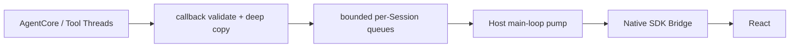

# MetaWork AgentCore 集成契约

> 状态：Phase 0A Gate 6 同进程垂直链路与 Gate 7 fault-domain 对照均已通过；后续正式方向选择单 AgentCore Worker
> 依赖：metacodes AgentCore bundle `0.0.0-dev+db052085b197`

本文定义 MetaWork `agent/` 执行子系统与 cc-zig 之间的规范边界。Desktop Host 的 composition、Workbench 产品状态和 Bridge transport 见 [高层架构](architecture.md)，当前预编译库能力见 [AgentCore ABI v1 消费基线](agentcore-abi-v1.md)。

## 1. 集成原则

1. cc-zig 是 Agent 结构化协议的唯一来源；
2. MetaWork 不解析模型 Provider SSE；
3. MetaWork 不建立平行的 `AgentEvent` / `WorkbenchEvent` 体系；
4. MetaWork 正式 Agent module 只使用 bundle typed SDK 和 binary ABI；
5. AgentCore/tool callback 不直接调用 WebView；
6. MetaWork 只补充产品路由、生命周期、所有权、传输 envelope 和安全校验；
7. 当前产品路径只使用 cc-zig built-in tools，不注册 v1 Host tools；
8. 当前 UI request 是同步调用，不伪装成 async suspend/resume；
9. 进程模型变化不得改变 Renderer 看到的产品边界。

## 2. Bundle 消费合同

MetaWork 的依赖输入是一个完整 bundle，而不是 cc-zig source tree：

```text
AgentCore bundle
├── lib/libmetacodes_agentcore.a
├── include/metacodes_agentcore.h
├── sdk/metacodes_agentcore.zig
├── sdk/metacodes_agentcore_protocol.zig
├── sdk/metacodes_agentcore_types.zig
└── manifest
```

### 当前 bootstrap

- cc-zig 独立构建并测试 bundle；
- MetaWork 通过显式绝对 bundle root 消费；
- 依赖配置锁定 build identity、commit、target、toolchain、ABI version 和 checksum；
- 常规 build/test/package 不访问 cc-zig source tree；
- artifact 缺失、target 不匹配或 checksum 错误时明确失败；
- 禁止 path/Git source dependency、源码复制、`latest`、版本范围、可变 tag 和 source fallback。

当前 stable ABI v1 manifest 只消费锁定 bundle 的现行字段布局：`source.commit`、带 `abi` 的 build identity，以及 `{path, sha256}` 组成的 `files` 数组。MetaWork 不保留旧字段名、旧 object-shaped `files` 或双格式 fallback；上游协议变化与 lock、validator、stager 和 build graph 原子升级。

当前不先实现 dependency resolver 或 content-addressed cache。同步 baseline 通过后，本地 cache 与远程 artifact repository 必须复用同一 bundle layout 和校验规则，不能改变 AgentCore 链接方式。

### raw probe 与正式 Agent module

隔离的 artifact-only raw contract probe 只用于证明产物可以 source-free discover/link/run，并保留 raw ABI 回归覆盖。该 probe：

- 可以直接使用 bundle 当前 raw SDK 类型和常量；
- 不能进入正式 Host target；
- 不能成为产品状态映射或 UI JSON 解析实现；
- 不能注册到 React/Native SDK 正式链路。

当前 clean bundle `db052085b1970675b54426cfea7d71222bf174af` 提供 typed status、六个 StopReason、known/unknown observation decoder、`UiRequest` decoder 和 request-aware `UiResponse` encoder，并固定 built-in file/shell tools 相对 `workspace_root` 的执行合同。正式 `agent/` 直接使用这些表面；MetaWork 不手写 raw enum、tag switch 或 JSON schema。

### MetaWork module boundary

- `src/agent.zig` 是 Agent 执行层的 named module root；
- `src/agent/` 直接消费 `metacodes_agentcore`，不得 import Workbench、Bridge 或 App；
- Workbench 只通过 `metawork_agent` 公共表面协调 Session/Run；
- `src/main.zig` 只进入 `metawork_app`，不能绕过 App 组装低层模块；
- 当前 `HostCause` 与 injected Scheduler 是待迁移现状，其最终模型以 [架构调整实施方案](architecture-adjustment-plan.md) 为准。

## 3. 当前协议表面

| 类型              | 方向        | 当前 ABI v1 语义                                                       |
| ----------------- | ----------- | ---------------------------------------------------------------------- |
| `CoreEvent` JSON  | Core → Host | callback-scoped borrowed bytes；携带 callback Session handle 和 run ID |
| `UiRequest` JSON  | Core → Host | 同步 callback 请求                                                     |
| `UiResponse` JSON | Host → Core | 同一 callback 内 answered response；或 unavailable/fatal               |
| ABI status        | Core → Host | function 调用层错误，独立于有效 Run 结果                               |
| `RunResult`       | Core → Host | status OK 后才有效；包含 stop reason code、turn/tool count             |
| abort             | Host → Core | 按 Session/Run 的 user/timeout 中断机制                                |

`UiEvent` / `UiBackend.poll()` 虽然存在于 cc-zig native 协议中，但当前生产 agent loop 未证明消费。MetaWork 不依赖它完成 stop、生成期 queue message 或 steering。

当前 ABI `RunResult` 不包含 `SuspendInfo`、resume token、background handle 或 budget stop。unknown stop code 在 SDK validation 层失败；Host 不能制造这些产品状态。

## 4. Agent binding

Agent binding 是 cc-zig backend 的 ABI 消费者，不是 Native SDK Adapter。它直接持有 bundle SDK API table 和 opaque handles。

### Event callback

```text
AgentCore/tool thread
→ SDK validates bytes/tag/payload as known or owned unknown observation
→ unknown observation: Host releases the SDK owner and returns continue
→ known observation: Host deep-copies escaping bytes
→ attach workspace/session/run routing envelope
→ push bounded test sink/event pump
→ return CONTINUE or FATAL
```

约束：

- callback bytes 默认只在返回前有效；
- 校验和深拷贝必须在 callback 内完成；
- callback 可能来自不同 Session 的并发线程；
- 同一 Run 的事件顺序必须保留；
- 无法验证、复制或接收关键事件时返回 callback fatal；
- valid unknown observation 在 SDK 完成结构、ownership 和 byte-bound 校验后立即释放并忽略，不占用产品事件泵，不得传给 Renderer 或猜测为产品状态；
- callback 不等待 WebView，也不调用 Session destroy 或 re-enter Run。

Gate 4 把正式 Host 连接到 FIFO bounded test sink，并通过 typed callback、生命周期、同步 UI 和真实 bundle link/run 验证。Gate 5 将它替换为 per-Session/global count+bytes、control reserve 和 deadline 受限的 Event pump。Gate 6 已完成正式 AgentCore→Workbench projection→Native SDK Bridge→React 垂直接线，并验证同步权限、AskUserQuestion、Renderer reload、终态和异步 Session close；详见 [Gate 6 报告](phase-0-gate-6-report.md)。

### UI request callback

```text
Core calls synchronous UI callback
→ SDK validates UiRequest
→ Host resolves callback Session handle
→ bind to Session current_run
→ enqueue control item
→ callback waits on Host-owned condition/channel
→ response / deadline / cancel / close / shutdown
→ SDK encodes response or returns unavailable/fatal
```

Bridge handler 只写入 response channel，不同步等待 AgentCore。callback wait 仍占用 Run executor slot。

当前 stable ABI v1 的 `UiRequest` / `UiResponse` 只有 `ask_question`/`answers` 与 `permission`。旧 experimental bundle 的 `plan_approval` 和 `custom` 已从 Host、Bridge、Renderer 与测试移除；未来控制消息扩展需要新的 ABI version。

### Host tools

当前 v1 Host tool callback 的 public contract 尚未给出可验证的 MetaWork Session/Run 映射。MetaWork 不使用全局 current-session、TLS 或每 Session 一个 Runtime 绕过这一缺口。

因此产品 Runtime 配置必须保持 `host_tool_count = 0`。Read/Bash/Edit 使用 built-in tool catalog。Host tool 只允许在隔离 contract probe 中测试 callback/release mechanics。

## 5. Host envelope 与产品状态

Host 可以在 cc-zig event 外增加产品路由 envelope：

```json
{
  "workspaceId": "workspace-1",
  "sessionId": "session-12",
  "runId": "run-8",
  "sequence": 318,
  "event": {
    "tool_start": {
      "id": "toolu_123",
      "name": "Bash",
      "input": "{\"command\":\"zig build\"}"
    }
  }
}
```

其中：

- `event` 保持 cc-zig 语义，不复制为另一套 Agent event；
- workspace/session/run ID 属于 MetaWork 产品路由；
- `sequence` 是 Host 的单 Session/Run 传输序列；
- Host 可以维护 `run.started/completed/stopped/failed/cancelled/interrupted/waiting_ui` 等产品生命周期状态；
- envelope 必须保留 SDK 验证后的原始 stop code/reason；
- Renderer view model 可以派生消息列表和工具卡片，但不能反向成为 AgentCore 协议来源。

## 6. Session 与 Runtime 生命周期

### 状态机

```text
Open.Idle
  → Open.Queued
  → Open.Running
  ↔ Open.WaitingUi
  → Open.Idle / terminal Run state

Open.*
  → Closing
  → Closed
```

`WaitingUi` 是仍在执行的同步 Run 子状态，不是可持久化 `suspended`。

### 每 Session 规则

- 至多一个 in-flight Run；
- 第二个 Run 明确排队或拒绝；
- run ID 单调且与 Session 绑定；
- queued Run 不接触 AgentCore mutable state；
- queued prompt 在复制前按 Host byte limit 拒绝，保证 executor 有界时输入内存也有明确上限；
- active Run 独占 Session Conversation；
- callback context 与 Session handle 具有独立 lifetime guard；
- Run 返回不等于可以立刻 free callback context，必须确认 callback refcount 为零。

Gate 2 的 raw lifecycle foundation 使用 bundle SDK 提供的精确 `ApiV1` table 作为可注入依赖，并显式接收 Zig `std.Io` 来实现 mutex/condition；它不导入 cc-zig source tree，也不建立 Adapter。`submit` 在持有 Session lock 时完成 bounded executor enqueue，避免 enqueue 与 close 之间出现未入队的悬空 `Queued` 状态。Core callback 在 `Closing` 后不得再取得新的 lifetime reference；已经进入的 callback 必须在 destroy 前归零。

Gate 4 在同一状态机上直接加入 bundle typed SDK，不另建 Adapter：event callback 先校验并形成 SDK-owned parse owner，再以单调 Host Session ID 和 Run ID 进入 FIFO bounded sink；UI callback 保留校验后的 request owner，response 只由 request-aware SDK encoder 生成。同步 UI deadline 使用 Host `std.Io` future，response、cancel、close、shutdown 或 deadline 都在 callback 返回前收敛并回收 timer。

当前迁移阶段由 Workbench 在调用 `Session.submit()` 前预留 durable Run record、generation、tool slots 与 terminal diagnostic buffer；任何 admission 分配失败都发生在 Agent Run 建立之前。Session 正常 terminal 或 close worker 销毁 Session 前，将固定大小 terminal facts 交给 Workbench 的 write-once publication；同一 record 的迟到重复提交不得改写已经发布的产品历史。`RunRef` 引用归零前，所属 Task 即使已关闭并请求删除也只进入 `delete_pending`。

### Close 顺序

```text
1. CAS Session state → Closing
2. reject new Run and UI response
3. remove/cancel queued Run
4. wake active synchronous UI wait
5. set first-writer-wins HostCause if absent
6. request abort for active Run
7. join Run job
8. wait callback refcount == 0
9. call session_destroy
10. free Host callback/session state and mark Closed
```

规则：

- callback 内不得直接 destroy；
- abort stale/too-late 不跳过 join；
- `session_destroy` busy 说明 Host 顺序错误或 Run 尚未退出，不允许强行 free；
- double close、同一 Session/run ID 的重复 cancel 和 shutdown 竞态必须幂等；stale run ID 必须明确拒绝且不得触发 abort；
- Runtime 记录活跃 Session，只有全部 Session Closed 后才能 destroy；
- Host shutdown 对全部 Session 执行同样状态机，不另写一条危险的快速路径。
- Host shutdown 本身必须串行化；并发调用不得重复 join executor、`session_destroy` 或 `runtime_destroy`；暂时的 destroy failure 必须可由后续显式 shutdown/close 重试，失败时不得强行 deinit。
- abort 的 raw status 即使是 stale/too-late 也要保留供 diagnostic/telemetry 使用，且 owned diagnostic 仍按 bundle release contract 释放。
- `Closed` tombstone 保留到 owner 显式 `releaseClosedSession`，以支持幂等 close 和事后 snapshot；释放后指针失效且 Host slot 才可复用。Host shutdown 开始后禁止单独 release，由统一 teardown 持有所有权。

### 必测 race

- cancel 与自然完成同时发生；
- close queued Session；
- close active Run；
- close while WaitingUi；
- callback fatal 与用户 cancel 同时发生；
- Host shutdown 多 Session；
- abort 返回 stale/too-late；
- double close / duplicate response；
- runtime destroy while Session alive；
- diagnostic/release callback 恰好一次。

## 7. HostCause 与错误传播

每个 Run 持有：

```text
RunControl
├── HostCause: atomic optional, first writer wins
├── active run_id
└── abort capability
```

HostCause 至少区分：

- user cancel；
- timeout；
- Session close；
- Host shutdown；
- event validation/copy failure；
- queue/control capacity failure。

当前 wire abort reason 只作为 AgentCore 中断机制，产品最终状态由 HostCause 与 ABI status/StopReason 共同决定。`bridge_pipeline_failure` 已从该 interim enum 删除；Renderer transport 不是 active Run cause，不得写入 Agent 中断状态。HostCause 中剩余的可变控制状态与 Workbench immutable terminal history 仍在 Executor/terminal-model 迁移阶段拆分。

### callback 内失败

event validation、copy 或同步入队失败：

```text
set HostCause if absent
→ return CALLBACK_FATAL
→ session_run returns non-OK callback status
→ Host releases diagnostic
→ Run = failed
```

此路径不读取 `RunResult`。

### notification、projection 与 Renderer transport

event 入泵后 ownership 已经转移给 Agent event pump。`EventReadyNotifier` 只返回 `scheduled`、`already_pending` 或 `unavailable`；App 当前将 Native `services.wake()` 映射为 `scheduled/unavailable`。`unavailable` 表示 canonical consumer 无法被通知，callback 返回 fatal 并记录 interim `event_pipeline_failure`；已 owned event 仍由 pump 负责释放，不得泄漏。

callback 返回后的 Workbench canonical projection failure 仍可以按 Run identity 请求 Agent 终止，当前迁移期使用 `event_pipeline_failure`；这不是 Bridge failure。Renderer event delivery、revision、snapshot、connection/generation 和 detached retention expiry 则形成 typed transport report，由 Workbench policy 决定 reject/retry/detach/discard。当前所有 Renderer transport stage 都明确不返回 `request_run_termination`；Renderer detach/reload 或 retention expiry 不得杀死后台 Run。

Bridge 异步 payload 必须是 owned copy 或显式 ownership transfer。Native SDK 在 platform loop 上串行执行同步 Bridge handler 与 `app.stop`；App 先关闭 ingress，用 callback lease 计数断言 quiescence，再 detach Workbench。Bridge retained JSON/batch 不借用 Workbench memory，因此在 Workbench deinit 后独立释放。

## 8. Event pump

### 固定路径



### 当前已测量并固定的维度

- global queue count/bytes；
- per-Session queue count/bytes；
- maximum single event bytes；
- control reserved capacity；
- Bridge batch count/bytes/time window；
- per-pump Session/event budget；
- temporary detach retention count/bytes/time；
- large object store byte/count/TTL（如果最终需要）。

### 过载语义

| 数据                            | 允许策略                                                          |
| ------------------------------- | ----------------------------------------------------------------- |
| `text_chunk`                    | 当前逐项保留；若后续按 Session/Run 合并，最终字节必须一致         |
| `tool_progress`                 | pump 逐项保留；Renderer projection 按同一 tool 覆盖旧进度         |
| `usage`                         | pump 逐项保留；Renderer projection 根据 cc-zig 事件语义累计或替换 |
| diagnostics                     | 按明确配置采样                                                    |
| tool start/result               | 不得静默丢失                                                      |
| UI request/response state       | 不得静默丢失                                                      |
| run/error/cancel/terminal state | 不得静默丢失                                                      |

当前没有完整最终 assistant snapshot 时，`text_chunk` 不能丢。队列不能接收关键事件时，可以有限阻塞 callback；达到 deadline 后返回 fatal，而不是无限等待。

按 Session 公平轮转，单一高输出 Session 不得饿死其他 Session。控制容量不能被文本增量占满。

### 大 payload

Native SDK 和真实事件大小已经测量；49,703-byte 真实 event 超过当前 8 KiB Host window-event budget，因此当前使用受限 Host-owned object reference：

- opaque object ID；
- Session/Run ownership；
- count/byte/TTL 上限；
- Renderer fetch 命令的来源和归属校验；
- Session close、Run terminal、reload 和 shutdown 清理。

禁止为了假想大对象先建设通用 blob service。

## 9. Renderer reload 与重连

当前 baseline 只保证 WebView/Renderer reload 后从仍存活 Host 重建视图：

- Native SDK 的真实 push/poll 机制由 Gate 0 先验证；
- Host 维护可生成当前 view snapshot 的产品状态；
- 重连策略必须定义 snapshot/event 的大小上限、旧连接隔离和清理；
- reload 期间仍 active 的同步 UI request 可以重新展示，但响应仍须绑定原 Session/Run/request；
- Host/AgentCore 进程退出后不恢复 active Run；
- snapshot 不包含 Provider credential。

当前 event delivery 的 batch fetch/ACK 任一步失败时，Renderer 必须停止消费旧 generation，显式 disconnect 后以有上限的退避序列重新 connect；Host 只在新 generation 重发未 ACK 项。旧 batch 在重连后直接失效，不能吞掉错误后继续 ACK 后续 sequence。Workbench revision 通知只在 revision 变化时发送，Renderer 合并并发 refresh；Host 发送失败时保留最新 revision 并由一次性 timer 重试，若 timer 也无法建立则立即使当前 event connection 失效，不能只记录日志后继续宣称可用。Renderer snapshot 拉取失败时保留目标 revision；每个 generation 的自动重试预算耗尽后停止请求、禁止产品 mutation 并等待用户显式恢复，不得把失败误记成已同步，也不得永久循环重试。raw transport batch 只负责完整 ACK，不再额外触发一次全量 snapshot。

正式 AgentCore 产品事件在 Host event pump 中完成 typed projection 后即释放，不再把同一 raw `CoreEvent` 复制到 Renderer 再丢弃。`metawork:agent-events` raw batch/object/ACK 路径只保留为隔离的 Gate 5 transport fixture；产品 Renderer 的数据面是 Host-owned Workbench revision + bounded snapshot。

当前 Bridge 单次 result 上限为 1 MiB，但它不是 Workbench 产品状态容量。Host 在固定 8 MiB snapshot store 中生成一致的完整 JSON，再由 Renderer 以绑定 snapshot ID、generation、window、offset 和长度的 256 KiB 原始分块拉取；分块使用 base64 后仍低于单次 result 上限。新的 begin 在写入 store 前必须先使旧 descriptor 失效；写入失败不能让旧 identity 继续读取被部分覆盖的 buffer。Workbench 以 JSON 字符串最坏六倍 escaping、Session/Run/Tool 最大结构数量，以及“同步 UI 最多占满四个 executor slot”的并发 pending UI 最坏值，在初始化时验证完整 snapshot 预算，并以最大结构的真实 serializer 测试校验估算上界。当前 projection 上限恢复为 512 KiB；不得为了适配 Bridge 缩小产品状态，也不得允许合法 projection 进入永久 `SnapshotTooLarge` 状态。

不在验证 transport 前发明固定 `events.drain`、cursor 或轮询协议；最终机制必须以 Native SDK 事实和压力数据为依据。

## 10. UI request 语义

当前 ABI v1 只有同步 outcome：answered、unavailable、fatal。

- answered response 由 SDK encoder 生成，并按照 bundle ownership 规则 release 恰好一次；
- unavailable 表示当前 Host 无法回答，Core 按其工具语义安全失败；
- fatal 表示 Host request pipeline 失败，Run 必须退出；
- 每个 Run 同时最多一个 active UI wait；
- deadline 到期默认 deny/unavailable，不允许无限等待；
- cancel、close、shutdown 唤醒 wait；
- response 必须拒绝 stale、duplicate、错误 Session/Run 和错误类型；
- 同步 wait crash 后不恢复，工具保持未执行，Run 标记 interrupted。

未来 async pending/resume 必须独立定义 request identity、SuspendInfo、持久化、exactly-once tool execution、subagent 限制和 crash recovery；不能只在 React 中保存审批框。

## 11. RunResult 与 StopReason

`session_run` 的处理顺序固定：

```text
call ABI
→ validate typed function Status
→ non-OK: release diagnostic, do not read RunResult
→ OK: validate RunResult and typed StopReason
→ exhaustive Host mapping
```

| StopReason     | 当前 Host 状态                                                         |
| -------------- | ---------------------------------------------------------------------- |
| `end_turn`     | completed                                                              |
| `max_turns`    | stopped / awaiting_user                                                |
| `aborted`      | 迁移期 HostCause 决定 cancelled / interrupted / failed                  |
| `tool_error`   | failed                                                                 |
| `api_error`    | failed                                                                 |
| `tool_loop`    | stopped / awaiting_user                                                |

MetaWork 对 bundle SDK 的 typed StopReason 使用无 `else` switch。unknown raw code 必须在 SDK validation 层失败，并在 diagnostic 中保留 raw value。

ABI status 新增 `resource_limit`。它与 pre-admission `invalid_argument`、`busy`、`stale_run` 一样不污染 Session；一旦 Run 已 admission，`out_of_memory`、`core_error`、`callback_failed` 或 `internal_error` 会 poison Session。Host 在这些状态后拒绝新 Run 并要求关闭或重建 Task 的 AgentCore Session，不能提供虚假的原 Session retry。

`stream_done` 只表示一次模型流结束，不等于整个 Run 完成。只有 ABI status 与 RunResult 映射完成后才能发布 terminal product state。

## 12. Credential、Workspace 与工具安全

### Credential

- Provider key 从 Host process environment 或受控配置读取；
- 只在 `session_create` 所需期间构造 borrowed view；
- 不从 Renderer command 接收 key；
- 不写日志、event、snapshot、crash diagnostic 或持久化 view；
- Host 临时 buffer 在不再需要时及时清理；
- cc-zig 是否复制并如何清理 Session credential 以锁定 bundle contract 为准。

### Workspace

- Host 直接发起原生目录选择与原生 trust 确认，规范化结果后签发绑定 window、event delivery generation 和 canonical path 的一次性 grant；
- Renderer 创建 Session 时只回传 grant，不得回传任意路径加 `trusted` boolean；grant 在 disconnect、拒绝、替换或首次消费后失效；
- Gate 2 的 lifecycle API 只接收 Host 已规范化的绝对路径，并再次拒绝空 component、`.`、`..`、尾随分隔符和临时根的词法逃逸；symlink/TOCTOU 仍不在此保证内；
- 当前 v1 只运行临时 fixture 或用户明确 trusted 的 Workspace；
- 不以 `workspace_root` 字段存在为 strict security 证据；
- symlink、路径逃逸、不存在写入目标、sandbox、process tree 和 TOCTOU 矩阵属于后续安全 Gate；
- strict security 未完成前，UI 和文档不得宣称可以安全运行不可信 Workspace。

### built-in tools

- Runtime catalog 与 Session allowlist 共同限制可发布工具；
- Provider 伪造未发布工具名必须 dispatch 失败；
- Write/Edit/Bash 等危险操作执行前经过同步 permission；
- 默认 Bash 是非交互 shell，不使用 PTY；
- stdout/stderr/exit code 有界或通过后续对象引用展示。

## 13. 反向控制

### 当前有效路径

```text
React stop command
→ Native SDK main thread handler
→ validate Session/Run
→ set HostCause=user_cancel
→ session_abort(run_id)
→ join synchronous run
→ publish terminal state
```

stop 不进入普通 FIFO，不能被文本或 queue message 阻塞。abort 只请求中断；UI 必须等待真实 Run 返回后才能显示 terminal state。

生成期 `queue_message` 当前只进入 Host 有界 Session 输入队列，在当前 Run 结束后按确定规则形成下一 Run 输入。它不依赖未接通的 `UiBackend.poll()`。

## 14. Shell 边界

| 能力                         | 当前 Bash baseline |
| ---------------------------- | ------------------ |
| hidden non-interactive child | 使用               |
| stdout/stderr capture        | 使用               |
| exit code/timeout/cancel     | 必须验证           |
| Terminal Emulator            | 不使用             |
| PTY/ConPTY                   | 不使用             |
| TTY-only programs            | 拒绝或明确报错     |

未来如需交互式终端，应作为独立 `TerminalTool` 设计，不得重新成为 Agent 通信层。

## 15. 进程模型

Gate 7 已在独立测试进程完成同进程 fatal baseline 和最小 Worker harness。结果是同进程 fatal 会带走 Host 与全部进程内 Session；Worker crash 时 Host 与已有产品 snapshot 可继续存活，归属 active Run 进入 `interrupted/worker_disconnected`，危险工具不自动重放。因此后续正式方向选择单 AgentCore Worker。

当前应用仍是同进程 bounded-executor prototype。正式 Worker 尚未实现，spike IPC 不是产品协议。后续必须单独定义版本化 transport、容量/backpressure、ownership、correlation、credential、disconnect 和 shutdown；在 AgentCore 没有 checkpoint capability 时，Worker restart 不等于 Run 或 Conversation 恢复。

Renderer 始终只面对 Host 领域命令和产品 envelope，不直接绑定 Worker 或 AgentCore memory。
