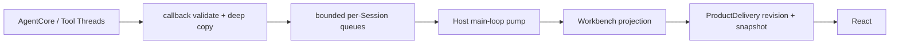

# MetaWork AgentCore 集成契约

> 状态：AgentCore ABI v1 revision 3 macOS 与 Windows x86_64 GNU development baseline 已通过；fault-domain 验证选择单 AgentCore Worker 作为后续正式方向
> 目标依赖：Metask AgentCore ABI v1 revision 3；精确 artifact identity 见 [AgentCore ABI v1 消费合同](agentcore-abi-v1.md)

本文定义 MetaWork `agent/` 执行子系统与 Metask AgentCore 之间的规范边界。Desktop Host 的 composition、Workbench 产品状态和 Bridge transport 见 [高层架构](architecture.md)，revision 3 目标能力见 [AgentCore ABI v1 消费合同](agentcore-abi-v1.md)。

## 1. 集成原则

1. Metask AgentCore bundle SDK 是 Agent 结构化协议的唯一来源；
2. MetaWork 不解析模型 Provider SSE；
3. MetaWork 不建立平行的 `AgentEvent` / `WorkbenchEvent` 体系；
4. MetaWork 正式 Agent module 只使用 bundle typed SDK 和 binary ABI；
5. AgentCore/tool callback 不直接调用 WebView；
6. MetaWork 只补充产品路由、生命周期、所有权、传输 envelope 和安全校验；
7. 当前产品路径只使用 AgentCore built-in tools，不注册 v1 Host tools；
8. 当前 UI request 是同步调用，不伪装成 async suspend/resume；
9. 进程模型变化不得改变 Renderer 看到的产品边界。

## 2. Bundle 消费合同

MetaWork 的依赖输入是一个完整 bundle，而不是 AgentCore 实现源码。精确 artifact identity、payload whitelist 和 manifest schema 只由 [AgentCore ABI v1 消费合同](agentcore-abi-v1.md)定义；本文只定义 candidate、staging、build graph 和 Host 生命周期。

### revision 3 开发期 bootstrap

- Metask AgentCore 独立构建并测试 target-specific bundle，candidate 直接取自本机精确路径 `metacodes/zig-out/agentcore/<target>`；
- candidate probe 与 `agentcore:stage` 使用显式绝对 bundle root；正式 build/test/package 只消费 `.agentcore/bundle`；
- 每个已接入 target 的 repository lock 保存完整 revision 3 manifest，并锁定 package/source、target、toolchain、ABI version/revision、link inputs 和所有 payload checksum；macOS 与 Windows lock 不互相替代；
- stager 只复制 manifest whitelist；捕获到的复制/rename 错误必须恢复旧 canonical bundle。当前内部开发不承诺跨进程 crash transaction 或并发 build/stage，强制中断后的残留由再次执行 stage 清理；
- staged bundle 在正式 build 前由 MetaWork verifier 再校验；官方 Zig package 只负责 module/link graph，不承担 repository lock 和 checksum 信任政策；
- 由于 Zig 会在执行 root build verification 前解析 staged path dependency，正式 `dev/check/test/build/package` 必须先运行轻量 `agentcore:verify-staged` preflight，给出明确的缺包或 lock mismatch 错误；Zig build-time verifier 仍负责最终 build correctness；
- 常规 build/test/package 不访问 AgentCore 实现源码或外部 `zig-out`；
- artifact 缺失、target 不匹配或 checksum 错误时明确失败；
- 禁止 path/Git source dependency、源码复制、`latest`、版本范围、可变 tag 和 source fallback。

stager 与 verifier 根据 manifest target 选择显式 target policy 和 exact lock，只接受 ABI 消费合同定义的 schema 1 revision 3 manifest。未知 target 必须失败；Linux 后续通过新增独立 policy/lock 接入，不提供 generic fallback。MetaWork 不保留 revision 2 字段、目录、symbol、module alias 或双格式 parser。

当前内部初步开发不实现 dependency resolver、content-addressed cache、artifact repository 或跨机器自动分发。这个限制意味着开发 checkout 需要本机 Metask AgentCore 构建输出；它是明确的开发期前提，不得伪装成公司发布方案。

### candidate validation 与正式 Agent module

candidate probe 只用于证明锁定 artifact 与官方 Zig package 可以 source-free discover/link/run。该 probe：

- 只通过 bundle 的官方 `bindings/zig` package 消费 AgentCore；
- 不能进入正式 Host target；
- 不能成为产品状态映射或 UI JSON 解析实现；
- 不能注册到 React/Native SDK 正式链路；
- 不维护上游 ABI facade 或 SDK 行为的平行测试套件。

revision 3 bundle 保持 typed status、六个 StopReason、known/unknown observation decoder、`UiRequest` decoder、request-aware `UiResponse` encoder，以及 callback-scoped validated `RunContext`。正式 `agent/` 直接使用官方 `bindings/zig` package 暴露的表面；MetaWork 不手写 raw enum、tag switch、identity layout、JSON schema 或 SDK module/link graph。

### MetaWork module boundary

- `src/agent.zig` 是 Agent 执行层的 named module root；
- `src/agent/` 直接消费唯一 `metask_agentcore` module，不得 import Workbench、Bridge 或 App；
- App 不再直接 discover AgentCore ABI；`agent.Runtime.init()` 在 Agent 边界内完成 bundle SDK discovery，raw function-table injection 只保留给隔离测试；
- Workbench 只通过 `metawork_agent` 公共表面协调 Session/Run，并消费 SDK-validated `OwnedCoreEvent`/UI types；这不是复制一套 `AgentEvent`/UI schema；
- Bridge DTO 使用 Bridge-owned transport enum，由 App 显式映射到 Agent UI response，不返回 SDK enum、owner 或 handle；
- `src/main.zig` 只进入 `metawork_app`，不能绕过 App 组装低层模块；
- Executor、queue 与 workers 归 Workbench 独占，Agent Runtime 不接收 Scheduler capability。Agent active Run 只保留 first-writer-wins `TerminationSignal`，并通过 immutable `TerminalResult` 向 Workbench 提交 terminal facts；Session snapshot 不保存历史结果。

## 3. 当前协议表面

| 类型              | 方向        | 当前 ABI v1 语义                                                                 |
| ----------------- | ----------- | -------------------------------------------------------------------------------- |
| `RunContext`      | Core → Host | callback-scoped borrowed identity；包含 Session handle、run ID 和稳定 session ID |
| `CoreEvent` JSON  | Core → Host | callback-scoped borrowed bytes；与同次 callback 的 `RunContext` 绑定             |
| `UiRequest` JSON  | Core → Host | 同步 callback 请求；与同次 callback 的 `RunContext` 绑定                         |
| `UiResponse` JSON | Host → Core | 同一 callback 内 answered response；或 unavailable/fatal                         |
| ABI status        | Core → Host | function 调用层错误，独立于有效 Run 结果                                         |
| `RunResult`       | Core → Host | status OK 后才有效；包含 stop reason code、turn/tool count                       |
| abort             | Host → Core | 按 Session/Run 的 user/timeout 中断机制                                          |

`UiEvent` / `UiBackend.poll()` 虽然存在于 Metask AgentCore native 协议中，但当前生产 agent loop 未证明消费。MetaWork 不依赖它完成 stop、生成期 queue message 或 steering。

当前 ABI `RunResult` 不包含 `SuspendInfo`、resume token、background handle 或 budget stop。unknown stop code 在 SDK validation 层失败；Host 不能制造这些产品状态。

## 4. Agent binding

Agent binding 是 Metask AgentCore 的 ABI 消费者，不是 Native SDK Adapter。它直接持有 bundle SDK API table 和 opaque handles。

### Event callback

```text
AgentCore/tool thread
→ SDK validates RunContext layout and borrowed session ID
→ Host atomically binds/compares Session handle + active run ID + stable session ID
→ SDK validates bytes/tag/payload as known or owned unknown observation
→ unknown observation: Host releases the SDK owner and returns continue
→ known observation: Host deep-copies escaping bytes
→ attach workspace/session/run routing envelope
→ push bounded test sink/event pump
→ return CONTINUE or FATAL
```

约束：

- callback bytes 默认只在返回前有效；
- `RunContext` 及其 session ID 也只在 callback 内借用，禁止保存 slice；
- Session handle、active run ID、Session-lifetime session ID 的首次绑定/比较与 callback ref admission 必须在同一 Session lock 内完成；
- invalid layout、错误 handle/run ID、同 Run 或跨 Run session ID 漂移均为 dependency contract failure，返回 fatal 并 poison Session；
- 校验和深拷贝必须在 callback 内完成；
- callback 可能来自不同 Session 的并发线程；
- 同一 Run 的事件顺序必须保留；
- 无法验证、复制或接收关键事件时返回 callback fatal；
- valid unknown observation 在 SDK 完成结构、ownership 和 byte-bound 校验后立即释放并忽略，不占用产品事件泵，不得传给 Renderer 或猜测为产品状态；
- callback 不等待 WebView，也不调用 Session destroy 或 re-enter Run。

初始验证先把正式 Host 连接到 FIFO bounded test sink，再替换为 per-Session/global count+bytes、control reserve 和 deadline 受限的 Event pump。当前正式 AgentCore→Workbench projection→Native SDK Bridge→React 垂直链路已经验证同步权限、AskUserQuestion、Renderer reload、终态和异步 Session close；持续回归要求见 [验证规范](validation.md)。

### UI request callback

```text
Core calls synchronous UI callback
→ SDK validates RunContext and UiRequest
→ Host atomically validates the same full Session/Run identity tuple
→ enqueue control item
→ callback waits on Host-owned condition/channel
→ response / deadline / cancel / close / shutdown
→ SDK encodes a response into Host-owned bytes when one was supplied
→ under the Session lock, recheck identity/dependency-contract health
→ transfer answered bytes, or free them and return unavailable/fatal
```

Bridge handler 只写入 response channel，不同步等待 AgentCore。callback wait 仍占用 Run executor slot。

callback admission 只建立 lifetime 与当时的 identity 事实，不保证等待期间不会有另一个并发 callback 发现 identity 漂移。因此 Host 在发布 UI request 前和最终提取 response 的线性化点都必须在同一 Session lock 下重新检查现有 Core identity 与 dependency-contract 状态。检查失败时返回 UI fatal；如果 Renderer response 已完成编码但 ownership 尚未转移给 Core，Host 必须自行释放，禁止返回 answered。

目标 ABI v1 revision 3 的 `UiRequest` / `UiResponse` 只有 `ask_question`/`answers` 与 `permission`。更早 experimental bundle 的 `plan_approval` 和 `custom` 已从 Host、Bridge、Renderer 与测试移除；未来控制消息扩展需要新的 ABI revision/version。

### Host tools

目标 revision 3 的 Host tool callback 同样携带 validated `RunContext`，但这只补齐 wire identity，不自动建立 MetaWork 的产品工具、安全与路由政策。当前产品 Runtime 配置仍必须保持 `host_tool_count = 0`，Read/Bash/Edit 使用 built-in tool catalog；启用正式 Host tools 属于独立 capability Gate，不在本次 ABI 迁移中顺带开放。

## 5. Host envelope 与产品状态

Host 可以在 AgentCore event 外增加产品路由 envelope：

```json
{
  "workspaceId": "workspace-1",
  "sessionId": "session-12",
  "runId": "run-8",
  "sequence": 318,
  "event": {
    "tool_start": {
      "id": "toolu_123",
      "name": "Bash",
      "input": "{\"command\":\"zig build\"}"
    }
  }
}
```

其中：

- `event` 保持 AgentCore 语义，不复制为另一套 Agent event；
- workspace/session/run ID 属于 MetaWork 产品路由；
- `sequence` 是 Host 的单 Session/Run 传输序列；
- Host 可以维护 `run.started/completed/stopped/failed/cancelled/interrupted/waiting_ui` 等产品生命周期状态；
- envelope 必须保留 SDK 验证后的原始 stop code/reason；
- Renderer view model 可以派生消息列表和工具卡片，但不能反向成为 AgentCore 协议来源。

## 6. Session 与 Runtime 生命周期

### 状态机

```text
Open.Idle
  → Open.Queued
  → Open.Running
  ↔ Open.WaitingUi
  → Open.Idle / terminal Run state

Open.*
  → Closing
  → Closed
```

`WaitingUi` 是仍在执行的同步 Run 子状态，不是可持久化 `suspended`。

### 每 Session 规则

- 至多一个 in-flight Run；
- 第二个 Run 明确排队或拒绝；
- run ID 单调且与 Session 绑定；
- queued Run 不接触 AgentCore mutable state；
- queued prompt 在复制前按 Host byte limit 拒绝，保证 executor 有界时输入内存也有明确上限；
- active Run 独占 Session Conversation；
- callback context 与 Session handle 具有独立 lifetime guard；
- Run 返回不等于可以立刻 free callback context，必须确认 callback refcount 为零。

初始 raw lifecycle foundation 使用 bundle SDK 提供的精确 `ApiV1` table 作为可注入依赖，并显式接收 Zig `std.Io` 来实现 mutex/condition；它不导入 AgentCore 实现源码，也不建立 Adapter。`submit` 在持有 Session lock 时完成 bounded executor enqueue，避免 enqueue 与 close 之间出现未入队的悬空 `Queued` 状态。Core callback 在 `Closing` 后不得再取得新的 lifetime reference；已经进入的 callback 必须在 destroy 前归零。

正式 Host 在同一状态机上直接加入 bundle typed SDK，不另建 Adapter：event callback 先校验并形成 SDK-owned parse owner，再以单调 Host Session ID 和 Run ID 进入 FIFO bounded sink；UI callback 保留校验后的 request owner，response 只由 request-aware SDK encoder 生成。同步 UI deadline 使用 Host `std.Io` future，response、cancel、close、shutdown 或 deadline 都在 callback 返回前收敛并回收 timer。

当前实现由 Workbench 预留 durable Run record、generation、tool slots 与 terminal diagnostic buffer，再调用 `Session.prepareRun()` 并把 Workbench-owned job 放入自身 bounded Executor。worker claim 后以原子 `starting` 状态调用 `Session.beginRun()`；成功后先发布 generation-bound `RunControl` 和 `running`，再调用唯一 latch-aware `Run.execute()`。`beginRun()` 失败会在同一 Session lock 下返回 typed completion disposition，Workbench 据此生成 pre-execution terminal payload，不再额外读取 Session snapshot。cancel/close/shutdown 在 `starting` 时只发布 first-writer pending termination，在 `running` 时取得 `RunControlLease` 后于锁外请求终止。Agent Runtime 不 enqueue、不停止、也不销毁 Executor。

每个 Session 拥有独立分配、存活到 Session release 的 `SessionControlBlock`。`RunControlLease` 用 closed-bit + atomic reference count 保活该 control block，并携带单调 `run_generation`；旧 lease 在下一 Run 复用执行槽后返回 `stale_run`，Run 自然完成后返回 `already_terminal`。Session close 先关闭 lease acquisition gate，再等待 Run、callback 和全部 control lease 归零；该 quiescence wait 不持有 Session/Workbench lock。`Run.execute()` 返回 immutable `TerminalResult`，worker 在释放 execution base lease 前将它提交到 Workbench admission 时预留的 write-once terminal payload。Workbench executor worker 入队前取得的 Task-owned stable record reference 归零前，所属 Task 即使已关闭并请求删除也只进入 `delete_pending`；不存在只被测试消费的第二套公开 record-reference 协议。

### Close 顺序

```text
1. close control lease acquisition gate and CAS Session state → Closing
2. reject new Run and UI response
3. remove/cancel queued Run
4. wake active synchronous UI wait
5. set first-writer-wins TerminationSignal if absent
6. request abort for active Run
7. join Run job
8. wait callback refcount == 0
9. wait control refcount == owner only
10. call session_destroy
11. free Host callback/session state and mark Closed
```

规则：

- callback 内不得直接 destroy；
- abort stale/too-late 不跳过 join；
- `session_destroy` busy 说明 Host 顺序错误或 Run 尚未退出，不允许强行 free；
- double close、同一 Session/run ID 的重复 cancel 和 shutdown 竞态必须幂等；stale run ID 必须明确拒绝且不得触发 abort；
- Runtime 记录活跃 Session，只有全部 Session Closed 后才能 destroy；
- Host shutdown 对全部 Session 执行同样状态机，不另写一条危险的快速路径。
- Host shutdown 本身必须串行化；并发调用不得重复 join executor、`session_destroy` 或 `runtime_destroy`；暂时的 destroy failure 必须可由后续显式 shutdown/close 重试，失败时不得强行 deinit。
- abort 的 raw status 即使是 stale/too-late 也要保留供 diagnostic/telemetry 使用，且 owned diagnostic 仍按 bundle release contract 释放。
- `Closed` tombstone 保留到 owner 显式 `releaseClosedSession`，以支持幂等 close 和事后 snapshot；释放后指针失效且 Host slot 才可复用。Host shutdown 开始后禁止单独 release，由统一 teardown 持有所有权。

### 必测 race

- cancel 与自然完成同时发生；
- close queued Session；
- close active Run；
- close while WaitingUi；
- callback fatal 与用户 cancel 同时发生；
- Host shutdown 多 Session；
- abort 返回 stale/too-late；
- double close / duplicate response；
- runtime destroy while Session alive；
- diagnostic/release callback 恰好一次。

## 7. TerminationSignal、TerminalResult 与错误传播

每个 Run 持有：

```text
SessionControlBlock (Session lifetime)
├── closed-bit + atomic control reference count
├── Session termination capability
└── close quiescence wait

RunControl / RunControlLease
├── active run_id
├── monotonic run_generation
└── requestTermination() → requested / already_requested / already_terminal / stale_run / session_closing
```

`TerminationSignal` 是 active Run 唯一可变的 first-writer-wins latch，并按 execution failure domain 分型：external interruption、callback failure、event-pump failure、event-consumer-notification failure。dependency contract failure、ABI status 与 validated StopReason 是 terminal facts，不伪装成 abort cause。

wire abort reason 只作为 AgentCore 中断机制。`TerminalResult` 同时保留 typed/raw ABI status、typed/raw StopReason、typed/raw abort status、最终 termination latch、completion-time Session disposition，以及 bounded owned diagnostic。产品 `RunOutcome` 与 durable cause 只由 Workbench 映射。Renderer transport 不是 active Run cause，不得写入 Agent termination latch。

### callback 内失败

event validation、copy 或同步入队失败：

```text
set typed TerminationSignal if absent
→ return EVENT_FATAL
→ session_run returns non-OK callback status
→ Host releases diagnostic
→ Run = failed
```

此路径不读取 `RunResult`。

### notification、projection 与 Renderer transport

event 入泵后 ownership 已经转移给 Agent event pump。`EventReadyNotifier` 只返回 `scheduled`、`already_pending` 或 `unavailable`；App 使用原子 pending gate 将重复 Native `services.wake()` 合并为 `already_pending`，并在 drain 前清 gate，避免 producer 与 consumer 交错时丢 wake。Agent 对 `unavailable` 按 composition 提供的 retry interval 和 deadline 同步重试；deadline 耗尽后 callback 才返回 fatal 并记录 typed `event_consumer_notification_failure`。失败不会撤销已经完成的 pump ownership transfer，事件仍由 pump 负责释放或交给 canonical consumer。

callback 返回后的 Workbench canonical projection failure 仍可以按 Run identity 请求 Agent 终止，并使用不含 Workbench 名称的 `event_pump_failure.consumer_rejected`；这不是 Bridge failure。如果 Agent terminal 已先发布，Workbench 还必须独立保存 projection failure 产品事实，在 event drain 后把 Run 暴露为 `event_pipeline_failure` 并禁止 continuation，不能把已经太晚的 termination request 当作唯一收口。Renderer response、revision、snapshot 和 connection/generation failure 则形成 typed transport report，由 Workbench policy 决定 reject/retry/detach。当前所有 Renderer transport stage 都明确不返回 `request_run_termination`；Renderer detach/reload 不得杀死后台 Run。

AgentCore tool event 的 raw `id` 只在 Workbench 消费当前 event 时用于计算固定长度 SHA-256 correlation key；raw `id` 不保存在产品历史。后续 progress/result 使用同一 digest 关联 Tool record。Workbench 以 Run 内唯一 activity order 生成稳定且不敏感的产品 tool `id`；`name`、input、progress 和 content 在进入 canonical projection 前统一清理。该 digest 不进入 Renderer wire，也不是第二个产品 tool identity。Renderer decoder 必须拒绝同一 Run 内重复的产品 tool `id` 或 activity order。

assistant `text_chunk` 的 credential 清理采用流式未决尾部：已经提交的 canonical 字节不再随之后的 chunk 重扫，只有仍可能组成跨 chunk credential 的有限后缀与新字节参与下一次清理。snapshot 只发布 committed prefix，未决尾部保持 Host-only。Run terminal publication acquire 后，App 再完整排空一次 Agent event pump，Workbench 才同时发布产品可见 terminal phase/outcome/cause、折叠 completion-time Session disposition、提交最终安全 assistant 尾部并关闭该 Run 的 event ingestion；raw terminal publication 本身不能替代这次 drain barrier。barrier 完成前新 Run admission 仍以当前 Run 未结束处理，close completion 和 Task 物理删除也必须等待该 Run 的事件流完成收口。barrier 后仍到达的 event 属于合同违约；仍开放的 Task 必须关闭 owning Session 并终止可能已经开始的后续 Run，不能只对已经 terminal 的历史 Run 重发无效 termination。上述状态属于 Workbench projection，不形成第二份 terminal 或 assistant 内容。

Bridge 异步 payload 必须是 owned copy 或显式 ownership transfer。Native SDK 在 platform loop 上串行执行同步 Bridge handler 与 `app.stop`；App 先关闭 ingress，用 callback lease 计数断言 quiescence，再 detach Workbench。Bridge retained JSON/batch 不借用 Workbench memory，因此在 Workbench deinit 后独立释放。

## 8. Event pump

### 固定路径



### 当前已测量并固定的维度

- global queue count/bytes；
- per-Session queue count/bytes；
- maximum single event bytes；
- control reserved capacity；
- per-pump Session/event budget；
- Workbench snapshot capacity/chunk bytes 与 revision retry budget。

### 过载语义

| 数据                            | 允许策略                                                             |
| ------------------------------- | -------------------------------------------------------------------- |
| `text_chunk`                    | 当前逐项保留；若后续按 Session/Run 合并，最终字节必须一致            |
| `tool_progress`                 | pump 逐项保留；Renderer projection 按同一 tool 覆盖旧进度            |
| `usage`                         | pump 逐项保留；Renderer projection 根据 AgentCore 事件语义累计或替换 |
| diagnostics                     | 按明确配置采样                                                       |
| tool start/result               | 不得静默丢失                                                         |
| UI request/response state       | 不得静默丢失                                                         |
| run/error/cancel/terminal state | 不得静默丢失                                                         |

当前没有完整最终 assistant snapshot 时，`text_chunk` 不能丢。队列不能接收关键事件时，可以有限阻塞 callback；达到 deadline 后返回 fatal，而不是无限等待。

按 Session 公平轮转，单一高输出 Session 不得饿死其他 Session。控制容量不能被文本增量占满。

### 大 payload

Native SDK 和真实事件大小已经测量；49,703-byte 真实 event 超过当前 8 KiB Host window-event budget，因此当前使用受限 Host-owned object reference：

- opaque object ID；
- Session/Run ownership；
- count/byte/TTL 上限；
- Renderer fetch 命令的来源和归属校验；
- Session close、Run terminal、reload 和 shutdown 清理。

禁止为了假想大对象先建设通用 blob service。

## 9. Renderer reload 与重连

当前 baseline 只保证 WebView/Renderer reload 后从仍存活 Host 重建视图：

- Native SDK 的真实 push/poll 机制由 dev/prod smoke 验证；
- Host 维护可生成当前 view snapshot 的产品状态；
- 重连策略必须定义 snapshot/event 的大小上限、旧连接隔离和清理；
- reload 期间仍 active 的同步 UI request 可以重新展示，但响应仍须绑定原 Session/Run/request；
- Host/AgentCore 进程退出后不恢复 active Run；
- snapshot 不包含 Provider credential。

Workbench revision 通知只在 revision 变化时发送，Renderer 合并并发 refresh；Host 发送失败时保留最新 revision 并由一次性 timer 重试，若 timer 也无法建立则立即使当前 event connection 失效，不能只记录日志后继续宣称可用。Renderer snapshot 拉取失败时保留目标 revision；每个 generation 的自动重试预算耗尽后停止请求、禁止产品 mutation 并等待用户显式恢复，不得把失败误记成已同步，也不得永久循环重试。

正式 AgentCore 产品事件在 Host event pump 中完成 typed projection 后即释放，不把同一 raw `CoreEvent` 复制到 Renderer。产品 Renderer 的唯一数据面是 Host-owned Workbench revision + bounded snapshot；automation 只观察和驱动这条真实路径，不定义独立 Renderer transport。

当前 Bridge 单次 result 上限为 1 MiB，但它不是 Workbench 产品状态容量。Host 在固定 12 MiB snapshot store 中生成一致的完整 JSON，再由 Renderer 以绑定 snapshot ID、generation、window、offset 和长度的 256 KiB 原始分块拉取；分块使用 base64 后仍低于单次 result 上限。新的 begin 在写入 store 前必须先使旧 descriptor 失效；写入失败不能让旧 identity 继续读取被部分覆盖的 buffer。Workbench 以 JSON 字符串最坏六倍 escaping、最大 Account catalog、Task/Run/Tool 最大结构数量，以及“同步 UI 最多占满四个 executor slot”的并发 pending UI 最坏值，在初始化时验证完整 snapshot 预算，并以最大 Account projection 和最大 Task 结构的真实 serializer 测试校验估算上界。当前 Task projection 上限保持 512 KiB；不得为了适配 Bridge 缩小产品状态，也不得允许合法 projection 进入永久 `SnapshotTooLarge` 状态。

不在验证 transport 前发明固定 `events.drain`、cursor 或轮询协议；最终机制必须以 Native SDK 事实和压力数据为依据。

## 10. UI request 语义

当前 ABI v1 只有同步 outcome：answered、unavailable、fatal。

- answered response 由 SDK encoder 生成，并按照 bundle ownership 规则 release 恰好一次；
- unavailable 表示当前 Host 无法回答，Core 按其工具语义安全失败；
- fatal 表示 Host request pipeline 失败，Run 必须退出；
- 每个 Run 同时最多一个 active UI wait；
- deadline 到期默认 deny/unavailable，不允许无限等待；
- cancel、close、shutdown 唤醒 wait；
- response 必须拒绝 stale、duplicate、错误 Session/Run 和错误类型；
- 同步 wait crash 后不恢复，工具保持未执行，Run 标记 interrupted。

未来 async pending/resume 必须独立定义 request identity、SuspendInfo、持久化、exactly-once tool execution、subagent 限制和 crash recovery；不能只在 React 中保存审批框。

## 11. RunResult 与 StopReason

`session_run` 的处理顺序固定：

```text
call ABI
→ validate typed function Status
→ non-OK: release diagnostic, do not read RunResult
→ OK: validate RunResult and typed StopReason
→ exhaustive Host mapping
```

| StopReason   | 当前 Host 状态                                                                           |
| ------------ | ---------------------------------------------------------------------------------------- |
| `end_turn`   | completed                                                                                |
| `max_turns`  | stopped / awaiting_user                                                                  |
| `aborted`    | `TerminalResult.termination_signal` 由 Workbench 映射为 cancelled / interrupted / failed |
| `tool_error` | failed                                                                                   |
| `api_error`  | failed                                                                                   |
| `tool_loop`  | stopped / awaiting_user                                                                  |

MetaWork 对 bundle SDK 的 typed StopReason 使用无 `else` switch。unknown raw code 必须在 SDK validation 层失败，并在 diagnostic 中保留 raw value。

ABI status 新增 `resource_limit`。它与 pre-admission `invalid_argument`、`busy`、`stale_run` 一样不污染 Session；一旦 Run 已 admission，`out_of_memory`、`core_error`、`callback_failed` 或 `internal_error` 会 poison Session。Host 在这些状态后拒绝新 Run 并要求关闭或重建 Task 的 AgentCore Session，不能提供虚假的原 Session retry。

`stream_done` 只表示一次模型流结束，不等于整个 Run 完成。只有 ABI status 与 RunResult 映射完成后才能发布 terminal product state。

## 12. Credential、Workspace 与工具安全

### Credential

- Provider key 从 Host process environment 或受控配置读取；
- composition 将 execution defaults 复制进 Workbench-owned process-local storage；该 storage 不进入 Task/Run canonical state，并在 Executor 与全部 workers quiesce 后清零；
- `session_create` 只借用 Workbench 在 Session 生命周期所需期间保持稳定的 credential view；
- 不从 Renderer command 接收 key；
- 不写日志、event、snapshot、crash diagnostic 或持久化 view；
- Host 临时 buffer 在不再需要时及时清理；
- AgentCore 是否复制并如何清理 Session credential 以锁定 bundle contract 为准。

### Workspace

- Host 直接发起原生目录选择与原生 trust 确认，Bridge 签发绑定 window、`ProductDelivery` connection generation 和该次 Native picker 结果的一次性 grant；
- Renderer 创建 Task 时只回传 grant，不得回传任意路径加 `trusted` boolean；Workbench 消费 grant 后使用标准 I/O 规范化并验证目录，再建立 Task/Agent Session。grant 在 disconnect、拒绝、替换或首次消费后失效；
- lifecycle API 只接收 Workbench 已规范化的绝对路径，并再次拒绝空 component、`.`、`..`、尾随分隔符和临时根的词法逃逸；symlink/TOCTOU 仍不在此保证内；
- 当前 v1 只运行临时 fixture 或用户明确 trusted 的 Workspace；
- 不以 `workspace_root` 字段存在为 strict security 证据；
- symlink、路径逃逸、不存在写入目标、sandbox、process tree 和 TOCTOU 矩阵属于后续安全 Gate；
- strict security 未完成前，UI 和文档不得宣称可以安全运行不可信 Workspace。

### built-in tools

- Runtime catalog 与 Session allowlist 共同限制可发布工具；
- Provider 伪造未发布工具名必须 dispatch 失败；
- Write/Edit/Bash 等危险操作执行前经过同步 permission；
- 默认 Bash 是非交互 shell，不使用 PTY；
- stdout/stderr/exit code 有界或通过后续对象引用展示。

## 13. 反向控制

### 当前有效路径

```text
React stop command
→ Native SDK main thread handler
→ validate Session/Run
→ set TerminationSignal.interrupted=user_cancel
→ session_abort(run_id)
→ join synchronous run
→ publish terminal state
```

stop 不进入普通 FIFO，不能被文本或 queue message 阻塞。abort 只请求中断；UI 必须等待真实 Run 返回后才能显示 terminal state。

生成期 `queue_message` 当前只进入 Host 有界 Session 输入队列，在当前 Run 结束后按确定规则形成下一 Run 输入。它不依赖未接通的 `UiBackend.poll()`。

## 14. Shell 边界

| 能力                         | 当前 Bash baseline |
| ---------------------------- | ------------------ |
| hidden non-interactive child | 使用               |
| stdout/stderr capture        | 使用               |
| exit code/timeout/cancel     | 必须验证           |
| Terminal Emulator            | 不使用             |
| PTY/ConPTY                   | 不使用             |
| TTY-only programs            | 拒绝或明确报错     |

未来如需交互式终端，应作为独立 `TerminalTool` 设计，不得重新成为 Agent 通信层。

## 15. 进程模型

独立测试进程已经完成同进程 fatal baseline 和最小 Worker harness。结果是同进程 fatal 会带走 Host 与全部进程内 Session；Worker crash 时 Host 与已有产品 snapshot 可继续存活，归属 active Run 进入 `interrupted/worker_disconnected`，危险工具不自动重放。因此后续正式方向选择单 AgentCore Worker。

当前应用仍是同进程 bounded-executor prototype。正式 Worker 尚未实现，spike IPC 不是产品协议。后续必须单独定义版本化 transport、容量/backpressure、ownership、correlation、credential、disconnect 和 shutdown；在 AgentCore 没有 checkpoint capability 时，Worker restart 不等于 Run 或 Conversation 恢复。

Renderer 始终只面对 Host 领域命令和产品 envelope，不直接绑定 Worker 或 AgentCore memory。
