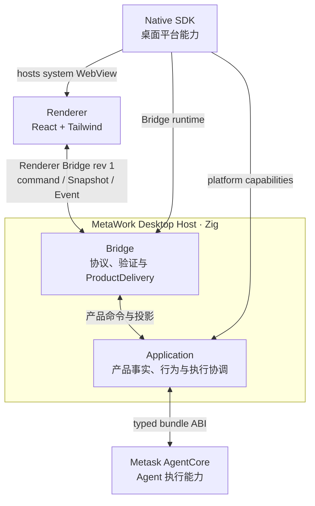

# MetaWork 高层架构

> 状态：当前为同进程 prototype；后续正式故障域选择单 AgentCore Worker
> 日期：2026-08-04

本文只定义 MetaWork 的顶层模块、依赖方向、进程与故障域以及跨模块安全边界。产品对象和行为见 [产品需求](requirements.md)，Application 内部 owner、事务、并发和恢复见 [Application 内部架构](application-architecture.md)，Renderer Bridge wire 见 [Renderer Bridge 合同](renderer-bridge-contract.md)，AgentCore 线程与生命周期见 [AgentCore 集成契约](agentcore-integration.md)，ABI 与 bundle 门槛见 [AgentCore ABI v1 消费合同](agentcore-abi-v1.md)。实际源码目录和依赖方向见 [工程结构与所有权](project-structure.md)，验证状态见 [验证规范](validation.md)。

## 1. 已确认的技术选型

| 顶层模块    | 选择                            | 定位                                                              |
| ----------- | ------------------------------- | ----------------------------------------------------------------- |
| Renderer    | React + Tailwind                | 唯一正式 UI；运行于 Native SDK 托管的系统 WebView                 |
| Bridge      | Zig                             | Renderer Bridge revision 1 的协议、验证和 ProductDelivery 边界    |
| Application | Zig                             | MetaWork 产品事实、产品行为、执行协调和恢复语义的唯一边界         |
| AgentCore   | Metask AgentCore library bundle | 独立构建和发布；MetaWork 只消费 canonical bundle                  |
| Native SDK  | Native SDK                      | Zig 桌面 Runtime，提供 WebView、窗口、主线程和受限平台 capability |

正式主路径不采用 Tauri + Rust，不建立第二套 Renderer，不以 PTY、xterm、终端字节流或 Provider SSE 作为 Agent UI 协议，不复制 AgentCore ABI 或实现源码，也不建立 Native SDK Adapter、通用 Desktop Interface 或可替换框架抽象。

## 2. 顶层模块

这是一张逻辑模块图，不等于进程图或源码目录图：

1. Renderer 只通过 Renderer Bridge revision 1 访问产品路径；
2. Bridge 与 Application 物理上位于同一个 Zig Desktop Host，逻辑上分别是入站协议边界和产品核心；
3. Application 是 `app`、`account`、`workbench` 与 `agent` 的逻辑产品边界，不代表统一源码 module 或 facade；Bridge 把命令 dispatch 给其中对应 owner；
4. AgentCore 与 Native SDK 是两个并列依赖：前者提供 Agent 执行能力，后者托管 Renderer，并向 Bridge 与 Application 提供桌面平台能力；
5. 当前 AgentCore bundle 链入同进程；未来单 Worker 只改变 Application 后方的部署、资源和故障域，不改变 Renderer Bridge 产品合同。

## 3. 模块职责

### 3.1 Renderer

Renderer 负责页面、布局、交互、结构化 Agent 工作展示和纯 UI 临时状态。它可以缓存 Application projection，但不能成为 Workspace、Task、Run、Account readiness、Agent 执行状态、持久化历史、权限决策或窗口真实状态的唯一 owner。WebView reload 或重连后，Renderer 必须能够从完整 Snapshot 重建产品界面。

Renderer 不直接加载 AgentCore，不访问任意文件或进程，不持有 Provider credential，也不作为权限或安全边界。

### 3.2 Bridge

Bridge 验证来源与启动窗口 identity，严格解码 payload，把合法输入转换为产品命令，调用 Application，编码 typed result，并运输 Snapshot/Event。Bridge 不决定 Task admission、Workspace authority、Agent cancellation、credential replacement 或历史持久化。

Bridge 的连接、revision、snapshot identity、分块读取、retry 和 fail-closed 规则只由 [Renderer Bridge 合同](renderer-bridge-contract.md)定义。窗口 chrome 是受限平台意图，不形成第二产品数据面。

### 3.3 Application

Application 是 MetaWork 产品事实与行为的逻辑边界。它不是统一源码 module 或 facade；Bridge 把 typed 产品命令 dispatch 给内部对应 owner，由这些 owner 执行 admission，协调账号、Workspace、Task、Run、持久化、恢复与 Agent 执行，并共同生成 canonical 产品 projection。

Application 内部如何拆分 owner 不属于本图，见 [Application 内部架构](application-architecture.md)。Application 的产品 policy 不依赖 DOM、React tab、Toast、JSX state 或 WebView URL。

MCP 不形成第五个 Application owner。Workbench 拥有 registry、credential locator/恢复、产品状态、工具 authority、Task binding 与安全 projection；Agent 拥有运行期 transport、secret copy、AgentCore descriptor/catalog/selection 与 typed health；App 的 `app/mcp_platform.zig` 只注入 `<MetaWork data dir>/mcp` 的目录单写锁、独立系统 credential service、stdio/network capability并编排启动/关闭。Account 不参与 MCP，Bridge 仍只运输 Workbench projection，AgentCore 继续唯一拥有 MCP 协议、JSON-RPC、协商和 tool binding 语义。

### 3.4 AgentCore

AgentCore 拥有 Provider 调用、agent loop、Conversation、built-in tools、Session、结构化 CoreEvent、同步 UI request 和 RunResult。它不拥有 MetaWork 的 Workspace、Task、Run 产品历史、Renderer projection 或持久化 policy。

只有 Application 内部的 Agent 边界可以消费官方 typed SDK 与 binary ABI；其他模块只使用 MetaWork-owned 产品类型。精确合同见 [AgentCore 集成契约](agentcore-integration.md)和 [AgentCore ABI v1 消费合同](agentcore-abi-v1.md)。

### 3.5 Native SDK

Native SDK 直接构成 Zig Desktop Host 的系统 WebView、窗口与桌面生命周期，并提供主线程、timer、通知、文件对话框和应用目录等平台能力。它托管 Renderer，为 Bridge 提供受限平台 seam，并由 Desktop Host composition 把产品所需的窄 capability 注入 Application；产品 policy 不直接持有 Native SDK Runtime 对象。

## 4. 跨模块合同

- Renderer → Bridge 只提交产品语义命令或受限平台意图，不提交 React component state、任意路径、Provider 配置或完整 credential。
- Bridge → Application 只提交严格解码后的 typed command；业务拒绝由 Application 返回 typed result，malformed payload 与 authority failure 由 Bridge fail closed。
- Application → Bridge 发布 canonical projection；Bridge 只拥有编码后的 transport bytes、connection generation 和 Snapshot transport state。
- Application → AgentCore 只经内部 AgentCore 边界；Renderer、Bridge 与 Application 的其他 owner 只使用 MetaWork-owned 产品类型。
- Native SDK → Desktop Host 的能力按调用边界和 owner 使用；不得用一个通用平台接口掩盖线程、ownership、deadline、容量和 shutdown 语义。
- Renderer 断连、Snapshot 失败或 Bridge transport failure 默认不反向伪造 Agent Run cause，也不直接终止后台执行。

当前 Renderer Bridge identity 是 `metawork.renderer-bridge` revision 1；兼容、hard-cut 与版本审批语义只由 [Renderer Bridge 合同](renderer-bridge-contract.md)定义。

## 5. 状态、恢复与故障域

Application 在 Renderer 生命周期之外拥有产品状态。WebView reload 通过完整 Snapshot 重建视图；Host 重启只恢复经过校验的产品历史。AgentCore ABI v1 revision 6 已提供 checkpoint export/restore 原语，但 MetaWork 尚未完成其持久化、exclusive restore、execution binding 对账和故障恢复验收；因此当前历史 Task 不伪造 continuation，无法恢复的 non-terminal operation 保守收口为 interrupted。

Bridge transport、Application 产品状态和 Agent execution terminal cause 是不同事实。Snapshot/Event 失败不覆盖产品历史；transport failure 不伪造用户取消；Agent terminal result 只有经 Application 提交后才成为 MetaWork 产品事实。详细线性化、持久化和恢复规则见 [Application 内部架构](application-architecture.md)，连接与 Snapshot transport 见 [Renderer Bridge 合同](renderer-bridge-contract.md)。

| 模型                      | 故障隔离               | 作用                                |
| ------------------------- | ---------------------- | ----------------------------------- |
| 同进程 + bounded executor | 零进程级隔离           | 当前最小真实 baseline               |
| 单 AgentCore Worker       | Host 与 AgentCore 隔离 | fault-domain 验证选定的后续正式方向 |
| 每活跃 Session Worker     | 会话级隔离             | 只有前两者数据不足时再验证          |

统一 Zig 不提供隔离。独立 crash 对照证明同进程是零进程级隔离，并选择单 AgentCore Worker 作为后续正式方向。该决定不把 spike IPC 升格为产品协议；版本化 transport、backpressure、shutdown、credential 和真实 bundle 资源数据必须在后续能力验收中定义。当前同进程应用仍只是 prototype。

## 6. 当前能力边界

当前正式 AgentCore baseline 是 ABI v1 revision 6。MetaWork 只消费经 verifier 接收并 stage 到 `.agentcore/bundle` 的 canonical bundle；缺失、identity、checksum、target、ABI 或 symbol 校验失败必须明确失败，不允许旧 revision、`latest`、可变 tag、implementation source fallback 或静默降级。精确 bundle 规则见 [AgentCore ABI v1 消费合同](agentcore-abi-v1.md)。

当前 baseline 不包含 async pending、suspend/resume、跨进程 Conversation 恢复、strict Workspace security、正式 Host tools、typed Output/FileChange、plan progress/approval、custom UI 或 Windows 安装签名更新。存在 ABI entry 不代表产品能力已经开放；能力状态只以 [验证规范](validation.md)为准。

Native SDK 的平台支持矩阵、真实 WebView 路径、构建与分发证据只在 [验证规范](validation.md)维护。架构不预设未经验证的 push、poll 或自制 `events.drain` 协议，也不从一个平台的结果推断另一个平台已经可用。

## 7. 安全边界

Renderer 按不可信调用方处理：

- Bridge 命令默认拒绝，只开放白名单；
- dev origin 和 release origin 分离，开发配置不得泄漏到发布包；
- Host 校验 payload、Session/Run 归属和请求时效；
- trusted Workspace 只能由 Host 原生目录选择与原生确认生成一次性 grant；Renderer 不能提交路径加 boolean 自行授信；
- Provider credential 不进入 Bridge、事件、日志或 snapshot；
- OAuth token、PKCE verifier、authorization code、完整 API Key 和 Authorization header 只能存在于 Application secret owner、系统凭据存储和受控 runtime copy；所有 owner 在释放前 secure-zero；
- MCP credential 使用与 Metask Account 分离的 `<bundle-id>.mcp` 系统 credential service，只存在于系统凭据存储、Workbench preparation 的线性临时 copy 和 Agent runtime copy；`mcp/registry.json`、Bridge、Renderer、日志、产品历史和 raw diagnostic 均不得保存 credential 原文；
- production provider/base URL/API Key 不从环境变量或 Renderer 注入，只能来自 Account 已锁定并验证的 Metask contract；Renderer 只能提交 Host 当前脱敏 catalog 中的稳定 API/model selection identifier，Host 必须重新校验 ownership、active 状态、API→model 归属并从锁定合同推导 typed provider/base URL；
- Host 在形成产品 projection 前移除已知 Host-held credential 和 schema 标记的 secret 字段，并对命令与工具输出设置 byte 上限和 truncation 状态；Renderer 不是秘密过滤边界；
- 当前不暴露通用 Host tool 或任意执行接口；
- built-in Bash 使用非交互子进程；
- strict Workspace security 未通过前，只运行临时或明确 trusted Workspace。

持久 permission 是 Host-owned 产品状态，不是 Renderer preference 或 AgentCore parallel protocol。规则必须绑定 stable Workspace identity、tool identity/version、operation、canonical resource constraint 和 rule schema version；canonical path 字符串本身不能充当 stable identity。Workspace、tool、script 或 capability 变化时规则 fail closed。Workspace 文件边界、process tree、network、environment、审计和撤销分别通过对应安全 Gate 前，UI 不得为相关能力提供 `Always allow` 或 `Full access`。

## 8. Release 与合同 identity

MetaWork 桌面产品、根 npm workspace、Renderer workspace 和 Zig package 随同一仓库原子发布，共用一个 release version。`app.zon` 是产品版本与 Bundle ID 真源；根 npm、Renderer 与 Zig manifest 必须精确镜像，派生 lock 只保存工具生成结果。实际源码 owner 见 [工程结构与所有权](project-structure.md)。

Renderer Bridge revision、Account persistence schema、AgentCore artifact version、AgentCore ABI version/revision 和 bundle manifest schema 各自保护不同合同，不得随 MetaWork release version 自动升降。精确账号存储身份见 [Metask Account API 合同](metask-account-contract.md)，macOS 签名规则见 [macOS 本地开发签名](macos-local-development.md)；任何合同类版本标识的变更都必须先得到用户显式同意。

## 9. 主要风险

| 风险                                   | 当前控制方式                                                              |
| -------------------------------------- | ------------------------------------------------------------------------- |
| Native SDK Zig → React 路径不符合预期  | 真实 dev/prod smoke                                                       |
| typed SDK 与真实 producer wire 漂移    | source-free corpus + 真实 Host link/run 回归                              |
| callback 数据返回后失效                | callback 内验证并深拷贝                                                   |
| callback/close race 造成 UAF           | abort、join、callback quiescence 后 destroy                               |
| callback identity race 泄漏 permission | UI request publication 与 response extraction 均在 Session lock 下复检    |
| 同步 UI 耗尽 executor                  | bounded slots、deadline、cancel/close/shutdown 唤醒和压力测试             |
| Bridge/event 造成无限内存              | count/byte/time 多维上限和公平调度                                        |
| Run failure 被误报用户取消             | active first-writer cause 与 Application write-once terminal history 分层 |
| Renderer 掉线杀死后台 Run              | typed transport policy 不向 Agent termination 反向泄漏                    |
| v1 Workspace 被误报安全                | 只允许临时/trusted 验证并显式标注限制                                     |
| 同进程 native crash 带走全部状态       | fault-domain 验证已选后续单 Worker；当前同进程应用仍是 prototype          |
| 过早建设发布系统                       | baseline 通过后再做 cache 与 remote                                       |
