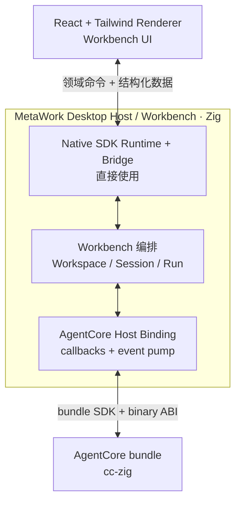

# MetaWork 高层架构

> 状态：技术选型与系统边界已确认；当前实现基线已对齐 AgentCore ABI revision 1
> 日期：2026-07-15

产品范围见 [产品需求](requirements.md)，cc-zig 的具体接入约束见 [AgentCore 集成契约](agentcore-integration.md)，当前 bundle 能力见 [AgentCore ABI v1 消费基线](agentcore-abi-v1.md)。

## 1. 已确认的技术选型

| 层级 | 选择 | 决策说明 |
| --- | --- | --- |
| Renderer | React + Tailwind | 当前正式 UI 技术栈，适合复杂 Workbench 界面 |
| Desktop Framework | Native SDK | Zig 一等公民，负责系统 WebView、窗口、Bridge 和桌面生命周期 |
| Workbench / Host | Zig | 承担产品编排、权限边界、状态协调和 AgentCore 接入 |
| AgentCore | cc-zig AgentCore library bundle | cc-zig 独立构建和发布；MetaWork 链接产物，不把 cc-zig 源码纳入自身构建 |
| Agent UI contract | cc-zig 原生结构化协议 | React 消费语义数据，不消费终端字节流或 Provider SSE |

由此排除以下正式主路径：

- 不采用 Tauri + Rust；
- 不由 MetaWork 维护 AgentCore ABI 或复制协议；
- 不通过本地 path dependency、Git source dependency 或源码复制把 cc-zig 编进 MetaWork；
- 不以 PTY、xterm 或模拟终端作为默认 Agent 架构；
- 当前不使用 `.native` 取代 React；
- 不建立 Native SDK Adapter、通用 Desktop Interface 或可替换框架抽象。

## 2. 当前里程碑边界

### 同步 macOS baseline

当前 cc-zig bundle 提供 experimental AgentCore ABI revision 1。MetaWork 首先验证同步 Run、built-in tools、`CoreEvent` JSON、同步 Host UI、abort 和生命周期。

该 baseline 不包含：

- async pending 或 suspend/resume；
- Session/Conversation 跨进程恢复；
- strict Workspace security；
- 可映射到 MetaWork Session/Run 的正式 Host tools；
- Windows 产物。

### 完整 Phase 0A

同步原型通过后，还必须完成事件泵容量数据、shutdown race、同进程 crash baseline 和最小 Worker fault-domain spike。完成这些验证才能结束 Phase 0A。

### 后续能力

artifact cache/remote 发布、async resume、strict Workspace security、正式 Host tools 和 Windows Phase 0B 使用独立 Gate 推进，不阻塞同步 macOS baseline。

## 3. 高层结构



这是三层职责边界，不等于三个进程：

1. Renderer：产品界面；
2. Zig Host / Workbench：桌面宿主、产品编排和安全边界；
3. AgentCore：Agent loop、模型、工具和结构化事件。

## 4. 组件职责

### 4.1 React + Tailwind Renderer

负责：

- Workbench 页面、布局和交互；
- 渲染消息、工具、审批、错误、usage 和运行状态；
- 维护纯 UI 临时状态；
- 通过集中式 client 调用 Host 领域命令并接收事件。

不负责：

- 直接加载 AgentCore；
- 解析 Anthropic/OpenAI SSE；
- 从终端输出推断 Agent 状态；
- 直接访问任意文件或启动任意进程；
- 持有 Provider credential；
- 作为权限或安全边界。

### 4.2 MetaWork Zig Host / Workbench

Native SDK 直接构成这一层的 Runtime、窗口和 Bridge。Host 内部可以按代码规模形成 Bridge、Workbench 和 AgentCore 模块，但不得为假想替换需求再包装一套镜像接口。

Host 负责：

- 创建窗口并托管系统 WebView；
- 暴露小而明确的领域命令；
- 校验来源、参数、Workspace、Session 和权限；
- 在 Renderer 之外读取并持有 Provider credential；
- 管理 Session、Run、队列、取消、关闭和当前进程内状态；
- 实现 AgentCore callback binding 和有界事件泵；
- 管理跨会话产品状态；
- 提供文件对话框、通知、更新和应用生命周期能力。

当前 v1 Host 只在临时或用户明确 trusted 的 Workspace 中运行。它不能因为传入了 `workspace_root` 就宣称 strict Workspace security 已成立。

### 4.3 AgentCore

负责：

- Provider 请求、SSE 解析和流式组装；
- agent loop 和 Conversation；
- built-in tool schema、选择、permission 与执行；
- Session 运行和 abort；
- 输出 `CoreEvent`；
- 通过同步 UI callback 发起 `UiRequest` 并接收 `UiResponse`；
- 返回 ABI status 与 `RunResult`。

async suspend/resume、持久化恢复和后台转换属于后续 AgentCore capability，不是当前 bundle 的隐藏能力。

## 5. AgentCore bundle 边界

cc-zig 与 MetaWork 是两个独立构建单元。正式接入物是 cc-zig 构建的 target-specific bundle：

```text
AgentCore bundle
├── lib/libmetacodes_agentcore.a
├── include/metacodes_agentcore.h
├── sdk/metacodes_agentcore.zig
├── sdk/metacodes_agentcore_types.zig
└── manifest.json
```

规范要求：

- cc-zig 单一维护 binary facade、C header、Zig SDK 和内部映射；
- MetaWork 当前从显式 bundle root 消费，不访问 cc-zig source tree；
- manifest 锁定 commit/build identity、Zig toolchain、target、architecture、构建模式、ABI version、系统链接输入和 checksum；
- artifact 缺失、target 不匹配或 checksum 错误时明确失败；
- 不使用 `latest`、版本范围、可变 tag 或 source fallback；
- 当前 raw contract probe 与正式 Host 分离。probe 可以记录 raw SDK 缺口，正式 Host 必须只使用 typed SDK contract；
- 同步 baseline 通过后，再建设内容寻址 cache 和远程 artifact source；切换来源不能改变 bundle layout 或链接方式；
- 当前产品 Runtime 配置不注册 Host tools，Read/Bash/Edit 使用 AgentCore built-in tools。

现有 ABI version 1 对一个精确 bundle 的 layout、code 和语义是确定的。未来不兼容变化必须使用新的 ABI version；兼容增量必须通过 capability 与新 bundle identity 明确表达，不能在相同版本下静默漂移。

## 6. 实施 Gate

实施顺序固定为：

1. 统一同步 v1 baseline 的规范；
2. 验证 Native SDK React dev/prod 和真实双向 Bridge；
3. 用显式 bundle root 完成隔离的 artifact-only raw contract probe；
4. 建立 Host 生命周期、安全边界和 deterministic ABI function-table 测试；
5. cc-zig bundle SDK 补齐 typed status、事件与 UI request/response codec；
6. 正式 Host 直接接入 typed SDK，并先连接有界测试 sink；
7. 根据真实 trace 实现事件泵和 Bridge；
8. 完成同进程 macOS 同步原型；
9. 完成 fault-domain spike 并决定进程模型；
10. 再建设 cache、remote、后续 capability 和 Windows Phase 0B。

任何 Gate 未满足退出条件时，不得用 MetaWork 自己复制协议、放宽安全语义或引入 source dependency 绕过。

## 7. 并发、生命周期与故障边界

### 7.1 逻辑并发单元

```text
SessionRuntime
├── AgentCore Session handle
├── Conversation 所在 AgentCore Session 生命周期
├── current_run: optional RunJob
├── bounded input/event state
├── synchronous UI wait state
└── callback lifetime guard

RunJob
├── run_id
├── HostCause（first writer wins）
├── executor slot
└── run-scoped Host scratch
```

- 每个 Session 至多一个 in-flight Run；
- Host 使用有上限的 Run executor；
- 空闲 Session 不占 worker；同步 Run 和同步 UI wait 占用 execution slot；
- Bridge/main thread 不执行长耗时 Run，也不等待 permission；
- Session close 必须在 join 与 callback quiescence 后才销毁 AgentCore handle；
- Runtime 只能在全部 Session 销毁后销毁。

完整状态机、错误映射和 callback 所有权见 [AgentCore 集成契约](agentcore-integration.md)。

### 7.2 进程模型

| 模型 | 故障隔离 | 作用 |
| --- | --- | --- |
| 同进程 + bounded executor | 零进程级隔离 | 当前最小真实 baseline |
| 单 AgentCore Worker | Host 与 AgentCore 隔离 | Phase 0A fault-domain 对照 |
| 每活跃 Session Worker | 会话级隔离 | 只有前两者数据不足时再验证 |

统一 Zig 不提供隔离。Phase 0A 必须通过独立测试进程注入 crash；在完成同进程与最小 Worker 对照前，不确定正式进程模型。

## 8. 状态与恢复边界

当前同步 baseline 应形成以下可靠 Host 状态：

- 用户提交的消息；
- 已完成的 assistant 消息；
- 工具调用和结果；
- 同步审批决策；
- Run 的 running/waiting/stopped/completed/cancelled/failed/interrupted 状态；
- WebView reload 所需的当前 Host view snapshot。

Renderer reload 只重建仍存活 Host 的视图。Host/AgentCore crash 后当前 Run 必须标记 interrupted，危险工具不得自动重放。Conversation/checkpoint 跨进程恢复只有在未来 AgentCore capability 明确提供后才能设计。

## 9. 安全边界

Renderer 按不可信调用方处理：

- Bridge 命令默认拒绝，只开放白名单；
- dev origin 和 release origin 分离，开发配置不得泄漏到发布包；
- Host 校验 payload、Session/Run 归属和请求时效；
- Provider credential 不进入 Bridge、事件、日志或 snapshot；
- 当前不暴露通用 Host tool 或任意执行接口；
- built-in Bash 使用非交互子进程；
- strict Workspace security 未通过前，只运行临时或明确 trusted Workspace。

## 10. Native SDK 边界

Native SDK 是当前选型，但 Phase 0A 必须验证：

- React development server 与 production assets；
- JavaScript → Zig command；
- 真实 Zig → React 传输路径及其线程要求；
- message/result size 上限；
- origin policy、文件对话框、窗口关闭和正常退出；
- Debug/Release macOS 构建。

在验证前不预设 push、poll 或自制 `events.drain` 协议。Windows WebView、打包、签名和更新在 Phase 0B 单独验证。

## 11. 主要风险

| 风险 | 当前控制方式 |
| --- | --- |
| Native SDK Zig → React 路径不符合预期 | Gate 0 先做真实 dev/prod smoke |
| typed SDK 与真实 producer wire 漂移 | Gate 3 source-free corpus + Gate 4 真实 Host link/run 回归 |
| callback 数据返回后失效 | callback 内验证并深拷贝 |
| callback/close race 造成 UAF | abort、join、callback quiescence 后 destroy |
| 同步 UI 耗尽 executor | bounded slots、deadline、cancel/close/shutdown 唤醒和压力测试 |
| Bridge/event 造成无限内存 | count/byte/time 多维上限和公平调度 |
| Host fatal 被误报用户取消 | per-Run `HostCause` 是产品状态真相 |
| v1 Workspace 被误报安全 | 只允许临时/trusted 验证并显式标注限制 |
| 同进程 native crash 带走全部状态 | Gate 7 fault-domain spike 后再决定进程模型 |
| 过早建设发布系统 | baseline 通过后再做 cache 与 remote |
