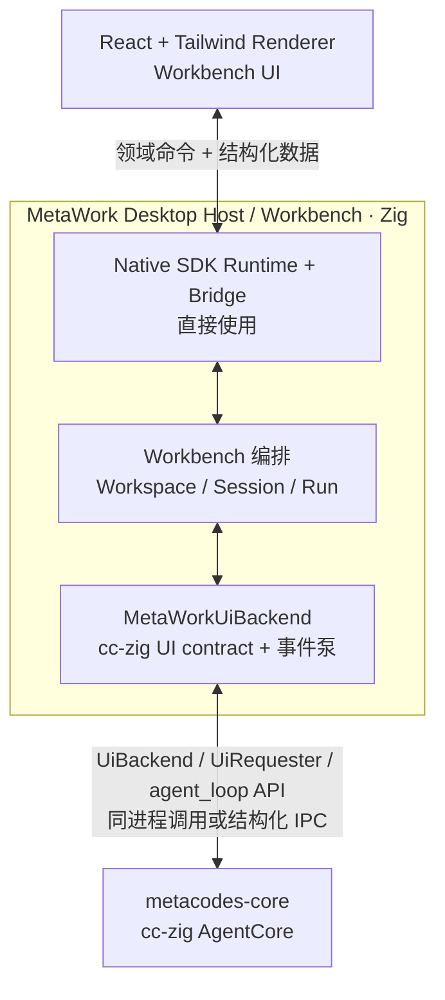

# MetaWork 高层架构

> 状态：技术选型与高层架构已确认，详细设计待 Phase 0 验证
> 日期：2026-07-14

产品范围见 [产品需求](requirements.md)，cc-zig 的具体接入约束见 [AgentCore 集成契约](agentcore-integration.md)。

## 1. 已确认的技术选型

| 层级 | 选择 | 决策说明 |
| --- | --- | --- |
| Renderer | React + Tailwind | 当前正式 UI 技术栈，适合复杂 Workbench 界面 |
| Desktop Framework | Native SDK | Zig 一等公民，负责系统 WebView、窗口、Bridge 和桌面生命周期 |
| Workbench / Host | Zig | 承担产品编排、权限边界、状态协调和 AgentCore 接入 |
| AgentCore | cc-zig 的 `metacodes-core` | 以 Zig library 形式集成，提供 agent loop 和结构化 UI contract |
| Agent UI contract | cc-zig 原生协议 | React 消费语义数据，不消费终端字节流或 Provider SSE |

由此排除以下正式主路径：

- 不采用 Tauri + Rust；
- 不为 AgentCore 额外维护 Rust/C ABI；
- 不以 PTY、xterm 或模拟终端作为默认 Agent 架构；
- 当前不使用 `.native` 取代 React；
- 不建立 Native SDK Adapter、通用 Desktop Interface 或可替换框架抽象。

架构阶段默认 cc-zig 能够完成 Windows 兼容。其兼容进度是 AgentCore 的交付问题，不改变 MetaWork 的目标边界。

## 2. 高层结构



这是三层职责边界，不等于三个进程：

1. Renderer：产品界面；
2. Zig Host / Workbench：桌面宿主、产品编排和安全边界；
3. AgentCore：Agent loop、模型、工具和结构化事件。

## 3. 组件职责

### 3.1 React + Tailwind Renderer

负责：

- Workbench 页面、布局和交互；
- 渲染消息、工具、审批、错误、usage 和运行状态；
- 维护纯 UI 临时状态；
- 通过集中式 `metawork-client` 调用 Host 领域命令并订阅事件。

不负责：

- 直接加载 AgentCore；
- 解析 Anthropic/OpenAI SSE；
- 从终端输出推断 Agent 状态；
- 直接访问任意文件或启动任意进程；
- 作为权限或安全边界。

### 3.2 MetaWork Zig Host / Workbench

Native SDK 直接构成这一层的 Runtime、窗口和 Bridge。Native SDK API 可以集中在 `host/` 职责范围内，但不通过 Adapter 再包装一套镜像接口。

Host / Workbench 负责：

- 创建窗口并托管系统 WebView；
- 暴露小而明确的领域命令；
- 校验来源、参数、Workspace、Session 和权限；
- 管理 Workspace、Session、Run、取消、关闭和恢复；
- 实现 `MetaWorkUiBackend`，接入 cc-zig 原生 UI contract；
- 管理跨会话产品状态；
- 提供文件对话框、通知、更新和应用生命周期能力。

Host 内部可以按代码规模形成 Bridge、Workbench 和 AgentCore backend 模块，但它们不是额外网络层，也不为假想替换需求建立接口体系。

### 3.3 metacodes-core / AgentCore

负责：

- 基础 agent loop；
- Provider 请求、SSE 解析和流式组装；
- 工具选择、permission 与执行；
- 会话运行、取消、挂起和恢复；
- 输出 `CoreEvent`；
- 通过 `UiRequester` 发起 `UiRequest` 并接收 `UiResponse`；
- 通过每 Run 的 `AbortSignal` 接收当前已验证的跨线程中断。

MetaWork 依赖 library contract，不依赖 CLI、REPL、TUI 或字符显示协议。cc-zig CLI 和 WebBackend 可以继续作为其他前端存在，但不构成 MetaWork 内部路径。

cc-zig 虽然定义了 `UiBackend.poll()` 和 `UiEvent`，但当前 `agent_loop` 生产路径尚未消费该 poll contract。MetaWork 不把未接通的接口当作已具备能力；反向控制的当前语义见 [AgentCore 集成契约](agentcore-integration.md#7-反向控制与-host-中断)。

## 4. 进程与故障边界

语言统一与故障隔离是两个不同问题。统一 Zig 有利于构建、类型和调试，但不会自动提供进程隔离。

| 模型 | 故障隔离等级 | 主要优点 | 主要代价 |
| --- | --- | --- | --- |
| 同进程 + 工作线程 | **零进程级隔离** | 最简单、低延迟、无序列化 | Zig panic、野指针、allocator corruption 或 C 越界可能带走 Host 和全部会话 |
| 单 AgentCore Worker，承载多会话 | Host 与 AgentCore 隔离，Worker 内共享故障域 | 进程数可控 | 需要 IPC、重连和恢复；Worker crash 影响其中全部会话 |
| 每个活跃会话一个 Worker | 会话级隔离 | 单会话 native crash 不影响 Host 和其他会话 | 资源、调度和恢复复杂度最高 |

高层架构不提前强制选择。Phase 0 至少比较同进程与单独 Worker，并通过独立测试进程注入 fatal crash。选择依据包括崩溃影响、恢复时间、取消可靠性、多会话资源、事件吞吐和实现复杂度。

### 4.1 并发与所有权单元

进程模型可以延后选择，但逻辑并发单元现在固定：

```text
SessionRuntime（长期状态）
├── Conversation 与 transcript/checkpoint 引用
├── permission memory / registries
├── current_run: optional RunHandle
├── session-lifetime allocator ownership
└── 至多一个 in-flight RunJob

RunJob（一次执行）
├── 独占借用所属 SessionRuntime 的可变状态
├── RunControl（独立 AbortSignal + Host fatal reason）
├── run-scoped scratch allocator
└── 同进程模型下占用一个 worker thread 直到 run()/resumeRun() 返回
```

- 同一 Session 不允许两个 `run()` / `resumeRun()` 并发修改同一 `Conversation`；
- Host 使用**有上限的 Run executor**，`max_active_runs` 由 Phase 0 测量后确定，超出的 Run 排队；
- 空闲 Session 不占 worker thread；正在执行的同步 Run 占用一个 execution slot；
- 同步 permission 等待会继续占用该 Run 的 worker slot，但不得阻塞 Native SDK/WebView 主线程；
- `Conversation` 和跨 Run 状态必须由 Session 生命周期内存持有。只有确认不会逃逸的临时数据才能放入 run-scoped arena；
- 如果选择独立 Worker，以上 Session/Run 独占规则不变，只是 execution slot 从 Host 线程变成 Worker 内执行单元。

这一约束防止两类错误：无上限地为 Session 创建线程，以及在 Run 返回时释放仍被 `Conversation` 引用的 arena 内存。

## 5. 状态边界

Workbench 是产品状态的最终解释者，但不要求每个流式 token 在显示前同步落盘。

应形成可靠状态边界：

- 用户提交的消息；
- 已完成的 assistant 消息；
- 工具调用与最终结果；
- permission 和其他 UI 决策；
- Run / Session 关键状态；
- 恢复所需 transcript、`SuspendInfo` 或 checkpoint 引用。

可以批量或异步处理：

- 高频文本增量；
- 短生命周期工具进度；
- 仅用于动画的 UI 状态。

具体数据库、日志和 checkpoint 格式属于详细设计。cc-zig 当前各类 UI 请求的恢复差异由 [AgentCore 集成契约](agentcore-integration.md#8-ui-请求与恢复语义)定义。

## 6. 安全边界

系统 WebView 中的 Renderer 按不可信调用方处理，即使前端资源随应用打包。

Host 必须：

- 默认拒绝，只开放显式注册的命令；
- 验证调用来源、payload、Session 归属和 Workspace 路径；
- 对文件、进程和高风险工具进行能力控制；
- 限制导航来源、外部链接和 CSP；
- 设置消息大小、频率和队列上限；
- 记录审批、工具调用和关键状态变化。

进程拆分可以增强故障隔离，但不能替代权限校验。统一使用 Zig 同样不会自动建立安全边界。

## 7. Native SDK 与 `.native`

### Native SDK

Native SDK 是长期桌面平台方向，因为它将 Zig 作为一等公民，能够直接承载 Workbench 和 cc-zig，同时提供 WebView 与桌面宿主能力。

项目固定明确版本或 commit。Windows WebView、Bridge、打包、签名、更新和 API 变化是 Phase 0 必须验证的外部依赖风险。

Native SDK 直接使用，不设置 Adapter。相关代码按职责集中是正常模块组织，不意味着建立框架替换层。

### `.native`

`.native` 具有长期观察价值，但不是当前 React Renderer 的替代方案。

- 正式产品继续使用 React + Tailwind；
- 关注 `.native` 的组件、布局、输入、可访问性、调试和 Windows 进展；
- 只有能力足以支撑复杂 Agent Workbench 后，才通过独立原型重新评估；
- 当前不建立通用 UI 抽象，不制定 React 迁移工程，不维护第二套 Renderer。

## 8. 当前风险

| 风险 | 控制方式 |
| --- | --- |
| Native SDK pre-1.0、API 变化 | 固定版本/commit；Phase 0 验证硬能力 |
| Windows 打包、签名和更新路径 | 在形成深层依赖前完成 Windows spike |
| cc-zig Windows 兼容仍在推进 | 独立建立 Windows CI 和最小运行验证 |
| WebView Bridge 高频事件 | 使用有界事件泵；按集成契约压测 |
| 同进程 AgentCore native crash | 明确认定零进程级隔离；比较 Worker 模型 |
| 同步 `run()` 占满 worker | 有界 Run executor；每 Session 至多一个 in-flight Run；额外 Run 排队 |
| 同步 permission 等待不可 checkpoint | crash 后 Run 标记 `interrupted`，工具保持未执行 |
| cc-zig 对外文档与实际 enum/signature 漂移 | 固定 commit；从导入类型做编译期穷尽检查；Phase 0 校验契约 |
| `.native` 生态成熟度不足 | 不影响 React 主线，仅独立观察 |

## 9. 已撤回的过度结论

- 每个 Session 必须一个 AgentCore 进程；
- 每个流式 chunk 必须先落盘再显示；
- NDJSON 因文本换行而天然不安全；
- 进程模型、IPC framing 或数据库未定就意味着高层架构不成立；
- 选择 Native SDK 就等于选择 `.native`；
- 统一 Zig 就等于单进程；
- Native SDK 必须包装 Adapter；
- MetaWork 需要重新定义完整 Agent 事件协议；
- 所有 UI 请求都不可 checkpoint，或所有 UI 请求都可 checkpoint。

## 10. 参考资料

以下 Native SDK 链接已于 2026-07-14 逐项验证可访问。

- [Native SDK](https://github.com/vercel-labs/native)
- [Native SDK: Frontend](https://native-sdk.dev/frontend)
- [Native SDK: Bridge](https://native-sdk.dev/bridge)
- [Native SDK: Platform Support](https://native-sdk.dev/platform-support)
- [Native SDK: Packaging](https://native-sdk.dev/packaging)
- [Native SDK: Updates](https://native-sdk.dev/updates)
- [Native SDK: Native UI](https://native-sdk.dev/native-ui)
- [Native SDK: Zig](https://native-sdk.dev/zig)
