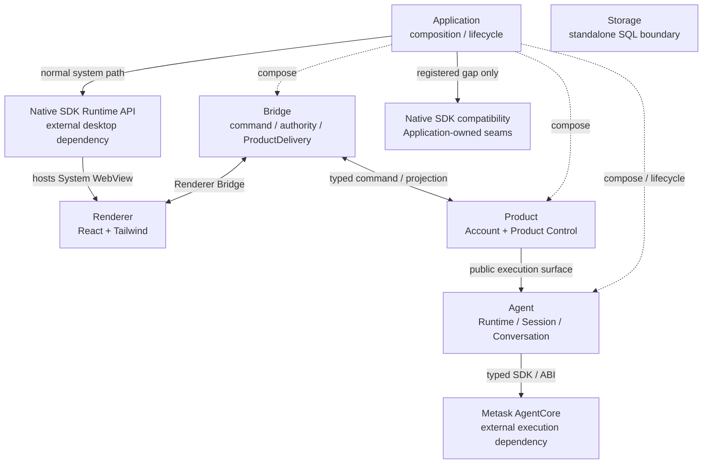

# MetaWork 高层架构

本文只定义 MetaWork 的顶层逻辑边界、依赖方向、运行时组合、部署与故障域、跨模块安全边界、Native SDK compatibility 治理以及 release/contract identity。

产品对象和行为见[产品需求](requirements.md)，UI 信息架构、交互与视觉见[UI 设计规范](ui-design.md)，Product owner、事务、并发和恢复见[Product 架构](product-architecture.md)。Renderer Bridge wire、AgentCore 集成生命周期、ABI/bundle、Completion 和 Storage 分别由[Renderer Bridge 合同](renderer-bridge-contract.md)、[AgentCore 集成契约](agentcore-integration.md)、[AgentCore ABI v1 合同](agentcore-abi-v1.md)、[Completion 架构](completion-architecture.md)和[Storage 架构](storage-architecture.md)定义。源码根和依赖映射以[工程结构与所有权](project-structure.md)为准，能力状态和验证证据以[验证规范](validation.md)为准。

## 1. 技术决策与非目标

| 架构节点 | 选择 | 定位 |
| --- | --- | --- |
| Application | Zig | composition、跨 owner 编排、平台 capability 适配与生命周期 |
| Renderer | React + Tailwind | 唯一正式 UI，由 Native SDK System WebView 托管 |
| Bridge | Zig | Renderer 协议、authority 与 ProductDelivery 边界 |
| Product | Zig | 产品事实、行为、事务、持久化和恢复的逻辑边界 |
| Agent | Zig + Metask AgentCore | MetaWork-owned 执行边界及其对 canonical AgentCore bundle 的唯一消费路径 |
| Storage | Zig + SQLite | MetaWork-owned、无业务语义的 SQL contract 与 backend 边界 |
| Native SDK | Native SDK | Application 消费的外部桌面能力依赖 |

正式主路径不采用 Tauri + Rust，不建立第二套 Renderer，不以 PTY、xterm、终端字节流或 Provider SSE 作为 Agent UI 协议，不复制 AgentCore ABI 或实现源码，也不建立 Native SDK Adapter、通用 Desktop Interface、可替换框架 facade 或平行系统能力协议。

Metask AgentCore 与 Native SDK 是两个并列外部依赖。AgentCore 只通过 target-specific canonical bundle、官方 typed SDK 和 binary ABI 消费；缺失、identity、checksum、target、ABI 或 symbol 验证失败必须明确失败，不允许旧 revision、`latest`、可变 tag、implementation source fallback 或静默降级。精确 artifact identity 由 target lock 定义，接受规则由 ABI 合同和 verifier 拥有。

Agent 提供的独立 Completion 不属于 AgentCore Runtime、Session 或 AgentLoop，也不形成第二套 Agent 协议。它只消费调用方已冻结的 ExecutionConfig；provider codec、transport 和取消合同由[Completion 架构](completion-architecture.md)定义。

## 2. 顶层边界与运行时组合

这是逻辑边界图，不等于源码目录图或进程图：

1. Application 组装 Bridge、Product 与 Agent，执行平台生命周期和已定义的跨 owner 顺序；它不是业务 owner，也不形成统一 facade；
2. Renderer 的产品操作只通过 Renderer Bridge 访问 Host，不能直接调用 Product、Agent 或任意 OS API；它可以消费 `app.zon` 已开放且 Native SDK 明确面向 System WebView 的 UI/input surface，以及本节明确登记的标准 WebView API，这类消费不授予 Product authority 或通用系统执行权；
3. Product 包含 Account 与 Product Control 两个 named owner，不代表统一 module；Product Control 直接消费 Agent 公共执行能力；
4. Agent 是独立于 Product 的 MetaWork-owned 执行边界，也是 AgentCore SDK/ABI 的唯一正式消费者；
5. Native SDK compatibility 是 Application-owned 的受限消费路径，不是新的顶层 owner、平台层或 SDK 替代品；
6. Storage 是独立基础边界；接入 Product 必须显式定义 schema owner、backend composition 和 shutdown，不因源码存在而自动取得业务职责。

文档中的 Application 对应代码中的组合类型 `App`；“Product”只指产品逻辑边界；“Agent”只指 MetaWork 对 AgentCore 的产品化集成边界；“Host”在 wire 或依赖合同中泛指 Renderer 之外的可信侧，不能据此建立新的 owner。

## 3. 边界职责

### 3.1 Renderer

Renderer 拥有 WebUI 页面、布局、交互、结构化 Agent 工作展示和纯 UI 临时状态。它可以缓存 canonical Product projection，但不能成为 Workspace、Task、Run、Account、Agent execution、持久化历史、permission 或原生窗口状态的唯一 owner；WebView reload 或重连后必须能够从 Host Snapshot 重建界面。

Renderer 是随 MetaWork 桌面应用一同构建、签名和发布的可信 UI 实现，不作为与 Host 对立的恶意安全主体。它可以消费 `app.zon` 已开放且 Native SDK 明确面向 System WebView 的 UI/input surface，并在用户显式交互的有界生命周期内持有对应领域合同允许的 UI 输入或本地资源 locator；本地路径是否可以进入某个 typed command 由对应领域合同决定，不因数据先到达 Renderer 就要求 Native SDK 提供功能重复的 Host-only 接口。credential、raw file content 与原生 handle 仍只按各自明确合同处理，这一定位不授予通用访问权。

可信 UI 身份不使 Renderer 成为 Product authority、credential store 或原生系统 effect owner。Renderer 不访问任意文件或进程，不持有原生 identity/handle，不执行未登记的窗口、托盘、快捷键等平台 effect，也不根据 DOM、Toast、URL、显示文本或本地缓存发明 Product policy。Bridge 对 payload 的严格解码和 Host 对 identity、revision、membership、资源范围与时效的重新校验用于维护 owner、处理陈旧 UI 状态、实现错误隔离并拒绝格式错误，不以 Renderer 是恶意代码为前提。用户在 Custom Provider 表单中显式填写的 API Key 只允许停留到一次 create/replace command 提交完成，之后必须从表单状态清除；该窄例外不赋予 Renderer credential authority。

Renderer 唯一可直接执行的标准 WebView 系统写入是 secure packaged origin 内、由用户手势触发的 Clipboard API 写入。它只承载已经进入 canonical Product projection 的 terminal final/partial response Markdown、由同一 Markdown 安全渲染得到的语义 HTML，或该 response 内可见代码块的纯文本；不得读取系统剪贴板、写入 provisional/commentary/Tool/状态、从页面 DOM 反取内容、截断后报告成功，或把这条登记扩展为任意 Web API 系统 effect。双格式写入必须由一个 `ClipboardItem` 原子提交；只有运行环境明确缺少多 MIME 能力时才可完整降级为 `writeText(Markdown)`，权限、容量、转换或系统拒绝必须显式失败。

### 3.2 Bridge

Bridge 是 Renderer 与 Host 之间的唯一产品通信边界。产品命令面只严格解码、校验 source/window authority、dispatch typed command 并运输 Snapshot/Event；受限平台 capability 面只接受已登记的封闭 intent 并交给 Application。两面可以复用 transport 和 origin policy，但不共享产品状态或系统执行 authority。

Bridge 不决定 Task admission、Workspace authority、Agent cancellation、credential replacement、持久化或恢复，不持有 AgentCore handle、Product 内部指针或系统 handle。除 Custom Provider create/replace 与 MCP captureSecret command 的调用期手动凭据外，Bridge 不接收 raw secret；这些命令只做严格解码、边界校验和同步转交，不记录、缓存、投影或返回 secret。连接、command catalog、wire、snapshot identity、retry 和 fail-closed 规则只由[Renderer Bridge 合同](renderer-bridge-contract.md)定义。

### 3.3 Product

Product 是产品事实与行为的逻辑边界。Bridge 把 typed 产品命令交给内部对应 owner；这些 owner 执行 admission、事务、持久化与恢复，并共同生成 canonical 产品 projection。Product policy 不依赖 Renderer component state、DOM、WebView URL 或 Application 平台实现。

Account 与 Product Control 是 Product 的两个 named owner。Models、Workspace、Task、Schedule、Skill 与 MCP 是 Product Control 持有的 aggregate，不形成新的顶层 owner；其中 Account 只拥有 Metask identity/authorization，Models 发布 Product 通用 protocol/config 合同并拥有 Metask provider catalog/selection和 user-managed Custom Provider。Account 授权是 Metask provider 的可用性前提，但 Account 与 Models 不互相导入；Application 只以单次 owned authorization lease完成组合。Product Control 只通过 Agent 公共执行表面消费 Agent 能力；Application 只执行平台 effect、生命周期和跨 owner coordination。内部事务、authority 和失败语义只由[Product 架构](product-architecture.md)与[Account 架构](account-architecture.md)定义。

### 3.4 Agent 与 AgentCore

Agent 拥有 MetaWork 对 AgentCore Runtime、Session、Conversation、callback、event pump、typed terminal fact、built-in tool selection 和独立 Completion 的集成边界。Application 创建并关闭 Agent、注入窄 effect capability并安排主线程 wake；Product Control 调用 Agent 公共执行表面，但不管理 Agent Runtime、不读取 Session 内部字段，也不借 Agent 获取通用 I/O。

AgentCore 拥有 provider 调用、agent loop、Conversation、Session、CoreEvent、UI request、RunResult 与官方工具协议；它不拥有 MetaWork Workspace、Task、产品 Run、Executor、projection 或持久化。正式产品只有 Agent 可以消费 AgentCore typed SDK 与 binary ABI；Product、Application、Bridge 和 Renderer 只能消费 MetaWork-owned 公共类型。精确生命周期、线程、callback、错误映射与 shutdown 见[AgentCore 集成契约](agentcore-integration.md)。

### 3.5 Native SDK

Native SDK 是 MetaWork 消费的外部桌面依赖。Application 通过其 Runtime API 执行生命周期、窗口、System WebView、菜单、托盘、快捷键、dialog、notification、timer、credential 和其他系统 effect，并把 Product 所需能力收窄成 MetaWork-owned capability；Renderer 可以消费 manifest 已开放、SDK 明确面向 WebView 的 presentation/input API。Product owner 不依赖 Native SDK Runtime 类型，Renderer 使用这些 UI/input API 也不因此取得原生 effect 或 Product authority。

Native SDK Bridge API 是独立的正式 transport surface，不属于系统 effect 入口。Bridge 和 Application 只能消费完成 transport authority 所需的公开 contract、data-only DTO 与 opaque identifier；这些值不授予任意系统执行权，也不得传播到 Product owner。

| Native SDK surface | 允许消费者 | 边界 |
| --- | --- | --- |
| Runtime API | Application | 正常系统 effect 与 SDK-owned runtime state |
| WebView UI/input API | Renderer、browser-side Bridge | 只消费 `app.zon` 已开放的呈现与用户输入能力，不授予 Product authority 或通用系统 effect |
| 标准 WebView Clipboard API | Renderer | 只允许上述 secure origin、用户手势限定的 canonical response/code 写入；禁止 clipboard read 与未登记内容 |
| Bridge API / data-only DTO | Bridge、Application | transport、source/window authority 与无执行权数据 |
| `PlatformServices` public primitive | 已登记一级 compatibility seam | 只补 Runtime API 的明确缺口 |
| 公开 OS API / platform handle | 已登记二级 compatibility seam | 只补 SDK 也未提供原语的明确缺口 |
| `PlatformServices.context` | 无 | SDK 私有 opaque 数据，MetaWork 永不访问、解释或强转 |

系统能力只通过以下路径消费：

| 路径 | 调用链 | 适用条件 |
| --- | --- | --- |
| 正常路径 | Application → Native SDK Runtime API → SDK internals → OS | Runtime API 已提供完整能力 |
| 一级兼容 | Application narrow seam → public `PlatformServices` primitive → OS | Runtime API 缺失，但 SDK 公开低层原语足够 |
| 二级兼容 | Application narrow platform seam → public OS API | SDK 没有可用原语，必须暂时补齐平台实现 |

Runtime API 已可用时，绕过它调用低层函数属于架构违规。Compatibility 的治理单位是 capability seam，而不是文件或目录；每项 seam 必须：

- 只存在于 Application-owned、按 capability 和平台收窄的实现中，且只向消费者注入完成该职责所需的能力；
- 明确 capability identity、SDK 缺口、调用者、目标平台、线程、资源 ownership、失败、shutdown、验证和删除条件；
- 不建立第二份窗口、WebView、托盘、实例、credential 或应用生命周期状态，也不允许 OS 状态与 Runtime 状态静默分裂；
- 只调用 SDK 公开原语或公开 OS API，不访问私有 context、私有实现类型或未登记 system handle；
- 在 Native SDK 等价正式能力经目标平台验收后原位替换，并删除 seam、allowlist 和专用验证。

当前登记的 compatibility capability 为：

| Capability | 层级 | 允许边界 | 删除条件 |
| --- | --- | --- | --- |
| `system_webview_drag_region` | macOS 一级；Windows 二级 | 只补 System WebView drag region，不提供通用窗口 action | SDK 等价 drag-region Runtime API 通过目标平台验收 |
| `system_webview_maximize_restore`、`maximized_state`、`user_close` | 二级 | 各自保持封闭语义，可共享同一 startup window identity，但不得形成任意窗口 facade | SDK 等价窗口能力通过目标平台验收 |
| `secure_input` | 二级 | 原生安全文本输入，不接收 Product 对象、Bridge DTO、credential slot 或系统 handle | SDK secure-input Runtime API 通过 Windows/macOS 验收 |
| `app_single_instance` | 二级 | 应用实例仲裁与 second-launch activation transport | SDK 提供等价 data-root authority、同用户转交、bounded activation 与 shutdown |
| `macos_icon_composer_package` | build-time | 只补 `.icon` 资源编译，不进入 executable 或 Runtime/Bridge API | SDK 原生产生等价资源与 metadata 并通过分发验收 |

Window compatibility 共享的 startup window identity 只能由 Application 在窗口创建期建立一次并验证，再注入需要它的 seam；消费者不得复制捕获机制或把 identity 当成通用 system handle。`minimize` 等 Runtime API 已提供的能力必须保持正常路径，不能因相邻按钮使用 compatibility 而被吸入 seam。

`secure_input` 只接受有界 UTF-8 文案和调用方拥有的可清零输出缓冲区，只返回提交长度或取消；不得截断。取消、失败和 owner 释放必须清零 MetaWork-owned plaintext。原生 modal loop 可能继续派发应用事件，因此正式调用必须证明 prompt 打开期间后台事件可继续处理且不会产生未声明的状态机重入；只有编译成功不能证明该 capability 可用。

`app_single_instance` 必须同时满足：

- 唯一 Primary authority 是 canonical data root 上由 OS 自动释放的独占文件 lease；endpoint、PID 文件和进程名都不能授予 Primary 身份；
- Windows 只允许 current-user DACL Named Pipe，并以 pipe server PID observation 和 scoped `AllowSetForegroundWindow` 完成同用户 activation；
- macOS 只允许 Darwin per-user temporary directory 下的 `0600` Unix Domain Socket，并用 `getpeereid` 校验同 UID，禁止退回共享 `/tmp`；
- Application 独占 artifact/revision/argv/cwd 协议、严格容量、合并队列、主线程 wake 与窗口 effect；compatibility transport 不解释请求语义、不持有 Native SDK Runtime，每次 `forward` 只执行一次 connect 和一次 request/response，实际显示和聚焦必须回到正常 Runtime API；
- 退出窗口内只能在总 deadline 中交替重新竞争 lease 与单次连接；只有 endpoint 尚未 ready 可以重试，连接后的 timeout、transport 或协议失败必须立即 fail closed；
- listener shutdown、资源释放和 crash 后 lease 自动回收属于该 seam 的生命周期合同。

`macos_icon_composer_package` 是分发期而非 Runtime compatibility。它只能在 Native SDK 生成未签名应用后、唯一 Developer ID 签名前把 canonical `.icon` 编译成等价系统资源，不得建立第二个应用 packager或修改 executable。精确资源、签名、公证和视觉验收见[macOS 分发](macos-distribution.md)。

Compatibility 的 module root 与依赖方向由[工程结构与所有权](project-structure.md)映射，machine allowlist 和 architecture guard 强制实现边界，平台证据与未闭合验收由[验证规范](validation.md)维护。未在本节登记的低层调用不构成兼容能力。

### 3.6 Storage

Storage 是 MetaWork-owned、无业务语义的基础设施边界，拥有 backend-neutral SQL value、statement、query/mutation outcome、limit 和 migration mechanism；concrete backend 独占 engine connection、transaction、engine profile 与错误映射。Product owner 始终独占自己的 schema、migration 内容、health、恢复、并发和所需 durability policy，Storage 不因承载数据取得业务 policy。

Storage 当前不进入生产 Application/Product 运行图。直接 SQLite backend、conformance 和未来 backend 原位替换只由[Storage 架构](storage-architecture.md)定义；正式接入 Product 时必须显式改变本图和 owner composition，不能通过共享数据库或通用 repository 绕过 Product 边界。

### 3.7 持久化权威与故障语义

本节适用于 Account 与 Product Control 持有的全部 Product persistence，不属于 §3.6 的 Storage backend 合同。持久化的逻辑权威与物理载体必须分开：owner 已接受并确认提交的当前格式数据才是跨重启真相；进程内 state 只是在当前进程中已经接纳的产品真相；无法识别、损坏或事务结果未确定的磁盘内容只是待分类证据，不能自行取得 active authority。当前代码与合同决定新写入接受的格式；无法识别的既有数据不得被冒充为当前数据或声称已经迁移，是否保留或清理由数据所属 Product owner 的现有合同决定。精确的格式识别、迁移、恢复、effect gate 和清理规则同样由该 owner 定义，Application 只执行受限 I/O，Renderer 不参与文件策略。

`fail closed` 只表示在缺少可靠 authority 时拒绝相应的危险 effect、无人值守执行或权限扩大，不等同于冻结整个 Workbench，也不自动推出“禁止保存任何新状态”。decode 拒绝、数据证据保留、运行时可用性、mutation admission、commit certainty 和恢复可用性是不同事实，必须由 owner 分别建模；一个事实不能代替另一个事实。

## 4. 跨模块合同

- Renderer → Bridge 只提交产品语义命令或已登记的封闭平台 intent；不得携带平台实现名、任意 action、系统 handle 或任意执行配置。用户通过已开放 Native SDK UI/input surface 明确选择的物理路径，只能进入对应领域明确登记、容量有界的 typed command；路径值本身不建立 Workspace trust、文件读取成功或其他 Product authority，Host 必须按该领域合同重新校验。secret-bearing 产品命令只允许用户显式触发的 Custom Provider create/replace 与 MCP captureSecret，其手动凭据只能作为有界字段一次性转交对应 Host owner 的 credential mutation；
- Bridge → Product 只提交严格解码后的 typed command；业务拒绝由 Product 返回 typed result，malformed payload、伪造 ownership 与 authority failure 由 Bridge fail closed；
- Product → Bridge 只发布 canonical、无 secret projection；Bridge 只拥有编码后的 transport bytes、connection/snapshot identity 与 delivery 状态；
- Product Control → Agent 只经 Agent 公共执行表面，Agent → AgentCore 是唯一 typed SDK/ABI 路径；Application 只管理 Agent composition、lifecycle 和 event-ready wake；
- Product owner → system effect 只经其定义的 MetaWork-owned capability进入 Application；Application 不读取领域内部状态形成 policy，也不得用通用 facade 掩盖线程、ownership、deadline、容量和 shutdown；
- Renderer disconnect、Snapshot/Event failure 与 Agent terminal cause 是不同事实；transport failure 默认不终止后台 Run、不覆盖产品历史，也不伪造用户取消；
- Host 不为人类 decision wait 设置 deadline；系统通过 bounded admission、显式取消、断连和 shutdown 收口资源压力，不能把容量压力伪造成用户 timeout、拒绝或 Agent terminal cause；
- 跨边界 borrowed 数据只在调用期有效；需要异步保存时必须验证、深拷贝并由接收 owner 有界持有，释放顺序不能依赖调用方内部对象继续存活。

## 5. 部署、状态与故障域

Product 在 Renderer 生命周期之外拥有产品状态。WebView reload 通过 Snapshot 重建视图；Application restart 先恢复经过校验的 Product history，Conversation attachment 只能经用户显式恢复事务重建。Bridge transport、Product durable fact 与 Agent execution fact 不能相互覆盖，精确事务见[Product 架构](product-architecture.md)。

| 模型 | 故障隔离 | 架构地位 |
| --- | --- | --- |
| 同进程 + bounded Executor | 无进程级隔离 | 当前实现拓扑 |
| 单 AgentCore Worker | Host 与 AgentCore crash 隔离 | 已选择的正式方向，尚未实现 |
| 每 active Session Worker | Session 级隔离 | 只有单 Worker 证据不足时才评估 |

统一 Zig 和线程池不提供进程隔离；当前 AgentCore fatal 可以带走 Host 与全部进程内 Session。独立 fault-domain 证据支持单 AgentCore Worker 方向，但 spike IPC 不是产品协议，也不证明 Worker 已实现。正式 Worker 必须独立定义 versioned transport、capacity/backpressure、ownership、correlation、credential、disconnect、Run cause 与 shutdown；不得把当前 checkpoint recovery 误报为 in-flight Run 或 Worker crash recovery。证据状态见[验证规范](validation.md)。

## 6. 安全边界

- Renderer 是可信应用组件；所有 Bridge payload 仍按可陈旧、可畸形的边界输入严格解码。command 默认拒绝，dev/release origin 分离，Host 重新校验 window、identity、ownership、generation、membership、资源范围与时效；这些校验维护 Product owner 与运行时一致性，不把 Renderer 定义为独立敌对安全主体；
- Renderer-facing Native SDK API 是否可以交付路径、文件条目或其他本地输入，由具体产品合同按用户手势、生命周期、容量和后续 Host 校验定义；不得仅因数据先到达 Renderer 就要求 Native SDK 再提供语义重复的 Host-only API，也不得由此推导出通用任意文件或系统 effect 接口；
- trusted Workspace 只能由 Host 原生选择和确认产生的 capability 授权；Renderer 不能提交路径、boolean 或显示名称自行建立 trust；
- credential 和 secret 默认只能存在于对应 Product owner、系统 credential storage 和执行所需的 Application-owned bounded copy。用户显式填写的 Custom Provider API Key 与 MCP static/client secret 可以短暂存在于 Renderer password form 与各自专用 typed Bridge command；输入生命周期按对应产品合同清理，并交给对应 Host owner 写入系统 credential storage。Bridge 不得记录、缓存、投影或返回该字段；任何 secret 仍不得进入 event、snapshot、日志、raw diagnostic、产品历史、checkpoint record 或持久化 metadata；
- production protocol、endpoint、model 与 credential authority 只能来自 Product Models、Account/MCP 等对应合同；Custom Provider 表单只负责创建或替换 Models-owned source，不能把 API Key、arbitrary URL 或临时字段直接注入 Run；
- Host 在形成 projection 前执行 schema-aware filtering、credential redaction、UTF-8 与容量验证；Renderer 不是 secret 过滤边界；
- permission 是 Product/Agent 协作的安全事实，不是 Renderer preference 或平行 AgentCore protocol。持久规则必须绑定 stable Workspace、tool/version、operation、canonical resource constraint 与 rule schema；相关 authority 变化时 fail closed；
- 外部依赖只从 canonical、已验证输入消费；source copy、可变版本、静默 fallback 和绕过 verifier 的替代路径均不构成有效能力；
- Workspace、process tree、network、environment、审计、撤销或其他危险能力在各自安全 Gate 完成前，Product 与 UI 都不得声称它们可用或开放扩大 authority 的持久选择。

## 7. Release 与合同 identity

MetaWork 桌面产品、根 npm workspace、Renderer workspace 与 Zig package 随同一仓库原子发布并共用 release version。`app.zon` 是产品 version、identity 与 Bundle ID 的机器真源；其他 manifest 只做必须精确一致的消费镜像，派生 lock 只保存工具生成结果。

macOS 和 Windows 分发层只拥有各自 artifact staging、签名、安装、公证和卸载职责，不成为 Application Runtime 或 Product owner，也不重写 Native SDK 生成的 runtime artifact。精确合同见[macOS 分发](macos-distribution.md)和[Windows 分发](windows-distribution.md)。

Renderer Bridge revision、Account persistence layout、AgentCore artifact version、AgentCore ABI version/revision、bundle manifest schema 与 MetaWork release version分别保护不同合同，不能互相推导或随 release 自动升降。任何合同类版本标识的变更都必须先得到用户明确同意，并同步收口对应真源、实现和验证。
