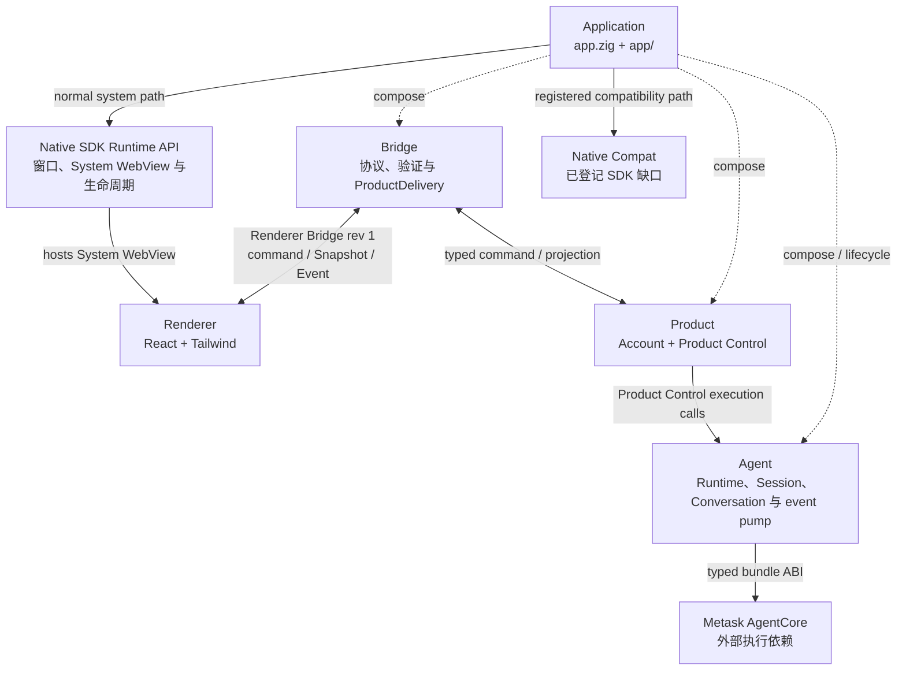

# MetaWork 高层架构

> 状态：当前为同进程 prototype；后续正式故障域选择单 AgentCore Worker
> 日期：2026-08-06

本文只定义 MetaWork 的顶层边界、依赖方向、运行形态、进程与故障域以及跨模块安全边界。产品对象和行为见 [产品需求](requirements.md)，UI 信息架构、交互与视觉见 [UI 设计规范](ui-design.md)，Product owner、事务、并发和恢复见 [Product 架构](product-architecture.md)，Renderer Bridge wire 见 [Renderer Bridge 合同](renderer-bridge-contract.md)，AgentCore Session、工具、Skill、Permission、线程与生命周期见 [AgentCore 集成契约](agentcore-integration.md)，ABI 与 bundle 门槛见 [AgentCore ABI v1 消费合同](agentcore-abi-v1.md)，Agent-owned 无 Tool Completion 见 [Completion 架构](completion-architecture.md)，Storage SQL contract 与 backend 见 [Storage 架构](storage-architecture.md)。实际源码目录和依赖方向见 [工程结构与所有权](project-structure.md)，验证状态见 [验证规范](validation.md)。

## 1. 已确认的技术选型

| 架构节点    | 选择                            | 定位                                                                  |
| ----------- | ------------------------------- | --------------------------------------------------------------------- |
| Application | Zig                             | composition root、用例编排、平台 capability 适配与生命周期驱动        |
| Renderer    | React + Tailwind                | 唯一正式 UI；运行于 Application 通过 Native SDK 托管的 System WebView |
| Bridge      | Zig                             | Renderer Bridge revision 1 的协议、验证和 ProductDelivery 边界        |
| Product     | Zig                             | MetaWork 产品事实、产品行为和恢复语义的唯一边界                       |
| Storage     | Zig + SQLite                    | MetaWork-owned、无业务语义的 SQL 基础能力与直接 SQLite 后端           |
| AgentCore   | Metask AgentCore library bundle | 外部执行依赖；独立构建和发布，MetaWork 只消费 canonical bundle        |
| Native SDK  | Native SDK                      | 外部桌面依赖；由 Application 消费                                     |

正式主路径不采用 Tauri + Rust，不建立第二套 Renderer，不以 PTY、xterm、终端字节流或 Provider SSE 作为 Agent UI 协议，不复制 AgentCore ABI 或实现源码，也不建立 Native SDK Adapter、通用 Desktop Interface 或可替换框架抽象。Agent-owned 独立 Completion 只解析三个封闭 Provider 的无 Tool 非流式 JSON 响应；该模型调用能力不构成 Agent UI/Event 协议。

Application、Renderer、Bridge、Product、Agent 与 Storage 是 MetaWork-owned 并列逻辑边界；Metask AgentCore 与 Native SDK 是外部依赖。Application 由 `src/app.zig` 和 `src/app/` 实现：代码组合类型名为 `App`，`app.zig` 是 composition root，具名适配、resolver、store 生命周期和跨 owner 用例编排位于 `app/`。Application 组装 Bridge、Product 与 Agent，消费 Native SDK 的原生应用生命周期、窗口和 System WebView 能力，并托管 React Renderer；它不是业务 owner，也不形成统一 facade。Storage 当前只进入独立测试图，尚未由 Application 或任何 Product owner 消费。

原生窗口机制由 Application 通过 Native SDK 执行；React 只负责 WebUI。涉及产品语义的校验和决策归对应 owner；Application coordinator 只执行 owner 已定义的跨 owner 提交与生命周期顺序，不复制 policy 或持有领域状态。Renderer 可以呈现一体化标题/命令栏，但原生窗口行为、系统资源和真实状态始终属于 Application。菜单、托盘、全局快捷键或其他平台 capability 位于同一边界，不代表当前版本已经开放；实际可用性仍以能力合同与验证状态为准。

## 2. 顶层边界与运行时组合

这是一张逻辑模块图，不等于进程图或源码目录图：

1. Renderer 只通过 Renderer Bridge revision 1 访问产品路径；
2. `app.zig` 是 Application 的 composition root；`app/` 承载 Application 的具名实现，二者共同组装 Bridge、Product 与 Agent，并消费 Native SDK 的窗口、System WebView、生命周期与窄平台 capability；
3. Product 包含 `Account` 与 `Product Control` 两个 named product owner，不代表统一源码 module 或 facade；Agent 是相邻的独立执行边界。Product Control 直接消费 Agent 公共执行能力，Application 只管理 Agent 的组装、生命周期与主线程 wake；
4. Native SDK Runtime API 与 Native Compat 是 Application 消费系统能力的两条并列路径，Native Compat 只覆盖逐项登记的 SDK 缺口；
5. AgentCore 与 Native SDK 是两个并列外部依赖；当前 AgentCore bundle 由 Agent 链入同进程，未来单 Worker 只改变 Agent 后方的部署、资源和故障域，不改变 Renderer Bridge 产品合同。

### 词汇对账

| 词          | 含义                                              | 图节点      | 所有权表行         | 源码                                                                                                    |
| ----------- | ------------------------------------------------- | ----------- | ------------------ | ------------------------------------------------------------------------------------------------------- |
| Application | 组合、用例编排、平台能力适配与生命周期边界        | APPLICATION | Application        | `src/main.zig`、`src/app.zig`、`src/app/`、`src/native_sdk_compat/`                                     |
| Product     | 产品逻辑边界；不是统一源码 module 或 facade       | PRODUCT     | Account、Product Control | `src/product/account*`、`src/product/control*`、`src/product/mcp*`、`src/product/schedule*`、`src/product/skill*`、`src/product/task*`、`src/product/workspace*` |
| Agent       | AgentCore 执行、Session/Conversation 与事件泵边界 | AGENT       | Agent              | `src/agent.zig`、`src/agent/`                                                                           |
| Bridge      | Renderer 与 MetaWork 本地边界之间的唯一通信边界   | BRIDGE      | Bridge             | `src/bridge*`                                                                                           |
| Renderer    | 产品 WebUI 模块                                   | RENDERER    | Renderer           | `frontend/`（含 `bridge/` 合同实现层）                                                                  |

用法约定：文档中的架构边界统一称为 Application，代码中的组合类型保持 `App`；不再另设 Desktop Host 或 Host infrastructure。`Product 边界/Product 模块`指本节逻辑边界，`桌面产品`指整个交付物。`product_identity.zig`（交付物 Bundle ID）与 Bridge 的 `ProductDelivery`（产品数据运输）维持原名，词根含义不同，不指 Product 边界。

Agent 是 MetaWork 对通用 AgentCore 的产品化边界，不是透明转发层。它可以在不修改 canonical bundle 或 ABI 的前提下收窄、组合或补充 Agent 能力，并独占 MetaWork built-in 工具集合及其 Runtime/Session 配置。Product Control 只消费形成后的 Agent 执行能力，不选择 AgentCore built-in 名称或 profile；MCP 的用户配置、授权和 Task admission 仍归 Product Control，Agent 只消费其解析后的窄 selection。

Product Control 是现有产品组合 owner 的身份收口，不是在 Account 与各 aggregate 之上新建统一 `ProductRuntime`。它拥有已安装的 execution、Workspace/Task history、Task/Skill/MCP/Schedule aggregate、共享 Executor、跨 aggregate admission/reconciliation、revision、完整 snapshot 与 shutdown 顺序。Account 继续独立拥有 credential、catalog 与 ExecutionConfig 生成。Application 的具名 coordinator 只经按用例裁剪的 opaque capability 调用 Product Control；除 `app.zig` composition root 外，Application 文件不得取得完整 Product Control Runtime 类型或字段访问权。

Completion 是 Agent 边界提供、但不属于 AgentCore Runtime/Session/AgentLoop 的独立能力。`src/agent/completion*` 拥有 MetaWork 自有 request/result/error 与 Anthropic/OpenAI/Gemini 三个无 Tool 非流式 JSON codec；它只消费 Account selection 冻结的同一 ExecutionConfig，不选择或回退模型。Application 通过窄 Transport port 提供一次有界、可取消的 buffered HTTP/TLS 请求并使用系统 CA；产品不配置证书。该 Transport 不拥有 Provider 语义，Agent 不导入 Application 实现。

## 3. 模块职责

### 3.1 Renderer

Renderer 负责产品 WebUI 的页面、布局、交互、结构化 Agent 工作展示和纯 UI 临时状态。它可以呈现与 WebUI 一体化的标题/命令栏，以单一 declarative marker 声明可拖动候选区，并绘制带固定语义 marker 的窗口按钮；React component 不直接调用 transport；`frontend/src/bridge/` 是 Renderer 模块内的合同实现层（browser-side Bridge），由它把这些声明转换为受限 Host intent，并 runtime decode Host 发布的 geometry/capability/state。Renderer 不执行原生窗口动作、不持有原生 identity/handle，也不成为窗口真实状态 owner。Renderer 可以缓存 Product projection，但不能成为 Workspace、Task、Run、Account 状态、Agent 执行状态、持久化历史、权限决策或窗口真实状态的唯一 owner。WebView reload 或重连后，Renderer 必须能够从完整 Snapshot 重建产品界面。

Renderer 不直接加载 AgentCore，不访问任意文件或进程，不持有 Provider credential 或原生窗口身份，不实现或模拟系统拖动循环、窗口状态、系统菜单、托盘、全局快捷键等平台行为，也不作为权限或安全边界。

### 3.2 Bridge

Bridge 是 Renderer 与 MetaWork 本地边界之间的唯一通信边界，承运两类 surface：产品命令面把 typed 产品命令直接 dispatch 给 Product 中对应 owner，并运输 Snapshot/Event，不经过 Application 代理，也不决定 Task admission、Workspace authority、Agent cancellation、credential replacement 或历史持久化；受限平台 capability 面只承运封闭枚举的 window-chrome bootstrap command，dispatch 给 Application 执行。两面共用 transport、origin policy 与 source/window authority，不共用数据面。

File Preview 沿同一产品命令面使用 Native SDK async registry：Bridge 只保存有界 responder/request identity，将精确 Task/Run/reference intent 交给 Product Control，并在主线程接收 Product Control 已重新授权、已脱敏的 callback-scoped 结果。Bridge 不读取文件、不持有 raw preview bytes、不建立文件缓存或 Files Changed 协议；Application 只负责 wake 与 shutdown 排序。

职责细节、封闭 command 枚举、连接、revision、snapshot identity、分块读取、retry 和 fail-closed 规则只由 [Renderer Bridge 合同](renderer-bridge-contract.md)定义。受限 window-chrome bootstrap session 的 source-window authority 与 document generation 同样归 Bridge：document attach 只建立一次 generation，Native SDK resize event 与 DOM layout observation 只驱动同 generation 的 geometry sync，不建立 resize command、第二 connection 或平台状态副本。

### 3.3 Product

Product 是 MetaWork 产品事实与行为的逻辑边界。它不是统一源码 module 或 facade；Bridge 把 typed 产品命令 dispatch 给内部对应 owner，由这些 owner 执行 admission，协调账号、Workspace、Task、Run、持久化与恢复，并由 Product Control 直接调用相邻 Agent 边界完成执行，共同生成 canonical 产品 projection。

Product 如何拆分内部 owner 不属于本图，见 [Product 架构](product-architecture.md)；Account owner、Metask 消费合同、状态、事务、持久化、提交与恢复见 [Account 架构](account-architecture.md)。Product 的产品 policy 不依赖 DOM、React tab、Toast、JSX state 或 WebView URL。

MCP 不形成第五个 Product owner。`src/product/mcp*` 只是 Product Control 持有的产品 MCP 子模块源码归属：configuration kernel 负责 schema 2 Desired Registry、connection approval、OAuth consent、credential locator/恢复、`oauth_operation`、Runtime preparation 与事务；state kernel 持有 Runtime Manifest、Agent Activation、Admission Authority、configuration-apply、OAuth/reauthorization、connection test，以及 request generation、pending、admission invalidation 与绝对 deadline 组成的 freshness 状态；policy kernel 负责 authorization transition、pending reauthorization、desired Admission allowlist、OAuth refresh binding、generation gate 与 Admission 状态转换，只构造 Agent 公共 allowlist/Selection 相关值而不持有 Runtime；view kernel 只借用 configuration/state 与 callback-scoped 敏感文本投影器，派生 revision 1 snapshot 的 MCP 子树；refresh-job 在途事实由 Runtime 从自身 aggregate 提供。`ports.zig` 只描述 Executor、Agent catalog、timer 与 notifier 的窄 capability；`refresh_job.zig` 独占 refresh worker payload、execute/cancel callback、atomic state 与线性 outcome，worker 不持有 Product Control、Product MCP aggregate 或裸 Agent Runtime。`runtime.zig` 是该子模块的 live aggregate，持有 MCP state、refresh job identity 与 timer capability，并闭合 refresh request/start/sync、connection test、configuration apply、Task admission/recovery authority、typed query、View 派生和 shutdown settlement；异步 worker 只写其独占 job，Runtime 在主线程安装结果。该子模块仍不取得独立 Product owner、具体 Executor 或额外线程；MCP management/OAuth 的 prepare→Admission candidate→durable commit→typed outcome 由 Runtime 闭合，具体 registry/credential effect 仍经注入 capability 执行；跨 owner coordinator、revision publication、完整 snapshot 编排和交付仍归 Product Control。Agent 继续拥有运行期 connector/backend 生命周期、AgentCore descriptor/catalog/selection、declarative Runtime apply、Activation 与 typed MCP health。Application 注入 bounded child/network effect，并拥有系统 credential、HTTP auth snapshot、OAuth effect，以及把 canonical desired preparation、Agent Runtime apply、activation 与 Product Control 完成事务串起来的窄 coordinator；它不拥有 transport 产品状态或 MCP JSON-RPC。Application 先创建 canonical empty MCP Runtime并提交零 entry Manifest，再由同一个 coordinator 后台应用恢复出的 Desired；因此外部 MCP effect 不成为 Application/普通 Task readiness 依赖，也不增加第二条 Runtime 或 worker 路径。STDIO child 只获得 Application 构造的显式 environment：受控 executable search path、Windows 必需的 `SystemRoot` 与用户逐名安全采集的 secret slot，不继承其余 Host 环境。隔离 connection test 仍不替换正式 Runtime。Runtime Manifest 记录正式 Runtime 已接管的 descriptor fingerprint 或安全 absence proof；`restart_required` alignment 只表示一次 apply 尚未完成，产品不要求重启 Application。新 Task 只消费 Product Control 原子提交的 Admission Authority，既有 Session 保持创建时 authority。Account 不参与 MCP；Bridge 与 Renderer 只运输 typed intent/状态；AgentCore 继续唯一拥有 MCP JSON-RPC、版本协商、catalog 与 tool binding。

`product/mcp.zig` 的生产公共面只发布 data-only `contract`、Runtime、Ports 与必要 typed DTO；state、policy、view 和 refresh-job kernel 只由 Runtime 组装，测试只能经 `builtin.is_test` seam 触达。

`src/product/skill/` 是同一 Product owner 内的 live Product Skill aggregate 边界：`runtime.zig` 独占 Personal/Workspace catalog control、catalog job、freshness、reschedule、stale completion 丢弃和 shutdown 收口，并拥有 enablement 双 revision CAS、受影响 authority candidate 预编译、FileStore commit、no-fail swap 与不确定结果失效事务，并只消费 `ports.zig` 定义的 shared Executor enqueue/cancel、Agent catalog query/release 与 change notification 窄 capability；它不取得 Product Control、具体 Executor、Agent Runtime/Session、线程或平台资源。`state.zig` 持有 management/enablement aggregate、reconciliation latch 与 tagged catalog authority，并只通过 callback-scoped release capability 归还 Agent catalog lease；`policy.zig` 无外部 effect 地解释 persistence failure、enablement scope 与 selection revision，并按当前 policy 编译/重编译 immutable catalog authority；`view.zig` 无状态地派生并编码 revision 1 snapshot 的 Skill catalog 与 management 子树，只通过 callback-scoped projector 借用敏感文本规则和 Workspace scoped catalog facts；`catalog.zig` 定义 Agent 公共 catalog projection 到 bounded snapshot 的 compiler；`enablement.zig` 拥有用户默认、Manual Workspace override、全局 revision、严格 codec 与原子 store；`management.zig` 拥有 install identity、inventory/transaction 实现、canonical-root 文件事务、recovery 与原子 store；`package.zig` 独占本地 Skill 目录与 canonical `.skill` ZIP 的有界检查、staging、导入导出和内容摘要。Product Control 仍独占 shared Executor 本体、Workspace/Task authority 校验与跨 owner admission、平台 picker、完整 snapshot 根编排、revision publication 与跨 owner 编排；Application 打开 FileStore 并经 composition 注入，enablement commit 不回流 Product Control；它不能再保存或调度 Product Skill catalog job。

`src/product/task*` 拥有 live Task aggregate、Run/Compact record、Agent event 的产品状态转换与 terminal event-drain gate、terminal/interruption/lifecycle/recovery policy，以及 persistence、view、checkpoint、execution binding、attachment、deletion、recovery 与 execution kernels。`runtime.zig` 是该 aggregate 的唯一存储与行为入口，持有有界 Task collection、identity/order、failure ledger、attachment/operation、late-terminal、recovery 与 shutdown facts，并闭合 Task create、Run/Compact、cancel、UI response、model selection、detach、recovery、event application、Task projection 与 shutdown transition；旧的 per-Task resource union 明确改名为 `attachment.zig`。`product/task.zig` 只公开 Runtime、所需 typed operation/port/fact、history 与 checkpoint store 叶面，其他 kernel 仅通过 `builtin.is_test` fixture seam 暴露给测试，组合模块不得直接装配。`execution.zig` 独占 Run/Compact executor payload 和 execute/cancel callback；payload 只借用稳定 record、scoped Session Access、具名 effect capability 与具体 worker-reference atomic，不得保存 Product Control、Task aggregate 或 Task runtime 指针。自动标题所需 credential clone 由 Run job 独占并在所有执行、取消和入队失败路径 secure-zero。Conversation recovery admission 只消费 Task/binding、checkpoint/terminal anchor、Workspace id/kind/epoch/root/authorization与 Automatic owner、ExecutionConfig、persistence/checkpoint store/Agent Runtime readiness及 operation/shutdown facts；Workspace visible、Skill/MCP/Permission readiness 与 projection capacity 不参与。异步 completion 按相同核心身份与 attempt/attachment exact revalidate；stale candidate 只丢弃且不隐式重试。Task persistence 独占 capability/health 类型、逐字段 wire projection、恢复重建与跨记录校验；Task view 无状态地派生并编码 revision 1 snapshot 的 Task/Run/Compact/UI 子树。canonical history 顶层的 Workspace frame 组装和唯一 durable commit effect 仍由组合层执行；Runtime 只观察 `committed | failed | outcome_unknown` typed 结果，unknown 后冻结 Task mutation。完整 snapshot 的根字段、姊妹子树、容量 buffer、revision 与交付也不进入 Task。该物理子模块不取得具体 executor 本体、Agent event pump、跨 Workspace/Account/MCP authority、durable commit 实现或完整 snapshot 编排；组合对象只通过 callback-scoped capability 借出 enqueue、authority、全局有界内存、credential 清洗、durable commit 和 publication effect，不向 worker 暴露自身。

`product/skill.zig` 只公开 live Runtime、ports、catalog 以及 Application/Bridge 需要直接消费的 enablement/management 持久化与 data-only 叶面。package、policy、state、view 与 management runtime 都是 Runtime 背后的内部实现，不允许 Product Control 直接拼装或读取内部 state。Catalog slot/control、generation 与可变 snapshot 不得越过 Runtime；Task admission、refresh 与 recovery 只能借用 Runtime 发布的 immutable typed authority，credential redaction 与 uninitialized refresh 判断也必须由 Runtime 原位执行。

Product Skill 的本地资产用例也属于该 live aggregate：`management_runtime.zig` 在总 Runtime 内部独占目录/归档 preview、已安装 definition 读取、canonical `.skill` 导出、install/reimport/uninstall/retry、staging、恢复和 catalog reconciliation，并调用唯一 package/management kernels；总 Runtime 根据其持有的 canonical Personal/Workspace binding 解析并打开 `.agents/skills`，不向 Product Control 发布 `CanonicalRoot`。Product Control 仅证明 Workspace authority 与 Task quiescence、传入时间事实并发布 revision，不解释 package bytes、拼接 Skill 物理路径或执行 Transactions。

### 3.4 Agent 与 AgentCore

Agent 是 MetaWork-owned 独立执行边界，也是 MetaWork 对 AgentCore 的 integration owner，拥有 Agent Runtime/Session/Conversation 的集成生命周期、callback、event pump 与 AgentCore terminal facts。Application 创建并关闭 Agent、注入其运行所需能力并把 event-ready wake 安排到主线程；Product Task 通过唯一 `agent_session` capability gateway 消费 Agent 公共 Session/Run 操作，组合层只持有 Task `Binding`/`Access`，不保存裸 Session/restore route、不管理 Agent Runtime 生命周期、不读取 Runtime 内部字段，也不借 Agent 获取通用 I/O。Agent 不拥有 Workspace、Task、产品 Run、Executor、持久化或 Bridge transport。

AgentCore 拥有 Provider 调用、agent loop、Conversation、built-in tools、Session、结构化 CoreEvent、同步 UI request 和 RunResult；这些是 AgentCore 内部的执行机制与协议状态。Agent 通过官方 SDK 集成并管理这些机制在 MetaWork 中的 Runtime/Session 生命周期、同步、所有权引用和执行 API，但不取得 AgentCore 实现的内部 ownership。AgentCore 不拥有 MetaWork 的 Workspace、Task、Run 产品历史、Renderer projection 或持久化 policy。

正式 MetaWork 产品模块中只有 Agent 边界可以消费官方 typed SDK 与 binary ABI；隔离 probe、bundle verifier 和 SDK 验证工具不进入正式产品 module graph。其他模块只使用 Agent 或对应 owner 暴露的 MetaWork-owned 类型。精确合同见 [AgentCore 集成契约](agentcore-integration.md)和 [AgentCore ABI v1 消费合同](agentcore-abi-v1.md)。

### 3.5 Native SDK

Native SDK 是外部桌面依赖。Application 通过 Native SDK 执行桌面生命周期、原生窗口与 window chrome 行为、System WebView、菜单、托盘、全局快捷键及其他受限平台机制，并拥有对应系统资源和真实状态；它托管 React Renderer，为 Bridge 提供受限平台 seam。Application 只把产品所需的窄 capability 注入对应 owner、驱动平台生命周期并执行已定义的跨 owner 顺序，不持有产品 policy。Renderer 也不能把视觉呈现或交互命中升级为原生 owner。

从 Application 作为 Native SDK consumer 的视角，对于窗口、WebView、生命周期、对话框、通知、计时器、凭据和其他系统 effect，只有 Native SDK Runtime API 才是 SDK 正式提供给应用的能力入口。这里的“应用”指整个 MetaWork executable，不表示 Product owner 可以依赖 Native SDK Runtime 类型；Product owner 只消费 MetaWork-owned 窄 capability，由 Application adapter 映射到 Runtime API。SDK 内存在但尚未进入 Runtime API 的函数或平台实现只证明底层机制存在，不构成 MetaWork 可以长期依赖的系统能力合同。

Native SDK Bridge API 是独立的正式 transport surface，不属于系统能力入口。Bridge 可以使用完成 command ingress、source/window authority、handler 注册和窄 Application capability 调用所必需的 Native SDK Bridge contract、data-only DTO 与 opaque identifier；这些值本身不授予系统执行权。Product owner 不消费这些 SDK 类型，Renderer 只消费 Renderer Bridge wire。

| Native SDK surface                | MetaWork 消费者             | 边界                                                                                    |
| --------------------------------- | --------------------------- | --------------------------------------------------------------------------------------- |
| Runtime API                       | Application                 | 执行系统 effect，并维护 Native SDK 的窗口、WebView、托盘和生命周期状态                  |
| Bridge API                        | Bridge、Application         | `Invocation`、`Source`、`Handler`、`BridgePolicy` 等正式 transport contract             |
| data-only DTO / opaque identifier | Bridge、Application adapter | `WindowId`、dialog options/result 等无执行 authority 的公开值；不得传播到 Product owner |
| `PlatformServices`                | 已登记的一级兼容 seam       | 可执行低层 SDK 原语的受限 authority，不是普通依赖                                       |
| 具体平台实现类型与 OS handle      | 已登记的二级兼容 seam       | `WindowsPlatform`、`HWND`、AppKit/GTK 对象等平台 authority                              |
| `PlatformServices.context`        | 无                          | Native SDK 私有 opaque 数据，MetaWork 永不访问、解释或强转                              |

产品需要系统能力时，正常依赖链是 `Product owner → MetaWork-owned capability → Application adapter → Native SDK Runtime API → SDK internals → OS`；Bridge 需要受限系统 effect 时经窄 Application capability 进入同一 Runtime 路径；Application 自身的生命周期和窗口行为直接进入 Runtime API。系统能力按以下三级调用路径消费：

Account 是该依赖链的具体实例：Account-owned `ports.zig` 定义 credential/preference、authorization URL、timer 与 Model Connection credential vault 需求，Application-owned `account_platform_binding.zig` 负责绑定和资源生命周期。Account 不导入 Native SDK 或 Application 实现；binding 不拥有 Account codec、事务、恢复、registry 或 persistence health。

OAuth loopback 同样按 policy/effect 切割：Account 拥有 callback/state/code/error/issuer、无效请求预算与 response policy，并向 Application 注入 callback-scoped request sink；Application 独占 listener、socket、accept/receive deadline、cancellation 与 HTTP byte pump。任何 socket、reader、request handle 或连接生命周期都不得跨入 Product owner。

| 路径     | 调用链                                                             | 适用条件                                                                         |
| -------- | ------------------------------------------------------------------ | -------------------------------------------------------------------------------- |
| 正常路径 | Application → Native SDK Runtime API → SDK `PlatformServices` → OS | Runtime API 已提供完整能力；MetaWork 只调用 Runtime API，后两段属于 SDK 内部实现 |
| 一级兼容 | Application 窄 seam → SDK `PlatformServices` 已有原语 → OS         | Runtime API 缺失或存在已确认的目标平台缺陷，但 SDK 底层已有所需原语              |
| 二级兼容 | Application 窄平台 seam → Win32 / AppKit / GTK → OS                | SDK 连可用底层原语都缺失，MetaWork 必须暂时补齐平台实现                          |

Runtime API 已提供且可用时，绕过它调用低层函数属于架构违规，不得包装成“兼容”。兼容的治理单位是 capability seam，而不是文件；每条 seam 只补一个明确的 Runtime/SDK 缺口，并且必须同时满足：

- 只存在于 Application-owned、按 capability 和平台收窄的兼容实现中；Product 和 Renderer 不得持有 Native SDK 系统能力类型，Bridge 不得持有原始 `PlatformServices`、具体平台实现类型、系统 handle 或底层调用权；Application 只能向 Bridge 或对应 owner 注入其职责所需的窄 capability；
- 只调用 SDK 对外可见的低层原语或公开系统 API；`PlatformServices.context` 始终视为 Native SDK 私有 opaque 数据，MetaWork 不得访问、解释或强转为具体平台内部类型；
- 明确线程、窗口身份、资源 ownership、失败和 shutdown 语义，不建立第二份窗口、WebView、托盘或生命周期状态，也不得使 OS 状态与 Runtime 状态静默分裂；
- 写明 capability identity、对应 SDK 缺口、允许的低层调用、目标平台、调用者、验证方式和删除条件；优先推动 Native SDK 补齐 Runtime API，正式 API 经目标平台验收可用后原位替换并删除兼容 seam；
- 多条 seam 只有共享同一资源、线程或生命周期不变量时才可共处一个窄 Application 文件，并且仍须独立登记、allowlist、验证和删除；禁止文件级或目录级宽泛放行，新增无直接关联的 capability 默认使用新的窄文件。

Native SDK 的发布 artifact 缺口不进入上述 Application Runtime 三级路径。`macos_icon_composer_package` 是独立的打包期兼容 seam：Native SDK 当前不能消费 Apple Icon Composer `.icon` 或生成动态 `Assets.car`，因此 `scripts/package-macos.mjs` 在 SDK 生成未签名 `.app` 后调用 `scripts/native-sdk-compat/macos-icon-composer.mjs`，只允许以已验收 Xcode `actool` 把 `assets/icons/MetaWork.icon` 编译为 `Assets.car` 与 fallback ICNS、合并两个标准 `CFBundleIcon*` 字段，并删除 SDK 临时 ICNS，随后才允许唯一一次 Developer ID 应用签名。该 seam 不进入 executable、不调用 Native SDK Runtime/Bridge API、不持有平台 handle，也不建立第二个 `.app` packager；编译器版本、源结构、无 glass/effect 不变量、输出集合、资源摘要与签名前顺序全部 fail closed。Native SDK 正式支持 `.icon`、生成同等资源与 metadata，并通过相同的 macOS 26 视觉、旧系统 fallback、双架构和签名验收后，删除该脚本、测试、版本 allowlist 与专用 staging 路径。

当前 System WebView window chrome 按 SDK 缺口独立登记：`system_webview_drag_region` 只补 drag-region；按钮兼容文件因共享同一 startup HWND 生命周期而共置 maximize/restore、maximized state 与 user-close 三项能力，但使用明确入口、逐项 allowlist 和独立删除条件，不提供内部任意 action facade。Windows startup identity 不是 capability：Application 只建立一条创建期 hook、产出一个经校验的 opaque root binding，再注入需要该 HWND 的 seam，消费者不得各自复制捕获机器。`minimize` 已由 Runtime API 提供，必须保持正常 Runtime 路径，不得进入兼容 seam。这些能力可以在 Bridge 的同一个固定 window-chrome command 边界内组合结果，但不得互相持有职责或扩展为统一窗口 facade。

`secure_input` 是与具体产品用途无关的二级兼容 seam，只补 Native SDK 0.9.2 缺失的原生安全文本输入 Runtime capability。公共 contract 只接受有界 UTF-8 标题、说明和确认/取消文案，以及调用方拥有的可清零输出缓冲区；只返回提交长度或取消，不接受产品对象、credential slot、Bridge DTO 或系统 handle。Windows 平台实现消费共享 startup HWND 作为 modal owner，macOS 平台实现使用 `NSSecureTextField`；两端都只允许绑定线程调用、拒绝自身重入、禁止截断，并在取消和失败路径清零 MetaWork-owned plaintext storage。平台控件和 OS framework 的内部副本不属于 MetaWork 可证明清零的内存。同步 capture 会运行平台 modal loop 并允许该线程继续派发应用事件，因此任何正式调用路径都必须通过“prompt 打开期间后台事件持续处理且不发生未声明状态机重入”的真实平台 gate；在证据完成前不得把编译成功写成平台可用结论。Native SDK 正式安全输入 API 经 Windows/macOS 分别验收后，原位替换并删除对应平台实现、低层 allowlist 和专用验证。

`app_single_instance` 是二级兼容 seam，只补 Native SDK 0.9.2 缺失的应用实例仲裁与 second-launch activation transport。最终写入 authority 是 canonical data root 上由 OS 自动释放的独占文件 lease；endpoint 的存在、PID 文件或进程名都不能授予 Primary 身份。Windows 只允许 current-user DACL Named Pipe、pipe server PID observation、`AllowSetForegroundWindow` 和固定 `MessageBoxW` 失败提示；macOS 只允许 Darwin 系统 API 返回的 per-user temporary directory 下的 0600 Unix Domain Socket、`getpeereid` UID gate 和固定 CoreFoundation 失败提示，禁止退回共享 `/tmp`。Application 独占 artifact/revision/argv/cwd 协议、严格边界、合并队列、主线程 wake 与窗口 effect；Application Coordinator 还独占 endpoint readiness 与 shutdown handoff 的总 deadline，以“重新竞争 lease → 单次 transport connect”交替处理冷启动和退出窗口，只有 endpoint 尚不可用可以重试，连接后的 timeout、传输错误或协议失败必须立即 fail closed。兼容层每次 `forward` 只执行一次 connect 和一次 request/response，不解释请求语义，也不持有 Native SDK Runtime。实际显示和聚焦必须回到现有 `Runtime.showWindow`/`focusWindow` 正常路径。listener shutdown、连接 deadline、资源释放和 crash 后 lease 自动回收都是该 seam 的显式生命周期；Native SDK 正式提供具备同等 data-root authority、同用户转交、bounded activation 和 shutdown 语义的 Runtime API，并经两平台验收后，原位替换并删除平台文件、framework link、allowlist 和专用测试。

获准兼容 seam 的当前文件、SDK 缺口、目标平台与删除条件由 [工程结构与所有权](project-structure.md)映射，合规状态和平台证据由 [验证规范](validation.md)维护；与 Renderer 交换的精确 wire 仍只由 [Renderer Bridge 合同](renderer-bridge-contract.md)定义。未登记的低层调用一律不构成兼容能力。

### 3.6 Storage

Storage 是 MetaWork-owned、无业务语义的基础设施边界，拥有后端无关的 SQL value、statement、query/exec outcome、limits、migration mechanism，以及当前直接 SQLite 后端的连接、事务、错误映射和 engine profile。SQLite C API 只存在于 concrete backend；公共 SQL contract 不依赖 Product、Application、Native SDK 或 SQLite 类型。

Product owner 仍独占自己的 schema、migration 内容、health、恢复、并发和 durable boundary 决策；Application 未来只负责创建 concrete backend、借出 capability 和安排 shutdown。当前 Storage 不解析产品数据目录、不创建 production `app.db`、不接入任何现有 persistence，也不改变 Product Control 单实例锁或恢复合同。直接 SQLite 是正式基础后端而非 Native SDK compatibility seam；未来只有在 Native SDK relational surface 满足同一 conformance contract 时，才可原位替换访问后端，并继续使用同一个 SQLite 文件。

## 4. 跨模块合同

- Renderer → Bridge 只提交产品语义命令；标题栏例外严格限于 browser-side Bridge 从 declarative DOM marker 计算出的有界 region mirror，以及 `minimize | toggle_maximize | close` 固定语义 intent。输入不包含平台名、任意 action、独立 state query 或原生窗口 identity/handle，也不得携带 React component state、任意路径、Provider 配置或完整 credential。
- Bridge → Product 只提交严格解码后的 typed command；业务拒绝由 Product 返回 typed result，malformed payload 与 authority failure 由 Bridge fail closed。
- Product → Bridge 发布 canonical projection；Bridge 只拥有编码后的 transport bytes、connection generation 和 Snapshot transport state。
- Product Control → Agent 只经 Agent 公共执行表面，Agent → AgentCore 是唯一 typed SDK 与 binary ABI 路径；Application 只管理 Agent 生命周期与 event-ready wake，Renderer 和 Bridge 不调用 Agent。
- Native SDK → Application 的能力按调用边界和 owner 使用；Application 不产生新产品模块或 facade，不得用一个通用平台接口掩盖线程、ownership、deadline、容量和 shutdown 语义。
- Renderer 断连、Snapshot 失败或 Bridge transport failure 默认不反向伪造 Agent Run cause，也不直接终止后台执行。

当前 Renderer Bridge identity 是 `metawork.renderer-bridge` revision 1；兼容、hard-cut 与版本审批语义只由 [Renderer Bridge 合同](renderer-bridge-contract.md)定义。

## 5. 状态、恢复与故障域

Product 在 Renderer 生命周期之外拥有产品状态。WebView reload 通过完整 Snapshot 重建视图；Application 重启先恢复经过校验的产品历史，再由用户显式触发 Conversation attachment 重建。Product Control 拥有 checkpoint blob store、record transaction、恢复资格、bounded recovery job 与主线程 commit；Agent 只拥有 AgentCore restore adapter、Session slot 和 Runtime shutdown fence；Application 只按既有 store 模式注入 `<MetaWork data dir>/workbench/checkpoints` 目录 capability、持有进程级单写锁并维持 owner 关闭顺序。恢复不重放历史输入、工具或 permission，无法恢复的 non-terminal operation 仍保守收口为 interrupted。精确事务见 [Product 架构](product-architecture.md)。

Bridge transport、Product 产品状态和 Agent execution terminal cause 是不同事实。Snapshot/Event 失败不覆盖产品历史；transport failure 不伪造用户取消；Agent terminal result 只有经 Product 提交后才成为 MetaWork 产品事实。详细线性化、持久化和恢复规则见 [Product 架构](product-architecture.md)，连接与 Snapshot transport 见 [Renderer Bridge 合同](renderer-bridge-contract.md)。

| 模型                      | 故障隔离               | 作用                                |
| ------------------------- | ---------------------- | ----------------------------------- |
| 同进程 + bounded executor | 零进程级隔离           | 当前最小真实 baseline               |
| 单 AgentCore Worker       | Host 与 AgentCore 隔离 | fault-domain 验证选定的后续正式方向 |
| 每活跃 Session Worker     | 会话级隔离             | 只有前两者数据不足时再验证          |

统一 Zig 不提供隔离。独立 crash 对照证明同进程是零进程级隔离，并选择单 AgentCore Worker 作为后续正式方向。该决定不把 spike IPC 升格为产品协议；版本化 transport、backpressure、shutdown、credential 和真实 bundle 资源数据必须在后续能力验收中定义。当前同进程应用仍只是 prototype。

## 6. 当前能力边界

当前正式 AgentCore target availability、exact artifact identity 与 ABI policy 由 [AgentCore ABI v1 消费合同](agentcore-abi-v1.md)唯一记录。MetaWork 只消费经 verifier 接收并 stage 到 `.agentcore/bundles/<target-id>` 的 canonical target-specific bundle 及其中的官方 Zig package。构建 target 精确选择同名 bundle，不读取“最后一次 stage”状态。缺失、identity、checksum、target、ABI 或 symbol 校验失败必须明确失败，不允许旧 revision、`latest`、可变 tag、implementation source fallback 或静默降级。精确 bundle 规则见 [AgentCore ABI v1 消费合同](agentcore-abi-v1.md)。

当前 baseline 已包含同一桌面 Application 正常重启后、由 durable checkpoint 驱动的显式 Conversation 恢复，以及基于结构化 file reference、按需读取当前内容的异步 File Preview。File Preview 不构成 async Agent pending、文件版本或 FileChange observation。当前仍不包含 suspend/resume、独立 AgentCore Worker crash recovery、跨进程 in-flight Run 恢复、strict Workspace security、正式 Host tools、typed Output/FileChange、plan progress/approval、custom UI 或 Windows 更新。当前仍是同进程 prototype；存在 ABI entry 不代表更宽的进程隔离或恢复能力已经开放，能力状态只以 [验证规范](validation.md)为准。

Native SDK 的平台支持矩阵、真实 WebView 路径、构建与分发证据只在 [验证规范](validation.md)维护。架构不预设未经验证的 push、poll 或自制 `events.drain` 协议，也不从一个平台的结果推断另一个平台已经可用。

## 7. 安全边界

Renderer 按不可信调用方处理：

- Bridge 命令默认拒绝，只开放白名单；
- dev origin 和 release origin 分离，开发配置不得泄漏到发布包；
- Host 校验 payload、Session/Run 归属和请求时效；
- trusted Workspace 只能由 Host 原生目录选择结果生成一次性 grant，用户确认选择本身构成显式授权；不得追加重复的 trust 确认，Renderer 也不能提交路径加 boolean 自行授信；
- Provider credential 不进入 Bridge、事件、日志或 snapshot；
- OAuth token、PKCE verifier、authorization code、完整 API Key 和 Authorization header 只能存在于对应 Product secret transaction、系统凭据存储和受控 runtime copy；所有 owner 在释放前 secure-zero；
- MCP credential 使用与 Metask Account 分离的 `<bundle-id>.mcp` 系统 credential service，只存在于系统凭据存储、Product Control mutation/OAuth operation 的线性临时 copy 和 Application-owned transport auth snapshot；`mcp/registry.json`、Bridge、Renderer、日志、产品历史和 raw diagnostic 均不得保存 credential 原文。Renderer 不得提交 secret；static credential 与 OAuth client secret 采集必须通过消费 Application-owned 通用 `secure_input` 的独立 `mcp_secret_capture` 窄 Host capability 直接写入系统 credential service，能力不可用时 fail closed；
- production provider/base URL/API Key 不从环境变量或 Renderer 注入，只能来自 Account 已锁定并验证的 Metask contract，或用户显式创建并验证的 Model Connection contract；Renderer 只能提交 Host 当前脱敏 catalog 中的稳定 API/model/connection identifier，Host 必须重新校验 ownership、active 状态、connection→model 归属、endpoint 合同和 generation，再推导 typed provider/base URL；
- Host 在形成产品 projection 前移除已知 Host-held credential 和 schema 标记的 secret 字段，并对命令与工具输出设置 byte 上限和 truncation 状态；Renderer 不是秘密过滤边界；
- 当前不暴露通用 Host tool 或任意执行接口；
- built-in Bash 使用非交互子进程；
- strict Workspace security 未通过前，只运行临时或明确 trusted Workspace。

持久 permission 是 Product Control-owned 产品状态，不是 Renderer preference 或 AgentCore parallel protocol。规则必须绑定 stable Workspace identity、tool identity/version、operation、canonical resource constraint 和 rule schema version；canonical path 字符串本身不能充当 stable identity。Workspace、tool、script 或 capability 变化时规则 fail closed。Workspace 文件边界、process tree、network、environment、审计和撤销分别通过对应安全 Gate 前，UI 不得为相关能力提供 `Always allow` 或 `Full access`。

## 8. Release 与合同 identity

MetaWork 桌面产品、根 npm workspace、Renderer workspace 和 Zig package 随同一仓库原子发布，共用一个 release version。`app.zon` 是产品版本与 Bundle ID 真源；根 npm、Renderer 与 Zig manifest 必须精确镜像，派生 lock 只保存工具生成结果。实际源码 owner 见 [工程结构与所有权](project-structure.md)。

macOS 分发由 Native SDK 生成 target-specific `.app`，再由仓库打包入口完成原生资源 staging、Developer ID 签名、公证和 DMG 验证；打包层不成为 Application runtime owner，也不提供更新能力。具体能力与签名边界见 [macOS 分发](macos-distribution.md)。

Windows 分发先由 Native SDK 生成完整 runtime stage，再由仓库的安装器定义生成单 EXE；安装器层只拥有文件安装、快捷方式和卸载语义，不成为 Application runtime owner，也不能重写 Native SDK artifact。具体能力与签名边界见 [Windows 分发](windows-distribution.md)。

Renderer Bridge revision、Account persistence layout、AgentCore artifact version、AgentCore ABI version/revision 和 bundle manifest schema 各自保护不同合同，不得随 MetaWork release version 自动升降。Account persistence 采用无版本 hard cut，精确账号存储身份见 [Account 架构](account-architecture.md#7-persistence-与恢复)；Apple Development 本地身份见 [macOS 分发](macos-distribution.md#本地签名非分发)。任何合同类版本标识的变更都必须先得到用户显式同意。

## 9. 主要风险

| 风险                                   | 当前控制方式                                                                                                 |
| -------------------------------------- | ------------------------------------------------------------------------------------------------------------ |
| Native SDK Zig → React 路径不符合预期  | 真实 dev/prod smoke                                                                                          |
| typed SDK 与真实 producer wire 漂移    | source-free corpus + 真实 Host link/run 回归                                                                 |
| callback 数据返回后失效                | callback 内验证并深拷贝                                                                                      |
| callback/close race 造成 UAF           | abort、join、callback quiescence 后 destroy                                                                  |
| callback identity race 泄漏 permission | UI request publication 与 response extraction 均在 Session lock 下复检                                       |
| 同步 UI 耗尽 executor                  | 16 个 bounded slots、同界 pending 容量、cancel/close/shutdown 唤醒和压力测试；Host 不为人类决策设置 deadline |
| Bridge/event 造成无限内存              | count/byte/time 多维上限和公平调度                                                                           |
| Run failure 被误报用户取消             | active first-writer cause 与 Product write-once terminal history 分层                                        |
| Renderer 掉线杀死后台 Run              | typed transport policy 不向 Agent termination 反向泄漏                                                       |
| v1 Workspace 被误报安全                | 只允许临时/trusted 验证并显式标注限制                                                                        |
| 同进程 native crash 带走全部状态       | fault-domain 验证已选后续单 Worker；当前同进程应用仍是 prototype                                             |
| 过早建设发布系统                       | baseline 通过后再做 cache 与 remote                                                                          |
