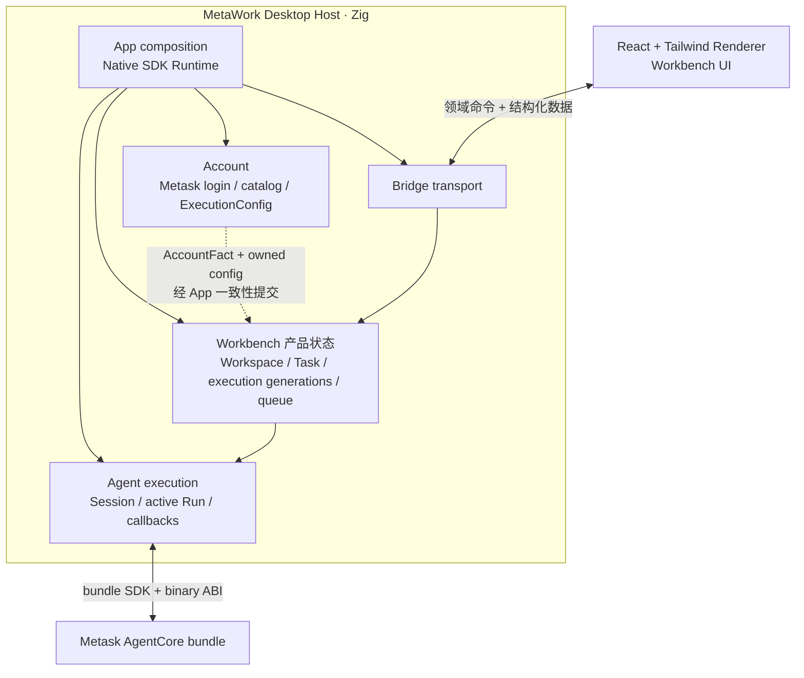

# MetaWork 高层架构

> 状态：AgentCore ABI v1 revision 4 macOS 与 Windows exact artifacts 已锁定，typed Skill 产品链正在本功能分支实施；后续正式方向选择单 AgentCore Worker
> 日期：2026-07-22

产品范围见 [产品需求](requirements.md)，Metask AgentCore 的具体接入约束见 [AgentCore 集成契约](agentcore-integration.md)，revision 4 目标能力见 [AgentCore ABI v1 消费合同](agentcore-abi-v1.md)。精确源码路径、binary 和 symbol identifier 只作为机器合同保留。

## 1. 已确认的技术选型

| 层级                              | 选择                            | 决策说明                                                                     |
| --------------------------------- | ------------------------------- | ---------------------------------------------------------------------------- |
| Renderer                          | React + Tailwind                | 当前正式 UI 技术栈，适合复杂 Workbench 界面                                  |
| Desktop Framework                 | Native SDK                      | Zig 一等公民，负责系统 WebView、窗口、Bridge 和桌面生命周期                  |
| App / Account / Workbench / Agent | Zig                             | 分别承担 composition、账号控制面、产品状态和 AgentCore 执行边界              |
| AgentCore                         | Metask AgentCore library bundle | Metask AgentCore 独立构建和发布；MetaWork 链接产物，不把上游源码纳入自身构建 |
| Agent UI contract                 | AgentCore 原生结构化协议        | React 消费 Host 产品投影，不消费终端字节流或 Provider SSE                    |

由此排除以下正式主路径：

- 不采用 Tauri + Rust；
- 不由 MetaWork 维护 AgentCore ABI 或复制协议；
- 不通过 AgentCore implementation source-tree path dependency、Git source dependency 或源码复制把 AgentCore 实现编进 MetaWork；staged bundle 内官方 source-free Zig package 不属于上游实现源码依赖；
- 不以 PTY、xterm 或模拟终端作为默认 Agent 架构；
- 当前不使用 `.native` 取代 React；
- 不建立 Native SDK Adapter、通用 Desktop Interface 或可替换框架抽象。

## 2. 当前里程碑边界

### 同步 macOS baseline

已批准的新基线是 Metask AgentCore ABI v1 revision 4。它在既有 RunContext、typed status/StopReason、CoreEvent/UI codec 和同步 Run 语义上增加 AgentCore-owned Skill catalog snapshot、Session catalog binding/refresh 与 tagged Text/Skill Run input。精确 API layout、artifact identity、payload 和 manifest schema 只由 [AgentCore ABI v1 消费合同](agentcore-abi-v1.md)定义。MetaWork 对它执行 hard cut：active build、Host、probe 和规范文档只接受 revision 4，不保留 revision 3 parser、function table、Run payload 或 fallback。

当前 checkout 的 repository locks、verifier、build graph、staged bundle 和纯 Text Host baseline 已切到 revision 4；macOS 与 Windows artifacts 均来自 clean source commit `ac2584da8bfcf18ed74c7b2738fb4c784f714579`。Catalog、Workbench、Bridge 与 Renderer Slash vertical 仍须按 [实施方案](agent-interaction-entry-decision.md)完成后才可声明整个产品能力通过；历史 revision 3 迁移事实不构成兼容要求。

该 baseline 不包含：

- async pending 或 suspend/resume；
- Session/Conversation 跨进程恢复；
- strict Workspace security；
- 可映射到 MetaWork Session/Run 的正式 Host tools；
- typed `Output`、`FileChange` 和 plan-progress observation；
- plan approval 或 custom UI control；
- Windows 安装、签名与更新产物。

### Fault-domain 结论

事件泵容量、shutdown race、同进程 crash baseline 和最小 Worker fault-domain spike 均已完成。结论是选择单 AgentCore Worker 作为后续正式故障域；当前应用仍是同进程 prototype，不能宣称已经具备进程隔离或 crash recovery。

### 后续能力

Windows development baseline 使用独立 target lock、系统链接输入和桌面自动化，已验证 x86_64 Windows GNU artifact、Native Debug/Release、Renderer 生产资源与 AgentCore vertical path。MSI/签名/更新仍属分发层。Linux 后续复用同一 target-policy 入口，但必须新增精确 lock、link policy、probe 和平台验证，不能落入 generic fallback。

## 3. 高层结构



这是三层职责边界，不等于三个进程：

1. Renderer：产品界面；
2. Zig Desktop Host：由 App、Account、Bridge、Workbench、Agent 五个明确产品 module boundary 组成，另有不承担产品职责的纯 `account_contract` 构建模块；
3. AgentCore：Agent loop、模型、工具和结构化事件。

## 4. 组件职责

### 4.1 React + Tailwind Renderer

负责：

- Workbench 页面、布局和交互；
- 渲染消息、工具、审批、错误、usage 和运行状态；
- 维护纯 UI 临时状态；
- 通过集中式 client 调用 Host 领域命令并接收事件。

不负责：

- 直接加载 AgentCore；
- 解析 Anthropic/OpenAI SSE；
- 从终端输出推断 Agent 状态；
- 直接访问任意文件或启动任意进程；
- 持有 Provider credential；
- 作为权限或安全边界。

### 4.2 MetaWork Zig Desktop Host

Native SDK 直接构成桌面 Runtime 与窗口能力。MetaWork 内部目标为五个 named product modules：`app` 负责 composition 和主线程提交协调，`account` 负责 Metask 登录、catalog 与凭据代际，`bridge` 负责验证与运输，`workbench` 拥有产品状态与队列，`agent` 执行并收口一个真实 Agent Run。`AgentCore` 只指 Metask 提供的外部 bundle。`metawork_account_contract` 只承载 Account 发布给 App/Bridge/Workbench 的有界纯合同，不是第六个产品模块。

Bridge 的唯一产品数据面由具体 `Dispatcher` 内部的 `ProductDelivery` 统一拥有：connection generation、revision retry/timer、snapshot identity 和 snapshot transport storage 都不再存放在 App。Dispatcher 通过明确的 `*Workbench` 同步生成 snapshot；App 只注入 Native emit/timer/dialog/window-control/main-thread capability，并按顺序组织 shutdown。`hidden_inset_tall` 的 WebView 标题栏只提交 drag、minimize、toggle-maximize 或 close 意图；这些逃生能力属于受限 bootstrap chrome capability，不依赖 ProductDelivery 是否连接。Bridge policy 先约束 origin，Dispatcher 再精确匹配 App-owned 单一启动窗口 identity、payload 与主线程；Windows platform seam 仅在 manifest 仍声明该唯一启动窗口时解析对应 native window，不能用当前活动窗口代替 identity mapping。它不建立第二数据面，也不让 Renderer 提交 HWND 等原生身份。automation 只能提供受控账号、临时 Workspace authority 和桌面驱动，不注册 Renderer command/event、不跟踪产品 generation，也不建立平行传输协议。

Host 负责：

- 创建窗口并托管系统 WebView；
- 暴露小而明确的领域命令；
- 校验来源、参数、Workspace、Session 和权限；
- 由 Account 在 Renderer 之外完成 Metask OAuth、目录查询、凭据持久化与 ExecutionConfig 生成；
- 由 App/Account 在 committed transition 之后启动有界 continuation，把登录后的确定性目录准备留在后台，并只把真实歧义投影成用户动作；
- 由 App 在同一主线程 turn 内协调 Account prepare、Workbench no-fail install 和 Account commit；
- 由 Workbench 管理 Task、Run record、队列、取消协调和产品历史；
- 由 Agent 管理 AgentCore Session、active Run、callback binding 和有界事件泵；
- 管理跨会话产品状态；
- 提供文件对话框、通知、更新和应用生命周期能力。

当前 v1 Host 只在临时或用户明确 trusted 的 Workspace 中运行。它不能因为传入了 `workspace_root` 就宣称 strict Workspace security 已成立。

### 4.3 Account 与执行配置

Account 和 Workbench 是同级 owner，彼此不导入 runtime。Account 独占 OAuth token、PKCE、完整 API Key、平台凭据 locator、catalog attempt、当前默认选择和 credential generation；Workbench 独占已安装的默认 runtime ExecutionConfig、被 Task 引用的 generation owned copy、不含 secret 的 Task execution binding descriptor/epoch history、Task admission、Workspace/Task/Run history 与 execution replacement gate。Bridge 只提交无 secret 的 catalog selection identifier 或 `AccountCommand`，并读取 Workbench 的脱敏 `AccountView`；Renderer 不能提交 provider、base URL、完整 credential 或未被 Host catalog 验证的模型配置。

Account 使用 `AccountSessionState` 与 `ExecutionState` 两个正交状态。OAuth refresh 失败可以进入 `reauth_required` 并保留 ready ExecutionConfig；默认 API Key/模型/base URL 变化递增 `execution_generation`。Workbench 安装新 generation 后把它作为后续 New Task admission 的默认配置；创建 Task 时建立第一个 binding epoch，为 Agent Session 固化对应 owned config，并在 Task/Run 记录不含 secret 的 account/profile、generation、API/Provider identity 和 model。既有 Task 的后续 Run 校验当前 binding epoch，不要求等于 Account 当前默认 generation。后续默认值变化不修改或停止既有 Task 的当前 epoch；旧 generation 在最后一个 Task、Session、Run、executor job 与真实 worker reference 释放后 secure-zero。

`execution replacement gate` 区分两类操作：

- 默认 API/模型切换可以安装新 generation，既有 Task 继续引用旧 generation，且其 admission 不被无关的默认切换冻结；默认安装只在新配置无法安全安装、目标 catalog 已失效或同一 generation 提交仍未收口时拒绝；
- 账号 identity 切换、退出登录和设备 credential 清理必须等待所有引用该账号 credential 的 Task/Session/Run/job/worker reference 归零，不能借默认切换绕过 secret lifetime。

唯一 committed-state 写路径为：

```text
Account.prepare(command | completion)
→ Account effect admission
→ Workbench.commitAccountFactNoFail(...)
→ Workbench.installDefaultExecutionNoFail(...)  [可选]
→ Account.commit(prepared)
→ dispatch committed Account effect
```

前五步在 App 主线程同一 turn 内完成，effect 只有在 committed swap 后才能启动；worker completion 再经主循环进入同一条链。任何校验或内部不变量失败都保留旧 committed state，并清零 staged secret；Bridge 不参与 prepare/commit，也不接触 credential。C1 登录只依赖锁定的 OAuth client/scope/loopback/profile 合同，成功先提交 `account_only`，不等待 API Key 或模型目录。

`account_only` 是安全与持久化提交边界，不是可进入 Workbench 的产品 readiness，也不是要求用户手动启动 C2 的边界。C1 commit 完成后，App/Account 创建新的 catalog attempt 自动继续；历史选择仍存在且匹配当前 catalog 时优先恢复，单一候选自动采用，只有无法由锁定合同确定的多候选才进入 waiting-for-user。这个 continuation 必须通过相同 prepare/admit/commit 链，不得由 Renderer 观察状态后发送隐藏命令。

每个 Account attempt 都有 Host-owned deadline、attempt identity 和唯一 terminal completion。浏览器未回调、网络悬挂、effect 启动失败和取消都必须收口到可恢复 committed state。幂等 catalog read 可以有限重试；OAuth code exchange、凭据持久化和结果不确定 mutation 不得自动重放。进入 credential persistence 前允许取消；持久化 effect 开始后撤销 cancel admission，直到 main thread 原子消费 completion，避免磁盘已提交而内存被取消回滚。Renderer command timeout 只释放本地交互并触发 snapshot resync，不能代表 Host mutation 失败。

production 网络接入受 [Metask Account API 合同](metask-account-contract.md)约束。C1 OAuth/login 独立提交 `account_only`，不打开 Workbench 或 Task admission；C2 使用 profile-aware API Key/model catalog，从精确 `group.platform` 生成固定 Metask AgentCore target。macOS 通过 OAuth/execution 双 family A/B slot 与单一 `manifest.json` schema 1 提交 `execution_ready`；Windows 只在 Credential Manager 保存一个 refresh token，在无版本 `account.json` 保存无 secret identity/API/model 选择，access token 与 Provider API Key 不跨进程。Windows 冷启动恢复 `account_only` 后必须先刷新 OAuth、重新读取 profile 并精确核对 profile；refresh response 提供 `account_id` 时也必须精确核对，省略时只能沿用已保存 account id 组成 identity，不能跳过远端 profile 验证。identity 验证通过后才重新加载 catalog，并只在历史选择仍受当前 catalog ownership 证明时于内存重建 execution。只有 Workbench 安装同一默认 execution generation 后才进入 Workbench。macOS manifest 仍只持久化一个默认 execution family；Windows 不消费该 schema。被既有 Task 引用的旧 generation secret 仅在当前进程由 Workbench/Agent Session own。Task persistence 只能另存不含 secret 的 binding descriptor/epoch history，不能据此重建 credential。Metask 内部实现只作为外部合同确认的证据，MetaWork 不修改其代码。

进入 Workbench 后的 API/模型切换仍由 Account owner 执行，不是 Renderer preference。每次 steady selection 都用当前 OAuth/profile 重新加载 authenticated API catalog，不能复用已 secure-zero 的旧 private catalog。candidate private/public catalog 与 committed public catalog 分槽；Account projection 发布候选目录所属的脱敏 API selection identity，Renderer 只能从该 owned catalog 选择模型。加载、取消、选择或持久化期间继续保留已提交 execution，成功后才原子安装新的默认 generation 并提交候选目录；其他 terminal outcome 丢弃候选并回到旧默认配置。Workbench 只用新 generation 接纳之后创建的 Task，既有 Task 继续使用自身 binding epoch。

跨 Host 重启的 execution binding 恢复必须 fail closed：

1. Workbench 先把历史 Task、Run 与 binding descriptor 恢复成只读 projection；
2. Account 恢复可执行默认配置后，Host 才能比较 account/profile、API、model 和 generation。macOS 可从 committed execution family 恢复；Windows 必须刷新 OAuth、重新拉取 catalog 并在内存重建，不能从 `account.json` 恢复 credential。全部精确匹配也只证明 credential binding 可恢复，不证明 AgentCore Conversation 可恢复；
3. binding 或 Conversation 任一不可恢复时，Task admission 保持关闭。当前 baseline 不承诺跨 Host Task history；若只读 history persistence 先行落地，只发布 `从此历史新建任务`，不注册伪 `resume` 或 `rebind` 产品路径；
4. 未来 Conversation 恢复或重建通过独立能力验收后，无法精确恢复旧 binding 的 Task 发布 `rebind_required`。用户确认只提交 Task identity、expected binding epoch 和当前 catalog selection identifier；Host 重新校验 Workspace、account/profile、API→model 归属和无 non-terminal Run；
5. rebind commit 原子关闭旧 Session owner、创建新 binding epoch 与新 Agent Session，并追加不可改写的配置边界事件。它不修改旧 Run 记录，也绝不热替换 live Session。

因此“默认配置切换”和“历史 Task rebind”是两种不同 mutation：前者不触碰既有 Task，后者只由用户对单个只读 Task 明确发起，并受 optimistic epoch 与 admission 校验保护。

Workspace 是 Workbench-owned 产品对象，而不是 Renderer 从 Task 路径派生的 convenience view。Renderer Bridge 固定 revision 1 发布 stable identity、optimistic epoch、canonical root、display label、authorization/removal outcome 与聚合 Task signals；一次性目录能力由 Bridge/Native capability 生成并在同一 `workspaces.choose` Host 命令内消费，Renderer 只得到 Workspace identity。Task 创建绑定 expected execution generation，后续 Run 绑定 expected binding epoch，Workspace mutation 绑定 expected Workspace epoch；Host 对 window、ownership、catalog membership 与 admission 重新校验。预期业务拒绝编码为严格 typed result，非法 payload 与 authority failure 仍走 Bridge failure；合同不接受被当前形态取代的临时 payload 或兼容字段。

Workbench 单独分配稳定的产品 Task identity，并在 Task owner 内保存 Agent Session route identity；AgentCore event 与 event-projection failure 都只按 route identity 回到 owner，Bridge snapshot 与 mutation 只使用产品 Task identity，二者不共享生成器也不依赖数值相等。Task binding descriptor 包含无 secret 的 account/profile、API、Provider、model、generation 与 binding epoch；内部执行使用的 raw model 与 Renderer projection 的 selection identity 分开持有。

credential redaction 是 owner 释放协议的一部分，而不是 snapshot 时的偶然过滤。安装新 credential 前先永久清洗所有既有产品投影；替换或清空默认 execution、释放 quiescent Task-owned execution 前再次使用即将释放的 credential 清洗 Workspace、Task、Run、tool 与 UI history，然后才 secure-zero。序列化仍扫描所有 live credential，并在前缀重叠时采用最长匹配，作为释放前的第二道防线。credential 是 opaque bytes；若匹配发生在 UTF-8 codepoint 内部，所有 ingestion、流式跨 chunk 清洗与序列化路径都必须扩大到完整 codepoint，禁止为了替换 secret 产生非法 UTF-8 产品事实或 JSON。

### 4.4 AgentCore

负责：

- Provider 请求、SSE 解析和流式组装；
- agent loop 和 Conversation；
- built-in tool schema、选择、permission 与执行；
- Session 运行和 abort；
- 输出 `CoreEvent`；
- 通过同步 UI callback 发起 `UiRequest` 并接收 `UiResponse`；
- 返回 ABI status 与 `RunResult`。

async suspend/resume、持久化恢复和后台转换属于后续 AgentCore capability，不是当前 bundle 的隐藏能力。

### 4.5 MetaWork release identity

MetaWork 桌面产品、根 npm workspace、Renderer workspace 和 Zig package 随同一仓库原子发布，共用一个 release version。`app.zon` 是产品版本真源；根 `package.json`、`frontend/package.json` 与 `build.zig.zon` 必须精确镜像，`package-lock.json` 只保存 npm 派生结果。当前统一版本为 `0.1.0`。

当前 development 产品身份做一次 pre-release 原子 hard cut：各平台 Native runtime 与 macOS CodeDirectory identifier 统一使用 Bundle ID `com.metask.metawork.dev`。`app.zon` 是 Bundle ID 唯一真源，`src/product_identity.zig` 从 Native SDK 的 manifest module 派生该值，并只额外定义 macOS 的 `MetaWork Dev` 数据目录与 `com.metask.metawork.dev.account` Keychain service；Account store 独立拥有 `manifest.json` 文件名与 schema 1。旧 macOS namespace 不读取、不迁移、不 fallback；Account-owned maintenance command 可显式删除精确的旧 Keychain slot 与 `manifest.v2`。Windows 只采用统一产品 Bundle ID，账号存储仍使用原有 `MetaWork` 数据根目录、Credential Manager 单 refresh token 和无版本 `account.json`，不得复用 macOS Keychain/manifest/A-B slot 协议。

macOS 本地 Account development 与 package 使用 Apple 签发的 `Apple Development` identity，并验证实际 `TeamIdentifier`、`app.zon` 中既有的 CodeDirectory identifier 与 Apple-anchored designated requirement。签名层只消费产品 identity，不拥有或改写 Bundle ID、Account persistence、Windows credential 或 Renderer 行为；普通 check、test、Debug/Release build 和 Windows baseline 不依赖个人证书。具体操作见 [macOS 本地开发签名](macos-local-development.md)。

Renderer Bridge revision、Account manifest schema、AgentCore artifact version、AgentCore ABI version/revision 和 bundle manifest schema 各自保护不同合同，不得随 MetaWork release version 自动升降。任何合同类版本标识的变更都必须先得到用户显式同意；release version 变化必须原子更新全部镜像并通过跨 manifest 一致性守卫。

## 5. AgentCore bundle 边界

Metask AgentCore 与 MetaWork 是两个独立构建单元。revision 4 正式接入物是 Metask AgentCore 构建的 target-specific bundle，包含 binary、C header、官方语言 bindings、README 和 manifest；精确 payload whitelist 只在 [AgentCore ABI v1 消费合同](agentcore-abi-v1.md)定义。

规范要求：

- Metask AgentCore 单一维护 binary facade、C header、官方 Zig/Rust bindings、内部映射和 link metadata；
- 公司内部初步开发期直接从精确本机路径 `<metacodes>/zig-out/agentcore/aarch64-macos` 取得 candidate bundle；当前不建设下载器、resolver、artifact repository、content-addressed cache 或跨机器自动分发；
- candidate probe 使用显式绝对 bundle root；`agentcore:stage` 校验 candidate 后只复制 manifest whitelist 到 `.agentcore/bundle`；正式 build/test/package 只消费这个 canonical staged root，不直接链接精确本机路径 `metacodes/zig-out`；
- MetaWork verifier 决定 artifact 是否可信，官方 Zig package 只负责 module/link graph；精确 identity、schema、checksum、target、ABI 和 symbol 规则见 [AgentCore ABI v1 消费合同](agentcore-abi-v1.md)；
- artifact 缺失或校验失败时明确失败；不使用 `latest`、版本范围、可变 tag 或 source fallback；
- candidate SDK consumer 与 staged 正式 Host 分离，具体 staging/build/lifecycle 规则见 [AgentCore 集成契约](agentcore-integration.md)；
- 正式 build 通过 staged `bindings/zig` package 获取唯一 `metask_agentcore` module；不得继续手工创建 SDK root/types/protocol modules、直接 `addObjectFile` AgentCore archive 或复制 link-input 逻辑；
- 只有 `agent/` 可以 import `metask_agentcore`；Workbench、Bridge、Renderer 和 Account 只消费 MetaWork-owned 产品类型；
- 当前产品 Runtime 配置不注册 Host tools，Read/Bash/Edit 使用 AgentCore built-in tools。

revision 4 是硬切换，不提供 revision 3 active compatibility path。新增 observation tag 仍由 bundle SDK 解码为 owned unknown observation；MetaWork 在 SDK 校验后立即释放并忽略，不让它占用产品事件泵，也不传给 Renderer 或猜测为产品状态。

## 6. 并发、生命周期与故障边界

### 6.1 逻辑并发单元

```text
SessionRuntime
├── AgentCore Session handle
├── Conversation 所在 AgentCore Session 生命周期
├── task binding epoch 对应的 owned ExecutionConfig generation
├── current_run: optional RunJob
├── bounded input/event state
├── synchronous UI wait state
└── callback lifetime guard

RunJob
├── run_id
├── pending external interruption（Workbench admission/handoff 窗口）
├── executor slot
└── run-scoped Host scratch
```

- 每个 Session 至多一个 in-flight Run；
- 每个 Session 在创建时绑定一个 immutable ExecutionConfig generation；默认 Account 配置变化不热替换 live Session，显式 Task rebind 也必须创建新 Session；
- Host 使用有上限的 Run executor；
- 空闲 Session 不占 worker；同步 Run 和同步 UI wait 占用 execution slot；
- Workbench 创建、排队、停止并销毁 bounded Executor；Agent Runtime 不接收 Scheduler capability，worker 从 Workbench queue 主动进入 Agent Run；
- Bridge/main thread 不执行长耗时 Run，也不等待 permission；
- 只有 `agent/` import `metask_agentcore`；App 让 Agent 内部完成 ABI discovery，Workbench 通过 Agent 公共 validated types 消费，Bridge DTO 不暴露 SDK enum/owner/handle；
- `account/contract.zig` 不导入 Native SDK、Agent、Workbench、Bridge 或 AgentCore；Account runtime 可以导入 Native SDK，Workbench/Bridge 只导入纯 contract，不导入 Account runtime；
- Agent 通过 `EventReadyNotifier` 只报告 `scheduled` / `already_pending` / `unavailable`，不知道 Native main loop 或 Renderer；App 用原子 pending gate 合并重复 wake，Agent 对 `unavailable` 执行有界 retry/deadline；
- Renderer response、revision、snapshot 和 connection failure 作为 typed transport fact 进入 Workbench policy，默认只拒绝、重试或断开，不中止后台 Agent Run；
- Session close 必须在 join 与 callback quiescence 后才销毁 AgentCore handle；
- Runtime 只能在全部 Session 销毁后销毁。

完整状态机、错误映射和 callback 所有权见 [AgentCore 集成契约](agentcore-integration.md)。

### 6.2 进程模型

| 模型                      | 故障隔离               | 作用                                |
| ------------------------- | ---------------------- | ----------------------------------- |
| 同进程 + bounded executor | 零进程级隔离           | 当前最小真实 baseline               |
| 单 AgentCore Worker       | Host 与 AgentCore 隔离 | fault-domain 验证选定的后续正式方向 |
| 每活跃 Session Worker     | 会话级隔离             | 只有前两者数据不足时再验证          |

统一 Zig 不提供隔离。独立 crash 对照证明同进程是零进程级隔离，并选择单 AgentCore Worker 作为后续正式方向。该决定不把 spike IPC 升格为产品协议；版本化 transport、backpressure、shutdown、credential 和真实 bundle 资源数据必须在后续能力验收中定义。当前同进程应用仍只是 prototype。

## 7. 状态与恢复边界

当前同步 baseline 应形成以下可靠 Host 状态：

- 用户提交的消息；
- 已完成的 assistant 消息；
- 工具调用和结果；
- 同步审批决策；
- Run 的 running/waiting/stopped/completed/cancelled/failed/interrupted 状态；
- WebView reload 所需的当前 Host view snapshot。

Workbench 在 admission 时为每个 Run 建立稳定 record slot、单调 generation 和 bounded terminal diagnostic storage。executor worker 入队前直接取得 Task-owned stable record reference，并在 queued cancellation、执行失败或 terminal publication 收口后精确释放；该真实引用非零时 Task record 不得物理释放。删除已关闭 Task 只能进入 `delete_pending`，并在 worker reference 归零后收口。Agent 对已开始的 Run 返回自包含、不可变的 `TerminalResult`；Workbench 将其无分配、write-once 地提交进 Run record。queued-before-execute 由 Workbench 直接生成 pre-execution 产品结果。Session snapshot 只描述 live lifecycle，不再承载历史 terminal facts。

Renderer reload 只重建仍存活 Host 的视图。Host/AgentCore crash 后当前 Run 必须标记 interrupted，危险工具不得自动重放。Conversation/checkpoint 跨进程恢复只有在未来 AgentCore capability 明确提供后才能设计。

Account attempt 与 Renderer 生命周期解耦：Renderer reload、短暂断连或视图同步失败不能遗失 Host 中的 deadline、取消能力或 terminal result。Workbench Account projection 必须发布产品 readiness 和 Host 允许的用户动作；Renderer 不从内部 operation、error code 或候选数量自行发明 continuation。

Host view snapshot 使用 Bridge `Dispatcher` 内部 `ProductDelivery` 独占的 12 MiB 有界存储，不受 Bridge 单次 1 MiB result 上限反向约束。该容量覆盖 512 KiB Task projection、最大 Account API Key/model catalog、JSON 最坏转义和全部结构上界。Dispatcher 同时拥有 callback gate、workspace grants、handler registry 和 `*Workbench`，产品 command 的 decode、authority、domain call 与 response encode 不再经过 App。Workbench writer 只能在同步调用期间借用这块 output buffer；返回后 Bridge 独占 encoded bytes，禁止保存 Workbench borrowed view。Renderer 通过带 snapshot identity 的 256 KiB 分块读取完成 resync；begin 写入前先使旧 descriptor 失效，序列化失败后旧 identity 必须保持 stale，不能继续读取已被部分覆盖的 store。revision 通知和 snapshot 拉取分别保留 pending/retry 状态，瞬时发送或读取失败不能把旧视图标记为最新。revision retry 同时受 attempt 和 deadline 预算约束，耗尽或 retry timer 不可用时当前 event connection fail closed，但不终止后台 Agent Run。新 event generation 建立时会使旧 snapshot descriptor 失效；Renderer 若仍持有旧 generation Promise，必须在旧 Promise 退出后继续完成新 generation 的实际 resync，不能把等待旧 Promise 误判为同步成功。Bridge 异步保留的 payload 必须自有；App shutdown 先 stop Bridge ingress、关闭 delivery connection 并取消 timer，在 Native platform loop 上确认同步 handler quiescence，然后 detach Workbench，最后才独立释放 delivery buffers。

### 7.1 Renderer Bridge wire contract

Host 与 Renderer 随同一应用包原子发布，不承担旧 Renderer/新 Host 或新 Renderer/旧 Host 的兼容。bootstrap 必须拒绝合同 identity 或经用户批准后出现的 revision 错配；固定 revision 策略下，`connect` 无法通过 revision 数字识别同 revision 的陈旧开发产物。严格 command catalog 和 payload decoder 只能在实际命令或结构差异被触及时失败，不能检测纯 wire 语义错配。此类错配属于 unsupported development state，必须通过 clean rebuild、清理缓存或重新安装恢复；原子打包用于降低发生概率，不构成 runtime compatibility guarantee。Renderer Bridge contract 覆盖全部 product command、event 和 snapshot wire surface；它与产品版本、AgentCore ABI、bundle manifest schema 相互独立。

Renderer Bridge 使用独立合同身份 `metawork.renderer-bridge`，快速开发阶段固定 revision 为 `1`。Host 与 Renderer 随同一应用包原子发布，任何 command、event、payload 字段或 wire 语义变化都直接原地 hard cut，不为临时合同形态递增 revision、不维护兼容层，也不在 snapshot 内维护第二个局部版本。`contractRevision` 仍精确匹配，用于拒绝非当前固定标识，但不承诺识别同 revision 的开发产物错配。任何 Renderer Bridge revision 变更都必须先得到用户显式同意。

`connect` 是 product delivery 的 bootstrap 边界。Host 必须在合同身份与 revision 校验成功后才建立 `ProductDelivery` connection；既有 `requireWindow()` 门禁随后统一保护 Account、Task、event 和 snapshot 产品路径。协商前只允许显式列出的无状态 bootstrap/smoke 命令，不得读取或修改产品状态。合同不匹配返回 typed terminal bootstrap error，Renderer 不把它当作瞬时断线重试。

Zig/TypeScript 的 identity、revision 和完整 command catalog 必须精确一致，`app.zon` allowlist 不得缺项或多项；Host serializer → TypeScript decoder 与 TypeScript bootstrap payload → Host decoder 必须有跨语言 fixture/行为测试。Renderer 始终 runtime decode Host payload；malformed payload 或 decoder/serializer contract mismatch 一律进入 fail-closed view-sync failure，不能猜测字段或静默降级。

## 8. 安全边界

Renderer 按不可信调用方处理：

- Bridge 命令默认拒绝，只开放白名单；
- dev origin 和 release origin 分离，开发配置不得泄漏到发布包；
- Host 校验 payload、Session/Run 归属和请求时效；
- trusted Workspace 只能由 Host 原生目录选择与原生确认生成一次性 grant；Renderer 不能提交路径加 boolean 自行授信；
- Provider credential 不进入 Bridge、事件、日志或 snapshot；
- OAuth token、PKCE verifier、authorization code、完整 API Key 和 Authorization header 只能存在于 Account secret owner、系统凭据存储和 Workbench runtime copy；所有 owner 在释放前 secure-zero；
- production provider/base URL/API Key 不从环境变量或 Renderer 注入，只能来自 Account 已锁定并验证的 Metask contract；Renderer 只能提交 Host 当前脱敏 catalog 中的稳定 API/model selection identifier，Host 必须重新校验 ownership、active 状态、API→model 归属并从锁定合同推导 typed provider/base URL；
- Host 在形成产品 projection 前移除已知 Host-held credential 和 schema 标记的 secret 字段，并对命令与工具输出设置 byte 上限和 truncation 状态；Renderer 不是秘密过滤边界；
- 当前不暴露通用 Host tool 或任意执行接口；
- built-in Bash 使用非交互子进程；
- strict Workspace security 未通过前，只运行临时或明确 trusted Workspace。

持久 permission 是 Host-owned 产品状态，不是 Renderer preference 或 AgentCore parallel protocol。规则必须绑定 stable Workspace identity、tool identity/version、operation、canonical resource constraint 和 rule schema version；canonical path 字符串本身不能充当 stable identity。Workspace、tool、script 或 capability 变化时规则 fail closed。Workspace 文件边界、process tree、network、environment、审计和撤销分别通过对应安全 Gate 前，UI 不得为相关能力提供 `Always allow` 或 `Full access`。

## 9. Native SDK 边界

Native SDK 是当前选型，当前 baseline 已验证：

- React development server 与 production assets；
- JavaScript → Zig command；
- 真实 Zig → React 传输路径及其线程要求；
- message/result size 上限；
- origin policy、文件对话框、窗口关闭和正常退出；
- Debug/Release macOS 构建。

在验证前不预设 push、poll 或自制 `events.drain` 协议。Windows WebView、打包、签名和更新必须独立验证。

## 10. 主要风险

| 风险                                   | 当前控制方式                                                            |
| -------------------------------------- | ----------------------------------------------------------------------- |
| Native SDK Zig → React 路径不符合预期  | 真实 dev/prod smoke                                                     |
| typed SDK 与真实 producer wire 漂移    | source-free corpus + 真实 Host link/run 回归                            |
| callback 数据返回后失效                | callback 内验证并深拷贝                                                 |
| callback/close race 造成 UAF           | abort、join、callback quiescence 后 destroy                             |
| callback identity race 泄漏 permission | UI request publication 与 response extraction 均在 Session lock 下复检  |
| 同步 UI 耗尽 executor                  | bounded slots、deadline、cancel/close/shutdown 唤醒和压力测试           |
| Bridge/event 造成无限内存              | count/byte/time 多维上限和公平调度                                      |
| Run failure 被误报用户取消             | active first-writer cause 与 Workbench write-once terminal history 分层 |
| Renderer 掉线杀死后台 Run              | typed transport policy 不向 Agent termination 反向泄漏                  |
| v1 Workspace 被误报安全                | 只允许临时/trusted 验证并显式标注限制                                   |
| 同进程 native crash 带走全部状态       | fault-domain 验证已选后续单 Worker；当前同进程应用仍是 prototype        |
| 过早建设发布系统                       | baseline 通过后再做 cache 与 remote                                     |
