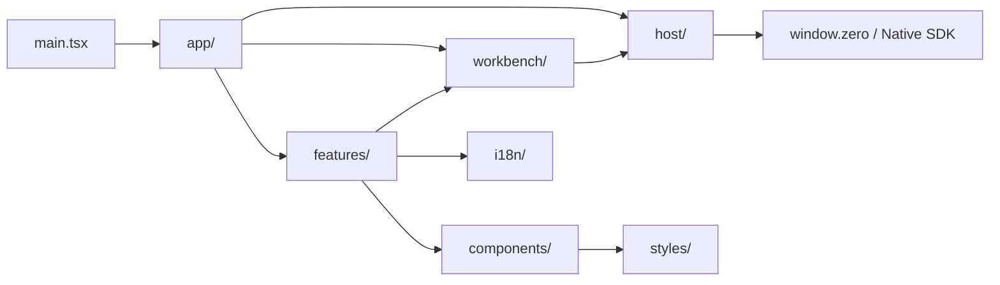
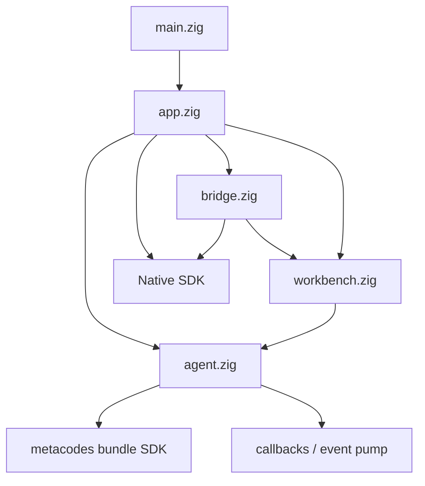

# MetaWork 工程目录结构设计草案

> 状态：Approved v0.4；Zig module boundary 与 Bridge product delivery ownership 已落地，后续继续收口 automation build boundary
> 日期：2026-07-19
> 范围：仓库外层、React Renderer、Zig `src/`、依赖方向、状态所有权、测试布局与渐进迁移

## 1. 文档职责

本文档定义 MetaWork 正式 Workbench 实现的目标工程结构。它不以“目录看起来整齐”为目标，而是固定真实边界：

- React feature、Host client 和 Workbench view model；
- Native SDK App/Runtime callback 与 Renderer Bridge；
- Workbench 产品编排与 AgentCore bundle 调用；
- snapshot 序列化与 Bridge snapshot transport；
- Workspace grant、持久权限和状态所有权；
- 单元测试、真实 GUI 验证与历史 spikes。

系统职责仍以 [高层架构](architecture.md) 为准，AgentCore 生命周期与协议边界仍以 [AgentCore 集成契约](agentcore-integration.md) 为准，界面 feature 以 [Workbench UI 设计草案](workbench-ui-design.md) 为准。

本文档是目标结构设计，不授权一次性搬迁文件。任何迁移都必须保持现有 build、test、package 和 Phase 0A Gate 行为。

## 2. 当前结构与评审结论

首轮边界迁移已经落地：

- `src/main.zig` 只保留进程入口，Native SDK App 与 composition 已移入 `src/app.zig`；
- Bridge command、policy、payload decoder、callback ingress gate、`ProductDelivery` 和一次性 Workspace grant 已形成独立模块；`ProductDelivery` 独占 connection generation、revision retry/timer、snapshot identity 与 owned storage；
- bounded executor 的队列、worker、容量策略和 shutdown 归 `workbench/executor.zig`；Agent 不持有调度 capability，也不反向 enqueue；
- Agent Runtime/Session、callback quiescence、cancel/close/shutdown 语义仍集中在 `agent/session.zig`，后续只按已验证责任继续拆分；
- `workbench/projection.zig` 仍同时承担产品 Task view 和 snapshot writer，后续任务再提取；
- Workbench admission 已在 `workbench/projection.zig` 建立 stable Run record、generation、`RunRef`、write-once terminal publication 与 `delete_pending`，并独占 Executor/queue/workers；已开始执行的 Run 由 Agent immutable `TerminalResult` 收口，queued-before-execute 由 Workbench 生成产品结果；
- Renderer Host 合同已集中到 `frontend/src/host/`；应用 composition 已进入 `frontend/src/app/`，已落地的 Workspace navigation、Search、Timeline、question/permission Approvals、Composer draft 和 Task activity 进入各自 `frontend/src/features/`，`workbench/` 只保留 projection store 与 selector。尚未形成真实产品能力的 Outputs、持久权限管理和 Settings 不创建空模块。

当前 Zig 顶层固定为 `main.zig + app.zig + agent.zig + workbench.zig + bridge.zig`。`agent/` 表达 MetaWork 自己拥有的执行子系统；`AgentCore` 只指 metacodes 构建的外部 bundle。完整后续状态机与迁移顺序见 [架构调整实施方案](architecture-adjustment-plan.md)。

采纳时做六项收敛：

1. 不建立通用 `models.zig` 垃圾桶，类型跟随 projection、Session、Workspace 或 permission 不变量；
2. 将 `bridge/snapshot.zig` 明确命名为 `snapshot_delivery.zig`，只负责传输；Workbench JSON 由 `snapshot_writer.zig` 生成；
3. 保留 `bridge/workspace_grant.zig`，但它只能是一种绑定 Native picker、window/source 且一次性消费的 Renderer capability；持久 Workspace registry 属于 Workbench。
4. 正式产品只保留 Workbench revision notification + bounded snapshot 数据面；raw batch/object/ACK 只留在隔离 transport fixture；
5. bounded executor 和排队策略属于 Workbench/Host lifecycle，不下沉到 AgentCore 集成层；
6. 产品 Task 与 bundle Session handle 使用不同命名，不靠注释解释两个 `session` 模块为什么没有重复所有权。

产品边界已统一为 schema v5：Bridge/Renderer command 使用 `metawork.tasks.*`，产品 payload/result 使用 `taskId`，snapshot 根集合使用 `tasks`。内部 Agent Session route identity 只存在于 Agent 与隔离 transport fixture，不建立第二套可持久化产品 ID，也不提供 schema v4 兼容别名。

`app.zig` 定义 Native SDK App 与 callback，但 Native SDK runner 仍然拥有 Runtime 的构造和驱动，MetaWork 不再包一层替代 Runtime。

## 3. 结构目标

目录结构必须服务于真实职责，而不是追求层数。目标是：

- React 按产品 feature 组织，不让 `App.tsx` 成为协议、状态和页面的集合体；
- Renderer 只能通过一个集中式 Host client 调用领域命令；
- Host snapshot DTO、UI 状态和 AgentCore 原始协议保持清晰边界；
- Zig 以 Native composition、Workbench 产品状态、AgentCore lifecycle 和 Bridge transport 分责；
- 不增加 Native SDK adapter、通用 Desktop Interface 或 AgentCore mirror；
- 已通过验证的 lifecycle/event pump 模块不为追求目录美观进行无价值重写；
- 测试与对应 feature 或 runtime 相邻，端到端编排保留在 scripts；
- spikes 只保留隔离验证和历史 Gate 证据，不承载正式产品实现。

避免使用缺少产品含义的顶层目录，例如 `services/`、`managers/`、`helpers/`、`common/` 和 `interfaces/`。只有存在多个明确消费者时，代码才进入共享层。

## 4. 目标仓库结构

```text
metawork/
├── docs/
│   ├── requirements.md
│   ├── architecture.md
│   ├── agentcore-integration.md
│   ├── agentcore-abi-v1.md
│   ├── phase-0-validation.md
│   ├── workbench-ui-design.md
│   └── project-structure.md
├── frontend/
│   ├── src/
│   │   ├── app/
│   │   ├── host/
│   │   ├── workbench/
│   │   ├── features/
│   │   ├── components/
│   │   ├── i18n/
│   │   ├── styles/
│   │   ├── assets/
│   │   ├── main.tsx
│   │   └── native-sdk.d.ts
│   ├── index.html
│   ├── csp.mjs
│   └── vite.config.ts
├── src/
│   ├── main.zig
│   ├── app.zig
│   ├── bridge.zig
│   ├── bridge/
│   ├── workbench.zig
│   ├── workbench/
│   ├── agent.zig
│   └── agent/
├── build_support/
├── scripts/
├── spikes/
├── build.zig
├── app.zon
└── package.json
```

这是一份目标结构，不要求一次移动所有现有文件。每次拆分必须伴随真实职责迁移和对应测试，不能只做路径重命名。

## 5. Renderer 目录

```text
frontend/src/
├── app/
│   ├── App.tsx
│   ├── AppShell.tsx
│   ├── app-state.ts
│   └── app-shortcuts.ts
├── host/
│   ├── client.ts
│   ├── commands.ts
│   ├── contracts.ts
│   ├── decode-contracts.ts
│   ├── contracts.test.ts
│   ├── connection.ts
│   ├── revision-notification.ts
│   └── snapshot/
│       ├── snapshot-client.ts
│       └── snapshot-demand.ts
├── workbench/
│   ├── store.ts
│   ├── selectors.ts
│   ├── task-status.ts
│   └── view-model.ts
├── features/
│   ├── workspaces/
│   ├── tasks/
│   ├── timeline/
│   ├── composer/
│   ├── approvals/
│   ├── permissions/
│   ├── outputs/
│   ├── task-activity/
│   ├── search/
│   └── settings/
├── components/
│   ├── layout/
│   └── ui/
├── i18n/
│   ├── index.ts
│   ├── formatters.ts
│   ├── pseudo-locale.ts
│   └── messages/
│       ├── en-US.json
│       └── zh-CN.json
├── styles/
│   ├── tokens.css
│   ├── globals.css
│   └── motion.css
├── assets/
├── main.tsx
├── native-sdk.d.ts
└── vite-env.d.ts
```

#### `app/`

只负责应用组合：

- 组装主窗口和全局 provider；
- 选择当前 Workspace 和 Task；
- 注册全局快捷键；
- 切换全局错误、启动和 view-sync 状态。

`App.tsx` 不声明 Host command 字符串、snapshot wire 类型或 feature 内部组件。

当前 `app/App.tsx` 已成为唯一 composition entry，并从 feature public component 组装主窗口。后续只有在 controller 状态形成可独立测试的不变量时才继续提取 `app-state.ts` 或 hooks；不得为了缩短文件制造无所有权的 callback 转发层。

#### `host/`

Renderer 与 Zig Host 的唯一边界：

- `commands.ts` 集中定义公开领域命令名称；
- `contracts.ts` 定义带 schema version 的 Host 产品投影 DTO，不定义 AgentCore raw wire；
- `decode-contracts.ts` 在运行时校验 snapshot、command result 和 revision notification，禁止用 type assertion 把任意 JSON 当成 DTO；
- `contracts.test.ts` 消费真实 Zig serializer 生成的 source-free fixture corpus，验证字段、边界值、unknown version 和 malformed payload；
- `client.ts` 提供小而明确的 typed method；
- `connection.ts` 负责连接 generation、重连和 snapshot 协调；
- `revision-notification.ts` 只接收 Host-owned Workbench revision，不承载 AgentCore raw event、batch、object 或 ACK；
- `snapshot/` 保留当前经过验证的 bounded snapshot descriptor、分块读取和 retry 逻辑。

React component 不得直接访问 `window.zero`，也不得自己拼 Bridge payload。

Zig Workbench projection struct 和 serializer 是产品数据模型真源；TypeScript DTO 只是显式验证的消费者合同。若以后引入 code generation，生成输入必须来自同一机器可读投影定义，不能再维护第三份 JSON schema。没有 codegen 时，contract test 必须在同一次验证中调用真实 Zig serializer，或把提交的 fixture 与确定性重新生成结果逐字节比较，再交给前端 decoder；手写一份恰好能通过测试的 JSON 不算合同证据。

#### `workbench/`

维护 Renderer 对 Host 产品投影的消费方式：

- canonical snapshot store；
- active Workspace/Task selector；
- 派生状态和排序；
- Host DTO 到 UI view model 的无副作用映射；
- view-sync failure 时的 fail-closed mutation policy。

该目录不复制 Host 领域状态机，也不自行推断 AgentCore stop reason。Host snapshot 仍是产品真相，Renderer 只保存选择、折叠、输入草稿等纯 UI 状态。

#### `features/`

按用户可见功能分区。每个 feature 可以包含：

```text
feature-name/
├── FeatureView.tsx
├── components/
├── use-feature.ts
├── feature-model.ts
└── FeatureView.test.tsx
```

feature 之间不通过对方内部文件耦合。跨 feature 的产品数据通过 `workbench/` selector 获取；真正复用的无业务 UI 才进入 `components/ui/`。

#### `components/`

- `layout/`：三栏、标题栏安全区、可折叠 panel 等布局组件；
- `ui/`：Button、IconButton、Menu、Tooltip、Dialog、Disclosure 等无业务语义 primitives。

`ToolCard`、`PermissionCard`、`OutputCard` 等带产品语义的组件留在各自 feature，不进入通用 UI 库。

#### `i18n/`、`styles/` 与 `assets/`

- message catalog 只存界面文案，不存用户内容或诊断文本；
- formatter 统一处理日期、时间、数字、货币和相对时间；
- MetaWork token 只在 `tokens.css` 定义，feature 不直接写任意品牌色；
- `globals.css` 只包含 reset、根字体和应用级默认值；
- `motion.css` 集中 reduced-motion 规则；
- assets 只存应用自有图形和静态资源，不依赖远程字体或图片。

## 6. Renderer 依赖方向



约束：

- `host/` 不依赖 React component；
- `components/ui/` 不依赖 feature 或 Host；
- `workbench/` 可以依赖 Host DTO，但 Host client 不依赖 UI view model；
- feature 不直接消费 Agent event raw JSON；
- 禁止以 barrel file 把整个 feature graph 重新耦合在一起。

## 7. Zig `src/` 目录

当前四个 named module root、App、Bridge product delivery、Workspace grant 和 Workbench executor 已完成责任拆分；`agent/session.zig` 与 `workbench/projection.zig` 仍保留尚未形成独立不变量的代码，后续按 lifecycle 测试保护逐步提取，不为匹配目录树制造空模块。automation-only raw event transport 暂存于 `bridge/delivery.zig`，只跟随产品 generation，不进入产品 `ProductDelivery`，并将在 automation build-boundary 阶段从 release graph 移除。

Zig 目标结构采用少量顶层 module entrypoint，而不是先建立多层 `host/` 空目录：

```text
src/
├── main.zig
├── app.zig
│
├── bridge.zig
├── bridge/
│   ├── commands.zig
│   ├── policy.zig
│   ├── handlers.zig
│   ├── callback_gate.zig
│   ├── product_delivery.zig
│   ├── revision_delivery.zig
│   ├── snapshot_delivery.zig
│   ├── delivery.zig
│   └── workspace_grant.zig
│
├── workbench.zig
├── workbench/
│   ├── tasks.zig
│   ├── executor.zig
│   ├── projection.zig
│   ├── snapshot_writer.zig
│   ├── workspaces.zig
│   └── permissions.zig
│
├── agent.zig
└── agent/
    ├── runtime.zig
    ├── session_handle.zig
    ├── callbacks.zig
    ├── event_sink.zig
    └── event_pump.zig
```

职责：

- `main.zig`：只导入 named `metawork_app` 并调用 `app.run()`；
- `app.zig`：composition root，定义 `native_sdk.App` callbacks，明确区分 `native_runtime` 与 `agent_runtime`；
- `bridge.zig`：Renderer Bridge 的最小公开入口，显式导出 command/policy/handler 所需类型，不使用 `usingnamespace` 倾倒全部内部符号；
- `bridge/commands.zig`：公开领域 command 名称和 payload 上限；
- `bridge/policy.zig`：release/development/automation origin、command 和 builtin policy；
- `bridge/handlers.zig`：payload 校验、Task/Run/request 归属校验和领域调用；
- `bridge/callback_gate.zig`：同步 Native Bridge callback 的 ingress stop 与 quiescence 合同；若 Native callback 改为跨线程异步，该模块必须升级为真实 wait primitive；
- `bridge/product_delivery.zig`：产品 connection generation、revision retry/timer、snapshot identity 与 owned transport storage 的唯一 owner；只通过 capability 调用 Native emit/timer 和 Workbench snapshot writer；
- `bridge/revision_delivery.zig`：`ProductDelivery` 的内部 revision 状态，不从 `bridge.zig` 单独公开；不传输 AgentCore raw event、batch/object/ACK；
- `bridge/snapshot_delivery.zig`：`ProductDelivery` 的内部 snapshot id、window/generation 绑定、分块读取和 storage 实现；不负责生成 Workbench JSON；
- `bridge/delivery.zig`：automation-only raw Agent batch/object/ACK retention；只跟随 `ProductDelivery` 分配的 generation，不拥有产品连接或 view-sync 状态，并在阶段 8 从 release build graph 移除；
- `bridge/workspace_grant.zig`：由原生目录选择产生、绑定 window/source、一次性消费的 Renderer capability；它不是持久 Workspace registry；
- `workbench.zig`：产品编排的最小公开入口；
- `workbench/tasks.zig`：产品 Task 集合、当前/排队 Run 和生命周期投影；
- `workbench/executor.zig`：有界 executor、排队、admission、每 Task 单 Run 和 shutdown policy；
- `workbench/projection.zig`：Renderer 可消费的有界产品 view；类型与其不变量就近定义，不先创建通用 `models.zig`；
- `workbench/snapshot_writer.zig`：把 canonical projection 序列化为 bounded snapshot；
- `workbench/workspaces.zig`：Workspace identity、registry 和与 Task 的归属关系；
- `workbench/permissions.zig`：Host-owned 持久权限规则、匹配、撤销和审计；规则与存储真的形成独立不变量后再拆子目录；
- `agent.zig`：MetaWork Agent 执行子系统的最小 module entrypoint，不镜像 bundle types、code 或 binary facade；
- `agent/runtime.zig`、`session.zig` 和 `run.zig`：目标上直接拥有 SDK Runtime/Session handle、Conversation、同步 run 调用与收口；不拥有产品队列；
- `agent/callbacks.zig`、`event_sink.zig` 和 `event_pump.zig`：callback copy、同步 UI wait、事件所有权、backpressure 和 notification。尚未形成独立不变量的代码暂留 `agent/session.zig`。

目标模型中 Run phase、产品 outcome 和 StopReason 映射只归 `workbench/tasks.zig`；`agent/` 只返回 bundle SDK 已校验的 typed/raw terminal facts。Scheduler 倒挂、混合 `HostCause` 和 Session snapshot terminal 回查均已移除；后续文件拆分不得重新引入平行结果状态。

当前 `agent/session.zig` 已验证的 shutdown、callback quiescence 和 first-writer-wins cause，以及 `workbench/executor.zig` 的 bounded scheduling 行为，只能按正式迁移阶段改写，不能与纯路径迁移混成一次不可审查的变化。

如果某个目录只有一个很小文件且没有独立不变量，应先保留单文件，避免为了匹配目标树制造空壳模块。

## 8. Zig 依赖方向



禁止方向：

- bundle SDK 不反向依赖 MetaWork；
- `agent/` 不依赖 `workbench/`、`bridge/` 或 `app.zig`；callback 只写入自身 sink/pump；
- Workbench projection 不解析 Provider SSE、终端字符流或 AgentCore raw JSON；
- permission store 不由 Renderer 写入；
- bridge handler 不绕过 Workbench 直接操作 AgentCore handle；
- app 层不复制 Host 产品状态；
- 不建立通用 adapter 只为让 Native SDK 或 AgentCore 看起来可替换。

`app.zig`、`bridge.zig`、`workbench.zig` 和 `agent.zig` 由 `build.zig` 注册为 named modules；边界由 build graph 与 `scripts/architecture-boundaries.test.mjs` 共同检查，不能只靠目录文档。

## 9. 状态与类型所有权

| 数据                       | 唯一所有者            | Renderer 行为                            |
| -------------------------- | --------------------- | ---------------------------------------- |
| Session/Run 生命周期       | Zig Host              | 通过 snapshot 展示，不重建状态机         |
| AgentCore event 解释       | bundle SDK + Zig Host | 不解析 raw protocol                      |
| Workspace identity/grant   | Zig Host              | 只持有可展示信息和 opaque command result |
| 持久权限                   | Zig Host              | 展示、请求创建或撤销，不直接写存储       |
| Workbench snapshot         | Zig Host              | 作为 canonical product view 消费         |
| 当前选中 Task              | Renderer app state    | reload 后基于 snapshot 恢复或回退        |
| panel 折叠、草稿、显示密度 | Renderer UI state     | 本地持久化，不能改变 Host 真相           |
| 国际化文案                 | Renderer i18n         | 根据 structured code 和参数生成          |

## 10. 测试目录与命名

- React component、selector 和 formatter 测试与源文件相邻；
- Host connection、revision notification、snapshot 和 decoder 保持纯模块测试；
- Zig serializer fixture 与 TypeScript decoder 必须形成跨语言 contract test，unknown schema version 和 malformed payload 默认拒绝；
- 跨 Renderer/Host 的场景测试由 `scripts/` 编排真实应用；
- `spikes/` 保留实验 build graph 和故障注入，不被正式 target 导入；
- GUI screenshot/automation fixture 使用稳定的 structured Host fixture，不在生产组件中硬编码演示数据；
- 测试名称使用用户可见结果或不变量，不使用 `works`、`basic` 等无信息名称。

TypeScript 文件约定：

- React component 使用 `PascalCase.tsx`；
- 非组件模块和目录使用 `kebab-case.ts`；
- 测试使用 `*.test.ts` 或 `*.test.tsx`。

Zig 文件和符号遵循现有 `snake_case` 与 Zig 风格。

## 11. 渐进迁移顺序

不进行一次性目录重写。建议按以下顺序迁移：

1. 把 App 中的 command、DTO、snapshot 和 revision notification 移入 `frontend/src/host/`，先保持行为不变；raw transport fixture 直接隔离到测试路径；
2. 建立 `workbench/` store 与 selector，让 App 不再直接遍历 raw snapshot；
3. 建立 app shell、三栏 layout 和 token；
4. 按 Workspace、Task、timeline、approval、output 顺序提取 feature；
5. 接入 en-US/zh-CN message catalog 后再扩展新文案；
6. 建立 named `app.zig`、`bridge.zig`、`workbench.zig` 和 `agent.zig` module root，不改变现有行为；
7. 从 `src/main.zig` 提取 `app.zig`、Bridge policy/handler、Workspace grant 和 snapshot delivery；
8. 按现有 `lifecycle.zig` 的真实责任拆出 Workbench executor/Task policy 与 AgentCore session handle/callback，保持所有 lifecycle 测试不变；
9. 从现有 Workbench 投影中提取 tasks、projection 和 snapshot writer；
10. permission 和 Workspace registry 形成真实能力后再创建对应模块；
11. 每一步保持现有 Gate、build、package 和 GUI 验证通过。

## 12. 目录迁移验收

目录调整只有同时满足以下条件才算完成：

- `main.zig` 只调用 `app.run()`，不包含 composition、领域 handler 或大段测试；
- 顶层 module root 只显式暴露实际消费者需要的类型和函数；
- `agent/` 不依赖 `workbench/`、`bridge/` 或 `app.zig`；
- Bridge handler 不能绕过 Workbench 直接操作 AgentCore handle；
- Renderer component 不直接访问 `window.zero`；
- Renderer 对所有 Host payload 做 runtime decode，并由真实 Zig serializer fixture 验证跨语言合同；
- Host snapshot 是 Renderer 产品状态的唯一真相；
- snapshot writer 与 snapshot delivery 没有重复序列化或 identity 所有权；
- Workspace grant、Workspace registry 和持久 permission 没有混成一个 boolean trust；
- 现有 lifecycle、event pump、snapshot、revision delivery、隔离 raw transport fixture 和 GUI 测试全部保持通过；
- 正式 build graph 不导入 spikes，也不访问 metacodes source tree；
- 不新增 Native SDK adapter、AgentCore ABI facade 或平行协议。
