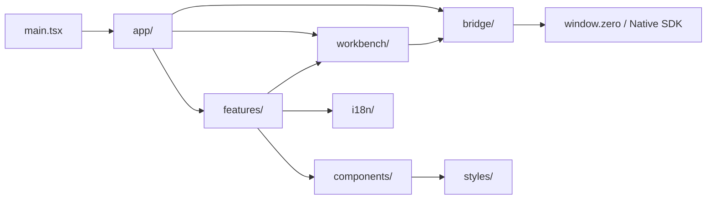
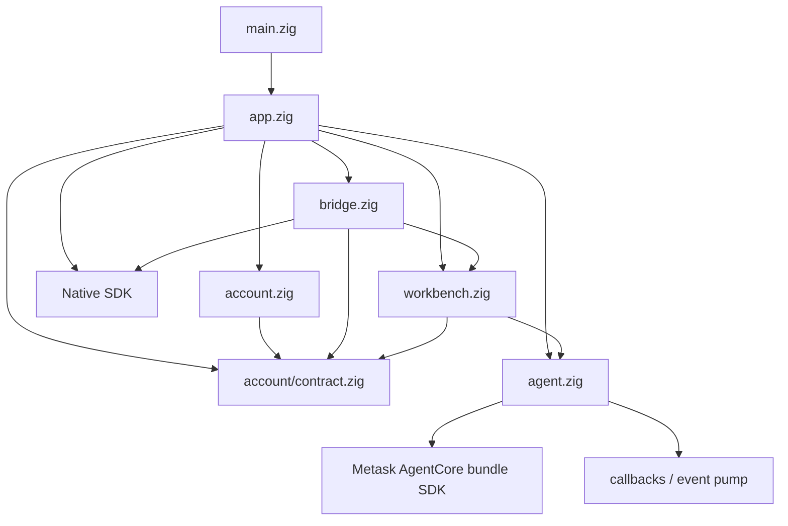

# MetaWork 工程目录结构设计草案

> 状态：Approved v0.7；加入 Account 产品边界与纯 account contract
> 日期：2026-07-20
> 范围：仓库外层、React Renderer、Zig `src/`、依赖方向、状态所有权、测试布局与渐进迁移

## 1. 文档职责

本文档定义 MetaWork 正式 Workbench 实现的目标工程结构。它不以“目录看起来整齐”为目标，而是固定真实边界：

- React feature、Bridge client 和 Workbench view model；
- Native SDK App/Runtime callback 与 Renderer Bridge；
- Workbench 产品编排与 AgentCore bundle 调用；
- snapshot 序列化与 Bridge snapshot transport；
- Workspace grant、持久权限和状态所有权；
- 单元测试、真实 GUI 验证与持续验证资产。

系统职责仍以 [高层架构](architecture.md) 为准，AgentCore 生命周期与协议边界仍以 [AgentCore 集成契约](agentcore-integration.md) 为准，界面 feature 以 [Workbench UI 设计草案](workbench-ui-design.md) 为准。

本文档是目标结构设计，不授权一次性搬迁文件。任何迁移都必须保持现有 build、test、package 和验证行为。

## 2. 当前结构与评审结论

首轮边界迁移已经落地：

- `src/main.zig` 只保留进程入口，Native SDK App 与 composition 已移入 `src/app.zig`；
- Bridge command、policy、payload decoder、callback ingress gate、`ProductDelivery` 和一次性 Workspace grant 已形成独立模块；`ProductDelivery` 独占 connection generation、revision retry/timer、snapshot identity 与 owned storage；
- bounded executor 的队列、worker、容量策略和 shutdown 归 `workbench/executor.zig`；Agent 不持有调度 capability，也不反向 enqueue；
- Agent Runtime/Session、callback quiescence、cancel/close/shutdown 语义仍集中在 `agent/session.zig`，后续只按已验证责任继续拆分；
- `workbench/projection.zig` 仍同时承担产品 Task view 和 snapshot writer，后续任务再提取；
- Workbench admission 已在 `workbench/projection.zig` 建立 stable Run record、generation、`RunRef`、write-once terminal publication 与 `delete_pending`，并独占 Executor/queue/workers；已开始执行的 Run 由 Agent immutable `TerminalResult` 收口，queued-before-execute 由 Workbench 生成产品结果；
- Renderer Native Bridge 合同已集中到 `frontend/src/bridge/`，只有 `bridge/client.ts` 访问 `window.zero`；应用 composition 已进入 `frontend/src/app/`，已落地的 Workspace navigation、Search、Timeline、question/permission Approvals、Composer draft 和 Task activity进入各自 `frontend/src/features/`，`workbench/` 只保留 projection store 与 selector。尚未形成真实产品能力的 Outputs、持久权限管理和 Settings 不创建空模块。

当前已落地 `main.zig + app.zig + account.zig + agent.zig + workbench.zig + bridge.zig`。Task A 提供纯 `src/account/contract.zig`；Task B 提供不接触 production 网络或平台存储的纯 Account 状态机。产品边界为 App、Account、Bridge、Workbench、Agent 五个 modules；`account_contract` 只是 Account owner 发布的纯合同，不是第六个产品职责。`agent/` 表达 MetaWork 自己拥有的执行子系统；`AgentCore` 只指 Metask AgentCore 构建的外部 bundle。

采纳时做六项收敛：

1. 不建立通用 `models.zig` 垃圾桶，类型跟随 projection、Session、Workspace 或 permission 不变量；
2. 将 `bridge/snapshot.zig` 明确命名为 `snapshot_delivery.zig`，只负责传输；Workbench JSON 由 `snapshot_writer.zig` 生成；
3. 保留 `bridge/workspace_grant.zig`，但它只能是一种绑定 Native picker、window/source 且一次性消费的 Renderer capability；持久 Workspace registry 属于 Workbench。
4. Workbench revision notification + bounded snapshot 是唯一 Renderer 数据面；automation 只驱动和观察这条真实路径；
5. bounded executor 和排队策略属于 Workbench lifecycle，不下沉到 AgentCore 集成层；
6. 产品 Task 与 bundle Session handle 使用不同命名，不靠注释解释两个 `session` 模块为什么没有重复所有权。

产品边界已统一为 `metawork.renderer-bridge` revision 1：`connect` 精确协商后才建立产品 delivery connection，snapshot 根节点由无 secret 的 `account` 与 `tasks` 构成且不维护局部版本；Account 直接发布 Host-owned `readiness`、唯一 `primaryAction` 与 `canCancel`，Account command 使用 `metawork.account.*` 并只提交给 App 注入的 `AccountCommandSink`，Task command 使用 `metawork.tasks.*`，产品 Task payload/result 使用 `taskId`。内部 Agent Session route identity 只存在于 Agent，不建立第二套可持久化产品 ID，也不提供旧 revision 兼容别名。

`app.zig` 定义 Native SDK App 与 callback，但 Native SDK runner 仍然拥有 Runtime 的构造和驱动，MetaWork 不再包一层替代 Runtime。

## 3. 结构目标

目录结构必须服务于真实职责，而不是追求层数。目标是：

- React 按产品 feature 组织，不让 `App.tsx` 成为协议、状态和页面的集合体；
- Renderer 只能通过一个集中式 Bridge client 调用领域命令；
- Workbench snapshot DTO、UI 状态和 AgentCore 原始协议保持清晰边界；
- Zig 以 Native composition、Workbench 产品状态、AgentCore lifecycle 和 Bridge transport 分责；
- 不增加 Native SDK adapter、通用 Desktop Interface 或 AgentCore mirror；
- 已通过验证的 lifecycle/event pump 模块不为追求目录美观进行无价值重写；
- 测试与对应 feature 或 runtime 相邻，端到端编排保留在 scripts；
- 一次性 candidate、SDK 和 fault-domain 实验不进入 active tree；可复现结论由正式回归或精确 Git 证据承担。

避免使用缺少产品含义的顶层目录，例如 `services/`、`managers/`、`helpers/`、`common/` 和 `interfaces/`。只有存在多个明确消费者时，代码才进入共享层。

## 4. 目标仓库结构

```text
metawork/
├── docs/
│   ├── requirements.md
│   ├── architecture.md
│   ├── agentcore-integration.md
│   ├── agentcore-abi-v1.md
│   ├── validation.md
│   ├── metask-account-contract.md
│   ├── workbench-ui-design.md
│   └── project-structure.md
├── frontend/
│   ├── src/
│   │   ├── app/
│   │   ├── bridge/
│   │   ├── workbench/
│   │   ├── features/
│   │   ├── components/
│   │   ├── i18n/
│   │   ├── styles/
│   │   ├── assets/
│   │   ├── main.tsx
│   │   └── native-sdk.d.ts
│   ├── index.html
│   ├── csp.mjs
│   └── vite.config.ts
├── src/
│   ├── main.zig
│   ├── app.zig
│   ├── account.zig
│   ├── account/
│   │   ├── contract.zig
│   │   └── state.zig
│   ├── bridge.zig
│   ├── bridge/
│   ├── workbench.zig
│   ├── workbench/
│   ├── agent.zig
│   └── agent/
├── build_support/
│   ├── agentcore_bundle.zig
│   ├── agentcore-bundle.macos.lock.json
│   └── agentcore-bundle.windows.lock.json
├── tests/
│   ├── agent/
│   ├── bridge/
│   ├── workbench/
│   ├── integration/
│   └── support/
├── scripts/
├── build.zig
├── app.zon
└── package.json
```

这是一份目标结构，不要求一次移动所有现有文件。每次拆分必须伴随真实职责迁移和对应测试，不能只做路径重命名。

## 5. Renderer 目录

```text
frontend/src/
├── app/
│   ├── App.tsx
│   ├── AppShell.tsx
│   ├── app-state.ts
│   └── app-shortcuts.ts
├── bridge/
│   ├── client.ts
│   ├── commands.ts
│   ├── contracts.ts
│   ├── decode-contracts.ts
│   ├── contracts.test.ts
│   ├── connection.ts
│   ├── revision-notification.ts
│   └── snapshot/
│       ├── snapshot-client.ts
│       └── snapshot-demand.ts
├── workbench/
│   ├── store.ts
│   ├── selectors.ts
│   ├── task-status.ts
│   └── view-model.ts
├── features/
│   ├── workspaces/
│   ├── tasks/
│   ├── timeline/
│   ├── composer/
│   ├── approvals/
│   ├── permissions/
│   ├── outputs/
│   ├── task-activity/
│   ├── search/
│   └── settings/
├── components/
│   ├── layout/
│   └── ui/
├── i18n/
│   ├── index.ts
│   ├── formatters.ts
│   ├── pseudo-locale.ts
│   └── messages/
│       ├── en-US.json
│       └── zh-CN.json
├── styles/
│   ├── tokens.css
│   ├── globals.css
│   └── motion.css
├── assets/
├── main.tsx
├── native-sdk.d.ts
└── vite-env.d.ts
```

#### `app/`

只负责应用组合：

- 组装主窗口和全局 provider；
- 选择当前 Workspace 和 Task；
- 注册全局快捷键；
- 切换全局错误、启动和 view-sync 状态。

`App.tsx` 不声明 Bridge command 字符串、snapshot wire 类型或 feature 内部组件。

当前 `app/App.tsx` 已成为唯一 composition entry，并从 feature public component 组装主窗口。后续只有在 controller 状态形成可独立测试的不变量时才继续提取 `app-state.ts` 或 hooks；不得为了缩短文件制造无所有权的 callback 转发层。

#### `bridge/`

Renderer 与 Zig Native 应用的唯一 Bridge 边界：

- `commands.ts` 集中定义公开领域命令名称；
- `contracts.ts` 定义由 Renderer Bridge contract revision 整体覆盖的 Workbench 产品投影 DTO，不定义局部版本或 AgentCore raw wire；
- `decode-contracts.ts` 在运行时校验 snapshot、command result 和 revision notification，禁止用 type assertion 把任意 JSON 当成 DTO；
- `contracts.test.ts` 消费真实 Zig serializer 生成的 source-free fixture corpus，验证字段、边界值、unknown version 和 malformed payload；
- `client.ts` 提供小而明确的 typed method；
- `connection.ts` 负责连接 generation、重连和 snapshot 协调；
- `revision-notification.ts` 只接收 Workbench-owned revision，不承载 AgentCore raw event、batch、object 或 ACK；
- `snapshot/` 保留当前经过验证的 bounded snapshot descriptor、分块读取和 retry 逻辑。

React component 不得直接访问 `window.zero`，也不得自己拼 Bridge payload。

Zig Workbench projection struct 和 serializer 是产品数据模型真源；TypeScript DTO 只是显式验证的消费者合同。若以后引入 code generation，生成输入必须来自同一机器可读投影定义，不能再维护第三份 JSON schema。没有 codegen 时，contract test 必须在同一次验证中调用真实 Zig serializer，或把提交的 fixture 与确定性重新生成结果逐字节比较，再交给前端 decoder；手写一份恰好能通过测试的 JSON 不算合同证据。

#### `workbench/`

维护 Renderer 对 Workbench 产品投影的消费方式：

- canonical snapshot store；
- active Workspace/Task selector；
- 派生状态和排序；
- Bridge DTO 到 UI view model 的无副作用映射；
- view-sync failure 时的 fail-closed mutation policy。

该目录不复制 Workbench 领域状态机，也不自行推断 AgentCore stop reason。Workbench snapshot 仍是产品真相，Renderer 只保存选择、折叠、输入草稿等纯 UI 状态。

#### `features/`

按用户可见功能分区。每个 feature 可以包含：

```text
feature-name/
├── FeatureView.tsx
├── components/
├── use-feature.ts
├── feature-model.ts
└── FeatureView.test.tsx
```

feature 之间不通过对方内部文件耦合。跨 feature 的产品数据通过 `workbench/` selector 获取；真正复用的无业务 UI 才进入 `components/ui/`。

#### `components/`

- `layout/`：三栏、标题栏安全区、可折叠 panel 等布局组件；
- `ui/`：Button、IconButton、Menu、Tooltip、Dialog、Disclosure 等无业务语义 primitives。

`ToolCard`、`PermissionCard`、`OutputCard` 等带产品语义的组件留在各自 feature，不进入通用 UI 库。

#### `i18n/`、`styles/` 与 `assets/`

- message catalog 只存界面文案，不存用户内容或诊断文本；
- formatter 统一处理日期、时间、数字、货币和相对时间；
- MetaWork token 只在 `tokens.css` 定义，feature 不直接写任意品牌色；
- `globals.css` 只包含 reset、根字体和应用级默认值；
- `motion.css` 集中 reduced-motion 规则；
- assets 只存应用自有图形和静态资源，不依赖远程字体或图片。

## 6. Renderer 依赖方向



约束：

- `bridge/` 不依赖 React component；
- `components/ui/` 不依赖 feature 或 Bridge；
- `workbench/` 可以依赖 Bridge DTO，但 Bridge client 不依赖 UI view model；
- feature 不直接消费 Agent event raw JSON；
- 禁止以 barrel file 把整个 feature graph 重新耦合在一起。

## 7. Zig `src/` 目录

当前 named module root、App、Bridge concrete Dispatcher、Workbench executor 与 automation compile-time boundary 已完成责任拆分。`bridge/dispatcher.zig` 统一拥有产品 handler registry、callback gate、ProductDelivery、Workspace grant 和 Workbench command 边界；App 只注入 Native platform capability 并组织生命周期。`agent/session.zig` 与 `workbench/projection.zig` 仍保留尚未形成独立不变量的代码，后续按 lifecycle 测试保护逐步提取，不为匹配目录树制造空模块。automation enabled/disabled composition 只提供受控账号、origin 和临时 Workspace authority；它不注册额外 Bridge handler，不进入 connection lifecycle，release Native artifact 继续验证无 automation credential。

Zig 目标结构采用少量顶层 module entrypoint，而不是先建立多层 `host/` 空目录：

```text
src/
├── main.zig
├── app.zig
│
├── account.zig
├── account/
│   ├── contract.zig
│   ├── state.zig
│   ├── metask_client.zig
│   └── credential_store.zig
│
├── bridge.zig
├── bridge/
│   ├── dispatcher.zig
│   ├── commands.zig
│   ├── policy.zig
│   ├── handlers.zig
│   ├── callback_gate.zig
│   ├── product_delivery.zig
│   ├── revision_delivery.zig
│   ├── snapshot_delivery.zig
│   └── workspace_grant.zig
├── automation.zig
├── automation/
│   ├── disabled.zig
│   ├── enabled.zig
│   └── delivery.zig
│
├── workbench.zig
├── workbench/
│   ├── tasks.zig
│   ├── executor.zig
│   ├── projection.zig
│   ├── snapshot_writer.zig
│   ├── workspaces.zig
│   └── permissions.zig
│
├── agent.zig
└── agent/
    ├── runtime.zig
    ├── session_handle.zig
    ├── callbacks.zig
    ├── event_sink.zig
    └── event_pump.zig
```

职责：

- `main.zig`：只导入 named `metawork_app` 并调用 `app.run()`；
- `app.zig`：composition root，定义 `native_sdk.App` callbacks，明确区分 `native_runtime` 与 `agent_runtime`；
- `account.zig`：Metask Account runtime 的最小公开入口；拥有登录 attempt、catalog、credential generation、具体 credential owner 和 prepared transition，不拥有 Workbench；
- `account/contract.zig`：不依赖 Native SDK 或任何产品 runtime 的有界纯合同；包含脱敏 view/fact、command sink、ExecutionConfig transfer、稳定 error code 与 compile-time limits；
- `account/state.zig`：双状态、operation、attempt/generation 与唯一 prepare/commit 状态机；effect 只允许先进入有界 worker queue，再执行 no-fail commit；
- `app.zig` 内的 Account terminal mailbox：组合根持有的 single-slot worker-to-main ownership transfer；只允许一个 active attempt 和一次 terminal publish，collision fail closed；
- `account/oauth.zig`：已锁定 C1 OAuth 常量、PKCE、callback、token/profile strict decoder 和有界 secret；
- `account/loopback.zig`：动态 IPv4 loopback listener、严格 HTTP callback、cancel/shutdown wake；
- `account/login_attempt.zig`：单 attempt worker、Metask exchange/profile 编排与 owned terminal result；
- `account/metask_client.zig`：消费已锁定的 Metask C1/C2 production endpoint contract，不接受动态 production origin；
- `account/catalog.zig`：profile-aware API Key/model strict decoder、catalog owner 绑定与 fixed ExecutionTarget 生成；
- `account/credential_store.zig`：固定 OAuth/execution 双 family A/B slot、generation marker、`manifest.v2`、tombstone、restore 与 retired cleanup；
- `account/platform.zig`：Account 专用 Native SDK 主线程 open URL/Keychain 和 macOS atomic manifest，不是通用 Desktop Interface；
- `bridge.zig`：Renderer Bridge 的最小公开入口，显式导出 command/policy/handler 所需类型，不使用 `usingnamespace` 倾倒全部内部符号；
- `bridge/dispatcher.zig`：产品 command 的具体同步边界，统一拥有 handler registry、callback gate、`ProductDelivery`、Workspace grant、`*Workbench` 和 bounded decode/encode 流程；只接收 App 注入的实际平台动作；
- `bridge/commands.zig`：公开领域 command 名称和 payload 上限；
- `bridge/policy.zig`：产品 release/development origin、command 和 builtin policy；
- `bridge/handlers.zig`：只定义 bounded payload DTO、wire ID 与枚举解析；Task/Run 是否允许操作由 Dispatcher 调用 Workbench 判断；
- `bridge/callback_gate.zig`：同步 Native Bridge callback 的 ingress stop 与 quiescence 合同；若 Native callback 改为跨线程异步，该模块必须升级为真实 wait primitive；
- `bridge/product_delivery.zig`：产品 connection generation、revision retry/timer、snapshot identity 与 owned transport storage 的唯一 owner；只通过 capability 调用 Native emit/timer 和 Workbench snapshot writer；
- `bridge/revision_delivery.zig`：`ProductDelivery` 的内部 revision 状态，不从 `bridge.zig` 单独公开；不传输 AgentCore raw event、batch/object/ACK；
- `bridge/snapshot_delivery.zig`：`ProductDelivery` 的内部 snapshot id、window/generation 绑定、分块读取和 storage 实现；不负责生成 Workbench JSON；
- `automation.zig`：读取 Native SDK generated `build_options.automation`，在编译期选择 enabled/disabled implementation；
- `automation/enabled.zig`：automation-only 账号、origin 与临时 Workspace authority；不注册 Renderer 协议或拥有产品 transport state；
- `automation/disabled.zig`：release 的 inert authority capability，不包含 automation origin 或 credential；
- `bridge/workspace_grant.zig`：由原生目录选择产生、绑定 window/source、一次性消费的 Renderer capability；它不是持久 Workspace registry；
- `workbench.zig`：产品编排的最小公开入口；
- `workbench/tasks.zig`：产品 Task 集合、当前/排队 Run 和生命周期投影；
- `workbench/executor.zig`：有界 executor、排队、admission、每 Task 单 Run 和 shutdown policy；
- `workbench/projection.zig`：Renderer 可消费的有界产品 view；类型与其不变量就近定义，不先创建通用 `models.zig`；
- `workbench/snapshot_writer.zig`：把 canonical projection 序列化为 bounded snapshot；
- `workbench/workspaces.zig`：Workspace identity、registry 和与 Task 的归属关系；
- `workbench/permissions.zig`：Workbench-owned 持久权限规则、匹配、撤销和审计；规则与存储真的形成独立不变量后再拆子目录；
- `agent.zig`：MetaWork Agent 执行子系统的最小 module entrypoint，不镜像 bundle types、code 或 binary facade；
- `agent/runtime.zig`、`session.zig` 和 `run.zig`：目标上直接拥有 SDK Runtime/Session handle、Conversation、同步 run 调用与收口；不拥有产品队列；
- `agent/callbacks.zig`、`event_sink.zig` 和 `event_pump.zig`：callback copy、同步 UI wait、事件所有权、backpressure 和 notification。尚未形成独立不变量的代码暂留 `agent/session.zig`。

目标模型中 Run phase、产品 outcome 和 StopReason 映射只归 `workbench/tasks.zig`；`agent/` 只返回 bundle SDK 已校验的 typed/raw terminal facts。Scheduler 倒挂、混合 `HostCause` 和 Session snapshot terminal 回查均已移除；后续文件拆分不得重新引入平行结果状态。

当前 `agent/session.zig` 已验证的 shutdown、callback quiescence 和 first-writer-wins cause，以及 `workbench/executor.zig` 的 bounded scheduling 行为，只能按正式迁移阶段改写，不能与纯路径迁移混成一次不可审查的变化。

如果某个目录只有一个很小文件且没有独立不变量，应先保留单文件，避免为了匹配目标树制造空壳模块。

## 8. Zig 依赖方向



禁止方向：

- bundle SDK 不反向依赖 MetaWork；
- `agent/` 不依赖 `workbench/`、`bridge/` 或 `app.zig`；callback 只写入自身 sink/pump；
- Account 与 Workbench 是同级 owner，不互相导入 runtime；二者只通过 `metawork_account_contract` 和 App 主线程提交链协作；
- Bridge 不导入 Account runtime，只使用 contract 中不含 secret 的 command/view；
- Workbench projection 不解析 Provider SSE、终端字符流或 AgentCore raw JSON；
- permission store 不由 Renderer 写入；
- bridge handler 不绕过 Workbench 直接操作 AgentCore handle；
- app 层不复制 Workbench 产品状态；
- 不建立通用 adapter 只为让 Native SDK 或 AgentCore 看起来可替换。

`app.zig`、`account.zig`、`bridge.zig`、`workbench.zig` 和 `agent.zig` 由 `build.zig` 注册为 named product modules；`metawork_account_contract` 和 Account state 也有独立正式测试 root，terminal mailbox 则通过 App 正式测试 root 验证。边界由 build graph 与 `scripts/architecture-boundaries.test.mjs` 共同检查，不能只靠目录文档。

## 9. 状态与类型所有权

| 数据                       | 唯一所有者         | Renderer 行为                        |
| -------------------------- | ------------------ | ------------------------------------ |
| OAuth/session/catalog 状态 | Account            | 只观察脱敏 AccountView               |
| OAuth token/完整 API Key   | Account/凭据存储   | 永不接收                             |
| active ExecutionConfig     | Workbench          | 只观察 generation/provider/model     |
| Agent Session/active Run   | Agent              | 通过 snapshot 展示，不重建状态机     |
| Task/Run 产品历史          | Workbench          | 只消费不可变 terminal product record |
| AgentCore event 解释       | bundle SDK + Agent | 不解析 raw protocol                  |
| Workspace identity         | Workbench          | 只持有可展示信息                     |
| 一次性 Workspace grant     | Bridge             | 只持有 opaque command result         |
| 持久权限                   | Workbench          | 展示、请求创建或撤销，不直接写存储   |
| Workbench snapshot         | Workbench          | 作为 canonical product view 消费     |
| 当前选中 Task              | Renderer app state | reload 后基于 snapshot 恢复或回退    |
| panel 折叠、草稿、显示密度 | Renderer UI state  | 本地持久化，不能改变 Workbench 真相  |
| 国际化文案                 | Renderer i18n      | 根据 structured code 和参数生成      |

## 10. 测试目录与命名

Zig lifecycle 测试已从 mixed spike 拆为正式的 invariant-grouped suite：`tests/agent/` 验证 Session、callback 与 quiescence，`tests/workbench/` 验证 Executor、admission 与 shutdown，`tests/integration/lifecycle/` 只保留跨边界竞态。确定性 Fake AgentCore 和组合 fixture 统一位于 `tests/support/`，不得把共享 fixture 当成新的产品模块。入口命令为 `npm run test:lifecycle`，并继续要求显式校验过的 AgentCore bundle。

AgentCore repository locks 与正式 build verifier 相邻放在 `build_support/`。candidate probe 在临时目录生成最小官方 SDK consumer，不把一次性实验夹具留在仓库中。

- React component、selector 和 formatter 测试与源文件相邻；
- Bridge connection、revision notification、snapshot 和 decoder 保持纯模块测试；
- Zig serializer fixture 与 TypeScript decoder 必须形成跨语言 contract test，unknown contract revision 和 malformed payload 默认拒绝；
- 跨 Renderer/Native 的场景测试由 `scripts/` 编排真实应用；
- `build_support/` 只保留正式 build verifier 和 target locks，不接纳一次性实验夹具；
- GUI screenshot/automation fixture 使用稳定的 structured automation fixture，不在生产组件中硬编码演示数据；
- 测试名称使用用户可见结果或不变量，不使用 `works`、`basic` 等无信息名称。

TypeScript 文件约定：

- React component 使用 `PascalCase.tsx`；
- 非组件模块和目录使用 `kebab-case.ts`；
- 测试使用 `*.test.ts` 或 `*.test.tsx`。

Zig 文件和符号遵循现有 `snake_case` 与 Zig 风格。

## 11. 目录边界验收

目录调整只有同时满足以下条件才算完成：

- `main.zig` 只调用 `app.run()`，不包含 composition、领域 handler 或大段测试；
- 顶层 module root 只显式暴露实际消费者需要的类型和函数；
- `agent/` 不依赖 `workbench/`、`bridge/` 或 `app.zig`；
- Bridge handler 不能绕过 Workbench 直接操作 AgentCore handle；
- Renderer component 不直接访问 `window.zero`；
- Renderer 对所有 Bridge payload 做 runtime decode，并由真实 Zig serializer fixture 验证跨语言合同；
- Workbench snapshot 是 Renderer 产品状态的唯一真相；
- snapshot writer 与 snapshot delivery 没有重复序列化或 identity 所有权；
- Workspace grant、Workspace registry 和持久 permission 没有混成一个 boolean trust；
- 现有 lifecycle、event pump、snapshot、revision delivery 和 GUI 测试全部保持通过；
- 正式产品 target 不导入 candidate probe，也不访问 AgentCore 实现源码；
- 不新增 Native SDK adapter、AgentCore ABI facade 或平行协议。
