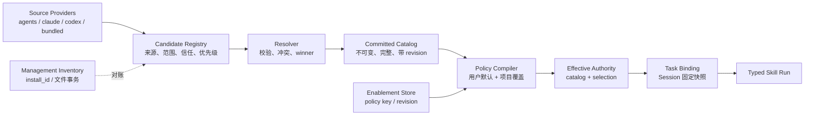

# MetaWork Skill 整体机制架构提案

> 状态：设计提案，尚未进入合同或实现变更
>
> 日期：2026-08-19
>
> 边界：本文不授权修改 AgentCore ABI、AgentCore descriptor schema、Renderer Bridge 合同、MetaWork persistence schema 或任何版本标识。所有合同和版本变更必须另行取得用户明确同意。

## 1. 背景与结论

当前 MetaWork 已经实现两项彼此独立且方向正确的能力：

- Workbench-owned 本地 Skill 资产管理，以 `install_id` 管理导入、重新导入、导出、卸载和文件事务；
- Workbench-owned 用户默认与 Manual Workspace 覆盖，以 `skill_id`、`catalog_revision`、`selection_revision` 和双 revision CAS 控制新 Task 的有效 Skill selection。

现有机制的主要限制不在上述两层，而在上游 catalog：当前 AgentCore projection 是已经完成 resolution 的扁平 winner 列表，MetaWork 看不到 provider、source scope、source instance、contribution identity、resolution trace 或 shadowed candidate。结果是：

- `.agents/skills` 之外的来源无法以统一机制接入；
- 管理资产与 runtime winner 只能在有限条件下对账；
- `skill_id` 同时承担调用身份和持久 policy key，但不能表达来源身份；
- catalog readiness 与 enablement readiness 容易被表示成互相矛盾的半状态；
- 中间态、provider failure 和 catalog replacement 的事务语义不够强。

因此，后续不应继续在 MetaWork 内增加独立目录扫描器或来源猜测。目标机制应重构为：

```text
Source Provider
    -> Candidate Registry
    -> Resolver
    -> Committed Catalog
    -> Policy Compiler
    -> Effective Skill Authority
    -> Task/Session Binding
    -> Typed Skill Run
```

当前分支应被视为“扁平 AgentCore catalog 上的管理与 enablement 垂直切片”。它不需要推翻，但也不应直接扩展成第二套 discovery/runtime catalog。

## 2. 设计目标

目标机制必须同时满足：

1. 支持 `.agents`、`.claude`、`.codex`、bundled 和未来远程来源，而不让 Renderer 或 Workbench 成为 Skill loader；
2. 将逻辑启用身份、来源贡献身份、管理安装身份和一次运行身份分开；
3. 保持用户默认与项目三态覆盖，并确保禁用 winner 不激活 shadowed loser；
4. 使用不可变 committed catalog 和完整 observation，避免半就绪状态替换可信视图；
5. 保持现有 Task pinned catalog/selection、idle refresh 和双 revision admission；
6. 让 catalog、enablement、management、trust 和 Session binding 各自拥有独立 failure domain；
7. 保持 Text Task 在 Skill discovery、policy 或 management 失败时可用；
8. 不把物理路径、AgentCore handle、raw definition 或内部来源 locator 暴露给 Renderer；
9. 在 AgentCore 尚未提供来源合同期间，禁止 MetaWork 根据名称、路径或 invocation 推导来源身份；
10. 不以兼容其他工具目录为理由自动修改任何协议或 persistence 版本。

## 3. 非目标

本文不定义：

- 在线市场、远程更新、publisher 账号和商业分发；
- 多设备或多 Agent 的 policy 同步；
- Skill 创作专用编辑器；
- 已运行 Session 的即时撤权或热替换；
- 未经用户批准的 AgentCore ABI、Bridge 或 persistence 合同变更；
- `.claude`、`.codex` 之间未经产品确认的任意品牌优先级。

## 4. 总体架构



### 4.1 Owner 划分

| Owner | 职责 | 明确不拥有 |
| --- | --- | --- |
| AgentCore | Provider registry、来源 discovery、definition parse、trust 输入消费、candidate validation、resolution、catalog revision、内容加载、catalog lease、Session 最终校验 | MetaWork 安装 inventory、用户产品 policy、Renderer UI |
| Workbench | 本地资产管理、用户默认、Workspace override、policy persistence、authority 编译、Task pinning、refresh/admission、产品失败语义 | 目录扫描、winner 猜测、Skill body parse、AgentCore handle 解释 |
| Application | canonical user home、Workspace authority、产品 data dir、Native picker、生命周期和跨 owner 用例编排 | Skill policy、resolution、catalog state |
| Bridge | 严格 command ingress 与 typed projection transport | Skill 业务决策、路径、loader、policy 推导 |
| Renderer | 展示 Host projection、提交用户 intent、保存 draft | 文件系统扫描、来源推断、optimistic enablement、Session authority |

## 5. 领域对象与身份

一个 Skill 至少涉及四种不同身份。

### 5.1 逻辑策略身份

`skill_policy_key` 表示用户希望启用或禁用的逻辑能力槽位。

要求：

- 同一 invocation 在 Personal 和 Workspace 来源中可以共享 policy key；
- policy key 不表达物理路径或具体来源；
-来源 winner 变化后，逻辑 policy 继续适用；
- invocation 改名后 policy 默认不跟随，避免根据名称猜测迁移；
- 当前阶段可继续使用 AgentCore `skill_id` 作为 policy key，直到上游提供更明确但语义兼容的字段。

### 5.2 来源贡献身份

`ContributionRef` 表示一个 Provider 贡献的具体候选项：

```text
ContributionRef
- provider_id
- source_scope: user | workspace | bundled
- source_instance_id
- contribution_id
- content_revision
```

要求：

- AgentCore 拥有并验证该身份；
- Workbench 只消费 MetaWork-owned typed copy，不解释 provider locator；
- Renderer 不接收绝对路径或 opaque locator；
- contribution identity 用于 provenance、对账、冲突说明和管理 authority 证明，不用于 typed Run。

### 5.3 管理安装身份

`install_id` 继续由 Workbench 生成并持久化，用于：

- 导入、替换、重新导入、导出、卸载；
- 文件事务 recovery；
- content hash 和安装 provenance；
- 精确确认 MetaWork 是否拥有目标资产的管理 authority。

`install_id` 不得替代 AgentCore runtime identity 或 policy key。

### 5.4 Catalog 与 Run 身份

Resolved winner 继续提供 typed Run 所需的：

- `skill_id`；
- invocation/display/description；
- argument schema；
- catalog revision；
- AgentCore-private catalog handle/lease。

Run history只保存 admission 时冻结的展示与参数事实，不保存物理路径、raw definition 或后续 catalog 投影。

## 6. Source Provider 机制

AgentCore 应提供 provider-neutral registry。概念接口如下，具体 ABI 形态需单独确认：

```text
SkillProvider.list(context)
    -> Observation { candidates, complete }

SkillProvider.load(candidate, context)
    -> Definition | unavailable

SkillProvider.invalidate()
    -> catalog invalidation signal
```

每个 Provider 负责自己来源的：

- 根目录定位；
- 格式解析；
- metadata/frontmatter 归一化；
- resource boundary；
- source-specific validation；
- contribution locator；
- watcher 或其他 invalidation source。

### 6.1 建议 Provider

| Provider | 建议来源 |
| --- | --- |
| `agents-filesystem` | `<workspace>/.agents/skills`、`<user>/.agents/skills` |
| `claude-filesystem` | `<workspace>/.claude/skills`、可选用户级 Claude root |
| `codex-filesystem` | `<workspace>/.codex/skills`、可选用户级 Codex root，含相关 sidecar 归一化 |
| `bundled` | 随 AgentCore 或产品发布的不可变 Skill |
| `custom` | 用户显式配置且获得 authority 的其他根 |

`.claude` 和 `.codex` 应作为格式 adapter，而不是由 MetaWork 将目录内容假设为 `.agents` 的完全同构副本。

### 6.2 Query scope

AgentCore catalog query 应显式表达：

```text
personal_only
workspace_effective(workspace identity/root/epoch)
```

禁止继续通过 `workspace_root == canonical_user_home` 暗示 Personal query。显式 scope 可以避免重复枚举、来源归类错误和未来 provider 扩展歧义。

## 7. Candidate 校验与 Resolution

Resolution 顺序固定为：

```text
discover
-> validate structure/resources/trust
-> eligible candidates
-> group by policy key/invocation identity
-> precedence resolution
-> winner + shadowed candidates + issues
-> committed catalog
```

### 7.1 推荐优先级原则

顶层规则：

```text
Workspace > User > Bundled
Canonical .agents > compatibility adapters
```

`.claude` 与 `.codex` 位于相同 scope 和相同 compatibility rank 时：

- 不应依赖目录枚举顺序或 provider 注册时机静默决胜；
- 同一逻辑 identity 的不同定义应形成明确 `source_conflict`；
- 是否增加用户可配置 provider 顺序属于后续产品决策；
- 不在当前方案中发明 Claude 优先或 Codex 优先的品牌规则。

### 7.2 Winner-only enablement

Enablement 只作用于 resolution 之后的 winner：

```text
winner disabled -> logical Skill unavailable
```

不得执行：

```text
winner disabled -> activate shadowed loser
```

结构非法、不可信或无法读取的候选项在 resolution 之前被排除；因此它们与“用户禁用一个合法 winner”具有不同语义。

## 8. Catalog observation 与 committed state

### 8.1 完整 observation

Provider registry 的一次发现结果必须标记 `complete`：

```text
CatalogObservation
- candidates
- complete
- issues
- provider generation facts
```

只有 complete observation 才能产生新的 committed catalog revision。

### 8.2 Last-good 规则

| 场景 | 行为 |
| --- | --- |
| complete，全部合法 | 构造并提交新 catalog |
| complete，部分 Skill 非法 | 提交 degraded catalog；仅受影响逻辑槽位不可用 |
| incomplete，已有 committed catalog | 保留 last-good catalog，发布 refresh stale/failed 状态 |
| incomplete，没有 committed catalog | Skill authority unavailable；Text 路径可用 |
| 全局 descriptor 无法安全解码 | 不安装候选；保留 last-good 或进入无 catalog 状态 |

### 8.3 内部状态类型

内部应采用 tagged state，而不是互相独立的 nullable 字段：

```text
CatalogSlot =
  | no_committed_catalog(reason, refresh_state)
  | committed {
      catalog,
      catalog_revision,
      health,
      refresh_state
    }
```

`refresh_state` 只描述当前刷新活动，不取代 committed catalog。

## 9. Enablement policy

### 9.1 编译规则

```text
effective(skill, workspace) =
    workspace explicit enabled/disabled override
    ?? user default
    ?? enabled
```

Personal policy：

- 默认 enabled；
- 只持久化 disabled exceptions；
- 影响现有和以后创建的 Workspace current authority。

Workspace policy：

- `inherit | enabled | disabled`；
- `inherit` 清除显式覆盖；
- override 只影响目标 Manual Workspace。

### 9.2 Revision 规则

- 使用全局单调 `last_revision` 分配器；
- 用户 mutation 给 user 与所有受影响 Workspace 精确盖同一个新 revision；
- Workspace mutation 只推进目标 Workspace；
- no-op 不推进；
- revision 0 永远非法；
- catalog revision 与 selection revision 始终双 CAS；
- policy 可以保留暂时不在 catalog 中的 key，使 Skill 重新出现时继续遵循用户 intent。

### 9.3 编译产物

Catalog 与 policy 必须原子编译成：

```text
SkillAuthority =
  | unavailable(reason)
  | committed {
      catalog_lease,
      catalog_revision,
      selection_revision,
      effective_selection
    }
```

只有 `committed SkillAuthority` 可以进入 Skill Task admission。

这使以下状态在类型上不可构造：

- ready catalog + null selection revision；
- selection 属于旧 catalog；
- UI 显示 enabled，但 Session 没有相同 authority；
- policy store 尚未 ready，却把默认全启用当作 committed selection。

## 10. Mutation 与事务

### 10.1 Policy mutation

一次用户 mutation：

1. 校验 expected user selection revision；
2. clone committed store；
3. 应用 mutation并分配一个新 revision；
4. 为所有受影响 Workspace 基于各自 committed catalog 预编译 candidate authority；
5. 任一必需编译失败时放弃全部 candidate；
6. 原子持久化 candidate store；
7. 明确成功后 no-fail swap store 和所有 candidate authority；
8. 发布单一 committed snapshot generation。

一次 Workspace mutation使用相同流程，但只编译和替换目标 Workspace。

### 10.2 Catalog refresh

1. 保留当前 committed catalog/authority；
2. Executor 获取 AgentCore observation 和 lease candidate；
3. 主线程重新校验 Workspace identity、epoch、request generation 和 shutdown；
4. incomplete observation 不替换 current；
5. complete observation 与当前 committed policy 编译 candidate authority；
6. 全部校验成功后原子替换 Workspace current catalog/authority；
7. 已有 Task binding 不变。

## 11. Task、Session 与 Run

### 11.1 New Task

New Task 使用 Workspace 当前 committed authority，并同时固定：

- catalog lease；
- catalog revision；
- selection revision；
- effective selection；
- Workspace identity/epoch。

### 11.2 Existing Task

- policy mutation 和 Workspace refresh 不热替换已有 Task；
- idle Task 只有在用户显式 refresh 后才采用新的 authority；
- active Run 期间禁止替换；
- stale draft 保留 identity 和参数，但禁止发送并要求重新选择。

### 11.3 Host restart

当前既定例外继续成立：恢复 Task 隐式重绑 Workspace 当前 committed catalog 与 selection。该行为不增加 Task persistence 字段。

如果未来要求跨重启保持原 pinned authority，则必须新增 persistence 设计并单独取得合同批准。

### 11.4 Content binding

Pinned catalog 必须对 Skill body/resources 具有实际约束：

- 最佳实现：AgentCore catalog lease 固定 definition/resource snapshot；
- 次选实现：Run 前重新校验 `content_revision`；
- 内容变化时返回 `stale_catalog` 或 `skill_unavailable`；
- 禁止在旧 catalog revision 下静默读取和执行新内容；
- 禁止因 winner load 失败回退 shadowed candidate。

## 12. 管理权、发现权、信任与启用权

四种 authority 独立：

| Authority | 含义 |
| --- | --- |
| Discovery | AgentCore 可以枚举并解析来源 |
| Trust | 候选内容允许参与 resolution |
| Management | MetaWork 可以导入、替换、导出或卸载资产 |
| Enablement | 用户可以允许或禁止逻辑 Skill 进入新的 effective authority |

典型行为：

| 来源 | Management | Enablement |
| --- | --- | --- |
| MetaWork 导入到 `.agents` | 有，需精确 install/target authority | 有 |
| Workspace 内 `.claude/.codex` live source | 默认 external management | 有，需精确 winner/policy key |
| 无法精确映射的 external candidate | 无 | 无或只读展示 |
| bundled immutable Skill | 无卸载 authority | 可由产品 policy 决定是否允许启停 |

Manual Workspace 已经是显式用户授权边界，因此其内部兼容 Skill root 可以继承 Workspace trust。用户级外部 root 应要求显式启用或导入，不能因目录存在自动扩大 MetaWork 的读取和执行范围。

## 13. Import 与 live source

必须区分两种产品能力。

### 13.1 Import

- 从 `.skill`、`.zip` 或目录读取；
- 有界预览和安全检查；
- 复制到 canonical `.agents/skills`；
- MetaWork 获得 install identity 和管理 authority；
- 后续外部源变化不会自动同步。

### 13.2 Live source

- AgentCore 直接从 `.claude/.codex/custom` Provider 发现；
- MetaWork 不复制文件；
- 来源通常 external management；
- 文件变化只产生 invalidation，不自动改变已有 Task；
- 是否自动刷新 Workspace current catalog属于独立产品策略。当前 MetaWork 继续使用显式 refresh。

Hermes 同时提供 canonical import 和 external directory overlay，说明这两个机制可以并存但不应混为一谈。参考：[Hermes Skills](https://hermes-agent.nousresearch.com/docs/user-guide/features/skills)、[Hermes Import](https://github.com/NousResearch/hermes-agent/blob/main/website/docs/user-guide/import-from-other-agents.md)。

## 14. UI 模型

Skill 中心应以“有效逻辑 Skill”为主要对象，以“来源资产”为详情事实。

### 14.1 Personal

- 展示 Personal catalog 与用户默认；
- switch 写 user policy；
- 管理动作只针对具有 install/target authority 的贡献资产；
- external source 可展示，但不因此获得卸载 authority。

### 14.2 Project

- 展示 Workspace effective winners；
- switch 写 `inherit | enabled | disabled` override；
- 显示继承的用户默认和显式覆盖；
- conflict、invalid、untrusted、pending verification 优先进入 Needs attention。

### 14.3 Detail

可以展示：

- active source kind/scope；
- managed 或 external；
- shadowed/conflict 摘要；
- invocation、arguments、health；
- policy state 与 selection revision；
- Host 已安全投影的 definition/resources。

不得展示：

- AgentCore opaque locator；
- catalog handle；
-未经脱敏的绝对路径；
- Renderer 推导出的 winner 或管理 authority；
- 任何 secret。

是否新增来源详情 wire 字段必须另行取得协议变更批准。

## 15. Failure domain

| 故障 | 必须行为 | 不得发生 |
| --- | --- | --- |
| 单 Provider incomplete | 保留 last-good，标记刷新失败 | 把 catalog 清空 |
| 单 Skill invalid/conflict | 仅该逻辑槽位 unavailable，catalog degraded | 整个 Workbench 不可用 |
| 首次 discovery 无完整结果 | Skill unavailable，Text 可用 | 默认全启用 |
| enablement store read/corrupt | 新 Skill authority fail closed，Text 可用 | 回退空 exceptions |
| enablement write definite failure | 保持旧 committed state | UI optimistic 成功 |
| enablement outcome unknown | 禁止新 authority mutation/admission并要求恢复 | 盲重试同一 mutation |
| management store failure | 禁用 import/reimport/uninstall | 关闭 catalog 浏览或已绑定 Run |
| external asset 无管理映射 | 标记 external management | 根据目录名卸载 |
| winner body 与 revision 不一致 | 当前 Run stale/unavailable | 读取新 body 或回退 loser |
| Renderer transport failure | 重连并恢复 canonical Host projection | 终止后台 Run |

已存在且成功固定 authority 的 Task/Session 不因后续 management 或 policy store failure被静默扩大或改写。是否允许其继续运行由 pinned authority 和既有 Session lifecycle 决定，新 admission 必须 fail closed。

## 16. 与当前实现的关系

### 16.1 保留

- `src/workbench/skill_enablement.zig` 的用户默认、Workspace override、全局 revision、strict codec、CAS 和 atomic store；
- `src/workbench/skill_management.zig` 的 `install_id`、provenance、文件事务和 recovery；
- catalog revision + selection revision 双校验；
- Task pinned selection、idle refresh 与 restart rebind 例外；
- AgentCore 独占 runtime catalog/lease；
- Renderer 不读文件、不读 Skill body、不 optimistic toggle。

### 16.2 后续替换

- `src/workbench/catalog_snapshot.zig` 中 catalog descriptor、nullable selection revision 和 mutable `enabled` 混合的内部模型；
- `src/agent/catalog.zig` 丢弃 source/scope/contribution facts 的扁平 projection；
- Personal query 依靠 root/home 相等表达 scope；
- management reconciliation 只能通过 target/name/`skill_id` 有限映射 winner；
- refresh intermediate state 与 committed authority 缺少统一 tagged type的路径。

### 16.3 当前分支收敛规则

在 AgentCore 来源合同落地前：

- `.agents/skills` 保持唯一 live runtime source；
- 不在 Workbench 增加 `.claude/.codex` 扫描；
- 不根据名称、路径或 invocation 构造持久 source identity；
- 如需兼容外部来源，只能另行设计明确标注的 Import，不冒充 live sync；
- 不主动修改 schema、Bridge revision 或 AgentCore ABI revision。

## 17. 竞品参考

### 17.1 DeepSeek Harness

DeepSeek Harness 的主要参考价值是：

- provider-neutral Skill registry；
- host/per-scope layered registry；
- rank-based winner resolution；
- source/provider/opaque locator 分离；
- complete/incomplete catalog observation；
- incomplete 保留 last-good session catalog；
- catalog 摘要与 definition loader 分离。

参考：[DeepSeek Harness Skills subsystem](https://github.com/deepseek-ai/deepseek-harness/blob/master/docs/subsystems/skills.md)。

DSH 的 frontmatter `modelInvocable`/`userInvocable` 是 Skill 作者调用策略，不等同于 MetaWork 的用户默认与项目覆盖。因此本方案借鉴其 discovery/catalog 结构，不照搬其 enablement 语义。

### 17.2 Hermes

Hermes 的主要参考价值是：

- canonical local root 与 external directories 并存；
-项目 Skill trust；
-危险内容扫描和隔离；
- project/local/external 明确 precedence；
- Claude/Codex import 复制到 canonical namespace；
- import 与 live overlay 是两条不同产品路径。

MetaWork 已有显式 Workspace authorization，因此项目 trust 不能机械照搬，但其 Import/Live Source 分离值得保留。

## 18. 实施阶段

### Phase A：架构确认

- 审核本文对象、owner、identity 和失败语义；
- 明确 provider precedence 的产品原则；
- 明确用户级 `.claude/.codex` 是默认启用还是显式 opt-in；
- 不修改代码、schema 或版本。

### Phase B：AgentCore 合同设计

目标能力：

- Provider Registry；
- explicit personal/workspace query mode；
- source/contribution identity；
- complete observation；
- winner与 conflict provenance；
- content-bound catalog lease 或 content revision revalidation。

任何 ABI/descriptor/bundle 变更在实施前单独提交用户审批。

### Phase C：MetaWork 内部 authority 重构

- 引入 immutable committed catalog；
- 引入独立 refresh state；
- 引入 compiled `SkillAuthority` tagged state；
- 移除内部 mutable `Snapshot.applyEnablement` 模型；
- 维持当前 Bridge 和 persistence shape，除非确有无法表达的合同需求。

### Phase D：Provider 接入

- 先验证 `.agents` Provider 与当前行为完全一致；
- 再接入 `.claude`；
- 再接入 `.codex`；
- 每个 adapter 独立测试格式、资源、安全边界、冲突和 watcher/invalidation；
- 现有 Task pinning 和 Text 路径不能回归。

### Phase E：产品来源展示

- 在 Host 已具备稳定 source identity 后设计 provenance UI；
- 决定是否公开 shadowed candidates 和 provider 设置；
- 如需 Bridge 字段变更，先取得用户明确批准；
- 不因字段增加自动提升 Bridge revision。

## 19. 验收矩阵

| 场景 | 必须成立 |
| --- | --- |
| Personal + Workspace 同名 | Workspace winner，继承同一用户默认；项目 override 可覆盖 |
| `.agents` + compatibility 同名 | canonical rank 决胜，loser 只作为 provenance/issue |
| `.claude` + `.codex` 同 rank 冲突 | 不依赖枚举顺序静默决胜 |
| winner disabled | Skill unavailable，不回退 loser |
| winner invalid/untrusted | 候选在 resolution 前排除，允许其他 eligible candidate 按 rank 决胜 |
| 用户 toggle | 所有受影响 Workspace revision 精确等于同一个新分配号 |
| 项目 toggle | 只推进目标 Workspace revision |
| no-op | revision 不推进 |
| provider incomplete | last-good catalog/authority 保持，Text 可用 |
| 首次启动无 complete catalog | Skill unavailable，不构造 ready+null |
| policy store unavailable | Skill admission fail closed，Text 可用 |
| refresh catalog change | Workspace current authority原子替换，已有 Task pinned authority 不变 |
| idle Task refresh | catalog+selection 一次替换，不出现混合 revision |
| body 修改未 refresh | 旧 lease 继续固定旧内容，或 Run 明确 stale；绝不静默执行新内容 |
| Host restart restore | 按当前例外重绑 Workspace current authority，Run 使用同一 revision pair |
| external source | 可以在身份可证明时启停，但没有管理 authority 时不可卸载 |
| Renderer reload | 从 Host 恢复 committed projection，不重新扫描或计算 policy |

## 20. 合同确认项

进入实施前必须分别确认：

1. AgentCore 是否接受 Provider Registry、显式 query scope、source identity 和 complete observation；
2. AgentCore catalog lease 是否能够固定 body/resources，或只能提供 content revision revalidation；
3. `.claude` 与 `.codex` compatibility Provider 的默认启用和同 rank 冲突规则；
4. 是否需要向 Renderer 展示 provider/source/shadowed candidate；
5. 若需要合同或 persistence shape 变化，具体变更必须取得用户明确同意；
6. 未取得同意前，所有现有 schema 与版本标识保持不变。
