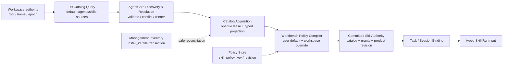

# MetaWork Skill 整体机制架构方案（AgentCore R9 基线）

> 状态：AgentCore R9 合同、policy 垂直切片与 Phase 1 Workbench authority 收敛已落地；当前只支持 AgentCore 默认的 user/workspace `.agents/skills` discovery，其他路径配置不在本阶段范围
>
> 更新日期：2026-08-21
>
> 边界：本文不授权修改 AgentCore ABI、AgentCore descriptor schema、Renderer Bridge 合同、MetaWork persistence schema 或任何版本标识。所有合同和版本变更必须另行取得用户明确同意。

R9 ABI 与 bundle 的当前事实以 [AgentCore ABI 合同](agentcore-abi-v1.md)和 [AgentCore 集成契约](agentcore-integration.md)为准；现行 Workbench 产品语义以 [Product 内部架构](product-architecture.md)为准。本文只记录 Skill 机制的目标形状、已落地基线和后续实施边界；摘要与上述规范冲突时不产生新的合同语义。

## 1. 结论

AgentCore R9 已经提供 MetaWork 建立正确 Skill 执行链所需的核心能力：

- `resolveWorkspaceSkillCatalog` 解析一个 Workspace authority 的完整 effective catalog；
- 默认发现 user/workspace `.agents/skills`；R9 ABI 也具备 typed `additional_sources`，但 MetaWork 当前不消费；
- AgentCore 独占候选校验、冲突处理和 winner 选择；
- resolved winner 提供 `skill_id`、`skill_policy_key`、来源身份和 `content_revision`；
- catalog descriptor 提供 `healthy | degraded` 及 typed issues；
- incomplete query 以 `skill_catalog_incomplete` 明确失败，不伪装为空 catalog；
- `SkillPolicyV1` 以 concrete `granted_skill_ids` 表示某个精确 catalog 的完整 default-deny 执行授权；
- Session create/restore 同时绑定 catalog 与 policy；
- Agent-owned `Session.refreshSkillCatalog` 在 idle Session 上原子替换 catalog 与 policy；
- typed Skill `RunInput` 按 `skill_id + catalog_revision + arguments` 执行并由 AgentCore 做最终校验。

因此，当前问题已经不再是“等待 AgentCore 提供 Skill policy 和来源身份”。本阶段主线是：

1. 在 Workbench 中把 catalog、policy 和 Session binding 编译成不可分裂的 committed authority；
2. 保持 AgentCore 是唯一 discovery、validation 和 resolution owner；
3. 只消费默认 `.agents/skills` 来源，不建立其他路径配置、扫描或兼容通道；
4. 对候选级 provenance、其他路径与格式 adapter、内容快照保证单独挂账，不阻塞现有能力收敛。

MetaWork 不建立第二套 Skill scanner、parser、resolver 或 AgentCore policy 镜像。

## 2. R9 能力基线与剩余边界

### 2.1 已落地能力

| 能力 | R9/当前 MetaWork 状态 |
| --- | --- |
| Workspace effective catalog | R9 `resolveWorkspaceSkillCatalog` 已提供 |
| 默认 `.agents/skills` discovery | R9 已提供 |
| typed additional directory source | R9 `SkillSourceV1[]` 已提供；MetaWork 当前明确不传入 |
| validation/conflict/winner | AgentCore 独占 |
| stable policy identity | R9 `skill_policy_key` 已提供，MetaWork 已持久化消费 |
| concrete execution identity | R9 `skill_id` 已提供 |
| source identity | R9 已提供 provider/scope/source instance/contribution |
| content identity | R9 `content_revision` 已提供 |
| catalog health/issues | R9 descriptor 已提供 |
| incomplete observation | R9 typed status 已提供 |
| Session authorization | R9 `SkillPolicyV1` 已提供 |
| atomic Session catalog+policy update | Agent-owned `Session.refreshSkillCatalog` 已提供 |
| typed Skill execution | Agent-owned typed `RunInput` 已提供 |
| 用户默认与 Workspace override | Workbench 已实现 |
| policy key → granted skill IDs 编译 | Workbench 已实现 |

### 2.2 R9 没有承诺的能力

以下能力不能从当前 R9 合同推导：

- 返回全部候选、shadowed candidates 或完整 resolution trace；
- 让消费方注册任意格式的 provider/adapter；
- 自动把 `.claude`、`.codex` 内容转换为 canonical Agent Skill 格式；
- 暴露物理路径、raw definition、资源内容或 opaque source locator；
- 明确保证 catalog lease 固定 Skill body/resources 的历史快照；
- 为 Personal 管理页提供独立于 Workspace effective query 的 `personal_only` API；
- 替 MetaWork 持有用户产品 policy、policy revision 或管理安装事务。

这些边界必须写实处理，不能由 MetaWork 根据目录名、文件名或 invocation 猜测补齐。

## 3. 设计目标

目标机制必须同时满足：

1. 以 R9 catalog/policy/run 合同形成端到端可执行 Skill authority；
2. 将逻辑策略身份、来源贡献身份、管理安装身份和 concrete 执行身份分开；
3. 保持用户默认与 Workspace 三态覆盖，并确保禁用 winner 不激活 loser；
4. 使用不可变 committed catalog 和 compiled authority，消灭 catalog ready、policy unavailable 等半状态；
5. 保持 Task pinned catalog/policy、idle refresh、重启恢复例外和双 revision admission；
6. 当前只使用默认 `.agents/skills`，不引入其他路径配置；
7. 让 catalog、policy、management、trust 和 Session binding 各自拥有明确 failure domain；
8. 保持 Text Task 在 Skill discovery、policy 或 management 失败时可用；
9. 不向 Renderer 暴露物理路径、AgentCore handle、raw definition 或内部 locator；
10. 不因增加来源或字段而自动修改 Bridge、persistence、ABI 或版本标识。

## 4. 非目标

本文不定义：

- 在线市场、远程更新、publisher 账号和商业分发；
- 多设备或多 Agent 的 policy 同步；
- Skill 创作专用编辑器；
- active Run 的即时撤权或热替换；
- 在 MetaWork 内实现 Claude/Codex parser 或 provider runtime；
- 未经批准的 AgentCore、Bridge、persistence 或版本变更；
- 未经产品确认的 `.claude`、`.codex` 品牌优先级；
- 自动公开 shadowed candidates 或物理来源路径。

## 5. 总体架构



AgentCore 内部可以拥有 provider registry、candidate registry 和 resolver；R9 对 MetaWork 暴露的是一次完整 Workspace query，而不是候选注册表。MetaWork 只依赖公开结果，不复制其内部抽象。

### 5.1 Owner 划分

| Owner | 职责 | 明确不拥有 |
| --- | --- | --- |
| AgentCore | 默认 source discovery、definition/resource validation、conflict、winner、catalog revision/lease、Session policy 校验、typed Skill Run | MetaWork 安装 inventory、用户产品 policy、Renderer UI |
| Workbench | 本地资产管理、用户默认、Workspace override、policy persistence、grants 编译、committed authority、Task pinning、refresh/admission、产品失败语义 | 目录扫描、格式解析、winner 选择、Skill body 读取、AgentCore handle 解释 |
| Agent | R9 typed API 调用、catalog lease 私有生命周期、Session binding 与最终状态映射 | 产品 policy、policy revision、管理资产、UI projection |
| Application | canonical user home、Workspace authority、产品 data dir、Native picker、生命周期和跨 owner 编排 | Skill policy、resolution、catalog state |
| Bridge | 严格 command ingress 与 typed projection transport | Skill 决策、路径、loader、policy 推导 |
| Renderer | 展示 Host projection、提交用户 intent、保存 draft | 文件系统扫描、来源推断、optimistic toggle、Session authority |

## 6. 领域对象与身份

### 6.1 逻辑策略身份：`skill_policy_key`

`skill_policy_key` 是用户启用或禁用的逻辑能力槽位，也是 Workbench policy persistence 的唯一 Skill key。

规则：

- policy key 不表达物理路径或具体 winner；
- winner 来源或内容变化后，同一 policy key 的用户 intent 继续适用；
- invocation 改名会产生新的 policy key；旧 disabled exception 保留但不再命中，新 key 按当前 default-enabled 规则启用；
- R9 不提供可证明 rename 关系，MetaWork 不自动迁移旧 key；
- MetaWork 不从 display name、路径或 source identity 自行推导 policy key；
- 当前 R9 校验 `skill_policy_key == invocation_name`，但 MetaWork 仍消费显式字段，不把该等式复制成自己的持久身份算法；
- `skill_id` 不得再作为持久 policy key。

### 6.2 来源贡献身份与内容版本

R9 resolved winner 的 `source` 字段提供来源贡献身份：

```text
SourceContributionRef
- provider_id
- source_scope: user | workspace
- source_instance_id
- contribution_id
```

`content_revision` 是 `SkillDescriptor` 上与 `source` 平级的内容版本身份。它可以随同一 contribution 的内容变化而变化，不属于 `SourceContributionRef`。

规则：

- AgentCore 分别生成并验证 source contribution identity 与 content revision；
- Workbench 只保存或投影任务所需的 MetaWork-owned bounded copy；
- contribution identity 用于 provenance、issue 归属和管理 reconciliation；
- content revision 用于证明具体内容版本，不授予来源管理 authority；
- source identity 不进入 typed Skill Run input；
- Renderer 不接收 opaque locator 或未经脱敏的绝对路径。

R9 descriptor 只为 winner 提供完整 contribution identity；issue 不一定对应一个可展示或可操作的候选资产，不能据此重建 candidate registry。

### 6.3 管理安装身份：`install_id`

`install_id` 继续由 Workbench 生成并持久化，用于：

- import、replace、reimport、export 和 uninstall；
- 文件事务 recovery；
- content hash 和安装 provenance；
- 证明 MetaWork 对某个目标资产具有管理 authority。

`install_id` 不替代 `skill_policy_key`、`skill_id` 或 AgentCore contribution identity。

### 6.4 Catalog 与执行身份

R9 resolved winner 为执行提供：

- `skill_id`：绑定具体 source+content 的 catalog-local concrete identity；
- `catalog_revision`：绑定 catalog world；
- argument schema；
- AgentCore-private catalog lease。

Workbench 在 admission 时保存稳定展示事实与参数副本，不保存物理路径、raw definition 或可被后续 catalog 改写的引用。

## 7. R9 Catalog Query 机制

### 7.1 唯一正式查询

MetaWork 只调用：

```text
resolveWorkspaceSkillCatalog(
    workspace_root,
    workspace_home,
    workspace_epoch
) -> CatalogAcquisition | skill_catalog_incomplete | typed failure
```

该调用解析一个 Workspace authority 的完整 effective catalog。MetaWork 不再设计 `personal_only` / `workspace_effective` 两套 AgentCore API，也不把 query 拆成 User catalog 与 Project catalog 后自行合并。

Manual Workspace execution query 使用真实 canonical Workspace root、canonical user home 和 Workspace epoch。AgentCore 在同一次 query 中处理 user 与 workspace 默认来源，并通过 `source_scope` 标识 winner 来源。

顶层 Personal 管理视图不是第二种 runtime authority。当前实现可用 `root == home`、空 epoch 取得仅供 Workbench 管理投影使用的顶层 catalog；其 lease 不得绑定到普通 Workspace Session。后续如果该管理视图不再需要，可以在 MetaWork 内删除，而不是要求 AgentCore 增加 scope mode。

### 7.2 `additional_sources` 的当前裁决

R9 `SkillSourceV1` 表达一个额外目录：

- `scope_code`；
- canonical `root`；
- 稳定 `source_instance_id`。

其合同限制非常明确：additional source 使用 canonical Agent Skill 格式；注册目录不等于安装 `.claude` 或 `.codex` 格式 adapter。

当前 MetaWork 不实现 `additional_sources` 的产品配置、Host 内部通道或 ABI 编码，query 对应字段保持 null/0。默认 user/workspace `.agents/skills` 已由 AgentCore 发现。以后是否支持其他路径必须作为独立需求重新设计和批准，不能从 R9 存在该字段推导为当前产品能力。

### 7.3 真正的 `.claude` / `.codex` 兼容

必须区分目录位置兼容与格式兼容：

- 如果某个额外目录本身已经采用 canonical Agent Skill 格式，R9 可以把它作为 additional source；
- 如果 Claude/Codex 定义、frontmatter、sidecar、resource 或调用语义与 canonical 格式不同，R9 当前合同不提供 adapter；
- MetaWork 不得读取并转换这些格式后再冒充 AgentCore catalog；
- 真正的 adapter 应由 AgentCore 扩展其 provider/source 合同，并在任何 ABI 或 descriptor 变更前取得用户批准。

所以本方案不承诺 MetaWork 当前支持 `.claude/.codex` 或其他路径；这不影响默认 `.agents/skills` 的 catalog、policy 与执行链。

## 8. Resolution 与 winner-only policy

AgentCore 独占以下顺序：

```text
discover
-> validate definition/resources/source
-> resolve conflicts
-> select winner
-> produce complete healthy/degraded catalog or typed incomplete failure
```

MetaWork 不定义或复制 `Workspace > User`、`.agents > compatibility` 等内部 precedence。只有 AgentCore 正式合同明确的 resolution 结果可以成为 runtime truth。

Enablement 只作用于 resolved winner 的逻辑 policy key：

```text
winner enabled  -> 将该 winner 的 skill_id 编译进 granted_skill_ids
winner disabled -> 不授权该 skill_id
```

禁止：

```text
winner disabled -> 激活 shadowed loser
```

由于 R9 不返回 shadowed candidate 列表，MetaWork 也不能把 loser 展示成可单独切换的资产。

## 9. Catalog observation 与 committed state

### 9.1 R9 完整结果语义

R9 不向 MetaWork 返回 `Observation { candidates, complete }`。实际边界是：

| R9 结果 | Workbench 语义 |
| --- | --- |
| `ok + healthy descriptor + lease` | 可作为 committed candidate |
| `ok + degraded descriptor + lease` | 可作为 committed candidate，保留 typed issues |
| `skill_catalog_incomplete` | 不得替换 current；保留 last-good |
| malformed/unknown/resource failure | 丢弃 candidate；保留 last-good 或保持 unavailable |

`ok` 返回的是 AgentCore 已完成 resolution 的完整 effective catalog，不是需要 Workbench 继续拼装的局部 observation。

### 9.2 内部 Catalog state

Workbench 应使用 tagged state：

```text
CatalogSlot =
  | uninitialized
  | unavailable
  | committed {
      acquisition,
      catalog_revision,
      health
    }
```

其中 `acquisition` 同时拥有 opaque lease 与独立 projection。独立 catalog job 只表达正在进行的 refresh，不进入 `CatalogSlot`，也不替代 committed catalog。当前阶段不保留或投影最近一次 refresh 失败事实。

必须保持：

- refresh 启动时继续服务 last-good；
- incomplete 或失败不安装空 catalog；
- 首次启动没有 committed catalog 时 Skill unavailable，但 Text 可用；
- descriptor 无法严格解码时 fail closed；
- lease 与 projection 按独立线性生命周期释放。

## 10. Enablement policy 与编译

### 10.1 产品 policy

```text
effective(policy_key, workspace) =
    workspace explicit enabled/disabled override
    ?? user default
    ?? enabled
```

用户 policy：

- 默认 enabled；
- 只持久化 disabled `skill_policy_key` exceptions；
- mutation 影响所有相关 Workspace 的 current authority。

Workspace policy：

- `inherit | enabled | disabled`；
- `inherit` 清除显式覆盖；
- override 只影响目标 Manual Workspace。

### 10.2 R9 policy 编译

Workbench 对当前 catalog 的每个 winner 执行：

```text
if effective(skill.skill_policy_key, workspace)
    grant skill.skill_id
else
    omit skill.skill_id
```

编译结果写入完整的 default-deny `SkillPolicyV1.granted_skill_ids`。空 grants 表示全部禁止，不表示全部允许。

R9 policy 不携带 MetaWork product revision。`selection_revision` 仍是 Workbench/Bridge 的产品并发事实，只用于 Host admission、CAS 和 projection；AgentCore 只消费与精确 catalog 同步提交的 concrete grants。

### 10.3 Revision 规则

- 使用全局单调 `last_revision` 分配器；
- 用户 mutation 给 user 与所有受影响 Workspace 精确盖同一个新 revision；
- Workspace mutation 只推进目标 Workspace；
- no-op 不推进；
- revision 0 非法；
- catalog revision 与 selection revision 始终双 CAS；
- policy 可以保留暂时不在 catalog 中的 key；
- policy key 重新出现时继续遵循原用户 intent。

## 11. Committed `SkillAuthority`

Catalog 与产品 policy 必须编译成一个不可分裂的状态：

```text
SkillAuthority =
  | unavailable {
      catalog_reason,
      policy_reason
    }
  | committed {
      catalog_acquisition,
      catalog_revision,
      selection_revision,
      granted_skill_ids,
      effective_projection
    }
```

只有 `committed SkillAuthority` 可以进入 Skill Task admission 或 Session binding。

该类型必须使以下状态不可构造：

- ready catalog + null selection revision；
- grants 属于旧 catalog；
- UI 显示 enabled，但 Session 没有同一 winner grant；
- policy store unavailable，却把空 exceptions 当成默认全启用；
- refresh candidate 已发布到 UI，但 Session 仍绑定旧 authority；
- catalog lease、projection 和 policy revision 来自不同 generation。

这项 Workbench 重构是 R9 之后的首要实施工作。

## 12. Mutation 与 refresh 事务

### 12.1 Policy mutation

一次用户 mutation：

1. 校验 expected user selection revision；
2. clone committed policy store；
3. 应用 mutation并分配一个新 revision；
4. 基于 Personal committed catalog，以及每个具有 committed catalog 的受影响 Workspace，预编译 candidate authorities；
5. 上述 candidate 集合中任一编译失败则放弃全部 candidate；
6. 原子持久化 candidate store；
7. 明确成功后 no-fail swap store 和 candidate authorities；
8. 发布单一 committed snapshot generation。

Workspace mutation使用相同流程，但只推进和替换目标 Workspace。

没有 committed catalog 的 Workspace 不进入 authority candidate 集合，继续保持 unavailable，也不阻塞用户 mutation；以后 catalog 成功提交时，它基于届时最新的 committed policy 和 revision 编译 authority。用户 mutation 仍按 §10.3 的同号规则推进全部受影响 Workspace 的有效 policy revision。

policy mutation 只改变 Personal/Workspace current authority；已经创建的 Task/Session 继续使用 pinned authority，不得因 toggle 自动重绑。持久化结果不确定时不得重试同一 mutation，也不得发布乐观状态。

### 12.2 Catalog refresh

1. 保留当前 committed authority；
2. Executor 调用 R9 query，取得 acquisition candidate 或 typed failure；
3. 主线程重新校验 Workspace identity、epoch、request generation 和 shutdown；
4. `skill_catalog_incomplete` 或其他失败不替换 current；
5. `ok` acquisition 与当前 committed policy 编译 candidate authority；
6. 全部校验成功后原子替换 Workspace current authority；
7. 已有 Task/Session 的 pinned authority 保持不变。

### 12.3 Idle Task 显式刷新

只有用户对 idle Task 发起显式刷新时，Task 才能采用 Workspace current authority：

1. 校验 Task/Workspace identity、epoch、idle 状态和 expected revision；
2. 从 Workspace current committed authority 构造 Task candidate projection；
3. 通过 `Session.refreshSkillCatalog` 一次提交 candidate catalog lease 与 policy；
4. bind 成功后 no-fail 替换 Task pinned authority；
5. bind 失败时保留 Task 原 pinned authority。

active Run、queued、waiting、closing 或 stale Task 都不得进入该路径。

### 12.4 Additional source 配置变化

source 配置变化不是普通 policy mutation。它会改变 discovery 输入和 catalog world，必须：

1. 先形成完整、可校验的 source configuration candidate；
2. 基于 candidate 执行新的 R9 query；
3. query complete 且 authority 编译成功后再提交配置和 current authority；
4. query incomplete/失败时保留旧 source configuration 与 last-good authority；
5. 不把目录暂时不可读解释为用户删除了所有 Skill。

如果 source configuration 需要新增持久字段，必须先取得 persistence shape 变更批准；在此之前只实施现有合同能够表达的非持久或固定产品来源。

## 13. Task、Session 与 Run

### 13.1 New Task

New Task 使用 Workspace 当前 committed authority，并固定：

- catalog lease；
- catalog revision；
- selection revision；
- effective winner projection；
- concrete grants；
- Workspace identity/epoch。

Session create 同步提交同一 catalog lease 与 `SkillPolicyV1`。无 committed Skill authority 时仍可创建 Text-only Session，catalog 与 policy 必须同时为 null。

### 13.2 Existing Task

- policy mutation 和 catalog refresh 不得在 active Run 中替换 binding；
- idle 更新必须使用 `Session.refreshSkillCatalog` 一次提交 catalog+policy；
- 不能先换 catalog 再换 grants，或反向执行；
- stale draft 保留用户输入，但发送前必须重新验证 pinned revisions 和 Skill membership。

### 13.3 Host restart

当前既定例外继续成立：恢复 Task 隐式重绑 Workspace 当前 committed catalog 与 policy。该行为不增加 Task persistence 字段。

如果未来要求跨重启保持原 pinned authority，必须新增 persistence 设计并单独取得合同批准。

### 13.4 Typed Run

Workbench 在进入 Agent 前校验：

- Workspace/Task epoch；
- pinned catalog revision；
- pinned selection revision；
- `skill_id` membership 与 enabled projection；
- 参数数量、UTF-8 和容量。

AgentCore 再校验 catalog、policy、Skill、arguments 和资源可用性。`stale_catalog`、`skill_not_found`、`invalid_skill_arguments`、`skill_policy_violation` 和 `skill_unavailable` 保持独立产品 cause，不自动 refresh 或重放用户动作。

### 13.5 Content binding

R9 已提供 `content_revision`，且 `SkillPolicyV1` 明确授权 concrete source+content `skill_id`，但现有公开合同没有充分说明 catalog lease 是否固定 body/resources 快照。

在确认前保持以下验收要求：

- 旧 catalog revision 下不得静默执行新内容；
- 内容或资源变化必须继续使用被 lease 固定的旧内容，或明确返回 stale/unavailable；
- winner load 失败不得回退 loser；
- MetaWork 不自行读取 body 做平行校验。

## 14. Discovery、Trust、Management 与 Enablement

四种 authority 独立：

| Authority | 含义 |
| --- | --- |
| Discovery | AgentCore 获准枚举并解析来源 |
| Trust | 候选内容获准参与 AgentCore resolution |
| Management | MetaWork 可以 import、replace、export 或 uninstall 资产 |
| Enablement | 用户允许或禁止 resolved 逻辑 Skill 进入新的 effective authority |

典型行为：

| 来源 | Management | Enablement |
| --- | --- | --- |
| MetaWork import 到 canonical `.agents` | 有，需精确 install/target authority | 有 |
| 无法证明映射关系的 external asset | 无 | 只对 resolved winner 启停，不操作原文件 |
| 未来 bundled/provider source | 无卸载 authority | 由产品 policy 决定 |

当前 live runtime source 只包括 AgentCore 默认发现的 canonical `.agents/skills`。

## 15. Import 与 live source

### 15.1 Import

- 从 package 或目录读取有界输入；
- 执行预览和安全检查；
- 复制到 canonical `.agents/skills`；
- Workbench 获得 `install_id` 和管理 authority；
- 外部源后续变化不自动同步。

### 15.2 Live source

当前不设计其他路径的 live source 配置。默认 `.agents/skills` 的文件变化仍通过显式 catalog refresh 生效，不自动改变已有 Task，也不引入第二个 watcher owner。

### 15.3 Format adapter

`.claude` / `.codex` format adapter 与 live directory 不是同一能力，二者都不在当前范围。MetaWork 可以继续提供“复制并规范化到 canonical `.agents`”的 Import 产品路径，但不能把 Import 宣称为 live source。

## 16. UI 模型

Skill 中心以当前 context 的 resolved winners 为主要对象，以安全来源事实和 issues 为详情。

### 16.1 Personal context

- 展示顶层管理 catalog 的 user-scope winners 与用户默认；
- switch 写 user policy；
- 管理动作只针对具有 install/target authority 的资产；
- 不把每个 Workspace 的 policy row 聚合成重复 Skill；
- Personal context 不代表可直接绑定到任意 Workspace Session 的独立 runtime catalog。

### 16.2 Project context

- 展示一个 Workspace effective catalog 的 winners；
- 同一 winner 只显示一次；
- switch 写 `inherit | enabled | disabled` override；
- 显示继承的用户默认和显式覆盖；
- invalid、unavailable、conflict issues 进入 Needs attention。

### 16.3 Detail

R9 Host 已知且可以安全投影的事实包括：

- invocation、display、description 和 arguments；
- provider、source scope、source instance、contribution identity；
- content revision；
- catalog health 和 typed issue；
- policy state 与 selection revision。

R9 不提供 shadowed candidate 列表，因此 UI 不得承诺 loser 详情。是否增加新的 Bridge 来源字段必须单独取得用户批准；字段增加本身不授权修改 Bridge revision。

## 17. Failure domain

| 故障 | 必须行为 | 不得发生 |
| --- | --- | --- |
| R9 catalog incomplete | 保留 last-good；最近一次失败状态投影延后 | 清空 catalog |
| degraded catalog | 提交有效 winners 与 typed issues | 关闭整个 Workbench |
| 首次 query 无 complete 结果 | Skill unavailable，Text 可用 | 默认全启用 |
| descriptor malformed | 丢弃 acquisition candidate | 安装部分解析结果 |
| policy store read/corrupt | 新 Skill authority fail closed，Text 可用 | 回退空 exceptions |
| policy write definite failure | 保持旧 committed state | UI optimistic 成功 |
| policy outcome unknown | 冻结新 mutation/admission 并要求恢复 | 盲重试 |
| management store failure | 禁用管理动作 | 关闭 catalog 浏览或已绑定 Run |
| external asset 无管理映射 | 标记 external management | 根据目录名卸载 |
| Session bind 失败 | 保持旧 Session binding | 只发布新 UI authority |
| winner content 不一致 | stale/unavailable | 读取新内容或回退 loser |
| Renderer transport failure | 重连并恢复 Host projection | 终止后台 Run |

已固定 authority 的 Task/Session 不因后续 management 或 policy store failure 被静默扩大或改写。新的 Skill admission 必须 fail closed。

## 18. 与当前实现的关系

### 18.1 已落地并保留

- `src/agent/catalog.zig` 的 R9 catalog query、source/policy/content projection 与 opaque lease ownership；
- `src/product/skill/enablement.zig` 的 `skill_policy_key` persistence、用户默认、Workspace override、全局 revision、strict codec、CAS 和 atomic store；
- Workbench 将有效 policy 编译为 concrete `granted_skill_ids`；
- Session create/restore 与 idle refresh 的 R9 catalog+policy binding；
- catalog revision + selection revision 双校验；
- Task pinned projection、idle refresh 与 restart rebind 例外；
- `src/product/skill/management.zig` 的 `install_id`、provenance、文件事务和 recovery；
- Renderer 不读文件、不解析 Skill、不 optimistic toggle；
- Skill 中心按单一 context 展示，不跨 Workspace 聚合 policy rows。

### 18.2 Phase 1 已完成

- Workbench current catalog 已收敛为 tagged `CatalogSlot`；生产 committed 分支不可分地持有 AgentCore lease 与 immutable compiled snapshot；
- catalog job 独立表达进行中的 refresh，refresh 期间继续服务 last-good，incomplete、查询失败、编译失败和 stale completion 不再清空 committed authority；当前不宣称保存或投影最近一次失败状态；
- `CatalogSnapshot` 在构造或 recompile candidate 时一次应用 policy 与非零 `selection_revision`，mutable `applyEnablement` 已移除；
- policy mutation 先预编译所有具有 committed authority 的受影响 context，持久化明确成功后再 no-fail swap；
- Task/Session 继续使用 pinned authority，idle refresh 继续通过 `Session.refreshSkillCatalog` 一次更新；
- Bridge、persistence schema、AgentCore ABI 与所有版本标识均未变化。

### 18.3 当前来源边界

- `src/agent/catalog.zig` 只查询 AgentCore 默认的 user/workspace `.agents/skills`；
- MetaWork 不构造或转发 `additional_sources`；
- Application、Workbench、Bridge 与 Renderer 都不提供其他路径配置；
- 其他路径需求以后单独立项，不作为本方案未完成项。

### 18.4 明确延后

- 非 canonical Claude/Codex format adapter；
- 全候选、shadowed candidate 和完整 resolution trace UI；
- user-configurable provider precedence；
- 自动 watcher/invalidation；
- 最近一次 catalog refresh 失败状态的保存与产品投影；
- Task authority 跨 Host 重启持久化；
- 未经批准的 schema、Bridge revision、ABI revision 或版本变更。

## 19. 实施阶段

### Phase 0：R9 hard cut（已完成）

- 正式 bundle hard cut 到 AgentCore R9；
- 消费 `skill_policy_key` 与 source/content identity；
- policy store hard cut 到 policy key；
- 编译 `granted_skill_ids`；
- Session create/restore/idle refresh 使用 R9 policy binding；
- 不保留旧 revision 兼容路径。

### Phase 1：Workbench authority 收敛（已完成）

- 引入 immutable committed catalog slot；
- 以独立 catalog job 表达进行中的 refresh；
- 引入 compiled `SkillAuthority` tagged state；
- 将 policy mutation、catalog refresh 和 Session bind 放入明确事务；
- 移除 mutable projection 上的 enablement authority；
- 保持 Bridge、persistence 和版本标识不变。

### 后续独立议题：来源详情 UI

- 先使用 Host 已有 R9 winner source facts；
- shadowed candidates 只有在 AgentCore 提供正式 projection 后才设计；
- 如需新 Bridge 字段，先取得用户批准；
- 不因字段增加自动提升 Bridge revision。

## 20. 验收矩阵

| 场景 | 必须成立 |
| --- | --- |
| User + Workspace 同名 | AgentCore 返回唯一 effective winner；policy key intent 继续适用 |
| winner disabled | concrete `skill_id` 不进入 grants，不回退 loser |
| empty grants | AgentCore policy 表示全部 Skill 禁止 |
| 用户 toggle | 所有受影响 Workspace revision 精确等于同一个新分配号 |
| Workspace toggle | 只推进目标 Workspace revision |
| no-op | revision 不推进 |
| catalog incomplete | last-good authority 保持，Text 可用 |
| degraded catalog | 有效 winners 可用，issues 可诊断 |
| 首次启动 query 失败 | Skill unavailable，不构造 ready+null |
| policy store unavailable | Skill admission fail closed，Text 可用 |
| refresh catalog change | current authority 原子替换，不出现旧 grants+新 catalog |
| Session idle bind | `Session.refreshSkillCatalog` 一次替换 catalog+policy |
| active Run | 禁止替换 binding |
| Host restart restore | 重绑 Workspace current authority，Run 使用同一 revision pair |
| external source | resolved winner 可启停；无管理 authority 时不可卸载 |
| disabled Skill 改 invocation | 旧 exception 不迁移；新 policy key 按 default-enabled 规则启用 |
| body 修改未 refresh | 旧内容继续被 lease 固定，或 Run 明确 stale/unavailable |
| Renderer reload | 从 Host 恢复 committed projection，不重新扫描或计算 policy |

## 21. 非阻塞后续决策与证据

AgentCore R9 已足以完成当前默认 `.agents/skills` 范围。以下事项只约束能力声明或未来独立议题，不构成当前实施 Gate：

1. 在宣称 immutable content pinning 前，验证 AgentCore catalog lease 是固定 body/resources，还是在 Run 时以 `content_revision` 做重新校验；
2. AgentCore 未来是否需要暴露 shadowed candidates 或完整 resolution trace；
3. Renderer 是否需要新增 provider/source detail 字段；
4. 任何合同、persistence shape 或版本标识变化必须在实施前取得用户明确同意。

AgentCore 已明确提供的 `skill_policy_key`、source identity、typed issues 与 `SkillPolicyV1` 不再列为前置确认项；MetaWork 只经 `Session.refreshSkillCatalog` 消费该能力。其他路径与格式兼容已从当前方案移除，后续如重新提出必须独立设计。

## 22. 竞品参考的使用边界

DeepSeek Harness 的 provider-neutral registry、分层 resolution、complete/incomplete observation 和 last-good 思路仍有参考价值，但 MetaWork 不复制其 registry API；R9 query 是当前正式边界。参考：[DeepSeek Harness Skills subsystem](https://github.com/deepseek-ai/deepseek-harness/blob/master/docs/subsystems/skills.md)。

Hermes 的 canonical import 与 external directory overlay 分离仍值得保留，但其 precedence、trust 和格式处理不能机械照搬到 MetaWork。参考：[Hermes Skills](https://hermes-agent.nousresearch.com/docs/user-guide/features/skills)、[Hermes Import](https://github.com/NousResearch/hermes-agent/blob/main/website/docs/user-guide/import-from-other-agents.md)。

竞品只用于验证架构形状，不覆盖 R9 合同、MetaWork owner 边界或用户审批要求。
